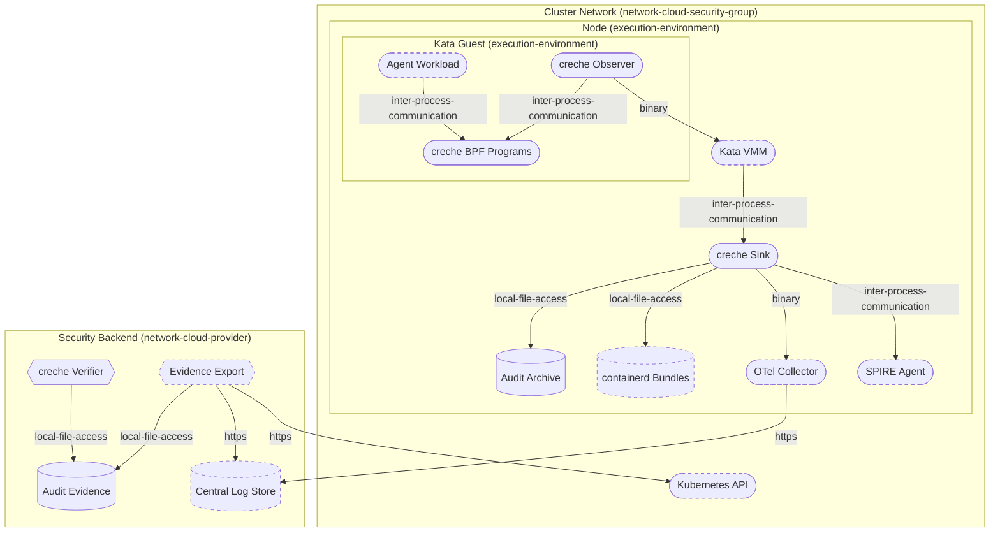
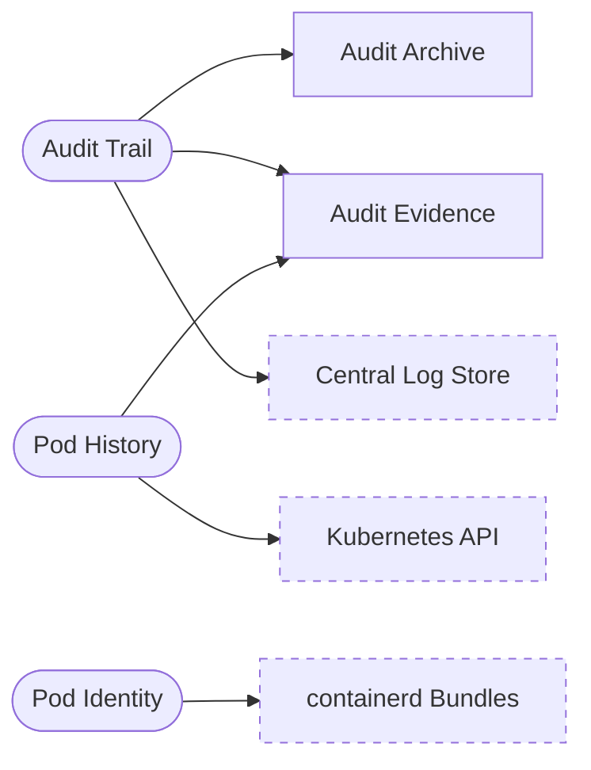

# Threat Model Report: creche

- **Author:** creche maintainers, [https://github.com/Pinguladora/creche](https://github.com/Pinguladora/creche)
- **Date:** 15 November 2026
- **Business criticality:** important
- **Threagile version:** 1.0.0

## Contents

1. [Management Summary](#management-summary)
2. [Impact Analysis of the Initial Risks](#impact-analysis-of-the-initial-risks)
3. [Risk Mitigation](#risk-mitigation)
4. [Impact Analysis of the Remaining Risks](#impact-analysis-of-the-remaining-risks)
5. [Risks by Severity](#risks-by-severity)
6. [Application Overview](#application-overview)
7. [Data-Flow Diagram](#data-flow-diagram)
8. [Asset Register](#asset-register)
9. [Security Requirements](#security-requirements)
10. [Abuse Cases](#abuse-cases)
11. [STRIDE Classification of Identified Risks](#stride-classification-of-identified-risks)
12. [Assignment by Function](#assignment-by-function)
13. [RAA Analysis](#raa-analysis)
14. [Data Mapping](#data-mapping)
15. [Out-of-Scope Assets](#out-of-scope-assets)
16. [Potential Model Failures](#potential-model-failures)
17. [Identified Risks by Vulnerability Category](#identified-risks-by-vulnerability-category)
18. [Identified Risks by Technical Asset](#identified-risks-by-technical-asset)
19. [Identified Data Breach Probabilities by Data Asset](#identified-data-breach-probabilities-by-data-asset)
20. [Trust Boundaries](#trust-boundaries)
21. [Shared Runtimes](#shared-runtimes)
22. [Communication Links](#communication-links)
23. [Risk Tracking](#risk-tracking)
24. [Threat Catalog Coverage](#threat-catalog-coverage)
25. [Risk Rules Checked by Threagile](#risk-rules-checked-by-threagile)
26. [Ratings](#ratings)
27. [Disclaimer](#disclaimer)

## Management Summary

Threagile toolkit was used to model the architecture of "creche" and derive risks by analyzing the components and data flows. The risks identified during this analysis are shown in the following chapters. Identified risks during threat modeling do not necessarily mean that the vulnerability associated with this risk actually exists: it is more to be seen as a list of potential risks and threats, which should be individually reviewed and reduced by removing false positives. For the remaining risks it should be checked in the design and implementation of "creche" whether the mitigation advices have been applied or not.

Each risk finding references a chapter of the OWASP ASVS (Application Security Verification Standard) audit checklist. The OWASP ASVS checklist should be considered as an inspiration by architects and developers to further harden the application in a Defense-in-Depth approach. Additionally, for each risk finding a link towards a matching OWASP Cheat Sheet or similar with technical details about how to implement a mitigation is given.

In total **18 initial risks** in **11 categories** have been identified during the threat modeling process:

| Severity | Risks | Status | Risks |
| --- | ---: | --- | ---: |
| Critical | 0 | Unchecked | 0 |
| High | 2 | In Discussion | 0 |
| Elevated | 9 | Accepted | 10 |
| Medium | 6 | In Progress | 1 |
| Low | 1 | Mitigated | 3 |
|  |  | False Positive | 4 |

## Impact Analysis of the Initial Risks

The most prevalent impacts of the **18 initial risks** (distributed over **11 risk categories**) are (taking the severity ratings into account and using the highest for each category):

- **High**: [Path-Traversal](#path-traversal): 3 Initial Risks, exploitation likelihood is _Very Likely_ with _High_ impact

    If this risk is unmitigated, attackers might be able to read sensitive files (configuration data, key/credential files, deployment files, business data files, etc.) from the filesystem of affected components.

- **Elevated**: [Missing Cloud Hardening](#missing-cloud-hardening): 2 Initial Risks, exploitation likelihood is _Unlikely_ with _Very High_ impact

    If this risk is unmitigated, attackers might access cloud components in an unintended way.

- **Elevated**: [Missing File Validation](#missing-file-validation): 1 Initial Risk, exploitation likelihood is _Very Likely_ with _Medium_ impact

    If this risk is unmitigated, attackers might be able to provide malicious files to the application.

- **Elevated**: [Missing Hardening](#missing-hardening): 2 Initial Risks, exploitation likelihood is _Likely_ with _Medium_ impact

    If this risk remains unmitigated, attackers might be able to easier attack high-value targets.

- **Elevated**: [Path-Traversal](#path-traversal): 3 Initial Risks, exploitation likelihood is _Very Likely_ with _High_ impact

    If this risk is unmitigated, attackers might be able to read sensitive files (configuration data, key/credential files, deployment files, business data files, etc.) from the filesystem of affected components.

- **Elevated**: [Tenant Resource Exhaustion](#tenant-resource-exhaustion): 1 Initial Risk, exploitation likelihood is _Likely_ with _Medium_ impact

    If this risk is unmitigated, one tenant might deny the service to the others, or make the asset lose their data, such as the audit records that would show what that tenant did.

- **Elevated**: [Untrusted Deserialization](#untrusted-deserialization): 2 Initial Risks, exploitation likelihood is _Likely_ with _Very High_ impact

    If this risk is unmitigated, attackers might be able to execute code on target systems by exploiting untrusted deserialization endpoints.

- **Medium**: [Missing Build Infrastructure](#missing-build-infrastructure): 1 Initial Risk, exploitation likelihood is _Unlikely_ with _Medium_ impact

    If this risk is unmitigated, attackers might be able to exploit risks unseen in this threat model due to critical build infrastructure components missing in the model.

- **Medium**: [Missing Identity Store](#missing-identity-store): 1 Initial Risk, exploitation likelihood is _Unlikely_ with _Medium_ impact

    If this risk is unmitigated, attackers might be able to exploit risks unseen in this threat model in the identity provider/store that is currently missing in the model.

- **Medium**: [Unencrypted Technical Assets](#unencrypted-technical-assets): 2 Initial Risks, exploitation likelihood is _Unlikely_ with _High_ impact

    If this risk is unmitigated, attackers might be able to access unencrypted data when successfully compromising sensitive components.

- **Medium**: [Virtual Machine Escape](#virtual-machine-escape): 2 Initial Risks, exploitation likelihood is _Unlikely_ with _High_ impact

    If this risk is unmitigated, attackers who control a guest, or the code it runs, might take over the host and from there every other virtual machine on it and the services the host runs.

- **Low**: [Wrong Communication Link Content](#wrong-communication-link-content): 1 Initial Risk, exploitation likelihood is _Unlikely_ with _Low_ impact

    If this potential model error is not fixed, some risks might not be visible.

## Risk Mitigation

The following table gives a high-level overview of the risk tracking status (including mitigated risks):

| Severity | Risks | Unchecked | In Discussion | Accepted | In Progress | Mitigated | False Positive |
| --- | ---: | ---: | ---: | ---: | ---: | ---: | ---: |
| Critical | 0 | 0 | 0 | 0 | 0 | 0 | 0 |
| High | 2 | 0 | 0 | 0 | 0 | 0 | 2 |
| Elevated | 9 | 0 | 0 | 4 | 1 | 3 | 1 |
| Medium | 6 | 0 | 0 | 6 | 0 | 0 | 0 |
| Low | 1 | 0 | 0 | 0 | 0 | 0 | 1 |

After removal of risks with status _mitigated_ and _false positive_ the following **11 remain unmitigated**:

| Severity | Unmitigated risks | To be checked by | Unmitigated risks |
| --- | ---: | --- | ---: |
| Critical | 0 | Business Side | 0 |
| High | 0 | Architecture | 3 |
| Elevated | 5 | Development | 0 |
| Medium | 6 | Operations | 8 |
| Low | 0 |  |  |

## Impact Analysis of the Remaining Risks

The most prevalent impacts of the **11 remaining risks** (distributed over **7 risk categories**) are (taking the severity ratings into account and using the highest for each category):

- **Elevated**: [Missing Cloud Hardening](#missing-cloud-hardening): 2 Remaining Risks, exploitation likelihood is _Unlikely_ with _Very High_ impact

    If this risk is unmitigated, attackers might access cloud components in an unintended way.

- **Elevated**: [Missing Hardening](#missing-hardening): 2 Remaining Risks, exploitation likelihood is _Likely_ with _Medium_ impact

    If this risk remains unmitigated, attackers might be able to easier attack high-value targets.

- **Elevated**: [Tenant Resource Exhaustion](#tenant-resource-exhaustion): 1 Remaining Risk, exploitation likelihood is _Likely_ with _Medium_ impact

    If this risk is unmitigated, one tenant might deny the service to the others, or make the asset lose their data, such as the audit records that would show what that tenant did.

- **Medium**: [Missing Build Infrastructure](#missing-build-infrastructure): 1 Remaining Risk, exploitation likelihood is _Unlikely_ with _Medium_ impact

    If this risk is unmitigated, attackers might be able to exploit risks unseen in this threat model due to critical build infrastructure components missing in the model.

- **Medium**: [Missing Identity Store](#missing-identity-store): 1 Remaining Risk, exploitation likelihood is _Unlikely_ with _Medium_ impact

    If this risk is unmitigated, attackers might be able to exploit risks unseen in this threat model in the identity provider/store that is currently missing in the model.

- **Medium**: [Unencrypted Technical Assets](#unencrypted-technical-assets): 2 Remaining Risks, exploitation likelihood is _Unlikely_ with _High_ impact

    If this risk is unmitigated, attackers might be able to access unencrypted data when successfully compromising sensitive components.

- **Medium**: [Virtual Machine Escape](#virtual-machine-escape): 2 Remaining Risks, exploitation likelihood is _Unlikely_ with _High_ impact

    If this risk is unmitigated, attackers who control a guest, or the code it runs, might take over the host and from there every other virtual machine on it and the services the host runs.

## Risks by Severity

All **18 risks** by severity, with their tracking status. Each risk links to its details in the chapter of its category.

### Critical

**0 risks**

_No risks._

### High

**2 risks**

| Severity | Risk | Category | Most relevant | Status |
| --- | --- | --- | --- | --- |
| High | [**Path-Traversal** risk at **creche Sink** against filesystem **Audit Archive** via **Write Archive**](#path-traversal) | [Path-Traversal](#path-traversal) | [creche Sink](#creche-sink), [Write Archive](#write-archive) | False Positive |
| High | [**Path-Traversal** risk at **creche Verifier** against filesystem **Audit Evidence** via **Read Evidence**](#path-traversal) | [Path-Traversal](#path-traversal) | [creche Verifier](#creche-verifier), [Read Evidence](#read-evidence) | False Positive |

### Elevated

**9 risks**

| Severity | Risk | Category | Most relevant | Status |
| --- | --- | --- | --- | --- |
| Elevated | [**Missing Cloud Hardening** risk at **Cluster Network**](#missing-cloud-hardening) | [Missing Cloud Hardening](#missing-cloud-hardening) | none | Accepted |
| Elevated | [**Missing Cloud Hardening** risk at **Security Backend**](#missing-cloud-hardening) | [Missing Cloud Hardening](#missing-cloud-hardening) | none | Accepted |
| Elevated | [**Missing File Validation** risk at **creche Verifier**](#missing-file-validation) | [Missing File Validation](#missing-file-validation) | [creche Verifier](#creche-verifier) | False Positive |
| Elevated | [**Missing Hardening** risk at **Audit Archive**](#missing-hardening) | [Missing Hardening](#missing-hardening) | [Audit Archive](#audit-archive) | Accepted |
| Elevated | [**Missing Hardening** risk at **Audit Evidence**](#missing-hardening) | [Missing Hardening](#missing-hardening) | [Audit Evidence](#audit-evidence) | Accepted |
| Elevated | [**Path-Traversal** risk at **creche Sink** against filesystem **containerd Bundles** via **Read Bundle**](#path-traversal) | [Path-Traversal](#path-traversal) | [creche Sink](#creche-sink), [Read Bundle](#read-bundle) | Mitigated |
| Elevated | [**Tenant Resource Exhaustion** of **creche Sink** by tenants behind **Kata VMM** via **Hybrid Vsock**](#tenant-resource-exhaustion) | [Tenant Resource Exhaustion](#tenant-resource-exhaustion) | [creche Sink](#creche-sink), [Hybrid Vsock](#hybrid-vsock) | In Progress |
| Elevated | [**Untrusted Deserialization** risk at **creche Sink**](#untrusted-deserialization) | [Untrusted Deserialization](#untrusted-deserialization) | [creche Sink](#creche-sink) | Mitigated |
| Elevated | [**Untrusted Deserialization** risk at **creche Observer**](#untrusted-deserialization) | [Untrusted Deserialization](#untrusted-deserialization) | [creche Observer](#creche-observer) | Mitigated |

### Medium

**6 risks**

| Severity | Risk | Category | Most relevant | Status |
| --- | --- | --- | --- | --- |
| Medium | [**Missing Build Infrastructure** in the threat model (referencing asset **creche Sink** as an example)](#missing-build-infrastructure) | [Missing Build Infrastructure](#missing-build-infrastructure) | [creche Sink](#creche-sink) | Accepted |
| Medium | [**Missing Identity Store** in the threat model (referencing asset **Central Log Store** as an example)](#missing-identity-store) | [Missing Identity Store](#missing-identity-store) | [Central Log Store](#central-log-store) | Accepted |
| Medium | [**Unencrypted Technical Asset** named **Audit Archive** missing end user individual encryption with data-with-end-user-individual-key](#unencrypted-technical-assets) | [Unencrypted Technical Assets](#unencrypted-technical-assets) | [Audit Archive](#audit-archive) | Accepted |
| Medium | [**Unencrypted Technical Asset** named **Audit Evidence** missing end user individual encryption with data-with-end-user-individual-key](#unencrypted-technical-assets) | [Unencrypted Technical Assets](#unencrypted-technical-assets) | [Audit Evidence](#audit-evidence) | Accepted |
| Medium | [**Virtual Machine Escape** risk at **Kata VMM** exposing **Audit Archive**](#virtual-machine-escape) | [Virtual Machine Escape](#virtual-machine-escape) | [Audit Archive](#audit-archive) | Accepted |
| Medium | [**Virtual Machine Escape** risk at **Kata VMM** exposing **creche Sink**](#virtual-machine-escape) | [Virtual Machine Escape](#virtual-machine-escape) | [creche Sink](#creche-sink) | Accepted |

### Low

**1 risk**

| Severity | Risk | Category | Most relevant | Status |
| --- | --- | --- | --- | --- |
| Low | [**Wrong Communication Link Content** (data assets sent/received not matching the communication link's readonly flag) at **creche Observer** regarding communication link **Ring Buffer**](#wrong-communication-link-content) | [Wrong Communication Link Content](#wrong-communication-link-content) | [creche Observer](#creche-observer), [Ring Buffer](#ring-buffer) | False Positive |

## Application Overview

### Business Criticality

The overall business criticality of "creche" was rated as:

- archive
- operational
- **important** (selected)
- critical
- mission-critical

### Business Overview

Visibility into what runs inside Kata Containers microVMs. Process trees, outgoing connections and file writes of the tools an AI agent spawns are streamed to the host, attributed to the sandbox and its pod, and kept as a tamper-evident audit trail.

### Technical Overview

An observer in the guest loads BPF programs (aya) and forwards their ring buffer records over hybrid vsock. The sink on the host attests which sandbox a connection comes from, names its pod from containerd's bundles, writes JSON lines with hash chained and SVID signed checkpoints, and exports them over OTLP. A verifier checks saved output against the trust bundle and the pod history.

## Data-Flow Diagram

The following diagram was generated by Threagile based on the model input and gives a high-level overview of the data-flow between technical assets. The RAA value of each asset, the calculated _Relative Attacker Attractiveness_ in percent, is in the chapter [RAA Analysis](#raa-analysis).

Data-flow diagram of "creche". A box is an external entity, a stadium a process, a cylinder a datastore and a hexagon a client used by a human. Assets out of scope have a dashed border, and the trust boundaries enclose the assets inside them. An arrow points from the asset that initiates a communication link to its target and names the protocol. A thick arrow is a link that also receives data back.

## Asset Register

### Technical Assets

- [Audit Archive](#audit-archive)

    The JSON lines file on the node

- [Audit Evidence](#audit-evidence)

    The files the auditor exported for a check, the stream lines, the trust bundle and the pod history

- [creche Sink](#creche-sink)

    Decodes the records, attests sandbox and pod, writes JSON lines with SVID signed checkpoints and exports OTLP

- [creche BPF Programs](#creche-bpf-programs)

    C BPF programs with CO-RE in the guest kernel, dropping noise in the kernel, a pid indexed task cache and the LSM guard on the observer's vsock port

- [creche Observer](#creche-observer)

    Loads the BPF programs with aya, drains the ring buffer and forwards whole records over vsock, started by systemd before kata-agent

- [creche Verifier](#creche-verifier)

    creche-sink --verify run by an auditor against saved output, a trust bundle, the sink SPIFFE IDs and the pod history

- [Agent Workload](#agent-workload) (out of scope)

    The AI agent and the tools it spawns, the untrusted party in the guest

- [Central Log Store](#central-log-store) (out of scope)

    The second store that keeps checkpoints out of reach of the node

- [Evidence Export](#evidence-export) (out of scope)

    The auditor's own tools that export the stream lines from the central store and the pod history from the cluster, such as the store's client and kubectl

- [Kata VMM](#kata-vmm) (out of scope)

    Cloud Hypervisor or Firecracker, which bridges guest vsock to a Unix socket on the host

- [Kubernetes API](#kubernetes-api) (out of scope)

    The cluster's API server

- [OTel Collector](#otel-collector) (out of scope)

    A node collector that ships the lines to a second store

- [SPIRE Agent](#spire-agent) (out of scope)

    Attests the sink and issues its node specific SVID

- [containerd Bundles](#containerd-bundles) (out of scope)

    containerd's runtime v2 task directory with each sandbox's config.json

### Data Assets

- [Agent Labels](#agent-labels)

    user.creche.agent extended attributes the agents set on their delegated cgroups

- [Audit Trail](#audit-trail)

    JSON lines with stream sequence numbers, hash chained checkpoints and their signatures

- [Guest Events](#guest-events)

    Process, connect and file write records from the guest, with command arguments, paths and destinations

- [Pod History](#pod-history)

    Lines of pod uid or sandbox id and the node they ran on, and the SPIFFE trust bundle

- [Pod Identity](#pod-identity)

    Pod name, namespace and uid from the annotations in the sandbox's OCI spec

- [Sink Signing Keys](#sink-signing-keys)

    The sink's X.509-SVID and the per stream P-256 keys that sign checkpoints

## Security Requirements

This chapter lists the custom security requirements which have been defined for the modeled target.

- **Guest Untrusted**

    Nothing the guest sends may crash, stall or mislead the sink.

- **Host Attests Identity**

    The sandbox, pod and node of a stream come from the host, never from the guest.

- **Tamper Evident Trail**

    Missing or changed lines must be detectable by a verifier.

_This list is not complete and regulatory or law relevant security requirements have to be taken into account as well. Also custom individual security requirements might exist for the project._

## Abuse Cases

This chapter lists the custom abuse cases which have been defined for the modeled target.

- **Audit Rewrite**

    Whoever takes over a sink or the archive rewrites the audit trail without detection.

- **Blinding**

    The guest floods or stalls the sink so that events of other sandboxes are lost.

- **Forged Events**

    A process in the guest sends records the host takes for the observer's.

- **Misattribution**

    A guest or a host process makes events appear under another sandbox, pod or container.

_This list is not complete and regulatory or law relevant abuse cases have to be taken into account as well. Also custom individual abuse cases might exist for the project._

## STRIDE Classification of Identified Risks

This chapter clusters and classifies the risks by STRIDE categories: in total **18 potential risks** have been identified during the threat modeling process.

### Spoofing

**2 risks**

Spoofing, against authenticity

- **Elevated**: [Missing File Validation](#missing-file-validation): 1 mitigated Risk, exploitation likelihood is _Very Likely_ with _Medium_ impact

    When a technical asset accepts files, these input files should be strictly validated about filename and type.

- **Medium**: [Missing Identity Store](#missing-identity-store): 1/1 unmitigated Risk, exploitation likelihood is _Unlikely_ with _Medium_ impact

    The modeled architecture does not contain an identity store, which might be the risk of a model missing critical assets (and thus not seeing their risks).

### Tampering

**7 risks**

Tampering, against integrity

- **Elevated**: [Missing Cloud Hardening](#missing-cloud-hardening): 2/2 unmitigated Risks, exploitation likelihood is _Unlikely_ with _Very High_ impact

    Cloud components should be hardened according to the cloud vendor best practices. This affects their configuration, auditing, and further areas.

- **Elevated**: [Missing Hardening](#missing-hardening): 2/2 unmitigated Risks, exploitation likelihood is _Likely_ with _Medium_ impact

    Technical assets with a Relative Attacker Attractiveness (RAA) value of 55 % or higher should be explicitly hardened taking best practices and vendor hardening guides into account.

- **Elevated**: [Untrusted Deserialization](#untrusted-deserialization): 2 mitigated Risks, exploitation likelihood is _Likely_ with _Very High_ impact

    When a technical asset accepts data in a specific serialized form (like Java or .NET serialization), Untrusted Deserialization risks might arise.

- **Medium**: [Missing Build Infrastructure](#missing-build-infrastructure): 1/1 unmitigated Risk, exploitation likelihood is _Unlikely_ with _Medium_ impact

    The modeled architecture does not contain a build infrastructure (devops-client, sourcecode-repo, build-pipeline, etc.), which might be the risk of a model missing critical assets (and thus not seeing their risks). If the architecture contains custom-developed parts, the pipeline where code gets developed and built needs to be part of the model.

### Repudiation

**0 risks**

Repudiation, against non-repudiability

_No risks were identified._

### Information Disclosure

**6 risks**

Information disclosure, against confidentiality

- **High**: [Path-Traversal](#path-traversal): 3 mitigated Risks, exploitation likelihood is _Very Likely_ with _High_ impact

    When a filesystem is accessed Path-Traversal or Local-File-Inclusion (LFI) risks might arise. The risk rating depends on the sensitivity of the technical asset itself and of the data assets processed.

- **Elevated**: [Path-Traversal](#path-traversal): 3 mitigated Risks, exploitation likelihood is _Very Likely_ with _High_ impact

    When a filesystem is accessed Path-Traversal or Local-File-Inclusion (LFI) risks might arise. The risk rating depends on the sensitivity of the technical asset itself and of the data assets processed.

- **Medium**: [Unencrypted Technical Assets](#unencrypted-technical-assets): 2/2 unmitigated Risks, exploitation likelihood is _Unlikely_ with _High_ impact

    Due to the confidentiality rating of the technical asset itself and/or the stored data assets this technical asset must be encrypted. The risk rating depends on the sensitivity technical asset itself and of the data assets stored.

- **Low**: [Wrong Communication Link Content](#wrong-communication-link-content): 1 mitigated Risk, exploitation likelihood is _Unlikely_ with _Low_ impact

    When a communication link is defined as readonly, but does not receive any data asset, or when it is defined as not readonly, but does not send any data asset, it is likely to be a model failure.

### Denial of Service

**1 risk**

Denial of service, against availability

- **Elevated**: [Tenant Resource Exhaustion](#tenant-resource-exhaustion): 1/1 unmitigated Risk, exploitation likelihood is _Likely_ with _Medium_ impact

    A multi-tenant asset shares its connections, queues, memory and processing time among its tenants. A tenant that sends more than its share, by mistake or on purpose, takes them from the others. For a collector of logs, events or audit records this does more than slow it down: the records of the other tenants are dropped, and whoever reads them can no longer tell a quiet tenant from one that was not heard.

### Elevation of Privilege

**2 risks**

Elevation of privilege, against authorization

- **Medium**: [Virtual Machine Escape](#virtual-machine-escape): 2/2 unmitigated Risks, exploitation likelihood is _Unlikely_ with _High_ impact

    A hypervisor isolates its guests from its host and from each other, and sandboxes like Kata Containers or Firecracker rely on that to run untrusted code. Code that exploits a vulnerability of the hypervisor or of the devices it emulates escapes its virtual machine and runs on the host, with the privileges of the hypervisor, next to the host's own services and every other guest.

## Assignment by Function

This chapter clusters and assigns the risks by functions which are most likely able to check and mitigate them: in total **18 potential risks** have been identified during the threat modeling process.

### Business Side

**0 risks**

Business

_No risks were identified._

### Architecture

**6 risks**

Architecture

- **Elevated**: [Tenant Resource Exhaustion](#tenant-resource-exhaustion): 1/1 unmitigated Risk, exploitation likelihood is _Likely_ with _Medium_ impact

    Give every tenant its own bounded share: limits on its connections, rate and queue length, and fair scheduling among tenants, so that one that floods only loses its own data. Count and report what is dropped per tenant, so that a gap can be told from silence, and alert on it.

- **Elevated**: [Untrusted Deserialization](#untrusted-deserialization): 2 mitigated Risks, exploitation likelihood is _Likely_ with _Very High_ impact

    Try to avoid the deserialization of untrusted data (even of data within the same trust-boundary as long as it is sent across a remote connection) in order to stay safe from Untrusted Deserialization vulnerabilities. Alternatively a strict whitelisting approach of the classes/types/values to deserialize might help as well. When a third-party product is used instead of custom developed software, check if the product applies the proper mitigation and ensure a reasonable patch-level.

- **Medium**: [Missing Build Infrastructure](#missing-build-infrastructure): 1/1 unmitigated Risk, exploitation likelihood is _Unlikely_ with _Medium_ impact

    Include the build infrastructure in the model.

- **Medium**: [Missing Identity Store](#missing-identity-store): 1/1 unmitigated Risk, exploitation likelihood is _Unlikely_ with _Medium_ impact

    Include an identity store in the model if the application has a login.

- **Low**: [Wrong Communication Link Content](#wrong-communication-link-content): 1 mitigated Risk, exploitation likelihood is _Unlikely_ with _Low_ impact

    Try to model the correct readonly flag and/or data sent/received of communication links. Also try to use communication link types matching the target technology/machine types.

### Development

**4 risks**

Development

- **High**: [Path-Traversal](#path-traversal): 3 mitigated Risks, exploitation likelihood is _Very Likely_ with _High_ impact

    Before accessing the file cross-check that it resides in the expected folder and is of the expected type and filename/suffix. Try to use a mapping if possible instead of directly accessing by a filename which is (partly or fully) provided by the caller. When a third-party product is used instead of custom developed software, check if the product applies the proper mitigation and ensure a reasonable patch-level.

- **Elevated**: [Missing File Validation](#missing-file-validation): 1 mitigated Risk, exploitation likelihood is _Very Likely_ with _Medium_ impact

    Filter by file extension and discard (if feasible) the name provided. Whitelist the accepted file types and determine the mime-type on the server-side (for example via "Apache Tika" or similar checks). If the file is retrievable by end users and/or backoffice employees, consider performing scans for popular malware (if the files can be retrieved much later than they were uploaded, also apply a fresh malware scan during retrieval to scan with newer signatures of popular malware). Also enforce limits on maximum file size to avoid denial-of-service like scenarios.

- **Elevated**: [Path-Traversal](#path-traversal): 3 mitigated Risks, exploitation likelihood is _Very Likely_ with _High_ impact

    Before accessing the file cross-check that it resides in the expected folder and is of the expected type and filename/suffix. Try to use a mapping if possible instead of directly accessing by a filename which is (partly or fully) provided by the caller. When a third-party product is used instead of custom developed software, check if the product applies the proper mitigation and ensure a reasonable patch-level.

### Operations

**8 risks**

Operations

- **Elevated**: [Missing Cloud Hardening](#missing-cloud-hardening): 2/2 unmitigated Risks, exploitation likelihood is _Unlikely_ with _Very High_ impact

    Apply hardening of all cloud components and services, taking special care to follow the individual risk descriptions (which depend on the cloud provider tags in the model).

- **Elevated**: [Missing Hardening](#missing-hardening): 2/2 unmitigated Risks, exploitation likelihood is _Likely_ with _Medium_ impact

    Try to apply all hardening best practices (like CIS benchmarks, OWASP recommendations, vendor recommendations, DevSec Hardening Framework, DBSAT for Oracle databases, and others).

- **Medium**: [Unencrypted Technical Assets](#unencrypted-technical-assets): 2/2 unmitigated Risks, exploitation likelihood is _Unlikely_ with _High_ impact

    Apply encryption to the technical asset.

- **Medium**: [Virtual Machine Escape](#virtual-machine-escape): 2/2 unmitigated Risks, exploitation likelihood is _Unlikely_ with _High_ impact

    Keep the hypervisor, its device emulation and the host kernel patched, and prefer a hypervisor with a small device model, like _Firecracker_ or _Cloud Hypervisor_. Run it as an unprivileged user with a seccomp filter and in its own namespaces, like the _Firecracker jailer_ does, and keep host services that hold secrets away from hosts that run untrusted guests. Where the host itself is not trusted, consider confidential virtual machines (_AMD SEV-SNP_, _Intel TDX_).

## RAA Analysis

For each technical asset the **"Relative Attacker Attractiveness"** (RAA) value was calculated in percent. The higher the RAA, the more interesting it is for an attacker to compromise the asset. The calculation algorithm takes the sensitivity ratings and quantities of stored and processed data into account as well as the communication links of the technical asset. Neighbouring assets to high-value RAA targets might receive an increase in their RAA value when they have a communication link towards that target ("Pivoting-Factor").

The following lists all technical assets sorted by their RAA value from highest (most attacker attractive) to lowest. This list can be used to prioritize on efforts relevant for the most attacker-attractive technical assets:

- [Audit Evidence](#audit-evidence): RAA 100 %, highest severity still at risk: **Elevated**

    The files the auditor exported for a check, the stream lines, the trust bundle and the pod history

- [Audit Archive](#audit-archive): RAA 79 %, highest severity still at risk: **Elevated**

    The JSON lines file on the node

- [creche Verifier](#creche-verifier): RAA 41 %

    creche-sink --verify run by an auditor against saved output, a trust bundle, the sink SPIFFE IDs and the pod history

- [creche Observer](#creche-observer): RAA 38 %

    Loads the BPF programs with aya, drains the ring buffer and forwards whole records over vsock, started by systemd before kata-agent

- [creche Sink](#creche-sink): RAA 25 %, highest severity still at risk: **Elevated**

    Decodes the records, attests sandbox and pod, writes JSON lines with SVID signed checkpoints and exports OTLP

- [creche BPF Programs](#creche-bpf-programs): RAA 22 %

    C BPF programs with CO-RE in the guest kernel, dropping noise in the kernel, a pid indexed task cache and the LSM guard on the observer's vsock port

## Data Mapping

The following table and diagram were generated by Threagile based on the model input and give a high-level distribution of data assets across technical assets, with the data breach probability still at risk of each data asset (see the chapter [Identified Data Breach Probabilities by Data Asset](#identified-data-breach-probabilities-by-data-asset)).

| Data asset | Data breach | Stored by | Processed by |
| --- | --- | --- | --- |
| [Agent Labels](#agent-labels) | Probable | none | [Agent Workload](#agent-workload), [Kata VMM](#kata-vmm), [creche BPF Programs](#creche-bpf-programs), [creche Observer](#creche-observer), [creche Sink](#creche-sink) |
| [Audit Trail](#audit-trail) | Probable | [Audit Archive](#audit-archive), [Audit Evidence](#audit-evidence), [Central Log Store](#central-log-store) | [Audit Archive](#audit-archive), [Audit Evidence](#audit-evidence), [Central Log Store](#central-log-store), [Evidence Export](#evidence-export), [OTel Collector](#otel-collector), [creche Sink](#creche-sink), [creche Verifier](#creche-verifier) |
| [Guest Events](#guest-events) | Probable | none | [Agent Workload](#agent-workload), [Kata VMM](#kata-vmm), [creche BPF Programs](#creche-bpf-programs), [creche Observer](#creche-observer), [creche Sink](#creche-sink) |
| [Pod History](#pod-history) | Probable | [Audit Evidence](#audit-evidence), [Kubernetes API](#kubernetes-api) | [Audit Evidence](#audit-evidence), [Evidence Export](#evidence-export), [Kubernetes API](#kubernetes-api), [creche Verifier](#creche-verifier) |
| [Pod Identity](#pod-identity) | Probable | [containerd Bundles](#containerd-bundles) | [containerd Bundles](#containerd-bundles), [creche Sink](#creche-sink) |
| [Sink Signing Keys](#sink-signing-keys) | Probable | none | [SPIRE Agent](#spire-agent), [creche Sink](#creche-sink) |

The diagram shows where the data assets are stored: an arrow points from a data asset, a stadium, to each technical asset that stores it, a box. Assets out of scope have a dashed border.

## Out-of-Scope Assets

**8 assets**

This chapter lists all technical assets that have been defined as out-of-scope. Each one should be checked in the model whether it should better be included in the overall risk analysis:

- [Agent Workload](#agent-workload) (out of scope)

    The workload creche observes, untrusted by design

- [Central Log Store](#central-log-store) (out of scope)

    Operated by the security team

- [Evidence Export](#evidence-export) (out of scope)

    The auditor's tools, not part of creche

- [Kata VMM](#kata-vmm) (out of scope)

    Part of Kata Containers

- [Kubernetes API](#kubernetes-api) (out of scope)

    Part of the cluster

- [OTel Collector](#otel-collector) (out of scope)

    Operated by the platform team

- [SPIRE Agent](#spire-agent) (out of scope)

    Part of the cluster's SPIRE deployment

- [containerd Bundles](#containerd-bundles) (out of scope)

    Owned by containerd

## Potential Model Failures

**2 of 3 unmitigated**

This chapter lists potential model failures where not all relevant assets have been modeled or the model might itself contain inconsistencies. Each potential model failure should be checked in the model against the architecture design:

- **Medium**: [Missing Build Infrastructure](#missing-build-infrastructure): 1/1 unmitigated Risk, exploitation likelihood is _Unlikely_ with _Medium_ impact

    The modeled architecture does not contain a build infrastructure (devops-client, sourcecode-repo, build-pipeline, etc.), which might be the risk of a model missing critical assets (and thus not seeing their risks). If the architecture contains custom-developed parts, the pipeline where code gets developed and built needs to be part of the model.

- **Medium**: [Missing Identity Store](#missing-identity-store): 1/1 unmitigated Risk, exploitation likelihood is _Unlikely_ with _Medium_ impact

    The modeled architecture does not contain an identity store, which might be the risk of a model missing critical assets (and thus not seeing their risks).

- **Low**: [Wrong Communication Link Content](#wrong-communication-link-content): 1 mitigated Risk, exploitation likelihood is _Unlikely_ with _Low_ impact

    When a communication link is defined as readonly, but does not receive any data asset, or when it is defined as not readonly, but does not send any data asset, it is likely to be a model failure.

## Identified Risks by Vulnerability Category

In total **18 potential risks** have been identified during the threat modeling process, distributed across **11 vulnerability categories**. The following sections describe each identified risk category and its risks.

### Missing Cloud Hardening

**Elevated**, 2/2 unmitigated Risks, `missing-cloud-hardening`

| Property | Value |
| --- | --- |
| STRIDE | Tampering |
| CWE | [CWE 1008](https://cwe.mitre.org/data/definitions/1008.html) |
| Function | Operations |
| Action | Cloud Hardening |
| ASVS chapter | V1: Architecture, Design and Threat Modeling Requirements |
| Cheat sheet | [Attack_Surface_Analysis_Cheat_Sheet](https://cheatsheetseries.owasp.org/cheatsheets/Attack_Surface_Analysis_Cheat_Sheet.html) |
| References | OWASP A02:2025 Security Misconfiguration, OWASP API8:2023 Security Misconfiguration |

#### Description

Cloud components should be hardened according to the cloud vendor best practices. This affects their configuration, auditing, and further areas.

#### Impact

If this risk is unmitigated, attackers might access cloud components in an unintended way.

#### Detection Logic

In-scope cloud components (either residing in cloud trust boundaries or more specifically tagged with cloud provider types).

#### Risk Rating

The risk rating depends on the sensitivity of the technical asset itself and of the data assets processed.

#### False Positives

Cloud components not running parts of the target architecture can be considered as false positives after individual review.

#### Mitigation

Apply hardening of all cloud components and services, taking special care to follow the individual risk descriptions (which depend on the cloud provider tags in the model).

For **Amazon Web Services (AWS)**: Follow the _CIS Benchmark for Amazon Web Services_ (see also the automated checks of cloud audit tools like _"PacBot", "CloudSploit", "CloudMapper", "ScoutSuite", or "Prowler AWS CIS Benchmark Tool"_).

For EC2 and other servers running Amazon Linux, follow the _CIS Benchmark for Amazon Linux_ and switch to IMDSv2.

For S3 buckets follow the _Security Best Practices for Amazon S3_ at [https://docs.aws.amazon.com/AmazonS3/latest/dev/security-best-practices.html](https://docs.aws.amazon.com/AmazonS3/latest/dev/security-best-practices.html) to avoid accidental leakage.

Also take a look at some of these tools: [https://github.com/toniblyx/my-arsenal-of-aws-security-tools](https://github.com/toniblyx/my-arsenal-of-aws-security-tools)

For **Microsoft Azure**: Follow the _CIS Benchmark for Microsoft Azure_ (see also the automated checks of cloud audit tools like _"CloudSploit" or "ScoutSuite"_).

For **Google Cloud Platform**: Follow the _CIS Benchmark for Google Cloud Computing Platform_ (see also the automated checks of cloud audit tools like _"CloudSploit" or "ScoutSuite"_).

For **Oracle Cloud Platform**: Follow the hardening best practices (see also the automated checks of cloud audit tools like _"CloudSploit"_).

#### Check

Are recommendations from the linked cheat sheet and referenced ASVS chapter applied?

#### Risk Findings

The risk **Missing Cloud Hardening** was found **2 times** in the analyzed architecture to be potentially possible. Each spot should be checked individually by reviewing the implementation whether all controls have been applied properly in order to mitigate each risk.

| Severity | Risk | ID | Likelihood | Impact | Most relevant | Status | Tracking |
| --- | --- | --- | --- | --- | --- | --- | --- |
| Elevated | **Missing Cloud Hardening** risk at **Cluster Network** | `missing-cloud-hardening@cluster-network` | Unlikely | Very High | none | Accepted | 2026-11-14. The cluster is the integrator's. |
| Elevated | **Missing Cloud Hardening** risk at **Security Backend** | `missing-cloud-hardening@security-backend` | Unlikely | Very High | none | Accepted | 2026-11-14. The security backend is the integrator's. |

### Missing Hardening

**Elevated**, 2/2 unmitigated Risks, `missing-hardening`

| Property | Value |
| --- | --- |
| STRIDE | Tampering |
| CWE | [CWE 16](https://cwe.mitre.org/data/definitions/16.html) |
| Function | Operations |
| Action | System Hardening |
| ASVS chapter | V14: Configuration Verification Requirements |
| Cheat sheet | [Attack_Surface_Analysis_Cheat_Sheet](https://cheatsheetseries.owasp.org/cheatsheets/Attack_Surface_Analysis_Cheat_Sheet.html) |
| References | OWASP A02:2025 Security Misconfiguration, OWASP API8:2023 Security Misconfiguration |

#### Description

Technical assets with a Relative Attacker Attractiveness (RAA) value of 55 % or higher should be explicitly hardened taking best practices and vendor hardening guides into account.

#### Impact

If this risk remains unmitigated, attackers might be able to easier attack high-value targets.

#### Detection Logic

In-scope technical assets with RAA values of 55 % or higher. Generally for high-value targets like data stores, application servers, identity providers and ERP systems this limit is reduced to 40 %

#### Risk Rating

The risk rating depends on the sensitivity of the data processed in the technical asset.

#### False Positives

Usually no false positives.

#### Mitigation

Try to apply all hardening best practices (like CIS benchmarks, OWASP recommendations, vendor recommendations, DevSec Hardening Framework, DBSAT for Oracle databases, and others).

#### Check

Are recommendations from the linked cheat sheet and referenced ASVS chapter applied?

#### Risk Findings

The risk **Missing Hardening** was found **2 times** in the analyzed architecture to be potentially possible. Each spot should be checked individually by reviewing the implementation whether all controls have been applied properly in order to mitigate each risk.

| Severity | Risk | ID | Likelihood | Impact | Most relevant | Status | Tracking |
| --- | --- | --- | --- | --- | --- | --- | --- |
| Elevated | **Missing Hardening** risk at **Audit Archive** | `missing-hardening@audit-archive` | Likely | Medium | [Audit Archive](#audit-archive) | Accepted | 2026-11-14. The archive is the integrator's (ADR 0012). |
| Elevated | **Missing Hardening** risk at **Audit Evidence** | `missing-hardening@audit-evidence` | Likely | Medium | [Audit Evidence](#audit-evidence) | Accepted | 2026-11-14. The exports are the auditor's. |

### Tenant Resource Exhaustion

**Elevated**, 1/1 unmitigated Risk, `tenant-resource-exhaustion`

| Property | Value |
| --- | --- |
| STRIDE | Denial of Service |
| CWE | [CWE 400](https://cwe.mitre.org/data/definitions/400.html) |
| Function | Architecture |
| Action | Per-Tenant Limits |
| ASVS chapter | V1: Architecture, Design and Threat Modeling Requirements |
| Cheat sheet | [Denial_of_Service_Cheat_Sheet](https://cheatsheetseries.owasp.org/cheatsheets/Denial_of_Service_Cheat_Sheet.html) |
| References | OWASP API4:2023 Unrestricted Resource Consumption |

#### Description

A multi-tenant asset shares its connections, queues, memory and processing time among its tenants. A tenant that sends more than its share, by mistake or on purpose, takes them from the others. For a collector of logs, events or audit records this does more than slow it down: the records of the other tenants are dropped, and whoever reads them can no longer tell a quiet tenant from one that was not heard.

#### Impact

If this risk is unmitigated, one tenant might deny the service to the others, or make the asset lose their data, such as the audit records that would show what that tenant did.

#### Detection Logic

In-scope multi-tenant technical assets that receive data over a communication link from a caller that is out of scope or in another trust boundary, of any type. Read-only links, which send no data, and links of devops usage are left out.

#### Risk Rating

Likely. The impact follows the higher of the availability of the asset and the integrity of the data it receives over the link: low below critical, medium for critical and high for mission-critical.

#### False Positives

Assets that already give every tenant its own bounded share can be considered as false positives after individual review.

#### Mitigation

Give every tenant its own bounded share: limits on its connections, rate and queue length, and fair scheduling among tenants, so that one that floods only loses its own data. Count and report what is dropped per tenant, so that a gap can be told from silence, and alert on it.

#### Check

Are recommendations from the linked cheat sheet and referenced ASVS chapter applied?

#### Risk Findings

The risk **Tenant Resource Exhaustion** was found **1 time** in the analyzed architecture to be potentially possible. Each spot should be checked individually by reviewing the implementation whether all controls have been applied properly in order to mitigate each risk.

| Severity | Risk | ID | Likelihood | Impact | Most relevant | Status | Tracking |
| --- | --- | --- | --- | --- | --- | --- | --- |
| Elevated | **Tenant Resource Exhaustion** of **creche Sink** by tenants behind **Kata VMM** via **Hybrid Vsock** | `tenant-resource-exhaustion@creche-sink@kata-vmm>hybrid-vsock` | Likely | Medium | [creche Sink](#creche-sink), [Hybrid Vsock](#hybrid-vsock) | In Progress | 2026-11-15. Each sandbox gets bounded connections, queues and caches. |

### Missing Build Infrastructure

**Medium**, 1/1 unmitigated Risk, `missing-build-infrastructure`

| Property | Value |
| --- | --- |
| STRIDE | Tampering |
| CWE | [CWE 1127](https://cwe.mitre.org/data/definitions/1127.html) |
| Function | Architecture |
| Action | Build Pipeline Hardening |
| ASVS chapter | V1: Architecture, Design and Threat Modeling Requirements |
| Cheat sheet | [Attack_Surface_Analysis_Cheat_Sheet](https://cheatsheetseries.owasp.org/cheatsheets/Attack_Surface_Analysis_Cheat_Sheet.html) |

#### Description

The modeled architecture does not contain a build infrastructure (devops-client, sourcecode-repo, build-pipeline, etc.), which might be the risk of a model missing critical assets (and thus not seeing their risks). If the architecture contains custom-developed parts, the pipeline where code gets developed and built needs to be part of the model.

#### Impact

If this risk is unmitigated, attackers might be able to exploit risks unseen in this threat model due to critical build infrastructure components missing in the model.

#### Detection Logic

Models with in-scope custom-developed parts missing in-scope development (code creation) and build infrastructure components (devops-client, sourcecode-repo, build-pipeline, etc.).

#### Risk Rating

The risk rating depends on the highest sensitivity of the in-scope assets running custom-developed parts.

#### False Positives

Models not having any custom-developed parts can be considered as false positives after individual review.

#### Mitigation

Include the build infrastructure in the model.

#### Check

Are recommendations from the linked cheat sheet and referenced ASVS chapter applied?

#### Risk Findings

The risk **Missing Build Infrastructure** was found **1 time** in the analyzed architecture to be potentially possible. Each spot should be checked individually by reviewing the implementation whether all controls have been applied properly in order to mitigate each risk.

| Severity | Risk | ID | Likelihood | Impact | Most relevant | Status | Tracking |
| --- | --- | --- | --- | --- | --- | --- | --- |
| Medium | **Missing Build Infrastructure** in the threat model (referencing asset **creche Sink** as an example) | `missing-build-infrastructure@creche-sink` | Unlikely | Medium | [creche Sink](#creche-sink) | Accepted | 2026-11-15. Building and releasing are outside this model. |

### Missing Identity Store

**Medium**, 1/1 unmitigated Risk, `missing-identity-store`

| Property | Value |
| --- | --- |
| STRIDE | Spoofing |
| CWE | [CWE 287](https://cwe.mitre.org/data/definitions/287.html) |
| Function | Architecture |
| Action | Identity Store |
| ASVS chapter | V2: Authentication Verification Requirements |
| Cheat sheet | [Authentication_Cheat_Sheet](https://cheatsheetseries.owasp.org/cheatsheets/Authentication_Cheat_Sheet.html) |

#### Description

The modeled architecture does not contain an identity store, which might be the risk of a model missing critical assets (and thus not seeing their risks).

#### Impact

If this risk is unmitigated, attackers might be able to exploit risks unseen in this threat model in the identity provider/store that is currently missing in the model.

#### Detection Logic

Models with authenticated data-flows authorized via end user identity missing an in-scope identity store.

#### Risk Rating

The risk rating depends on the sensitivity of the end user-identity authorized technical assets and their data assets processed.

#### False Positives

Models only offering data/services without any real authentication need can be considered as false positives after individual review.

#### Mitigation

Include an identity store in the model if the application has a login.

#### Check

Are recommendations from the linked cheat sheet and referenced ASVS chapter applied?

#### Risk Findings

The risk **Missing Identity Store** was found **1 time** in the analyzed architecture to be potentially possible. Each spot should be checked individually by reviewing the implementation whether all controls have been applied properly in order to mitigate each risk.

| Severity | Risk | ID | Likelihood | Impact | Most relevant | Status | Tracking |
| --- | --- | --- | --- | --- | --- | --- | --- |
| Medium | **Missing Identity Store** in the threat model (referencing asset **Central Log Store** as an example) | `missing-identity-store@log-store` | Unlikely | Medium | [Central Log Store](#central-log-store) | Accepted | 2026-11-14. Identities come from SPIRE and the cluster. |

### Unencrypted Technical Assets

**Medium**, 2/2 unmitigated Risks, `unencrypted-asset`

| Property | Value |
| --- | --- |
| STRIDE | Information Disclosure |
| CWE | [CWE 311](https://cwe.mitre.org/data/definitions/311.html) |
| Function | Operations |
| Action | Encryption of Technical Asset |
| ASVS chapter | V6: Stored Cryptography Verification Requirements |
| Cheat sheet | [Cryptographic_Storage_Cheat_Sheet](https://cheatsheetseries.owasp.org/cheatsheets/Cryptographic_Storage_Cheat_Sheet.html) |
| References | OWASP A04:2025 Cryptographic Failures |

#### Description

Due to the confidentiality rating of the technical asset itself and/or the stored data assets this technical asset must be encrypted. The risk rating depends on the sensitivity technical asset itself and of the data assets stored.

#### Impact

If this risk is unmitigated, attackers might be able to access unencrypted data when successfully compromising sensitive components.

#### Detection Logic

In-scope unencrypted technical assets (excluding reverse-proxy, load-balancer, waf, ids, ips and embedded components like library) storing data assets rated at least as confidential or critical. For technical assets storing data assets rated as strictly-confidential or mission-critical the encryption must be of type data-with-end-user-individual-key.

#### Risk Rating

Depending on the confidentiality rating of the stored data-assets either medium or high risk.

#### False Positives

When all sensitive data stored within the asset is already fully encrypted on document or data level.

#### Mitigation

Apply encryption to the technical asset.

#### Check

Are recommendations from the linked cheat sheet and referenced ASVS chapter applied?

#### Risk Findings

The risk **Unencrypted Technical Assets** was found **2 times** in the analyzed architecture to be potentially possible. Each spot should be checked individually by reviewing the implementation whether all controls have been applied properly in order to mitigate each risk.

| Severity | Risk | ID | Likelihood | Impact | Most relevant | Status | Tracking |
| --- | --- | --- | --- | --- | --- | --- | --- |
| Medium | **Unencrypted Technical Asset** named **Audit Archive** missing end user individual encryption with data-with-end-user-individual-key | `unencrypted-asset@audit-archive` | Unlikely | High | [Audit Archive](#audit-archive) | Accepted | 2026-11-14. Encryption at rest is the integrator's. |
| Medium | **Unencrypted Technical Asset** named **Audit Evidence** missing end user individual encryption with data-with-end-user-individual-key | `unencrypted-asset@audit-evidence` | Unlikely | High | [Audit Evidence](#audit-evidence) | Accepted | 2026-11-14. Encryption at rest is the auditor's. |

### Virtual Machine Escape

**Medium**, 2/2 unmitigated Risks, `virtual-machine-escape`

| Property | Value |
| --- | --- |
| STRIDE | Elevation of Privilege |
| CWE | [CWE 1008](https://cwe.mitre.org/data/definitions/1008.html) |
| Function | Operations |
| Action | Hypervisor Hardening |
| ASVS chapter | V14: Configuration Verification Requirements |
| Cheat sheet | [final](https://csrc.nist.gov/pubs/sp/800/125/a/r1/final) |
| References | OWASP A02:2025 Security Misconfiguration |

#### Description

A hypervisor isolates its guests from its host and from each other, and sandboxes like Kata Containers or Firecracker rely on that to run untrusted code. Code that exploits a vulnerability of the hypervisor or of the devices it emulates escapes its virtual machine and runs on the host, with the privileges of the hypervisor, next to the host's own services and every other guest.

#### Impact

If this risk is unmitigated, attackers who control a guest, or the code it runs, might take over the host and from there every other virtual machine on it and the services the host runs.

#### Detection Logic

Technical assets of the technology hypervisor. Their host is the trust boundary that holds them and their guests are the technical assets of the trust boundaries nested in it. An in-scope hypervisor gets the risk. For an out-of-scope one, like the hypervisor of a cloud or a sandbox runtime, each in-scope technical asset of its host gets it, since those are what an escape reaches.

#### Risk Rating

Escapes are unlikely. The impact is high when a technical asset of the host or of its guests processes strictly-confidential or mission-critical data, and medium otherwise.

#### False Positives

Hypervisors that only run trusted guests, on hosts that run nothing else, can be considered as false positives after individual review.

#### Mitigation

Keep the hypervisor, its device emulation and the host kernel patched, and prefer a hypervisor with a small device model, like _Firecracker_ or _Cloud Hypervisor_. Run it as an unprivileged user with a seccomp filter and in its own namespaces, like the _Firecracker jailer_ does, and keep host services that hold secrets away from hosts that run untrusted guests. Where the host itself is not trusted, consider confidential virtual machines (_AMD SEV-SNP_, _Intel TDX_).

#### Check

Are recommendations from the linked cheat sheet and referenced ASVS chapter applied?

#### Risk Findings

The risk **Virtual Machine Escape** was found **2 times** in the analyzed architecture to be potentially possible. Each spot should be checked individually by reviewing the implementation whether all controls have been applied properly in order to mitigate each risk.

| Severity | Risk | ID | Likelihood | Impact | Most relevant | Status | Tracking |
| --- | --- | --- | --- | --- | --- | --- | --- |
| Medium | **Virtual Machine Escape** risk at **Kata VMM** exposing **Audit Archive** | `virtual-machine-escape@kata-vmm@audit-archive` | Unlikely | High | [Audit Archive](#audit-archive) | Accepted | 2026-11-15. Isolation is Kata's and the hypervisor's (ADR 0012). |
| Medium | **Virtual Machine Escape** risk at **Kata VMM** exposing **creche Sink** | `virtual-machine-escape@kata-vmm@creche-sink` | Unlikely | High | [creche Sink](#creche-sink) | Accepted | 2026-11-15. Isolation is Kata's and the hypervisor's (ADR 0018). |

### Missing File Validation

1 mitigated Risk, `missing-file-validation`

| Property | Value |
| --- | --- |
| STRIDE | Spoofing |
| CWE | [CWE 434](https://cwe.mitre.org/data/definitions/434.html) |
| Function | Development |
| Action | File Validation |
| ASVS chapter | V12: File and Resources Verification Requirements |
| Cheat sheet | [File_Upload_Cheat_Sheet](https://cheatsheetseries.owasp.org/cheatsheets/File_Upload_Cheat_Sheet.html) |
| References | OWASP A06:2025 Insecure Design |

#### Description

When a technical asset accepts files, these input files should be strictly validated about filename and type.

#### Impact

If this risk is unmitigated, attackers might be able to provide malicious files to the application.

#### Detection Logic

In-scope technical assets with custom-developed code accepting file data formats.

#### Risk Rating

The risk rating depends on the sensitivity of the technical asset itself and of the data assets processed.

#### False Positives

Fully trusted (i.e. cryptographically signed or similar) files can be considered as false positives after individual review.

#### Mitigation

Filter by file extension and discard (if feasible) the name provided. Whitelist the accepted file types and determine the mime-type on the server-side (for example via "Apache Tika" or similar checks). If the file is retrievable by end users and/or backoffice employees, consider performing scans for popular malware (if the files can be retrieved much later than they were uploaded, also apply a fresh malware scan during retrieval to scan with newer signatures of popular malware). Also enforce limits on maximum file size to avoid denial-of-service like scenarios.

#### Check

Are recommendations from the linked cheat sheet and referenced ASVS chapter applied?

#### Risk Findings

The risk **Missing File Validation** was found **1 time** in the analyzed architecture to be potentially possible. Each spot should be checked individually by reviewing the implementation whether all controls have been applied properly in order to mitigate each risk.

| Severity | Risk | ID | Likelihood | Impact | Most relevant | Status | Tracking |
| --- | --- | --- | --- | --- | --- | --- | --- |
| Elevated | **Missing File Validation** risk at **creche Verifier** | `missing-file-validation@creche-verifier` | Very Likely | Medium | [creche Verifier](#creche-verifier) | False Positive | 2026-11-14. The verifier reads files named on its command line, not uploads. |

### Path-Traversal

3 mitigated Risks, `path-traversal`

| Property | Value |
| --- | --- |
| STRIDE | Information Disclosure |
| CWE | [CWE 22](https://cwe.mitre.org/data/definitions/22.html) |
| Function | Development |
| Action | Path-Traversal Prevention |
| ASVS chapter | V12: File and Resources Verification Requirements |
| Cheat sheet | [Input_Validation_Cheat_Sheet](https://cheatsheetseries.owasp.org/cheatsheets/Input_Validation_Cheat_Sheet.html) |
| References | OWASP A01:2025 Broken Access Control |

#### Description

When a filesystem is accessed Path-Traversal or Local-File-Inclusion (LFI) risks might arise. The risk rating depends on the sensitivity of the technical asset itself and of the data assets processed.

#### Impact

If this risk is unmitigated, attackers might be able to read sensitive files (configuration data, key/credential files, deployment files, business data files, etc.) from the filesystem of affected components.

#### Detection Logic

Filesystems accessed by in-scope callers.

#### Risk Rating

The risk rating depends on the sensitivity of the data stored inside the technical asset.

#### False Positives

File accesses by filenames not consisting of parts controllable by the caller can be considered as false positives after individual review.

#### Mitigation

Before accessing the file cross-check that it resides in the expected folder and is of the expected type and filename/suffix. Try to use a mapping if possible instead of directly accessing by a filename which is (partly or fully) provided by the caller. When a third-party product is used instead of custom developed software, check if the product applies the proper mitigation and ensure a reasonable patch-level.

#### Check

Are recommendations from the linked cheat sheet and referenced ASVS chapter applied?

#### Risk Findings

The risk **Path-Traversal** was found **3 times** in the analyzed architecture to be potentially possible. Each spot should be checked individually by reviewing the implementation whether all controls have been applied properly in order to mitigate each risk.

| Severity | Risk | ID | Likelihood | Impact | Most relevant | Status | Tracking |
| --- | --- | --- | --- | --- | --- | --- | --- |
| High | **Path-Traversal** risk at **creche Sink** against filesystem **Audit Archive** via **Write Archive** | `path-traversal@creche-sink@audit-archive@creche-sink>write-archive` | Very Likely | High | [creche Sink](#creche-sink), [Write Archive](#write-archive) | False Positive | 2026-11-14. The sink writes to stdout only. |
| High | **Path-Traversal** risk at **creche Verifier** against filesystem **Audit Evidence** via **Read Evidence** | `path-traversal@creche-verifier@audit-evidence@creche-verifier>read-evidence` | Very Likely | High | [creche Verifier](#creche-verifier), [Read Evidence](#read-evidence) | False Positive | 2026-11-14. The verifier opens only the files named on its command line. |
| Elevated | **Path-Traversal** risk at **creche Sink** against filesystem **containerd Bundles** via **Read Bundle** | `path-traversal@creche-sink@containerd-bundles@creche-sink>read-bundle` | Very Likely | Medium | [creche Sink](#creche-sink), [Read Bundle](#read-bundle) | Mitigated | 2026-11-14. Sandbox ids must be containerd identifiers, and bundles must be private to root (ADR 0010). |

### Untrusted Deserialization

2 mitigated Risks, `untrusted-deserialization`

| Property | Value |
| --- | --- |
| STRIDE | Tampering |
| CWE | [CWE 502](https://cwe.mitre.org/data/definitions/502.html) |
| Function | Architecture |
| Action | Prevention of Deserialization of Untrusted Data |
| ASVS chapter | V5: Validation, Sanitization and Encoding Verification Requirements |
| Cheat sheet | [Deserialization_Cheat_Sheet](https://cheatsheetseries.owasp.org/cheatsheets/Deserialization_Cheat_Sheet.html) |
| References | OWASP A08:2025 Software or Data Integrity Failures |

#### Description

When a technical asset accepts data in a specific serialized form (like Java or .NET serialization), Untrusted Deserialization risks might arise.

See [https://christian-schneider.net/JavaDeserializationSecurityFAQ.html](https://christian-schneider.net/JavaDeserializationSecurityFAQ.html) for more details.

#### Impact

If this risk is unmitigated, attackers might be able to execute code on target systems by exploiting untrusted deserialization endpoints.

#### Detection Logic

In-scope technical assets accepting serialization data formats (including EJB and RMI protocols).

#### Risk Rating

The risk rating depends on the sensitivity of the technical asset itself and of the data assets processed.

#### False Positives

Fully trusted (i.e. cryptographically signed or similar) data deserialized can be considered as false positives after individual review.

#### Mitigation

Try to avoid the deserialization of untrusted data (even of data within the same trust-boundary as long as it is sent across a remote connection) in order to stay safe from Untrusted Deserialization vulnerabilities. Alternatively a strict whitelisting approach of the classes/types/values to deserialize might help as well. When a third-party product is used instead of custom developed software, check if the product applies the proper mitigation and ensure a reasonable patch-level.

#### Check

Are recommendations from the linked cheat sheet and referenced ASVS chapter applied?

#### Risk Findings

The risk **Untrusted Deserialization** was found **2 times** in the analyzed architecture to be potentially possible. Each spot should be checked individually by reviewing the implementation whether all controls have been applied properly in order to mitigate each risk.

| Severity | Risk | ID | Likelihood | Impact | Most relevant | Status | Tracking |
| --- | --- | --- | --- | --- | --- | --- | --- |
| Elevated | **Untrusted Deserialization** risk at **creche Sink** | `untrusted-deserialization@creche-sink` | Likely | Very High | [creche Sink](#creche-sink) | Mitigated | 2026-11-14. Records are decoded with bounds checks (ADR 0004) and fuzzed. |
| Elevated | **Untrusted Deserialization** risk at **creche Observer** | `untrusted-deserialization@creche-observer` | Likely | High | [creche Observer](#creche-observer) | Mitigated | 2026-11-14. The observer forwards records without decoding them (ADR 0004) and checks agent labels before sending them (ADR 0017). |

### Wrong Communication Link Content

1 mitigated Risk, `wrong-communication-link-content`

| Property | Value |
| --- | --- |
| STRIDE | Information Disclosure |
| CWE | [CWE 1008](https://cwe.mitre.org/data/definitions/1008.html) |
| Function | Architecture |
| Action | Model Consistency |
| ASVS chapter | V1: Architecture, Design and Threat Modeling Requirements |
| Cheat sheet | [Threat_Modeling_Cheat_Sheet](https://cheatsheetseries.owasp.org/cheatsheets/Threat_Modeling_Cheat_Sheet.html) |

#### Description

When a communication link is defined as readonly, but does not receive any data asset, or when it is defined as not readonly, but does not send any data asset, it is likely to be a model failure.

#### Impact

If this potential model error is not fixed, some risks might not be visible.

#### Detection Logic

Communication links with inconsistent data assets being sent/received not matching their readonly flag or otherwise inconsistent protocols not matching the target technology type.

#### Risk Rating

low

#### False Positives

Usually no false positives as this looks like an incomplete model.

#### Mitigation

Try to model the correct readonly flag and/or data sent/received of communication links. Also try to use communication link types matching the target technology/machine types.

#### Check

Are recommendations from the linked cheat sheet and referenced ASVS chapter applied?

#### Risk Findings

The risk **Wrong Communication Link Content** was found **1 time** in the analyzed architecture to be potentially possible. Each spot should be checked individually by reviewing the implementation whether all controls have been applied properly in order to mitigate each risk.

| Severity | Risk | ID | Likelihood | Impact | Most relevant | Status | Tracking |
| --- | --- | --- | --- | --- | --- | --- | --- |
| Low | **Wrong Communication Link Content** (data assets sent/received not matching the communication link's readonly flag) at **creche Observer** regarding communication link **Ring Buffer** | `wrong-communication-link-content@creche-observer@creche-observer>ring-buffer` | Unlikely | Low | [creche Observer](#creche-observer), [Ring Buffer](#ring-buffer) | False Positive | 2026-11-14. Configuration written into the programs before they load, not a data asset. |

## Identified Risks by Technical Asset

In total **18 potential risks** have been identified during the threat modeling process, distributed across **6 in-scope technical assets**. The RAA value of a technical asset is the calculated "Relative Attacker Attractiveness" value in percent.

### Audit Archive

**Elevated**, 3/3 unmitigated Risks, `audit-archive`

The JSON lines file on the node

#### Identified Risks of the Asset

- **Elevated**: [**Missing Hardening** risk at **Audit Archive**](#missing-hardening) (Accepted)
- **Medium**: [**Unencrypted Technical Asset** named **Audit Archive** missing end user individual encryption with data-with-end-user-individual-key](#unencrypted-technical-assets) (Accepted)
- **Medium**: [**Virtual Machine Escape** risk at **Kata VMM** exposing **Audit Archive**](#virtual-machine-escape) (Accepted)

#### Asset Information

| Property | Value |
| --- | --- |
| Type | datastore |
| Usage | business |
| RAA | 79 % |
| Size | component |
| Technology | local-file-system |
| Tags | none |
| Trust boundary | [Node](#node) |
| Internet | no |
| Machine | virtual |
| Encryption | none |
| Multi-tenant | no |
| Redundant | no |
| Custom-developed | no |
| Client used by a human | no |
| Data formats accepted | JSON |
| Data processed | [Audit Trail](#audit-trail) |
| Data stored | [Audit Trail](#audit-trail) |
| Outgoing communication links | none |
| Incoming communication links | [Write Archive](#write-archive) |

#### Asset Rating

| Property | Value |
| --- | --- |
| Owner | Platform Team |
| Confidentiality | confidential |
| Integrity | mission-critical |
| Availability | important |
| CIA justification | The audit trail at rest |

### Audit Evidence

**Elevated**, 2/2 unmitigated Risks, `audit-evidence`

The files the auditor exported for a check, the stream lines, the trust bundle and the pod history

#### Identified Risks of the Asset

- **Elevated**: [**Missing Hardening** risk at **Audit Evidence**](#missing-hardening) (Accepted)
- **Medium**: [**Unencrypted Technical Asset** named **Audit Evidence** missing end user individual encryption with data-with-end-user-individual-key](#unencrypted-technical-assets) (Accepted)

#### Asset Information

| Property | Value |
| --- | --- |
| Type | datastore |
| Usage | business |
| RAA | 100 % |
| Size | component |
| Technology | local-file-system |
| Tags | none |
| Trust boundary | [Security Backend](#security-backend) |
| Internet | no |
| Machine | physical |
| Encryption | none |
| Multi-tenant | no |
| Redundant | no |
| Custom-developed | no |
| Client used by a human | no |
| Data formats accepted | File, JSON |
| Data processed | [Audit Trail](#audit-trail), [Pod History](#pod-history) |
| Data stored | [Audit Trail](#audit-trail), [Pod History](#pod-history) |
| Outgoing communication links | none |
| Incoming communication links | [Read Evidence](#read-evidence), [Write Evidence](#write-evidence) |

#### Asset Rating

| Property | Value |
| --- | --- |
| Owner | Security Team |
| Confidentiality | confidential |
| Integrity | mission-critical |
| Availability | important |
| CIA justification | A changed export misleads the check |

### creche Sink

**Elevated**, 3/6 unmitigated Risks, `creche-sink`

Decodes the records, attests sandbox and pod, writes JSON lines with SVID signed checkpoints and exports OTLP

#### Identified Risks of the Asset

- **High**: [**Path-Traversal** risk at **creche Sink** against filesystem **Audit Archive** via **Write Archive**](#path-traversal) (False Positive)
- **Elevated**: [**Tenant Resource Exhaustion** of **creche Sink** by tenants behind **Kata VMM** via **Hybrid Vsock**](#tenant-resource-exhaustion) (In Progress)
- **Elevated**: [**Untrusted Deserialization** risk at **creche Sink**](#untrusted-deserialization) (Mitigated)
- **Elevated**: [**Path-Traversal** risk at **creche Sink** against filesystem **containerd Bundles** via **Read Bundle**](#path-traversal) (Mitigated)
- **Medium**: [**Virtual Machine Escape** risk at **Kata VMM** exposing **creche Sink**](#virtual-machine-escape) (Accepted)
- **Medium**: [**Missing Build Infrastructure** in the threat model (referencing asset **creche Sink** as an example)](#missing-build-infrastructure) (Accepted)

#### Asset Information

| Property | Value |
| --- | --- |
| Type | process |
| Usage | business |
| RAA | 25 % |
| Size | service |
| Technology | monitoring |
| Tags | none |
| Trust boundary | [Node](#node) |
| Internet | no |
| Machine | virtual |
| Encryption | none |
| Multi-tenant | yes |
| Redundant | no |
| Custom-developed | yes |
| Client used by a human | no |
| Data formats accepted | Serialization |
| Data processed | [Agent Labels](#agent-labels), [Audit Trail](#audit-trail), [Guest Events](#guest-events), [Pod Identity](#pod-identity), [Sink Signing Keys](#sink-signing-keys) |
| Data stored | none |
| Outgoing communication links | [Write Archive](#write-archive), [Workload API](#workload-api), [Read Bundle](#read-bundle), [OTLP Export](#otlp-export) |
| Incoming communication links | [Hybrid Vsock](#hybrid-vsock) |

#### Asset Rating

| Property | Value |
| --- | --- |
| Owner | creche maintainers |
| Confidentiality | strictly-confidential |
| Integrity | mission-critical |
| Availability | important |
| CIA justification | Runs on every node, parses input from untrusted guests and holds the signing keys |

### creche BPF Programs

0 mitigated Risks, `creche-bpf`

C BPF programs with CO-RE in the guest kernel, dropping noise in the kernel, a pid indexed task cache and the LSM guard on the observer's vsock port

#### Identified Risks of the Asset

_No risks were identified._

#### Asset Information

| Property | Value |
| --- | --- |
| Type | process |
| Usage | business |
| RAA | 22 % |
| Size | component |
| Technology | ids |
| Tags | none |
| Trust boundary | [Kata Guest](#kata-guest) |
| Internet | no |
| Machine | virtual |
| Encryption | none |
| Multi-tenant | no |
| Redundant | no |
| Custom-developed | yes |
| Client used by a human | no |
| Data formats accepted | none |
| Data processed | [Agent Labels](#agent-labels), [Guest Events](#guest-events) |
| Data stored | none |
| Outgoing communication links | none |
| Incoming communication links | [Ring Buffer](#ring-buffer), [Traced Syscalls](#traced-syscalls) |

#### Asset Rating

| Property | Value |
| --- | --- |
| Owner | creche maintainers |
| Confidentiality | confidential |
| Integrity | critical |
| Availability | important |
| CIA justification | Run in the guest kernel, see every traced event |

### creche Observer

2 mitigated Risks, `creche-observer`

Loads the BPF programs with aya, drains the ring buffer and forwards whole records over vsock, started by systemd before kata-agent

#### Identified Risks of the Asset

- **Elevated**: [**Untrusted Deserialization** risk at **creche Observer**](#untrusted-deserialization) (Mitigated)
- **Low**: [**Wrong Communication Link Content** (data assets sent/received not matching the communication link's readonly flag) at **creche Observer** regarding communication link **Ring Buffer**](#wrong-communication-link-content) (False Positive)

#### Asset Information

| Property | Value |
| --- | --- |
| Type | process |
| Usage | business |
| RAA | 38 % |
| Size | service |
| Technology | ids |
| Tags | none |
| Trust boundary | [Kata Guest](#kata-guest) |
| Internet | no |
| Machine | virtual |
| Encryption | none |
| Multi-tenant | no |
| Redundant | no |
| Custom-developed | yes |
| Client used by a human | no |
| Data formats accepted | Serialization |
| Data processed | [Agent Labels](#agent-labels), [Guest Events](#guest-events) |
| Data stored | none |
| Outgoing communication links | [Vsock Stream](#vsock-stream), [Ring Buffer](#ring-buffer) |
| Incoming communication links | none |

#### Asset Rating

| Property | Value |
| --- | --- |
| Owner | creche maintainers |
| Confidentiality | confidential |
| Integrity | critical |
| Availability | important |
| CIA justification | Root in the guest, the only process allowed on the vsock port |

### creche Verifier

2 mitigated Risks, `creche-verifier`

creche-sink --verify run by an auditor against saved output, a trust bundle, the sink SPIFFE IDs and the pod history

#### Identified Risks of the Asset

- **High**: [**Path-Traversal** risk at **creche Verifier** against filesystem **Audit Evidence** via **Read Evidence**](#path-traversal) (False Positive)
- **Elevated**: [**Missing File Validation** risk at **creche Verifier**](#missing-file-validation) (False Positive)

#### Asset Information

| Property | Value |
| --- | --- |
| Type | process |
| Usage | business |
| RAA | 41 % |
| Size | application |
| Technology | cli |
| Tags | none |
| Trust boundary | [Security Backend](#security-backend) |
| Internet | no |
| Machine | physical |
| Encryption | none |
| Multi-tenant | no |
| Redundant | no |
| Custom-developed | yes |
| Client used by a human | yes |
| Data formats accepted | File, JSON |
| Data processed | [Audit Trail](#audit-trail), [Pod History](#pod-history) |
| Data stored | none |
| Outgoing communication links | [Read Evidence](#read-evidence) |
| Incoming communication links | none |

#### Asset Rating

| Property | Value |
| --- | --- |
| Owner | Security Team |
| Confidentiality | confidential |
| Integrity | mission-critical |
| Availability | important |
| CIA justification | Decides whether the trail is intact |

### Agent Workload

**out of scope**, `agent-workload`

The AI agent and the tools it spawns, the untrusted party in the guest

#### Identified Risks of the Asset

_The asset was defined as out-of-scope._

#### Asset Information

| Property | Value |
| --- | --- |
| Type | process |
| Usage | business |
| RAA | out of scope |
| Size | application |
| Technology | ai-agent |
| Tags | none |
| Trust boundary | [Kata Guest](#kata-guest) |
| Internet | no |
| Machine | virtual |
| Encryption | none |
| Multi-tenant | no |
| Redundant | no |
| Custom-developed | no |
| Client used by a human | no |
| Data formats accepted | none |
| Data processed | [Agent Labels](#agent-labels), [Guest Events](#guest-events) |
| Data stored | none |
| Outgoing communication links | [Traced Syscalls](#traced-syscalls) |
| Incoming communication links | none |

#### Asset Rating

| Property | Value |
| --- | --- |
| Owner | Agent operators |
| Confidentiality | confidential |
| Integrity | critical |
| Availability | important |
| CIA justification | Runs arbitrary tools |
| Out-of-scope justification | The workload creche observes, untrusted by design |

### Central Log Store

**out of scope**, `log-store`

The second store that keeps checkpoints out of reach of the node

#### Identified Risks of the Asset

- **Medium**: [**Missing Identity Store** in the threat model (referencing asset **Central Log Store** as an example)](#missing-identity-store) (Accepted)

#### Asset Information

| Property | Value |
| --- | --- |
| Type | datastore |
| Usage | business |
| RAA | out of scope |
| Size | system |
| Technology | database |
| Tags | none |
| Trust boundary | [Security Backend](#security-backend) |
| Internet | no |
| Machine | virtual |
| Encryption | transparent |
| Multi-tenant | yes |
| Redundant | yes |
| Custom-developed | no |
| Client used by a human | no |
| Data formats accepted | JSON |
| Data processed | [Audit Trail](#audit-trail) |
| Data stored | [Audit Trail](#audit-trail) |
| Outgoing communication links | none |
| Incoming communication links | [Export Trail](#export-trail), [Ship Logs](#ship-logs) |

#### Asset Rating

| Property | Value |
| --- | --- |
| Owner | Security Team |
| Confidentiality | confidential |
| Integrity | mission-critical |
| Availability | important |
| CIA justification | The copy of the audit trail a node cannot reach |
| Out-of-scope justification | Operated by the security team |

### Evidence Export

**out of scope**, `evidence-export`

The auditor's own tools that export the stream lines from the central store and the pod history from the cluster, such as the store's client and kubectl

#### Identified Risks of the Asset

_The asset was defined as out-of-scope._

#### Asset Information

| Property | Value |
| --- | --- |
| Type | process |
| Usage | business |
| RAA | out of scope |
| Size | application |
| Technology | cli |
| Tags | none |
| Trust boundary | [Security Backend](#security-backend) |
| Internet | no |
| Machine | physical |
| Encryption | none |
| Multi-tenant | no |
| Redundant | no |
| Custom-developed | no |
| Client used by a human | yes |
| Data formats accepted | JSON |
| Data processed | [Audit Trail](#audit-trail), [Pod History](#pod-history) |
| Data stored | none |
| Outgoing communication links | [Write Evidence](#write-evidence), [Export Trail](#export-trail), [Export Pod History](#export-pod-history) |
| Incoming communication links | none |

#### Asset Rating

| Property | Value |
| --- | --- |
| Owner | Security Team |
| Confidentiality | confidential |
| Integrity | mission-critical |
| Availability | important |
| CIA justification | Produces what the verifier checks |
| Out-of-scope justification | The auditor's tools, not part of creche |

### Kata VMM

**out of scope**, `kata-vmm`

Cloud Hypervisor or Firecracker, which bridges guest vsock to a Unix socket on the host

#### Identified Risks of the Asset

_The asset was defined as out-of-scope._

#### Asset Information

| Property | Value |
| --- | --- |
| Type | process |
| Usage | business |
| RAA | out of scope |
| Size | system |
| Technology | hypervisor |
| Tags | none |
| Trust boundary | [Node](#node) |
| Internet | no |
| Machine | virtual |
| Encryption | none |
| Multi-tenant | no |
| Redundant | no |
| Custom-developed | no |
| Client used by a human | no |
| Data formats accepted | Serialization |
| Data processed | [Agent Labels](#agent-labels), [Guest Events](#guest-events) |
| Data stored | none |
| Outgoing communication links | [Hybrid Vsock](#hybrid-vsock) |
| Incoming communication links | [Vsock Stream](#vsock-stream) |

#### Asset Rating

| Property | Value |
| --- | --- |
| Owner | Kata Containers |
| Confidentiality | confidential |
| Integrity | critical |
| Availability | critical |
| CIA justification | Holds the whole sandbox |
| Out-of-scope justification | Part of Kata Containers |

### Kubernetes API

**out of scope**, `kube-api`

The cluster's API server

#### Identified Risks of the Asset

_The asset was defined as out-of-scope._

#### Asset Information

| Property | Value |
| --- | --- |
| Type | process |
| Usage | devops |
| RAA | out of scope |
| Size | system |
| Technology | container-platform |
| Tags | none |
| Trust boundary | [Cluster Network](#cluster-network) |
| Internet | no |
| Machine | virtual |
| Encryption | none |
| Multi-tenant | yes |
| Redundant | yes |
| Custom-developed | no |
| Client used by a human | no |
| Data formats accepted | JSON |
| Data processed | [Pod History](#pod-history) |
| Data stored | [Pod History](#pod-history) |
| Outgoing communication links | none |
| Incoming communication links | [Export Pod History](#export-pod-history) |

#### Asset Rating

| Property | Value |
| --- | --- |
| Owner | Platform Team |
| Confidentiality | confidential |
| Integrity | critical |
| Availability | critical |
| CIA justification | The cluster |
| Out-of-scope justification | Part of the cluster |

### OTel Collector

**out of scope**, `otel-collector`

A node collector that ships the lines to a second store

#### Identified Risks of the Asset

_The asset was defined as out-of-scope._

#### Asset Information

| Property | Value |
| --- | --- |
| Type | process |
| Usage | business |
| RAA | out of scope |
| Size | service |
| Technology | monitoring |
| Tags | none |
| Trust boundary | [Node](#node) |
| Internet | no |
| Machine | container |
| Encryption | none |
| Multi-tenant | yes |
| Redundant | no |
| Custom-developed | no |
| Client used by a human | no |
| Data formats accepted | Serialization |
| Data processed | [Audit Trail](#audit-trail) |
| Data stored | none |
| Outgoing communication links | [Ship Logs](#ship-logs) |
| Incoming communication links | [OTLP Export](#otlp-export) |

#### Asset Rating

| Property | Value |
| --- | --- |
| Owner | Platform Team |
| Confidentiality | confidential |
| Integrity | mission-critical |
| Availability | important |
| CIA justification | Carries the audit trail |
| Out-of-scope justification | Operated by the platform team |

### SPIRE Agent

**out of scope**, `spire-agent`

Attests the sink and issues its node specific SVID

#### Identified Risks of the Asset

_The asset was defined as out-of-scope._

#### Asset Information

| Property | Value |
| --- | --- |
| Type | process |
| Usage | devops |
| RAA | out of scope |
| Size | service |
| Technology | workload-identity |
| Tags | none |
| Trust boundary | [Node](#node) |
| Internet | no |
| Machine | virtual |
| Encryption | none |
| Multi-tenant | no |
| Redundant | no |
| Custom-developed | no |
| Client used by a human | no |
| Data formats accepted | none |
| Data processed | [Sink Signing Keys](#sink-signing-keys) |
| Data stored | none |
| Outgoing communication links | none |
| Incoming communication links | [Workload API](#workload-api) |

#### Asset Rating

| Property | Value |
| --- | --- |
| Owner | Platform Team |
| Confidentiality | strictly-confidential |
| Integrity | critical |
| Availability | important |
| CIA justification | Issues identities |
| Out-of-scope justification | Part of the cluster's SPIRE deployment |

### containerd Bundles

**out of scope**, `containerd-bundles`

containerd's runtime v2 task directory with each sandbox's config.json

#### Identified Risks of the Asset

_The asset was defined as out-of-scope._

#### Asset Information

| Property | Value |
| --- | --- |
| Type | datastore |
| Usage | business |
| RAA | out of scope |
| Size | component |
| Technology | local-file-system |
| Tags | none |
| Trust boundary | [Node](#node) |
| Internet | no |
| Machine | virtual |
| Encryption | none |
| Multi-tenant | no |
| Redundant | no |
| Custom-developed | no |
| Client used by a human | no |
| Data formats accepted | JSON |
| Data processed | [Pod Identity](#pod-identity) |
| Data stored | [Pod Identity](#pod-identity) |
| Outgoing communication links | none |
| Incoming communication links | [Read Bundle](#read-bundle) |

#### Asset Rating

| Property | Value |
| --- | --- |
| Owner | Platform Team |
| Confidentiality | internal |
| Integrity | critical |
| Availability | important |
| CIA justification | Root only |
| Out-of-scope justification | Owned by containerd |

## Identified Data Breach Probabilities by Data Asset

In total **18 potential risks** have been identified during the threat modeling process, distributed across **6 data assets**. The following sections describe the derived data breach probabilities grouped by data asset.

### Agent Labels

**Probable**, 3/5 unmitigated Risks, `agent-labels`

user.creche.agent extended attributes the agents set on their delegated cgroups

| Property | Value |
| --- | --- |
| Usage | business |
| Quantity | few |
| Tags | none |
| Origin | Agents |
| Owner | Agent operators |
| Confidentiality | internal |
| Integrity | important |
| Availability | operational |
| CIA justification | Claims of the guest, reported next to the uid that owns the cgroup |
| Processed by | [Agent Workload](#agent-workload), [Kata VMM](#kata-vmm), [creche BPF Programs](#creche-bpf-programs), [creche Observer](#creche-observer), [creche Sink](#creche-sink) |
| Stored by | none |
| Sent via | [Vsock Stream](#vsock-stream), [Traced Syscalls](#traced-syscalls), [Hybrid Vsock](#hybrid-vsock) |
| Received via | [Ring Buffer](#ring-buffer) |
| Data breach | Probable |

#### Data Breach Risks

This data asset has data breach potential because of 3 remaining risks:

- Probable, **Elevated**: [**Missing Cloud Hardening** risk at **Cluster Network**](#missing-cloud-hardening) (Accepted)
- Probable, **Medium**: [**Virtual Machine Escape** risk at **Kata VMM** exposing **Audit Archive**](#virtual-machine-escape) (Accepted)
- Probable, **Medium**: [**Virtual Machine Escape** risk at **Kata VMM** exposing **creche Sink**](#virtual-machine-escape) (Accepted)

### Audit Trail

**Probable**, 8/12 unmitigated Risks, `audit-trail`

JSON lines with stream sequence numbers, hash chained checkpoints and their signatures

| Property | Value |
| --- | --- |
| Usage | business |
| Quantity | very-many |
| Tags | none |
| Origin | creche-sink |
| Owner | Security Team |
| Confidentiality | confidential |
| Integrity | mission-critical |
| Availability | important |
| CIA justification | The evidence for incident response, holds the guest events |
| Processed by | [Audit Archive](#audit-archive), [Audit Evidence](#audit-evidence), [Central Log Store](#central-log-store), [Evidence Export](#evidence-export), [OTel Collector](#otel-collector), [creche Sink](#creche-sink), [creche Verifier](#creche-verifier) |
| Stored by | [Audit Archive](#audit-archive), [Audit Evidence](#audit-evidence), [Central Log Store](#central-log-store) |
| Sent via | [Write Evidence](#write-evidence), [Write Archive](#write-archive), [Ship Logs](#ship-logs), [OTLP Export](#otlp-export) |
| Received via | [Read Evidence](#read-evidence), [Export Trail](#export-trail) |
| Data breach | Probable |

#### Data Breach Risks

This data asset has data breach potential because of 8 remaining risks:

- Probable, **Elevated**: [**Missing Cloud Hardening** risk at **Cluster Network**](#missing-cloud-hardening) (Accepted)
- Probable, **Elevated**: [**Missing Cloud Hardening** risk at **Security Backend**](#missing-cloud-hardening) (Accepted)
- Probable, **Medium**: [**Virtual Machine Escape** risk at **Kata VMM** exposing **Audit Archive**](#virtual-machine-escape) (Accepted)
- Probable, **Medium**: [**Virtual Machine Escape** risk at **Kata VMM** exposing **creche Sink**](#virtual-machine-escape) (Accepted)
- Improbable, **Elevated**: [**Missing Hardening** risk at **Audit Archive**](#missing-hardening) (Accepted)
- Improbable, **Elevated**: [**Missing Hardening** risk at **Audit Evidence**](#missing-hardening) (Accepted)
- Improbable, **Medium**: [**Unencrypted Technical Asset** named **Audit Archive** missing end user individual encryption with data-with-end-user-individual-key](#unencrypted-technical-assets) (Accepted)
- Improbable, **Medium**: [**Unencrypted Technical Asset** named **Audit Evidence** missing end user individual encryption with data-with-end-user-individual-key](#unencrypted-technical-assets) (Accepted)

### Guest Events

**Probable**, 3/5 unmitigated Risks, `guest-events`

Process, connect and file write records from the guest, with command arguments, paths and destinations

| Property | Value |
| --- | --- |
| Usage | business |
| Quantity | very-many |
| Tags | none |
| Origin | Guest kernel |
| Owner | Platform Team |
| Confidentiality | confidential |
| Integrity | critical |
| Availability | important |
| CIA justification | Command arguments and paths can hold secrets, and the events are the evidence of what an agent did |
| Processed by | [Agent Workload](#agent-workload), [Kata VMM](#kata-vmm), [creche BPF Programs](#creche-bpf-programs), [creche Observer](#creche-observer), [creche Sink](#creche-sink) |
| Stored by | none |
| Sent via | [Vsock Stream](#vsock-stream), [Traced Syscalls](#traced-syscalls), [Hybrid Vsock](#hybrid-vsock) |
| Received via | [Ring Buffer](#ring-buffer) |
| Data breach | Probable |

#### Data Breach Risks

This data asset has data breach potential because of 3 remaining risks:

- Probable, **Elevated**: [**Missing Cloud Hardening** risk at **Cluster Network**](#missing-cloud-hardening) (Accepted)
- Probable, **Medium**: [**Virtual Machine Escape** risk at **Kata VMM** exposing **Audit Archive**](#virtual-machine-escape) (Accepted)
- Probable, **Medium**: [**Virtual Machine Escape** risk at **Kata VMM** exposing **creche Sink**](#virtual-machine-escape) (Accepted)

### Pod History

**Probable**, 4/6 unmitigated Risks, `pod-history`

Lines of pod uid or sandbox id and the node they ran on, and the SPIFFE trust bundle

| Property | Value |
| --- | --- |
| Usage | devops |
| Quantity | many |
| Tags | none |
| Origin | Kubernetes API and SPIRE |
| Owner | Security Team |
| Confidentiality | internal |
| Integrity | critical |
| Availability | operational |
| CIA justification | The verifier binds each stream to its node with it |
| Processed by | [Audit Evidence](#audit-evidence), [Evidence Export](#evidence-export), [Kubernetes API](#kubernetes-api), [creche Verifier](#creche-verifier) |
| Stored by | [Audit Evidence](#audit-evidence), [Kubernetes API](#kubernetes-api) |
| Sent via | [Write Evidence](#write-evidence) |
| Received via | [Read Evidence](#read-evidence), [Export Pod History](#export-pod-history) |
| Data breach | Probable |

#### Data Breach Risks

This data asset has data breach potential because of 4 remaining risks:

- Probable, **Elevated**: [**Missing Cloud Hardening** risk at **Cluster Network**](#missing-cloud-hardening) (Accepted)
- Probable, **Elevated**: [**Missing Cloud Hardening** risk at **Security Backend**](#missing-cloud-hardening) (Accepted)
- Improbable, **Elevated**: [**Missing Hardening** risk at **Audit Evidence**](#missing-hardening) (Accepted)
- Improbable, **Medium**: [**Unencrypted Technical Asset** named **Audit Evidence** missing end user individual encryption with data-with-end-user-individual-key](#unencrypted-technical-assets) (Accepted)

### Pod Identity

**Probable**, 3/5 unmitigated Risks, `pod-identity`

Pod name, namespace and uid from the annotations in the sandbox's OCI spec

| Property | Value |
| --- | --- |
| Usage | business |
| Quantity | many |
| Tags | none |
| Origin | containerd and kubelet |
| Owner | Platform Team |
| Confidentiality | internal |
| Integrity | critical |
| Availability | important |
| CIA justification | Wrong pod identity attributes events to the wrong workload |
| Processed by | [containerd Bundles](#containerd-bundles), [creche Sink](#creche-sink) |
| Stored by | [containerd Bundles](#containerd-bundles) |
| Sent via | none |
| Received via | [Read Bundle](#read-bundle) |
| Data breach | Probable |

#### Data Breach Risks

This data asset has data breach potential because of 3 remaining risks:

- Probable, **Elevated**: [**Missing Cloud Hardening** risk at **Cluster Network**](#missing-cloud-hardening) (Accepted)
- Probable, **Medium**: [**Virtual Machine Escape** risk at **Kata VMM** exposing **Audit Archive**](#virtual-machine-escape) (Accepted)
- Probable, **Medium**: [**Virtual Machine Escape** risk at **Kata VMM** exposing **creche Sink**](#virtual-machine-escape) (Accepted)

### Sink Signing Keys

**Probable**, 3/4 unmitigated Risks, `sink-keys`

The sink's X.509-SVID and the per stream P-256 keys that sign checkpoints

| Property | Value |
| --- | --- |
| Usage | devops |
| Quantity | few |
| Tags | none |
| Origin | SPIRE |
| Owner | Platform Team |
| Confidentiality | strictly-confidential |
| Integrity | critical |
| Availability | important |
| CIA justification | Whoever holds them can sign forged checkpoints for the node |
| Processed by | [SPIRE Agent](#spire-agent), [creche Sink](#creche-sink) |
| Stored by | none |
| Sent via | none |
| Received via | [Workload API](#workload-api) |
| Data breach | Probable |

#### Data Breach Risks

This data asset has data breach potential because of 3 remaining risks:

- Probable, **Elevated**: [**Missing Cloud Hardening** risk at **Cluster Network**](#missing-cloud-hardening) (Accepted)
- Probable, **Medium**: [**Virtual Machine Escape** risk at **Kata VMM** exposing **Audit Archive**](#virtual-machine-escape) (Accepted)
- Probable, **Medium**: [**Virtual Machine Escape** risk at **Kata VMM** exposing **creche Sink**](#virtual-machine-escape) (Accepted)

## Trust Boundaries

In total **4 trust boundaries have** been modeled during the threat modeling process.

### Cluster Network

`cluster-network`

The cluster and its control plane

| Property | Value |
| --- | --- |
| Type | network-cloud-security-group |
| Tags | none |
| Nested in | none |
| Assets inside | [Kubernetes API](#kubernetes-api) |
| Boundaries nested | [Node](#node) |

### Kata Guest

`kata-guest`

The microVM with its own kernel, untrusted by the host

| Property | Value |
| --- | --- |
| Type | execution-environment (not a network boundary) |
| Tags | none |
| Nested in | [Node](#node) |
| Assets inside | [Agent Workload](#agent-workload), [creche BPF Programs](#creche-bpf-programs), [creche Observer](#creche-observer) |
| Boundaries nested | none |

### Node

`node`

A Kubernetes node running Kata sandboxes

| Property | Value |
| --- | --- |
| Type | execution-environment (not a network boundary) |
| Tags | none |
| Nested in | [Cluster Network](#cluster-network) |
| Assets inside | [Audit Archive](#audit-archive), [containerd Bundles](#containerd-bundles), [creche Sink](#creche-sink), [Kata VMM](#kata-vmm), [OTel Collector](#otel-collector), [SPIRE Agent](#spire-agent) |
| Boundaries nested | [Kata Guest](#kata-guest) |

### Security Backend

`security-backend`

Where the audit trail is kept and checked, out of reach of the nodes

| Property | Value |
| --- | --- |
| Type | network-cloud-provider |
| Tags | none |
| Nested in | none |
| Assets inside | [Audit Evidence](#audit-evidence), [creche Verifier](#creche-verifier), [Evidence Export](#evidence-export), [Central Log Store](#central-log-store) |
| Boundaries nested | none |

## Shared Runtimes

In total **2 shared runtimes have** been modeled during the threat modeling process.

### Guest Kernel

`guest-kernel`

Kata's guest kernel with BTF, fentry and BPF LSM, shared by the agent and the observer

| Property | Value |
| --- | --- |
| Tags | none |
| Assets running | [Agent Workload](#agent-workload), [creche BPF Programs](#creche-bpf-programs), [creche Observer](#creche-observer) |

### Host Kernel

`host-kernel`

The node's kernel, shared by the VMM, the sink and the node agents

| Property | Value |
| --- | --- |
| Tags | none |
| Assets running | [creche Sink](#creche-sink), [Kata VMM](#kata-vmm), [OTel Collector](#otel-collector), [SPIRE Agent](#spire-agent) |

## Communication Links

In total **13 communication links have** been modeled, listed by their source asset.

### Traced Syscalls

from [Agent Workload](#agent-workload) to [creche BPF Programs](#creche-bpf-programs) (`agent-workload>traced-syscalls`)

exec, fork, exit, connect and file opens for writing hit the tracepoints, fentry and LSM hooks, and cgroup labels are read from cgroupfs

| Property | Value |
| --- | --- |
| Source | [Agent Workload](#agent-workload) |
| Target | [creche BPF Programs](#creche-bpf-programs) |
| Protocol | inter-process-communication |
| Encrypted | no |
| Authentication | none |
| Identity | none |
| Authorization | none |
| Read-only | no |
| Usage | business |
| Tags | none |
| VPN | no |
| IP-filtered | no |
| Data sent | [Agent Labels](#agent-labels), [Guest Events](#guest-events) |
| Data received | none |

### Write Evidence

from [Evidence Export](#evidence-export) to [Audit Evidence](#audit-evidence) (`evidence-export>write-evidence`)

Saves the exports for the verifier

| Property | Value |
| --- | --- |
| Source | [Evidence Export](#evidence-export) |
| Target | [Audit Evidence](#audit-evidence) |
| Protocol | local-file-access |
| Encrypted | no |
| Authentication | none |
| Identity | none |
| Authorization | none |
| Read-only | no |
| Usage | business |
| Tags | none |
| VPN | no |
| IP-filtered | no |
| Data sent | [Audit Trail](#audit-trail), [Pod History](#pod-history) |
| Data received | none |

### Export Trail

from [Evidence Export](#evidence-export) to [Central Log Store](#central-log-store) (`evidence-export>export-trail`)

Exports the stream lines to verify

| Property | Value |
| --- | --- |
| Source | [Evidence Export](#evidence-export) |
| Target | [Central Log Store](#central-log-store) |
| Protocol | https |
| Encrypted | yes |
| Authentication | token |
| Identity | end-user |
| Authorization | function-level |
| Read-only | yes |
| Usage | business |
| Tags | none |
| VPN | no |
| IP-filtered | no |
| Data sent | none |
| Data received | [Audit Trail](#audit-trail) |

### Export Pod History

from [Evidence Export](#evidence-export) to [Kubernetes API](#kubernetes-api) (`evidence-export>export-pod-history`)

Pod uids and the nodes they ran on

| Property | Value |
| --- | --- |
| Source | [Evidence Export](#evidence-export) |
| Target | [Kubernetes API](#kubernetes-api) |
| Protocol | https |
| Encrypted | yes |
| Authentication | token |
| Identity | end-user |
| Authorization | function-level |
| Read-only | yes |
| Usage | devops |
| Tags | none |
| VPN | no |
| IP-filtered | no |
| Data sent | none |
| Data received | [Pod History](#pod-history) |

### Hybrid Vsock

from [Kata VMM](#kata-vmm) to [creche Sink](#creche-sink) (`kata-vmm>hybrid-vsock`)

The VMM connects to the sink's clh.sock_7000, mode 0600 and owned by the VMM's user. The sink admits only the VMM the kernel names for that sandbox (ADR 0018), at most 4 connections per sandbox

| Property | Value |
| --- | --- |
| Source | [Kata VMM](#kata-vmm) |
| Target | [creche Sink](#creche-sink) |
| Protocol | inter-process-communication |
| Encrypted | no |
| Authentication | credentials |
| Identity | workload |
| Authorization | object-level |
| Read-only | no |
| Usage | business |
| Tags | none |
| VPN | no |
| IP-filtered | no |
| Data sent | [Agent Labels](#agent-labels), [Guest Events](#guest-events) |
| Data received | none |

### Ship Logs

from [OTel Collector](#otel-collector) to [Central Log Store](#central-log-store) (`otel-collector>ship-logs`)

Ships the log records to the central store

| Property | Value |
| --- | --- |
| Source | [OTel Collector](#otel-collector) |
| Target | [Central Log Store](#central-log-store) |
| Protocol | https |
| Encrypted | yes |
| Authentication | client-certificate |
| Identity | workload |
| Authorization | function-level |
| Read-only | no |
| Usage | business |
| Tags | none |
| VPN | no |
| IP-filtered | no |
| Data sent | [Audit Trail](#audit-trail) |
| Data received | none |

### Vsock Stream

from [creche Observer](#creche-observer) to [Kata VMM](#kata-vmm) (`creche-observer>vsock-stream`)

Framed wire records to host port 7000, refused to every other guest process by the LSM guard

| Property | Value |
| --- | --- |
| Source | [creche Observer](#creche-observer) |
| Target | [Kata VMM](#kata-vmm) |
| Protocol | binary |
| Encrypted | no |
| Authentication | none |
| Identity | none |
| Authorization | none |
| Read-only | no |
| Usage | business |
| Tags | none |
| VPN | no |
| IP-filtered | no |
| Data sent | [Agent Labels](#agent-labels), [Guest Events](#guest-events) |
| Data received | none |

### Ring Buffer

from [creche Observer](#creche-observer) to [creche BPF Programs](#creche-bpf-programs) (`creche-observer>ring-buffer`)

Loads and attaches the programs, then drains their ring buffer at most every 20 ms

| Property | Value |
| --- | --- |
| Source | [creche Observer](#creche-observer) |
| Target | [creche BPF Programs](#creche-bpf-programs) |
| Protocol | inter-process-communication |
| Encrypted | no |
| Authentication | none |
| Identity | none |
| Authorization | none |
| Read-only | no |
| Usage | business |
| Tags | none |
| VPN | no |
| IP-filtered | no |
| Data sent | none |
| Data received | [Agent Labels](#agent-labels), [Guest Events](#guest-events) |

### Write Archive

from [creche Sink](#creche-sink) to [Audit Archive](#audit-archive) (`creche-sink>write-archive`)

JSON lines on stdout, redirected to a file

| Property | Value |
| --- | --- |
| Source | [creche Sink](#creche-sink) |
| Target | [Audit Archive](#audit-archive) |
| Protocol | local-file-access |
| Encrypted | no |
| Authentication | none |
| Identity | none |
| Authorization | none |
| Read-only | no |
| Usage | business |
| Tags | none |
| VPN | no |
| IP-filtered | no |
| Data sent | [Audit Trail](#audit-trail) |
| Data received | none |

### Workload API

from [creche Sink](#creche-sink) to [SPIRE Agent](#spire-agent) (`creche-sink>workload-api`)

Fetches the X.509-SVID over the SPIFFE Workload API Unix socket

| Property | Value |
| --- | --- |
| Source | [creche Sink](#creche-sink) |
| Target | [SPIRE Agent](#spire-agent) |
| Protocol | inter-process-communication |
| Encrypted | no |
| Authentication | none |
| Identity | workload |
| Authorization | function-level |
| Read-only | yes |
| Usage | devops |
| Tags | none |
| VPN | no |
| IP-filtered | no |
| Data sent | none |
| Data received | [Sink Signing Keys](#sink-signing-keys) |

### Read Bundle

from [creche Sink](#creche-sink) to [containerd Bundles](#containerd-bundles) (`creche-sink>read-bundle`)

Reads the sandbox's OCI spec, accepted only from a root owned private bundle

| Property | Value |
| --- | --- |
| Source | [creche Sink](#creche-sink) |
| Target | [containerd Bundles](#containerd-bundles) |
| Protocol | local-file-access |
| Encrypted | no |
| Authentication | none |
| Identity | none |
| Authorization | none |
| Read-only | yes |
| Usage | business |
| Tags | none |
| VPN | no |
| IP-filtered | no |
| Data sent | none |
| Data received | [Pod Identity](#pod-identity) |

### OTLP Export

from [creche Sink](#creche-sink) to [OTel Collector](#otel-collector) (`creche-sink>otlp-export`)

OTLP over gRPC or HTTP, zstd protobuf, in cleartext to a collector on the node

| Property | Value |
| --- | --- |
| Source | [creche Sink](#creche-sink) |
| Target | [OTel Collector](#otel-collector) |
| Protocol | binary |
| Encrypted | no |
| Authentication | none |
| Identity | none |
| Authorization | none |
| Read-only | no |
| Usage | business |
| Tags | none |
| VPN | no |
| IP-filtered | no |
| Data sent | [Audit Trail](#audit-trail) |
| Data received | none |

### Read Evidence

from [creche Verifier](#creche-verifier) to [Audit Evidence](#audit-evidence) (`creche-verifier>read-evidence`)

Reads the exported lines, the trust bundle and the pod history named on its command line

| Property | Value |
| --- | --- |
| Source | [creche Verifier](#creche-verifier) |
| Target | [Audit Evidence](#audit-evidence) |
| Protocol | local-file-access |
| Encrypted | no |
| Authentication | none |
| Identity | none |
| Authorization | none |
| Read-only | yes |
| Usage | business |
| Tags | none |
| VPN | no |
| IP-filtered | no |
| Data sent | none |
| Data received | [Audit Trail](#audit-trail), [Pod History](#pod-history) |

## Risk Tracking

**18 of 18 risks** are tracked in the model. The others are unchecked.

| Risk | ID | Severity | Status | Date | Checked by | Ticket | Justification |
| --- | --- | --- | --- | --- | --- | --- | --- |
| [**Path-Traversal** risk at **creche Sink** against filesystem **Audit Archive** via **Write Archive**](#path-traversal) | `path-traversal@creche-sink@audit-archive@creche-sink>write-archive` | High | False Positive | 2026-11-14 |  |  | The sink writes to stdout only. |
| [**Path-Traversal** risk at **creche Verifier** against filesystem **Audit Evidence** via **Read Evidence**](#path-traversal) | `path-traversal@creche-verifier@audit-evidence@creche-verifier>read-evidence` | High | False Positive | 2026-11-14 |  |  | The verifier opens only the files named on its command line. |
| [**Missing Cloud Hardening** risk at **Cluster Network**](#missing-cloud-hardening) | `missing-cloud-hardening@cluster-network` | Elevated | Accepted | 2026-11-14 |  |  | The cluster is the integrator's. |
| [**Missing Cloud Hardening** risk at **Security Backend**](#missing-cloud-hardening) | `missing-cloud-hardening@security-backend` | Elevated | Accepted | 2026-11-14 |  |  | The security backend is the integrator's. |
| [**Missing File Validation** risk at **creche Verifier**](#missing-file-validation) | `missing-file-validation@creche-verifier` | Elevated | False Positive | 2026-11-14 |  |  | The verifier reads files named on its command line, not uploads. |
| [**Missing Hardening** risk at **Audit Archive**](#missing-hardening) | `missing-hardening@audit-archive` | Elevated | Accepted | 2026-11-14 |  |  | The archive is the integrator's (ADR 0012). |
| [**Missing Hardening** risk at **Audit Evidence**](#missing-hardening) | `missing-hardening@audit-evidence` | Elevated | Accepted | 2026-11-14 |  |  | The exports are the auditor's. |
| [**Path-Traversal** risk at **creche Sink** against filesystem **containerd Bundles** via **Read Bundle**](#path-traversal) | `path-traversal@creche-sink@containerd-bundles@creche-sink>read-bundle` | Elevated | Mitigated | 2026-11-14 |  |  | Sandbox ids must be containerd identifiers, and bundles must be private to root (ADR 0010). |
| [**Tenant Resource Exhaustion** of **creche Sink** by tenants behind **Kata VMM** via **Hybrid Vsock**](#tenant-resource-exhaustion) | `tenant-resource-exhaustion@creche-sink@kata-vmm>hybrid-vsock` | Elevated | In Progress | 2026-11-15 |  |  | Each sandbox gets bounded connections, queues and caches. |
| [**Untrusted Deserialization** risk at **creche Sink**](#untrusted-deserialization) | `untrusted-deserialization@creche-sink` | Elevated | Mitigated | 2026-11-14 |  |  | Records are decoded with bounds checks (ADR 0004) and fuzzed. |
| [**Untrusted Deserialization** risk at **creche Observer**](#untrusted-deserialization) | `untrusted-deserialization@creche-observer` | Elevated | Mitigated | 2026-11-14 |  |  | The observer forwards records without decoding them (ADR 0004) and checks agent labels before sending them (ADR 0017). |
| [**Missing Build Infrastructure** in the threat model (referencing asset **creche Sink** as an example)](#missing-build-infrastructure) | `missing-build-infrastructure@creche-sink` | Medium | Accepted | 2026-11-15 |  |  | Building and releasing are outside this model. |
| [**Missing Identity Store** in the threat model (referencing asset **Central Log Store** as an example)](#missing-identity-store) | `missing-identity-store@log-store` | Medium | Accepted | 2026-11-14 |  |  | Identities come from SPIRE and the cluster. |
| [**Unencrypted Technical Asset** named **Audit Archive** missing end user individual encryption with data-with-end-user-individual-key](#unencrypted-technical-assets) | `unencrypted-asset@audit-archive` | Medium | Accepted | 2026-11-14 |  |  | Encryption at rest is the integrator's. |
| [**Unencrypted Technical Asset** named **Audit Evidence** missing end user individual encryption with data-with-end-user-individual-key](#unencrypted-technical-assets) | `unencrypted-asset@audit-evidence` | Medium | Accepted | 2026-11-14 |  |  | Encryption at rest is the auditor's. |
| [**Virtual Machine Escape** risk at **Kata VMM** exposing **Audit Archive**](#virtual-machine-escape) | `virtual-machine-escape@kata-vmm@audit-archive` | Medium | Accepted | 2026-11-15 |  |  | Isolation is Kata's and the hypervisor's (ADR 0012). |
| [**Virtual Machine Escape** risk at **Kata VMM** exposing **creche Sink**](#virtual-machine-escape) | `virtual-machine-escape@kata-vmm@creche-sink` | Medium | Accepted | 2026-11-15 |  |  | Isolation is Kata's and the hypervisor's (ADR 0018). |
| [**Wrong Communication Link Content** (data assets sent/received not matching the communication link's readonly flag) at **creche Observer** regarding communication link **Ring Buffer**](#wrong-communication-link-content) | `wrong-communication-link-content@creche-observer@creche-observer>ring-buffer` | Low | False Positive | 2026-11-14 |  |  | Configuration written into the programs before they load, not a data asset. |

## Threat Catalog Coverage

The risk rules reference the entries of threat catalogs. For each entry of the catalogs that the risks of this model fall into, the report lists the risk rules that checked it and the risks they found. An entry that no risk rule checks needs a review of its own.

### OWASP Top 10:2025

The risk rules checked **10 of 10** entries of the [OWASP Top 10:2025](https://top10.owasp.org/2025/).

| Entry | Risk rules | Risks |
| --- | --- | --- |
| `A01` Broken Access Control | Confused Deputy Agent, Cross-Account Takeover, Cross-Site Request Forgery (CSRF), Kubernetes API Write Access, Missing Identity Propagation, Missing Object-Level Authorization, Overprivileged Machine Identity, [Path-Traversal](#path-traversal), Public Cloud Asset Access, Server-Side Request Forgery (SSRF) | 3 mitigated Risks |
| `A02` Security Misconfiguration | Container Platform Escape, [Missing Cloud Hardening](#missing-cloud-hardening), [Missing Hardening](#missing-hardening), Missing Network Policy, Privileged Workload, Public Cloud Asset Access, Publicly Shared Cloud Snapshot, [Virtual Machine Escape](#virtual-machine-escape), XML External Entity (XXE) | 6/6 unmitigated Risks |
| `A03` Software Supply Chain Failures | Code Backdooring, Container Base Image Backdooring, Unchecked Deployment | _no risks found_ |
| `A04` Cryptographic Failures | Unencrypted Communication, [Unencrypted Technical Assets](#unencrypted-technical-assets) | 2/2 unmitigated Risks |
| `A05` Injection | Cross-Site Scripting (XSS), LDAP-Injection, SQL/NoSQL-Injection, Search-Query Injection | _no risks found_ |
| `A06` Insecure Design | [Missing File Validation](#missing-file-validation), Missing Identity Provider Isolation, Missing Network Segmentation, Missing Vault Isolation, Mixed Targets on Shared Runtime, Unguarded Access From Internet, Unguarded Direct Datastore Access | 1 mitigated Risk |
| `A07` Authentication Failures | Human Use of Machine Identity, Long-Lived Credentials, Missing Authentication, Missing Multi-Factor Authentication (MFA) | _no risks found_ |
| `A08` Software or Data Integrity Failures | Code Backdooring, Push instead of Pull Deployment, Service Registry Poisoning, [Untrusted Deserialization](#untrusted-deserialization) | 2 mitigated Risks |
| `A09` Security Logging and Alerting Failures | Missing AI Monitoring | _no risks found_ |
| `A10` Mishandling of Exceptional Conditions | Missing Policy Decision Point Redundancy | _no risks found_ |

### OWASP API Security Top 10 2023

The risk rules checked **6 of 10** entries of the [OWASP API Security Top 10 2023](https://owasp.org/API-Security/editions/2023/en/0x11-t10/).

| Entry | Risk rules | Risks |
| --- | --- | --- |
| `API1` Broken Object Level Authorization | Missing Identity Propagation, Missing Object-Level Authorization | _no risks found_ |
| `API2` Broken Authentication | Missing Authentication, Missing Multi-Factor Authentication (MFA) | _no risks found_ |
| `API3` Broken Object Property Level Authorization | none | _not checked by any risk rule_ |
| `API4` Unrestricted Resource Consumption | DoS-risky Access Across Trust-Boundary, [Tenant Resource Exhaustion](#tenant-resource-exhaustion), Unbounded Model Consumption | 1/1 unmitigated Risk |
| `API5` Broken Function Level Authorization | Missing Object-Level Authorization | _no risks found_ |
| `API6` Unrestricted Access to Sensitive Business Flows | none | _not checked by any risk rule_ |
| `API7` Server Side Request Forgery | Server-Side Request Forgery (SSRF) | _no risks found_ |
| `API8` Security Misconfiguration | [Missing Cloud Hardening](#missing-cloud-hardening), [Missing Hardening](#missing-hardening), Unencrypted Communication | 4/4 unmitigated Risks |
| `API9` Improper Inventory Management | none | _not checked by any risk rule_ |
| `API10` Unsafe Consumption of APIs | none | _not checked by any risk rule_ |

## Risk Rules Checked by Threagile

| Property | Value |
| --- | --- |
| Threagile version | 1.0.0 |
| Threagile build timestamp |  |
| Threagile execution timestamp | 20261115235309 |
| Model filename | threagile.yaml |
| Model hash (SHA256) | `91aa023af204974c5d4050b6f0758f1ae22e1f71100be262561fab4691dadac2` |

Threagile (see [threagile.io](https://threagile.io) for more details) is an open-source toolkit for agile threat modeling, created by Christian Schneider ([christian-schneider.net](https://christian-schneider.net)): It allows to model an architecture with its assets in an agile fashion as a YAML file directly inside the IDE. Upon execution of the Threagile toolkit all standard risk rules (as well as individual custom rules if present) are checked against the architecture model. At the time the Threagile toolkit was executed on the model input file the following risk rules were checked:

| Risk rule | ID | STRIDE | Description | Detection | Rating |
| --- | --- | --- | --- | --- | --- |
| Accidental Secret Leak | `accidental-secret-leak` | Information Disclosure | Sourcecode repositories (including their histories) as well as artifact registries can accidentally contain secrets like checked-in or packaged-in passwords, API tokens, certificates, crypto keys, etc. | In-scope sourcecode repositories and artifact registries. | The risk rating depends on the sensitivity of the technical asset itself and of the data assets processed. |
| Code Backdooring | `code-backdooring` | Tampering | For each build pipeline component Code Backdooring risks might arise where attackers compromise the build pipeline in order to let backdoored artifacts be shipped into production. Aside from direct code backdooring this includes backdooring of dependencies and even of more lower-level build infrastructure, like backdooring compilers (similar to what the XcodeGhost malware did) or dependencies. | In-scope development relevant technical assets which are either accessed by out-of-scope unmanaged developer clients and/or are directly accessed by any kind of internet-located (non-VPN) component or are themselves directly located on the internet. | The risk rating depends on the confidentiality and integrity rating of the code being handled and deployed as well as the placement/calling of this technical asset on/from the internet. |
| Confused Deputy Agent | `confused-deputy-agent` | Elevation of Privilege | An AI agent that acts for its users but reaches data and tools with an identity of its own, a service account or a workload, can do for any user what the agent may do for all of them. The targets check the agent, not the user, so whatever a user asks for, or a prompt injection makes the agent ask for, is allowed. | In-scope ai-agent technical assets that act for users, through an incoming communication link with the identity _end-user_ or from a caller used by humans (other than devops links), and reach a technical asset (other than an llm) processing or storing data rated at least as confidential or critical with the identity _service-account_ or _workload_, either directly or through the tools of an mcp-server technical asset. | The risk rating depends on the sensitivity of the most sensitive technical asset the agent reaches with its own identity. The attack is likely when the agent takes untrusted input, and unlikely otherwise. |
| Container Base Image Backdooring | `container-baseimage-backdooring` | Tampering | When a technical asset is built using container technologies, Base Image Backdooring risks might arise where base images and other layers used contain vulnerable components or backdoors. | In-scope technical assets running as containers, other than external entities. To track the risks of all containers at once, use the risk tracking key _container-baseimage-backdooring@\*_. | The risk rating depends on the sensitivity of the technical asset itself and of the data assets. |
| Container Platform Escape | `container-platform-escape` | Elevation of Privilege | Container platforms are especially interesting targets for attackers as they host big parts of a containerized runtime infrastructure. When not configured and operated with security best practices in mind, attackers might exploit a vulnerability inside an container and escape towards the platform as highly privileged users. These scenarios might give attackers capabilities to attack every other container as owning the container platform (via container escape attacks) equals to owning every container. | In-scope container platforms. | The risk rating depends on the sensitivity of the technical asset itself and of the data assets processed. |
| Cross-Account Takeover | `cross-account-takeover` | Elevation of Privilege | Cloud accounts, subscriptions, projects and VPCs isolate workloads and tenants from each other. Access from one of them into another (account A to account B) is granted by cross-account roles, trust policies or resource policies, and a misconfigured grant (too broad principals or rights, or no condition on the calling account) breaks that isolation. | Communication links into in-scope technical assets from technical assets in another cloud account, i.e. where the innermost trust boundaries of type network-cloud-provider around the source and the target differ. | The risk rating depends on the sensitivity of the target technical asset itself and of the data assets it processes and stores. The likelihood rises when the source or the target is multi-tenant, as another tenant can then try to abuse the cross-account access. |
| Cross-Site Request Forgery (CSRF) | `cross-site-request-forgery` | Spoofing | When a web application is accessed via web protocols Cross-Site Request Forgery (CSRF) risks might arise. | In-scope web applications accessed via typical web access protocols by a caller used by humans or a browser, directly or through technical assets forwarding the traffic, like load balancers, reverse proxies and WAFs. Requests of other callers, like a backend or a batch job, come from no browser a forged request could use, and are skipped. | The risk rating depends on the integrity rating of the data sent across the communication link. The attack is very likely, likely for DevOps usage, and unlikely when the link is authenticated with a token (_token_, _short-lived-token_ or _long-lived-token_), which a browser does not send on its own like a cookie. |
| Cross-Site Scripting (XSS) | `cross-site-scripting` | Tampering | For each web application Cross-Site Scripting (XSS) risks might arise. In terms of the overall risk level take other applications running on the same domain into account as well. | In-scope web applications. | The risk rating depends on the sensitivity of the data processed in the web application. |
| Direct IT/OT Communication | `direct-it-ot-communication` | Elevation of Privilege | Controllers, field devices, HMIs, SCADA servers and engineering workstations of an industrial control system belong into control zones that IT assets reach only through an industrial DMZ. A direct communication link between an IT asset and an asset of a control zone lets attackers who compromise the IT side, which is far more exposed, move straight into the control of the physical process. | In-scope OT technical assets (plc, rtu, safety-controller, field-device, hmi, scada-server, engineering-workstation) with a communication link, in either direction, with a technical asset that is neither an OT asset nor in the industrial DMZ (a historian or an asset tagged with _industrial-dmz_). | The risk rating depends on the integrity and availability of the OT asset, and is the highest for safety controllers. The attack is very likely when the other asset is on the internet, and likely otherwise. |
| DoS-risky Access Across Trust-Boundary | `dos-risky-access-across-trust-boundary` | Denial of Service | Assets accessed across trust boundaries with critical or mission-critical availability rating are more prone to Denial-of-Service (DoS) risks. | In-scope technical assets (excluding load-balancer) with availability rating of critical or higher which have incoming data-flows across a network trust-boundary (excluding devops usage). | Matching technical assets with availability rating of critical or higher are at low risk. When the availability rating is mission-critical and neither a VPN nor IP filter for the incoming data-flow nor redundancy for the asset is applied, the risk-rating is considered medium. |
| Denial of Service by Encryption Key Deletion | `encryption-key-deletion` | Denial of Service | Data in cloud storage encrypted with a key from a cloud key management service (like AWS KMS, Azure Key Vault or Google Cloud KMS) can only be decrypted as long as the key exists. Deleting the key, by mistake or by an attacker with enough rights, makes the data permanently unusable. | In-scope encrypted cloud technical assets (residing in cloud trust boundaries or tagged with cloud provider tags) storing data assets, which are either tagged as encrypted with a key from a cloud key management service (aws:kms, azure:keyvault, gcp:kms on the asset, a trust boundary around it or its shared runtime) or communicate with a cloud vault or hsm asset. Key stores themselves are excluded. | The risk rating depends on the availability rating of the technical asset itself and of the data assets stored, as the deletion destroys the data but does not disclose it. |
| Excessive Agency | `excessive-agency` | Elevation of Privilege | An AI agent decides on its own which tools to call and with which arguments. An agent that can change critical systems, directly or through the tools of an MCP server, without a human approving the change, does whatever a prompt injection, a hallucination or a misunderstanding makes it do. | In-scope ai-agent technical assets with a non-readonly communication link to a technical asset (other than an llm) processing or storing data rated at least as critical in integrity, either directly or through the tools of an mcp-server technical asset. Agents and links tagged with _human-in-the-loop_ are skipped. | The risk rating depends on the integrity rating of the technical asset the agent can change. The attack is likely when the agent takes untrusted input, and unlikely otherwise. |
| Human Use of Machine Identity | `human-use-of-machine-identity` | Repudiation | People who call a service with the account of a machine, like an administrator using the credentials of a service account or a client that ships with an API key of its own, act without an identity of theirs. The service cannot tell them apart, nor require a second factor or end their access when they leave, and the secret gets copied to wherever they work. | In-scope technical assets processing or storing data rated at least as confidential or critical with an incoming communication link that is not process-local, from a caller used by humans, whose identity is _service-account_ or _workload_. | The risk rating depends on the sensitivity of the data processed or stored by the target. The attack is likely, as secrets in the hands of people leak easily. |
| Incomplete Model | `incomplete-model` | Information Disclosure | When the threat model contains unknown technologies or transfers data over unknown protocols, this is an indicator for an incomplete model. | All technical assets and communication links with technology type or protocol type specified as unknown. | low |
| Insecure Control Protocol | `insecure-control-protocol` | Tampering | Most industrial control protocols, like Modbus, DNP3, S7comm, EtherNet/IP or PROFINET, were designed for closed networks: a controller or field device executes every command it receives, without checking who sent it or whether it was changed on the way. Anyone who can send packets to it can write setpoints and outputs, stop it or download a new program. | In-scope controllers (plc, rtu, safety-controller) and field-device technical assets with an incoming non-readonly communication link over an industrial control protocol without a secure variant in use (all of them except modbus-security, dnp3-encrypted and opc-ua-encrypted). | The risk rating depends on the integrity and availability of the controlled process, and is the highest for safety controllers. The attack is very likely when the sender is on the internet, likely when it is an IT asset, reaches IT or calls across a network trust boundary, and unlikely otherwise. |
| Insecure Inter-Agent Communication | `insecure-inter-agent-communication` | Spoofing | An AI agent takes the messages of another agent as tasks to act on. When it cannot verify which agent sent a message, because the link is not authenticated or only with a static secret, or cannot rely on the message being unchanged, because the link is not encrypted, anyone who reaches the link can make it act, and a prompt injection in one agent passes on to the next. | Communication links that are not process-local between ai-agent technical assets, into an in-scope agent, whose authentication is _none_, _credentials_, _session-id_ or _long-lived-token_, or whose protocol is not encrypted, when the receiving agent processes data rated at least as confidential or critical or can change such an asset, directly or through the tools of an mcp-server technical asset. | The risk rating depends on what the receiving agent can do: the most sensitive data it processes or asset it can change. The attack is likely across a network trust boundary, and unlikely otherwise. The rules on missing authentication, long-lived credentials and unencrypted communication may report the same link for the data it carries. |
| Kubernetes API Write Access | `kubernetes-api-write-access` | Elevation of Privilege | A workload whose service account may change resources through the API of its cluster, even narrowly, like creating pods, reading secrets or patching deployments, hands that power to whoever compromises the workload: a pod created with a mounted host path, or a secret read, opens the rest of the cluster. | Communication links that are not readonly and not process-local to a container-platform technical asset from a technical asset that is not used by humans, where either is in scope. Links of devops usage, like deployments, are skipped. | The risk rating depends on the most sensitive of the platform, the workload and the technical assets sharing a runtime with the workload. The attack is likely when the workload is on the internet or talks to the internet, and unlikely otherwise. |
| LDAP-Injection | `ldap-injection` | Tampering | When an LDAP server is accessed LDAP-Injection risks might arise. The risk rating depends on the sensitivity of the LDAP server itself and of the data assets processed. | In-scope clients accessing LDAP servers via typical LDAP access protocols. | The risk rating depends on the sensitivity of the LDAP server itself and of the data assets processed. |
| Long-Lived Credentials | `long-lived-credentials` | Spoofing | Passwords of service accounts, API keys and personal access tokens stay valid for months or for good. Once one leaks, from a repository, a log, a build system or a laptop, it lets anyone in until someone notices and rotates it. | In-scope technical assets processing or storing data rated at least as confidential or critical with an incoming communication link that is not process-local and is authenticated with _long-lived-token_, or with _credentials_ by a caller not used by humans, unless the identity of the link is _workload_. Links authenticated with _token_ are skipped, as the lifetime of the token is not modelled. | The risk rating depends on the sensitivity of the data processed or stored by the target. The attack is likely when the caller is on the internet, is used by humans or calls across a network trust boundary, where secrets leak more easily, and unlikely otherwise. |
| Missing AI Guardrail | `missing-ai-guardrail` | Elevation of Privilege | A guardrail screens what reaches a language model or an agent, and what comes back from it, for prompt injection, jailbreaks and data that must not pass, independently of the model. Without one, the instructions of the system prompt are the only defense, and a model follows whatever content convinces it. | In-scope llm and ai-agent technical assets that untrusted content reaches (as for prompt injection) through a communication link that no guardrail screens. A link is screened when it comes from an ai-guardrail technical asset, or when the model or agent is one itself or has a link to one. Links from other language models and agents are skipped, as the rule reports a missing guardrail where the content first reaches a model. | The risk rating depends on the sensitivity of the data processed by the model or agent. The attack is likely when the model or agent talks to the internet directly, and unlikely otherwise. |
| Missing AI Monitoring | `missing-ai-monitoring` | Repudiation | What an AI agent or a language model does depends on what it reads, so it cannot be tested in full before it runs. Without a record of its prompts, its tool calls and its answers in a monitoring system, nobody sees a prompt injection, an agent going astray or a model that drifts, nor can tell afterwards what it did. | In-scope ai-agent technical assets, and in-scope llm technical assets not on the internet (self-hosted models), with no communication link to or from a monitoring technical asset. | The risk rating depends on the sensitivity of the data processed by the agent or model. The attack is likely when the agent or model takes untrusted content, and unlikely otherwise. |
| Missing Authentication | `missing-authentication` | Elevation of Privilege | Technical assets (especially multi-tenant systems) should authenticate incoming requests when the asset processes sensitive data. | In-scope technical assets (except load-balancer, reverse-proxy, service-registry, waf, ids, and ips and in-process calls) should authenticate incoming requests when the asset processes sensitive data. This is especially the case for all multi-tenant assets (there even non-sensitive ones). Links over industrial control protocols that cannot authenticate are left to the insecure-control-protocol rule. Read-only links that send nothing and only receive public data are exempted: anyone may read public data, and the integrity of a download is the reader's to check, by signature or checksum. | The risk rating (medium or high) depends on the sensitivity of the data sent across the communication link. Monitoring callers are exempted from this risk. |
| Missing Multi-Factor Authentication (MFA) | `missing-authentication-second-factor` | Elevation of Privilege | Technical assets (especially multi-tenant systems) should authenticate incoming requests with multi-factor (MFA) authentication when the asset processes or stores highly sensitive data (in terms of confidentiality, integrity, and availability) and is accessed by humans. | In-scope technical assets (except load-balancer, reverse-proxy, waf, ids, and ips) should authenticate incoming requests via multi-factor authentication (MFA) when the asset processes or stores highly sensitive data (in terms of confidentiality, integrity, and availability) and is accessed by a client used by a human user. Links over industrial control protocols that cannot authenticate are left to the insecure-control-protocol rule. Process-local links (in-process calls, inter-process communication and local file access) are exempted, as they stay on the machine the user has already logged in to. | medium |
| Missing Build Infrastructure | `missing-build-infrastructure` | Tampering | The modeled architecture does not contain a build infrastructure (devops-client, sourcecode-repo, build-pipeline, etc.), which might be the risk of a model missing critical assets (and thus not seeing their risks). If the architecture contains custom-developed parts, the pipeline where code gets developed and built needs to be part of the model. | Models with in-scope custom-developed parts missing in-scope development (code creation) and build infrastructure components (devops-client, sourcecode-repo, build-pipeline, etc.). | The risk rating depends on the highest sensitivity of the in-scope assets running custom-developed parts. |
| Missing Cloud Hardening | `missing-cloud-hardening` | Tampering | Cloud components should be hardened according to the cloud vendor best practices. This affects their configuration, auditing, and further areas. | In-scope cloud components (either residing in cloud trust boundaries or more specifically tagged with cloud provider types). | The risk rating depends on the sensitivity of the technical asset itself and of the data assets processed. |
| Missing File Validation | `missing-file-validation` | Spoofing | When a technical asset accepts files, these input files should be strictly validated about filename and type. | In-scope technical assets with custom-developed code accepting file data formats. | The risk rating depends on the sensitivity of the technical asset itself and of the data assets processed. |
| Missing Hardening | `missing-hardening` | Tampering | Technical assets with a Relative Attacker Attractiveness (RAA) value of 55 % or higher should be explicitly hardened taking best practices and vendor hardening guides into account. | In-scope technical assets with RAA values of 55 % or higher. Generally for high-value targets like data stores, application servers, identity providers and ERP systems this limit is reduced to 40 % | The risk rating depends on the sensitivity of the data processed in the technical asset. |
| Missing Identity Propagation | `missing-identity-propagation` | Elevation of Privilege | Technical assets (especially multi-tenant systems), which usually process data for end users should authorize every request based on the identity of the end user when the data flow is authenticated (i.e. non-public). For DevOps usages at least the identity of a service account or a workload is required. | In-scope service-like technical assets which usually process data based on end user requests, if authenticated (i.e. non-public), should authorize incoming requests based on the propagated end user identity when their rating is sensitive. This is especially the case for all multi-tenant assets (there even less-sensitive rated ones). DevOps usages are exempted from this risk. | The risk rating (medium or high) depends on the confidentiality, integrity, and availability rating of the technical asset. |
| Missing Identity Provider Isolation | `missing-identity-provider-isolation` | Elevation of Privilege | Highly sensitive identity provider assets and their identity data stores should be isolated from other assets by their own network segmentation trust-boundary (execution-environment boundaries do not count as network isolation). | In-scope identity provider assets and their identity data stores when surrounded by other (not identity-related) assets (without a network trust-boundary in-between). This risk is especially prevalent when other non-identity related assets are within the same execution environment (i.e. same database or same application server). | Default is high impact. The impact is increased to very-high when the asset missing the trust-boundary protection is rated as strictly-confidential or mission-critical. |
| Missing Identity Store | `missing-identity-store` | Spoofing | The modeled architecture does not contain an identity store, which might be the risk of a model missing critical assets (and thus not seeing their risks). | Models with authenticated data-flows authorized via end user identity missing an in-scope identity store. | The risk rating depends on the sensitivity of the end user-identity authorized technical assets and their data assets processed. |
| Missing Network Policy | `missing-network-policy` | Elevation of Privilege | Without network policies, every pod of a Kubernetes cluster can reach the pods of a namespace, and its pods can reach the rest of the cluster and beyond: the namespace separates names, not traffic. | Execution environment trust boundaries (Kubernetes namespaces) whose network_policy is _none_, _ingress_ or _egress_, holding in-scope technical assets that process or store data rated at least as confidential or critical. Namespaces whose network policy is not modelled are skipped. | The risk rating depends on the most sensitive technical asset in the namespace. The attack is likely when incoming traffic is not restricted, and unlikely when only outgoing traffic is not. |
| Missing Network Segmentation | `missing-network-segmentation` | Elevation of Privilege | Highly sensitive assets and/or data stores residing in the same network segment than other lower sensitive assets (like webservers or content management systems etc.) should be better protected by a network segmentation trust-boundary. | In-scope technical assets with high sensitivity and RAA values as well as data stores when surrounded by assets (without a network trust-boundary in-between) which are of type client-system, web-server, web-application, cms, web-service-rest, web-service-soap, build-pipeline, sourcecode-repository, monitoring, or similar and there is no direct connection between these (hence no requirement to be so close to each other). | Default is low risk. The risk is increased to medium when the asset missing the trust-boundary protection is rated as strictly-confidential or mission-critical. |
| Missing Object-Level Authorization | `missing-object-level-authorization` | Elevation of Privilege | A service that acts for its users must check in each request that the user may access the object at hand, like the order or the account the request names. Checking only that the caller is logged in, or that its role may call the operation, lets any user read or change the objects of others by changing an id in the request (BOLA, also known as IDOR). | In-scope technical assets other than datastores and assets that forward requests without authenticating them (like load balancers and reverse proxies), processing or storing data rated at least as confidential or critical, with an incoming communication link whose authorization is _none_, _authenticated-only_ or _function-level_, and whose identity is _end-user_ or whose caller is used by humans. DevOps links, which administrators use by role, and links whose authorization is _unknown_ are skipped. | The risk rating depends on the sensitivity of the data processed or stored by the target, one step higher when the link has no function-level authorization either. The attack is very likely when the caller is on the internet, and likely otherwise. |
| Missing Policy Decision Point Redundancy | `missing-policy-decision-point-redundancy` | Denial of Service | Services that externalize their authorization to a policy decision point, for example through the AuthZEN Authorization API, cannot decide a request without it. When it fails, they either deny every request and stop working, or, when they fail open, allow every request. | In-scope policy-decision-point technical assets that are not redundant and that in-scope technical assets ask for decisions through communication links that are not process-local. | The risk rating depends on the highest availability rating of the services that ask the policy decision point. |
| Missing Safety System Independence | `missing-safety-system-independence` | Elevation of Privilege | A safety instrumented system brings the process into a safe state when the basic process control fails or is attacked. It only does so when it is independent of that control: when assets other than a dedicated safety engineering workstation can change its program, setpoints or outputs, one compromise can disable the control and the safety function together, as the TRITON attack did. | In-scope safety-controller technical assets with an incoming non-readonly communication link that is not process-local, from a technical asset other than an engineering-workstation that has no non-readonly communication links to other controllers. | The impact is very high, as the safety function protects people. The attack is very likely when the sender is on the internet, likely when it is an IT asset, reaches IT or calls across a network trust boundary, and unlikely otherwise. |
| Missing Vault (Secret Storage) | `missing-vault` | Information Disclosure | In order to avoid the risk of secret leakage via config files (when attacked through vulnerabilities being able to read files like Path-Traversal and others), it is best practice to use a separate hardened process with proper authentication, authorization, and audit logging to access config secrets (like credentials, private keys, client certificates, etc.). This component is usually some kind of Vault. | Models without a Vault (Secret Storage) and without a workload-identity provider, which issues short-lived credentials to workloads so that they need not store secrets. | The risk rating depends on the sensitivity of the technical asset itself and of the data assets processed. |
| Missing Vault Isolation | `missing-vault-isolation` | Elevation of Privilege | Highly sensitive vault assets and their data stores should be isolated from other assets by their own network segmentation trust-boundary (execution-environment boundaries do not count as network isolation). | In-scope vault assets when surrounded by other (not vault-related) assets (without a network trust-boundary in-between). This risk is especially prevalent when other non-vault related assets are within the same execution environment (i.e. same database or same application server). | Default is medium impact. The impact is increased to high when the asset missing the trust-boundary protection is rated as strictly-confidential or mission-critical. |
| Missing Web Application Firewall (WAF) | `missing-waf` | Tampering | To have a first line of filtering defense, security architectures with web-services or web-applications should include a WAF in front of them. Even though a WAF is not a replacement for security (all components must be secure even without a WAF) it adds another layer of defense to the overall system by delaying some attacks and having easier attack alerting through it. | In-scope web-services and/or web-applications accessed across a network trust boundary not having a Web Application Firewall (WAF) in front of them. | The risk rating depends on the sensitivity of the technical asset itself and of the data assets processed. |
| Mixed Targets on Shared Runtime | `mixed-targets-on-shared-runtime` | Elevation of Privilege | Different attacker targets (like frontend and backend/datastore components) should not be running on the same shared (underlying) runtime. | Shared runtime running technical assets of different trust-boundaries is at risk. Also mixing backend/datastore with frontend components on the same shared runtime is considered a risk. | The risk rating (low or medium) depends on the confidentiality, integrity, and availability rating of the technical asset running on the shared runtime. |
| Sensitive Data Disclosure through Model Output | `model-output-disclosure` | Information Disclosure | Whatever a language model or an agent can read, it can be talked into writing: data in its prompt, in its context window, in the documents it retrieves or in its training data. A model that has confidential data at hand and answers callers from the internet, from users or from another trust zone may hand that data to callers who are not allowed to see it. | In-scope llm and ai-agent technical assets that take untrusted input (as the prompt-injection rule defines it) and process, or read from a vector-database technical asset, data rated at least as confidential. | The risk rating depends on the confidentiality of the data the model or agent can read. Talking to the internet directly makes the attack very likely, other untrusted input likely. |
| Unverified Model Supply Chain | `model-supply-chain` | Tampering | Model weights are code in all but name: they decide what the system answers, and some model formats run code when they are loaded. Models that are self-hosted, fine-tuned or pulled from a model registry can be swapped, backdoored or poisoned anywhere between their training and their deployment. | In-scope model-registry technical assets, and in-scope llm technical assets that are custom-developed or communicate with a model-registry. | The risk rating depends on the sensitivity of the data processed by the model, or by the models a registry serves. |
| Overprivileged Machine Identity | `overprivileged-machine-identity` | Elevation of Privilege | A service account or workload identity that the target lets do everything, because it checks only that the caller is authenticated, like a cluster-admin binding, a subscription-wide role or a database owner, gives whoever controls the caller the whole target, while the caller needs only a part of it. | Communication links that are not process-local and not readonly, whose identity is _service-account_ or _workload_ and whose authorization is _none_ or _authenticated-only_, to technical assets processing or storing data rated at least as confidential or critical. Out-of-scope targets, like the API of a cloud provider, count for links from in-scope callers. Links whose authorization is _unknown_ are skipped. | The risk rating depends on the sensitivity of the data processed or stored by the target. An out-of-scope target is rated one level lower, as the model does not hold what else it holds. The rating of an out-of-scope target includes the data its callers send it and its own rating, so a cloud API rated by what the identity may change there is rated as such. The attack is likely when the link crosses a network trust boundary or the target is on the internet, where stolen credentials of the identity work from anywhere, and unlikely otherwise. |
| Path-Traversal | `path-traversal` | Information Disclosure | When a filesystem is accessed Path-Traversal or Local-File-Inclusion (LFI) risks might arise. The risk rating depends on the sensitivity of the technical asset itself and of the data assets processed. | Filesystems accessed by in-scope callers. | The risk rating depends on the sensitivity of the data stored inside the technical asset. |
| Privileged Workload | `privileged-workload` | Elevation of Privilege | A workload that runs as a privileged container, mounts a path of its node or shares the node's network, process or IPC namespace is not contained by its container: whoever controls the workload controls the node, the other workloads on it and the credentials of the node's kubelet. | In-scope technical assets that are privileged (the field privileged), rated by what runs on the same shared runtimes. | The risk rating depends on the most sensitive of the workload and the technical assets sharing a runtime with it, at least medium as the node itself is at stake. The attack is likely when the workload is on the internet or talks to the internet, and unlikely otherwise. |
| Prompt Injection | `prompt-injection` | Elevation of Privilege | A language model cannot tell the instructions of its prompt apart from the data in it. Content that reaches a model or an agent from users, the internet or another trust zone can carry instructions of its own, either directly in a request or indirectly in a document, a web page or a tool response the model reads, and so take over what the model does. | In-scope llm and ai-agent technical assets that untrusted content reaches: they are on the internet, are called across a network trust boundary, read from internet assets (directly or through a tool that does), or are sent requests, directly or through other technical assets, by internet assets or clients used by humans. | The risk rating depends on the sensitivity of the data processed by the model or agent, raised by one step for agents as they act on what they read. Talking to the internet directly makes the attack very likely, other untrusted input likely. |
| Public Cloud Asset Access | `public-cloud-asset-access` | Information Disclosure | Cloud storage and messaging services like object storage buckets or message queues are governed by resource policies and access control lists. A policy with wildcards (like a principal of _"\*"_) or an ACL granting access to all users makes the asset public. | In-scope cloud technical assets (residing in cloud trust boundaries or tagged with cloud provider tags) processing or storing data assets, that are either tagged as resource-policy governed services (aws:s3, aws:sqs) or are serverless file storage (like file-server), data-lake or message-queue assets, which is how managed cloud storage and queue services are modelled. | The risk rating depends on the sensitivity of the technical asset itself and of the data assets processed and stored. The likelihood rises when the asset is reachable from the internet (the internet flag of the asset or a communication link from an internet asset). |
| Publicly Shared Cloud Snapshot | `public-cloud-snapshot` | Information Disclosure | Snapshots and images of cloud disks, databases and virtual machines (like EBS or RDS snapshots and EC2 AMIs) can be shared with all accounts of the cloud provider. A snapshot shared publicly by mistake hands everything stored on the asset to anyone. | In-scope cloud technical assets (residing in cloud trust boundaries or tagged with cloud provider tags) storing data assets, that are either tagged as snapshot-capable services (aws:ebs, aws:rds, aws:ec2 for AMIs) or are database or block-storage assets not running as containers. | The risk rating depends on the confidentiality of the technical asset itself and of the data assets stored, as a snapshot discloses the stored data but does not alter it. |
| Push instead of Pull Deployment | `push-instead-of-pull-deployment` | Tampering | When comparing push-based vs. pull-based deployments from a security perspective, pull-based deployments improve the overall security of the deployment targets. Every exposed interface of a production system to accept a deployment increases the attack surface of the production system, thus a pull-based approach exposes less attack surface relevant interfaces. | Models with build pipeline components accessing in-scope targets of deployment (in a non-readonly way) which are not build-related components themselves. | The risk rating depends on the highest sensitivity of the deployment targets running custom-developed parts. |
| Search-Query Injection | `search-query-injection` | Tampering | When a search engine server is accessed Search-Query Injection risks might arise. | In-scope clients accessing search engine servers via typical search access protocols. | The risk rating depends on the sensitivity of the search engine server itself and of the data assets processed. |
| Server-Side Request Forgery (SSRF) | `server-side-request-forgery` | Information Disclosure | When a server system (i.e. not a client) is accessing other server systems via typical web protocols Server-Side Request Forgery (SSRF) or Local-File-Inclusion (LFI) or Remote-File-Inclusion (RFI) risks might arise. | In-scope non-client systems accessing (using outgoing communication links) targets with either HTTP or HTTPS protocol. | The risk rating (low or medium) depends on the sensitivity of the data assets receivable via web protocols from targets within the same network trust-boundary as well on the sensitivity of the data assets receivable via web protocols from the target asset itself. Also for cloud-based environments the exploitation impact is at least medium, as cloud backend services can be attacked via SSRF. |
| Service Registry Poisoning | `service-registry-poisoning` | Spoofing | When a service registry used for discovery of trusted service endpoints Service Registry Poisoning risks might arise. | In-scope service registries. | The risk rating depends on the sensitivity of the technical assets accessing the service registry as well as the data assets processed. |
| Shared Machine Account | `shared-machine-account` | Elevation of Privilege | Several technical assets that call others with one service account, API key or workload identity share all of its permissions: each can do what any of them needs, and the targets cannot tell them apart. | In-scope technical assets with a communication link naming an _account_ that communication links of other technical assets name as well, with the identity _service-account_ or _workload_. Links that name no account are skipped. | The risk rating depends on the sensitivity of the data processed or stored by the targets of all links of the account. The attack is likely when the callers are in different trust boundaries, so that the compromise of one crosses into others, and unlikely otherwise. |
| SQL/NoSQL-Injection | `sql-nosql-injection` | Tampering | When a database is accessed via database access protocols SQL/NoSQL-Injection risks might arise. The risk rating depends on the sensitivity technical asset itself and of the data assets processed. | In-scope datastores accessed via typical database access protocols, and databases accessed via HTTP or binary protocols as well (like NoSQL databases with a REST interface). | The risk rating depends on the sensitivity of the data stored inside the database. |
| Tenant Resource Exhaustion | `tenant-resource-exhaustion` | Denial of Service | A multi-tenant asset shares its connections, queues, memory and processing time among its tenants. A tenant that sends more than its share, by mistake or on purpose, takes them from the others. For a collector of logs, events or audit records this does more than slow it down: the records of the other tenants are dropped, and whoever reads them can no longer tell a quiet tenant from one that was not heard. | In-scope multi-tenant technical assets that receive data over a communication link from a caller that is out of scope or in another trust boundary, of any type. Read-only links, which send no data, and links of devops usage are left out. | Likely. The impact follows the higher of the availability of the asset and the integrity of the data it receives over the link: low below critical, medium for critical and high for mission-critical. |
| Unauthenticated MCP Server | `unauthenticated-mcp-server` | Spoofing | An MCP server, or another server exposing tools to AI agents, acts on the systems behind its tools with its own permissions. When it does not authenticate its callers, anyone who can reach it can call those tools, and it cannot tell one agent or user from another to limit what each may do. | In-scope mcp-server technical assets with an incoming communication link without authentication that is not process-local, whose tools (the outgoing communication links) reach technical assets processing or storing data rated at least as confidential or critical. | The risk rating depends on the sensitivity of the technical assets the tools reach. The attack is very likely when the caller is on the internet, likely when it takes untrusted input or sits across a network trust boundary, and unlikely otherwise. |
| Unbounded Model Consumption | `unbounded-model-consumption` | Denial of Service | Every request to a language model or an agent costs compute and tokens, and an agent can turn one request into many model calls. Users who reach a model or an agent without a gateway that limits their requests and tokens can exhaust its capacity, or the budget of a model paid for by use. | In-scope llm and ai-agent technical assets that users reach, from the internet or from clients used by humans, through communication links that pass no gateway technical asset. An agent that calls all its language models through a gateway technical asset is skipped, as the gateway can limit its tokens. | The risk rating depends on the availability rating of the data processed by the model or agent, at least medium for the costs. The attack is very likely when users on the internet reach it, and likely otherwise. |
| Unchecked Deployment | `unchecked-deployment` | Tampering | For each build-pipeline component Unchecked Deployment risks might arise when the build-pipeline does not include established DevSecOps best-practices. DevSecOps best-practices scan as part of CI/CD pipelines for vulnerabilities in source- or byte-code, dependencies, container layers, and dynamically against running test systems. There are several open-source and commercial tools existing in the categories DAST, SAST, and IAST. | All development-relevant technical assets. | The risk rating depends on the highest rating of the technical assets and data assets processed by deployment-receiving targets. |
| Unencrypted Technical Assets | `unencrypted-asset` | Information Disclosure | Due to the confidentiality rating of the technical asset itself and/or the stored data assets this technical asset must be encrypted. The risk rating depends on the sensitivity technical asset itself and of the data assets stored. | In-scope unencrypted technical assets (excluding reverse-proxy, load-balancer, waf, ids, ips and embedded components like library) storing data assets rated at least as confidential or critical. For technical assets storing data assets rated as strictly-confidential or mission-critical the encryption must be of type data-with-end-user-individual-key. | Depending on the confidentiality rating of the stored data-assets either medium or high risk. |
| Unencrypted Communication | `unencrypted-communication` | Information Disclosure | Due to the confidentiality and/or integrity rating of the data assets transferred over the communication link this connection must be encrypted. | Unencrypted technical communication links of in-scope technical assets (excluding monitoring traffic as well as local-file-access, in-process-library-call and inter-process-communication) transferring sensitive data. | Depending on the confidentiality rating of the transferred data-assets either medium or high risk. |
| Unguarded Access From Internet | `unguarded-access-from-internet` | Elevation of Privilege | Internet-exposed assets must be guarded by a protecting service, application, or reverse-proxy. | In-scope technical assets (excluding load-balancer) with confidentiality rating of confidential (or higher) or with integrity rating of critical (or higher) when accessed directly from the internet. All web-server, web-application, reverse-proxy, waf, and gateway assets are exempted from this risk when they do not consist of custom developed code and the data-flow only consists of HTTP or FTP protocols. Access from monitoring systems as well as VPN-protected connections are exempted, and so are process-local links (in-process calls, inter-process communication and local file access), which never cross the internet. | The matching technical assets are at low risk. When either the confidentiality rating is strictly-confidential or the integrity rating is mission-critical, the risk-rating is considered medium. For assets with RAA values higher than 40 % the risk-rating increases. |
| Unguarded Direct Datastore Access | `unguarded-direct-datastore-access` | Elevation of Privilege | Data stores accessed across trust boundaries must be guarded by some protecting service or application. | In-scope technical assets of type datastore (except identity-store-ldap when accessed from identity-provider and file-server when accessed via file transfer protocols) with confidentiality rating of confidential (or higher) or with integrity rating of critical (or higher) which have incoming data-flows from assets outside across a network trust-boundary. DevOps config and deployment access is excluded from this risk. | The matching technical assets are at low risk. When either the confidentiality rating is strictly-confidential or the integrity rating is mission-critical, the risk-rating is considered medium. For assets with RAA values higher than 40 % the risk-rating increases. |
| Unnecessary Communication Link | `unnecessary-communication-link` | Elevation of Privilege | When a technical communication link does not send or receive any data assets, this is an indicator for an unnecessary communication link (or for an incomplete model). | In-scope technical assets' technical communication links not sending or receiving any data assets. | low |
| Unnecessary Data Asset | `unnecessary-data-asset` | Elevation of Privilege | When a data asset is not processed by any data assets and also not transferred by any communication links, this is an indicator for an unnecessary data asset (or for an incomplete model). | Modelled data assets not processed by any data assets and also not transferred by any communication links. | low |
| Unnecessary Data Transfer | `unnecessary-data-transfer` | Elevation of Privilege | When a technical asset sends or receives data assets, which it neither processes or stores this is an indicator for unnecessarily transferred data (or for an incomplete model). When the unnecessarily transferred data assets are sensitive, this poses an unnecessary risk of an increased attack surface. | In-scope technical assets sending or receiving sensitive data assets which are neither processed nor stored by the technical asset are flagged with this risk. The risk rating (low or medium) depends on the confidentiality, integrity, and availability rating of the technical asset. Monitoring data is exempted from this risk. | The risk assessment is depending on the confidentiality and integrity rating of the transferred data asset either low or medium. |
| Unnecessary Technical Asset | `unnecessary-technical-asset` | Elevation of Privilege | When a technical asset does not process any data assets, this is an indicator for an unnecessary technical asset (or for an incomplete model). This is also the case if the asset has no communication links (either outgoing or incoming). | Technical assets not processing or storing any data assets. | low |
| Unprotected Authorization Decisions | `unprotected-authorization-decisions` | Tampering | A service that asks a policy decision point whether to allow a request trusts the answer it gets. When the link to the decision point is unauthenticated or unencrypted, attackers in the network can answer in its place or change its answers, and so allow themselves anything the service can do. | In-scope technical assets with a communication link to a policy-decision-point technical asset that is not process-local and is unauthenticated or uses a protocol that is not encrypted. | The risk rating depends on the sensitivity of the data processed or stored by the service that asks. The attack is likely when the link crosses a network trust boundary, and unlikely otherwise. |
| Unsandboxed Code Execution | `unsandboxed-code-execution` | Elevation of Privilege | A code interpreter runs the code that a language model or an AI agent writes. When untrusted content reaches the model, a prompt injection decides what that code does, and the code can do whatever the interpreter can reach: the systems it has links to, the internet, and the other assets of the runtime it shares, or all of the agent when it runs inside it. | In-scope code-interpreter technical assets that a language model or an AI agent taking untrusted content (as for prompt injection) sends code to, or that are such a model or agent themselves, when the code can reach data rated at least as confidential or critical: through a link of the interpreter, in an asset of a shared runtime it runs in, by sending what it processes to an internet asset, or, inside an agent, through what the agent processes and can change. | The risk rating depends on the most sensitive data the code can reach. The attack is very likely when the model or agent writing the code talks to the internet directly, and likely otherwise. |
| Untrusted Deserialization | `untrusted-deserialization` | Tampering | When a technical asset accepts data in a specific serialized form (like Java or .NET serialization), Untrusted Deserialization risks might arise. | In-scope technical assets accepting serialization data formats (including EJB and RMI protocols). | The risk rating depends on the sensitivity of the technical asset itself and of the data assets processed. |
| Vector Store Poisoning | `vector-store-poisoning` | Tampering | Language models and agents answer and act on what they retrieve from vector stores, for retrieval-augmented generation (RAG) or as the memory of an agent. Whoever can write into the store decides what the model believes: a poisoned document or memory entry carries false facts or hidden instructions into every answer that retrieves it, long after it was written. | In-scope vector-database technical assets that an llm or ai-agent technical asset communicates with. | The risk rating depends on the sensitivity of the data processed by the models and agents that use the store. The attack is likely when the store is written by an asset that takes untrusted input or sits across a network trust boundary, and unlikely otherwise. |
| Virtual Machine Escape | `virtual-machine-escape` | Elevation of Privilege | A hypervisor isolates its guests from its host and from each other, and sandboxes like Kata Containers or Firecracker rely on that to run untrusted code. Code that exploits a vulnerability of the hypervisor or of the devices it emulates escapes its virtual machine and runs on the host, with the privileges of the hypervisor, next to the host's own services and every other guest. | Technical assets of the technology hypervisor. Their host is the trust boundary that holds them and their guests are the technical assets of the trust boundaries nested in it. An in-scope hypervisor gets the risk. For an out-of-scope one, like the hypervisor of a cloud or a sandbox runtime, each in-scope technical asset of its host gets it, since those are what an escape reaches. | Escapes are unlikely. The impact is high when a technical asset of the host or of its guests processes strictly-confidential or mission-critical data, and medium otherwise. |
| Wrong Communication Link Content | `wrong-communication-link-content` | Information Disclosure | When a communication link is defined as readonly, but does not receive any data asset, or when it is defined as not readonly, but does not send any data asset, it is likely to be a model failure. | Communication links with inconsistent data assets being sent/received not matching their readonly flag or otherwise inconsistent protocols not matching the target technology type. | low |
| Wrong Trust Boundary Content | `wrong-trust-boundary-content` | Elevation of Privilege | When a trust boundary of type network-policy-namespace-isolation contains non-container assets it is likely to be a model failure. | Trust boundaries which should only contain containers, but have different assets inside. | low |
| XML External Entity (XXE) | `xml-external-entity` | Information Disclosure | When a technical asset accepts data in XML format, XML External Entity (XXE) risks might arise. | In-scope technical assets accepting XML data formats. | The risk rating depends on the sensitivity of the technical asset itself and of the data assets processed. Also for cloud-based environments the exploitation impact is at least medium, as cloud backend services can be attacked via SSRF (and XXE vulnerabilities are often also SSRF vulnerabilities). |

## Ratings

### Confidentiality Values

| Name | Value | Description |
| --- | ---: | --- |
| public | 1 | Public available information |
| internal | 2 | (Company) internal information, which all people in the institution can access |
| restricted | 3 | Internal and with restricted access |
| confidential | 4 | Only a few selected people have access |
| strictly-confidential | 5 | Highest secrecy level |

### Criticality Values

| Name | Value | Description |
| --- | ---: | --- |
| archive | 1 | Stored, not active |
| operational | 2 | If this fails, people will just have an ad-hoc coffee break until it is back |
| important | 3 | Issues here results in angry people |
| critical | 4 | Failure is really expensive or crippling |
| mission-critical | 5 | This must not fail |

## Disclaimer

creche maintainers conducted this threat analysis using the open-source Threagile toolkit on the applications and systems that were modeled as of this report's date. Information security threats are continually changing, with new vulnerabilities discovered on a daily basis, and no application can ever be 100% secure no matter how much threat modeling is conducted. It is recommended to execute threat modeling and also penetration testing on a regular basis (for example yearly) to ensure a high ongoing level of security and constantly check for new attack vectors.

This report cannot and does not protect against personal or business loss as the result of use of the applications or systems described. creche maintainers and the Threagile toolkit offers no warranties, representations or legal certifications concerning the applications or systems it tests. All software includes defects: nothing in this document is intended to represent or warrant that threat modeling was complete and without error, nor does this document represent or warrant that the architecture analyzed is suitable to task, free of other defects than reported, fully compliant with any industry standards, or fully compatible with any operating system, hardware, or other application. Threat modeling tries to analyze the modeled architecture without having access to a real working system and thus cannot and does not test the implementation for defects and vulnerabilities. These kinds of checks would only be possible with a separate code review and penetration test against a working system and not via a threat model.

By using the resulting information you agree that creche maintainers and the Threagile toolkit shall be held harmless in any event.

This report is confidential and intended for internal, confidential use by the client. The recipient is obligated to ensure the highly confidential contents are kept secret. The recipient assumes responsibility for further distribution of this document.

In this particular project, a time box approach was used to define the analysis effort. This means that the author allotted a prearranged amount of time to identify and document threats. Because of this, there is no guarantee that all possible threats and risks are discovered. Furthermore, the analysis applies to a snapshot of the current state of the modeled architecture (based on the architecture information provided by the customer) at the examination time.

### Report Distribution

Distribution of this report (in full or in part like diagrams or risk findings) requires that this disclaimer as well as the chapter about the Threagile toolkit and method used is kept intact as part of the distributed report or referenced from the distributed parts.

_Generated by Threagile 1.0.0 on 2026-11-15T23:53:09+01:00._
