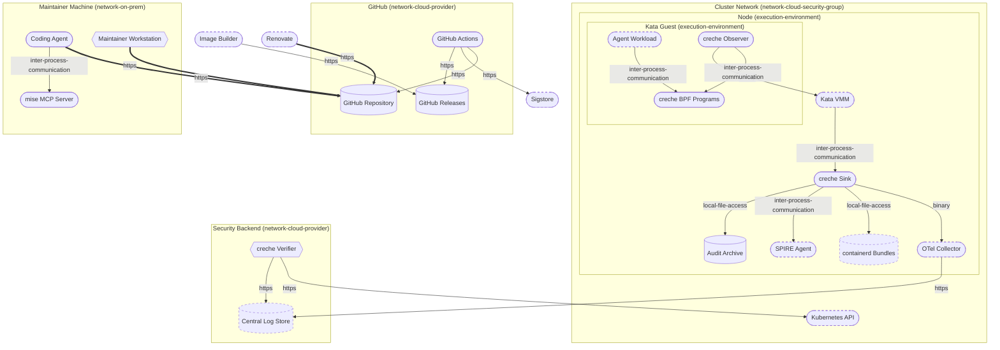
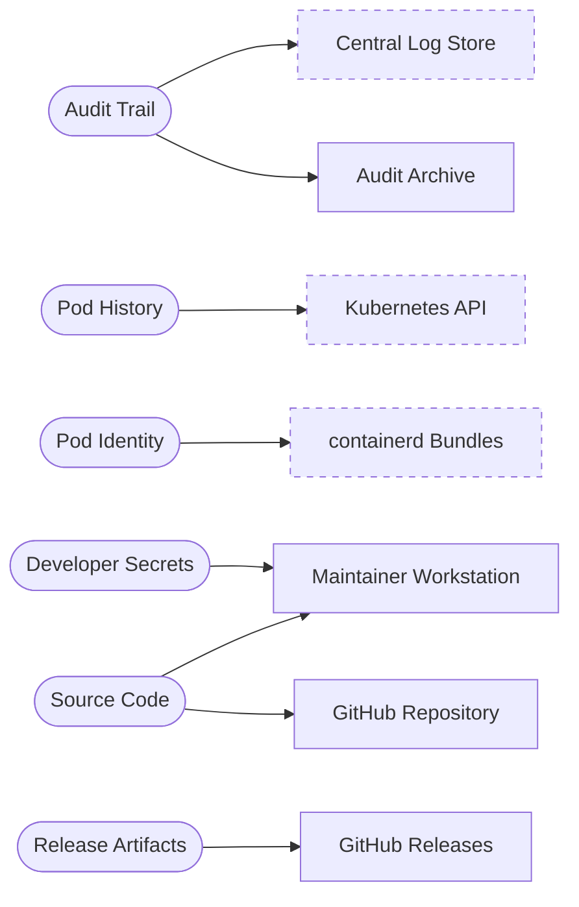

# Threat Model Report: creche

- **Author:** creche maintainers, [https://github.com/Pinguladora/creche](https://github.com/Pinguladora/creche)
- **Date:** 14 November 2026
- **Business criticality:** important
- **Threagile version:** 1.0.0

## Contents

1. [Management Summary](#management-summary)
2. [Impact Analysis of the Initial Risks](#impact-analysis-of-the-initial-risks)
3. [Risk Mitigation](#risk-mitigation)
4. [Impact Analysis of the Remaining Risks](#impact-analysis-of-the-remaining-risks)
5. [Risks by Severity](#risks-by-severity)
6. [Application Overview](#application-overview)
7. [Data-Flow Diagram](#data-flow-diagram)
8. [Asset Register](#asset-register)
9. [Security Requirements](#security-requirements)
10. [Abuse Cases](#abuse-cases)
11. [STRIDE Classification of Identified Risks](#stride-classification-of-identified-risks)
12. [Assignment by Function](#assignment-by-function)
13. [RAA Analysis](#raa-analysis)
14. [Data Mapping](#data-mapping)
15. [Out-of-Scope Assets](#out-of-scope-assets)
16. [Potential Model Failures](#potential-model-failures)
17. [Identified Risks by Vulnerability Category](#identified-risks-by-vulnerability-category)
18. [Identified Risks by Technical Asset](#identified-risks-by-technical-asset)
19. [Identified Data Breach Probabilities by Data Asset](#identified-data-breach-probabilities-by-data-asset)
20. [Trust Boundaries](#trust-boundaries)
21. [Shared Runtimes](#shared-runtimes)
22. [Communication Links](#communication-links)
23. [Risk Tracking](#risk-tracking)
24. [Threat Catalog Coverage](#threat-catalog-coverage)
25. [Risk Rules Checked by Threagile](#risk-rules-checked-by-threagile)
26. [Ratings](#ratings)
27. [Disclaimer](#disclaimer)

## Management Summary

Threagile toolkit was used to model the architecture of "creche" and derive risks by analyzing the components and data flows. The risks identified during this analysis are shown in the following chapters. Identified risks during threat modeling do not necessarily mean that the vulnerability associated with this risk actually exists: it is more to be seen as a list of potential risks and threats, which should be individually reviewed and reduced by removing false positives. For the remaining risks it should be checked in the design and implementation of "creche" whether the mitigation advices have been applied or not.

Each risk finding references a chapter of the OWASP ASVS (Application Security Verification Standard) audit checklist. The OWASP ASVS checklist should be considered as an inspiration by architects and developers to further harden the application in a Defense-in-Depth approach. Additionally, for each risk finding a link towards a matching OWASP Cheat Sheet or similar with technical details about how to implement a mitigation is given.

In total **51 initial risks** in **22 categories** have been identified during the threat modeling process:

| Severity | Risks | Status | Risks |
| --- | ---: | --- | ---: |
| Critical | 0 | Unchecked | 10 |
| High | 2 | In Discussion | 0 |
| Elevated | 18 | Accepted | 13 |
| Medium | 25 | In Progress | 0 |
| Low | 6 | Mitigated | 17 |
|  |  | False Positive | 11 |

## Impact Analysis of the Initial Risks

The most prevalent impacts of the **51 initial risks** (distributed over **22 risk categories**) are (taking the severity ratings into account and using the highest for each category):

- **High**: [Path-Traversal](#path-traversal): 2 Initial Risks, exploitation likelihood is _Very Likely_ with _High_ impact

    If this risk is unmitigated, attackers might be able to read sensitive files (configuration data, key/credential files, deployment files, business data files, etc.) from the filesystem of affected components.

- **High**: [Prompt Injection](#prompt-injection): 1 Initial Risk, exploitation likelihood is _Very Likely_ with _High_ impact

    If this risk is unmitigated, attackers might make the model leak what it has access to, give misleading answers, or, for an agent, use its tools and permissions for their own goals.

- **Elevated**: [Excessive Agency](#excessive-agency): 1 Initial Risk, exploitation likelihood is _Likely_ with _Medium_ impact

    If this risk is unmitigated, attackers who steer the agent, or the agent's own mistakes, might change or delete critical data and trigger actions with real-world effects.

- **Elevated**: [Missing AI Guardrail](#missing-ai-guardrail): 1 Initial Risk, exploitation likelihood is _Likely_ with _Medium_ impact

    If this risk is unmitigated, prompt injections and jailbreaks reach the model or the agent unchecked, and harmful or confidential output leaves it unchecked.

- **Elevated**: [Missing AI Monitoring](#missing-ai-monitoring): 1 Initial Risk, exploitation likelihood is _Likely_ with _Medium_ impact

    If this risk is unmitigated, attacks through the model or the agent, and its own mistakes, might go on unnoticed, and their effects could not be traced.

- **Elevated**: [Missing Authentication](#missing-authentication): 1 Initial Risk, exploitation likelihood is _Likely_ with _High_ impact

    If this risk is unmitigated, attackers might be able to access or modify sensitive data in an unauthenticated way.

- **Elevated**: [Missing Cloud Hardening](#missing-cloud-hardening): 3 Initial Risks, exploitation likelihood is _Unlikely_ with _Very High_ impact

    If this risk is unmitigated, attackers might access cloud components in an unintended way.

- **Elevated**: [Missing File Validation](#missing-file-validation): 2 Initial Risks, exploitation likelihood is _Very Likely_ with _Medium_ impact

    If this risk is unmitigated, attackers might be able to provide malicious files to the application.

- **Elevated**: [Missing Hardening](#missing-hardening): 2 Initial Risks, exploitation likelihood is _Likely_ with _Medium_ impact

    If this risk remains unmitigated, attackers might be able to easier attack high-value targets.

- **Elevated**: [Path-Traversal](#path-traversal): 2 Initial Risks, exploitation likelihood is _Very Likely_ with _High_ impact

    If this risk is unmitigated, attackers might be able to read sensitive files (configuration data, key/credential files, deployment files, business data files, etc.) from the filesystem of affected components.

- **Elevated**: [Sensitive Data Disclosure through Model Output](#sensitive-data-disclosure-through-model-output): 1 Initial Risk, exploitation likelihood is _Very Likely_ with _Medium_ impact

    If this risk is unmitigated, attackers might extract confidential data, other users' data or the system prompt through crafted questions.

- **Elevated**: [Server-Side Request Forgery (SSRF)](#server-side-request-forgery-ssrf): 6 Initial Risks, exploitation likelihood is _Likely_ with _Medium_ impact

    If this risk is unmitigated, attackers might be able to access sensitive services or files of network-reachable components by modifying outgoing calls of affected components.

- **Elevated**: [Unguarded Access From Internet](#unguarded-access-from-internet): 7 Initial Risks, exploitation likelihood is _Very Likely_ with _Medium_ impact

    If this risk is unmitigated, attackers might be able to directly attack sensitive systems without any hardening components in-between due to them being directly exposed on the internet.

- **Elevated**: [Untrusted Deserialization](#untrusted-deserialization): 2 Initial Risks, exploitation likelihood is _Likely_ with _Very High_ impact

    If this risk is unmitigated, attackers might be able to execute code on target systems by exploiting untrusted deserialization endpoints.

- **Medium**: [Accidental Secret Leak](#accidental-secret-leak): 2 Initial Risks, exploitation likelihood is _Unlikely_ with _High_ impact

    If this risk is unmitigated, attackers which have access to affected sourcecode repositories or artifact registries might find secrets accidentally checked-in.

- **Medium**: [Code Backdooring](#code-backdooring): 4 Initial Risks, exploitation likelihood is _Unlikely_ with _High_ impact

    If this risk remains unmitigated, attackers might be able to execute code on and completely takeover production environments.

- **Medium**: [Kubernetes API Write Access](#kubernetes-api-write-access): 1 Initial Risk, exploitation likelihood is _Unlikely_ with _Medium_ impact

    If this risk is unmitigated, attackers who compromise the workload might run their own workloads in the cluster, read its secrets and take over the other workloads and their data.

- **Medium**: [Missing Identity Store](#missing-identity-store): 1 Initial Risk, exploitation likelihood is _Unlikely_ with _Medium_ impact

    If this risk is unmitigated, attackers might be able to exploit risks unseen in this threat model in the identity provider/store that is currently missing in the model.

- **Medium**: [Missing Multi-Factor Authentication (MFA)](#missing-multi-factor-authentication-mfa): 1 Initial Risk, exploitation likelihood is _Unlikely_ with _Medium_ impact

    If this risk is unmitigated, attackers might be able to access or modify highly sensitive data without strong authentication.

- **Medium**: [Missing Vault (Secret Storage)](#missing-vault-secret-storage): 1 Initial Risk, exploitation likelihood is _Unlikely_ with _Medium_ impact

    If this risk is unmitigated, attackers might be able to easier steal config secrets (like credentials, private keys, client certificates, etc.) once a vulnerability to access files is present and exploited.

- **Medium**: [Server-Side Request Forgery (SSRF)](#server-side-request-forgery-ssrf): 6 Initial Risks, exploitation likelihood is _Likely_ with _Medium_ impact

    If this risk is unmitigated, attackers might be able to access sensitive services or files of network-reachable components by modifying outgoing calls of affected components.

- **Medium**: [Unchecked Deployment](#unchecked-deployment): 5 Initial Risks, exploitation likelihood is _Unlikely_ with _Medium_ impact

    If this risk remains unmitigated, vulnerabilities in custom-developed software or their dependencies might not be identified during continuous deployment cycles.

- **Medium**: [Unencrypted Technical Assets](#unencrypted-technical-assets): 4 Initial Risks, exploitation likelihood is _Unlikely_ with _High_ impact

    If this risk is unmitigated, attackers might be able to access unencrypted data when successfully compromising sensitive components.

- **Medium**: [Unguarded Access From Internet](#unguarded-access-from-internet): 7 Initial Risks, exploitation likelihood is _Very Likely_ with _Medium_ impact

    If this risk is unmitigated, attackers might be able to directly attack sensitive systems without any hardening components in-between due to them being directly exposed on the internet.

- **Low**: [Server-Side Request Forgery (SSRF)](#server-side-request-forgery-ssrf): 6 Initial Risks, exploitation likelihood is _Likely_ with _Medium_ impact

    If this risk is unmitigated, attackers might be able to access sensitive services or files of network-reachable components by modifying outgoing calls of affected components.

- **Low**: [Unchecked Deployment](#unchecked-deployment): 5 Initial Risks, exploitation likelihood is _Unlikely_ with _Medium_ impact

    If this risk remains unmitigated, vulnerabilities in custom-developed software or their dependencies might not be identified during continuous deployment cycles.

- **Low**: [Wrong Communication Link Content](#wrong-communication-link-content): 2 Initial Risks, exploitation likelihood is _Unlikely_ with _Low_ impact

    If this potential model error is not fixed, some risks might not be visible.

## Risk Mitigation

The following table gives a high-level overview of the risk tracking status (including mitigated risks):

| Severity | Risks | Unchecked | In Discussion | Accepted | In Progress | Mitigated | False Positive |
| --- | ---: | ---: | ---: | ---: | ---: | ---: | ---: |
| Critical | 0 | 0 | 0 | 0 | 0 | 0 | 0 |
| High | 2 | 1 | 0 | 0 | 0 | 0 | 1 |
| Elevated | 18 | 4 | 0 | 6 | 0 | 5 | 3 |
| Medium | 25 | 4 | 0 | 6 | 0 | 10 | 5 |
| Low | 6 | 1 | 0 | 1 | 0 | 2 | 2 |

After removal of risks with status _mitigated_ and _false positive_ the following **23 remain unmitigated**:

| Severity | Unmitigated risks | To be checked by | Unmitigated risks |
| --- | ---: | --- | ---: |
| Critical | 0 | Business Side | 1 |
| High | 1 | Architecture | 11 |
| Elevated | 10 | Development | 2 |
| Medium | 10 | Operations | 9 |
| Low | 2 |  |  |

## Impact Analysis of the Remaining Risks

The most prevalent impacts of the **23 remaining risks** (distributed over **14 risk categories**) are (taking the severity ratings into account and using the highest for each category):

- **High**: [Prompt Injection](#prompt-injection): 1 Remaining Risk, exploitation likelihood is _Very Likely_ with _High_ impact

    If this risk is unmitigated, attackers might make the model leak what it has access to, give misleading answers, or, for an agent, use its tools and permissions for their own goals.

- **Elevated**: [Excessive Agency](#excessive-agency): 1 Remaining Risk, exploitation likelihood is _Likely_ with _Medium_ impact

    If this risk is unmitigated, attackers who steer the agent, or the agent's own mistakes, might change or delete critical data and trigger actions with real-world effects.

- **Elevated**: [Missing AI Guardrail](#missing-ai-guardrail): 1 Remaining Risk, exploitation likelihood is _Likely_ with _Medium_ impact

    If this risk is unmitigated, prompt injections and jailbreaks reach the model or the agent unchecked, and harmful or confidential output leaves it unchecked.

- **Elevated**: [Missing AI Monitoring](#missing-ai-monitoring): 1 Remaining Risk, exploitation likelihood is _Likely_ with _Medium_ impact

    If this risk is unmitigated, attacks through the model or the agent, and its own mistakes, might go on unnoticed, and their effects could not be traced.

- **Elevated**: [Missing Cloud Hardening](#missing-cloud-hardening): 3 Remaining Risks, exploitation likelihood is _Unlikely_ with _Very High_ impact

    If this risk is unmitigated, attackers might access cloud components in an unintended way.

- **Elevated**: [Missing Hardening](#missing-hardening): 1 Remaining Risk, exploitation likelihood is _Likely_ with _Medium_ impact

    If this risk remains unmitigated, attackers might be able to easier attack high-value targets.

- **Elevated**: [Sensitive Data Disclosure through Model Output](#sensitive-data-disclosure-through-model-output): 1 Remaining Risk, exploitation likelihood is _Very Likely_ with _Medium_ impact

    If this risk is unmitigated, attackers might extract confidential data, other users' data or the system prompt through crafted questions.

- **Elevated**: [Unguarded Access From Internet](#unguarded-access-from-internet): 6 Remaining Risks, exploitation likelihood is _Very Likely_ with _Medium_ impact

    If this risk is unmitigated, attackers might be able to directly attack sensitive systems without any hardening components in-between due to them being directly exposed on the internet.

- **Medium**: [Code Backdooring](#code-backdooring): 2 Remaining Risks, exploitation likelihood is _Unlikely_ with _High_ impact

    If this risk remains unmitigated, attackers might be able to execute code on and completely takeover production environments.

- **Medium**: [Missing Identity Store](#missing-identity-store): 1 Remaining Risk, exploitation likelihood is _Unlikely_ with _Medium_ impact

    If this risk is unmitigated, attackers might be able to exploit risks unseen in this threat model in the identity provider/store that is currently missing in the model.

- **Medium**: [Missing Multi-Factor Authentication (MFA)](#missing-multi-factor-authentication-mfa): 1 Remaining Risk, exploitation likelihood is _Unlikely_ with _Medium_ impact

    If this risk is unmitigated, attackers might be able to access or modify highly sensitive data without strong authentication.

- **Medium**: [Unencrypted Technical Assets](#unencrypted-technical-assets): 2 Remaining Risks, exploitation likelihood is _Unlikely_ with _High_ impact

    If this risk is unmitigated, attackers might be able to access unencrypted data when successfully compromising sensitive components.

- **Medium**: [Unguarded Access From Internet](#unguarded-access-from-internet): 6 Remaining Risks, exploitation likelihood is _Very Likely_ with _Medium_ impact

    If this risk is unmitigated, attackers might be able to directly attack sensitive systems without any hardening components in-between due to them being directly exposed on the internet.

- **Low**: [Server-Side Request Forgery (SSRF)](#server-side-request-forgery-ssrf): 1 Remaining Risk, exploitation likelihood is _Unlikely_ with _Low_ impact

    If this risk is unmitigated, attackers might be able to access sensitive services or files of network-reachable components by modifying outgoing calls of affected components.

- **Low**: [Unchecked Deployment](#unchecked-deployment): 1 Remaining Risk, exploitation likelihood is _Unlikely_ with _Low_ impact

    If this risk remains unmitigated, vulnerabilities in custom-developed software or their dependencies might not be identified during continuous deployment cycles.

## Risks by Severity

All **51 risks** by severity, with their tracking status. Each risk links to its details in the chapter of its category.

### Critical

**0 risks**

_No risks._

### High

**2 risks**

| Severity | Risk | Category | Most relevant | Status |
| --- | --- | --- | --- | --- |
| High | [**Path-Traversal** risk at **creche Sink** against filesystem **Audit Archive** via **Write Archive**](#path-traversal) | [Path-Traversal](#path-traversal) | [creche Sink](#creche-sink), [Write Archive](#write-archive) | False Positive |
| High | [**Prompt Injection** risk at **Coding Agent**](#prompt-injection) | [Prompt Injection](#prompt-injection) | [Coding Agent](#coding-agent), [Agent Pushes](#agent-pushes) | Unchecked |

### Elevated

**18 risks**

| Severity | Risk | Category | Most relevant | Status |
| --- | --- | --- | --- | --- |
| Elevated | [**Excessive Agency** risk at **Coding Agent** changing **GitHub Repository**](#excessive-agency) | [Excessive Agency](#excessive-agency) | [Coding Agent](#coding-agent), [Agent Pushes](#agent-pushes) | Unchecked |
| Elevated | [**Missing AI Guardrail** risk at **Coding Agent**](#missing-ai-guardrail) | [Missing AI Guardrail](#missing-ai-guardrail) | [Coding Agent](#coding-agent), [Agent Pushes](#agent-pushes) | Unchecked |
| Elevated | [**Missing AI Monitoring** risk at **Coding Agent**](#missing-ai-monitoring) | [Missing AI Monitoring](#missing-ai-monitoring) | [Coding Agent](#coding-agent) | Unchecked |
| Elevated | [**Missing Authentication** covering communication link **Download Release** from **Image Builder** to **GitHub Releases**](#missing-authentication) | [Missing Authentication](#missing-authentication) | [GitHub Releases](#github-releases), [Download Release](#download-release) | Mitigated |
| Elevated | [**Missing Cloud Hardening** risk at **Cluster Network**](#missing-cloud-hardening) | [Missing Cloud Hardening](#missing-cloud-hardening) | none | Accepted |
| Elevated | [**Missing Cloud Hardening** risk at **GitHub**](#missing-cloud-hardening) | [Missing Cloud Hardening](#missing-cloud-hardening) | none | Accepted |
| Elevated | [**Missing Cloud Hardening** risk at **Security Backend**](#missing-cloud-hardening) | [Missing Cloud Hardening](#missing-cloud-hardening) | none | Accepted |
| Elevated | [**Missing File Validation** risk at **GitHub Actions**](#missing-file-validation) | [Missing File Validation](#missing-file-validation) | [GitHub Actions](#github-actions) | False Positive |
| Elevated | [**Missing File Validation** risk at **creche Verifier**](#missing-file-validation) | [Missing File Validation](#missing-file-validation) | [creche Verifier](#creche-verifier) | False Positive |
| Elevated | [**Missing Hardening** risk at **Audit Archive**](#missing-hardening) | [Missing Hardening](#missing-hardening) | [Audit Archive](#audit-archive) | Accepted |
| Elevated | [**Missing Hardening** risk at **GitHub Actions**](#missing-hardening) | [Missing Hardening](#missing-hardening) | [GitHub Actions](#github-actions) | Mitigated |
| Elevated | [**Sensitive Data Disclosure through Model Output** risk at **Coding Agent**](#sensitive-data-disclosure-through-model-output) | [Sensitive Data Disclosure through Model Output](#sensitive-data-disclosure-through-model-output) | [Coding Agent](#coding-agent) | Unchecked |
| Elevated | [**Path-Traversal** risk at **creche Sink** against filesystem **containerd Bundles** via **Read Bundle**](#path-traversal) | [Path-Traversal](#path-traversal) | [creche Sink](#creche-sink), [Read Bundle](#read-bundle) | Mitigated |
| Elevated | [**Server-Side Request Forgery (SSRF)** risk at **creche Verifier** server-side web-requesting the target **Central Log Store** via **Read Trail**](#server-side-request-forgery-ssrf) | [Server-Side Request Forgery (SSRF)](#server-side-request-forgery-ssrf) | [creche Verifier](#creche-verifier), [Read Trail](#read-trail) | False Positive |
| Elevated | [**Unguarded Access from Internet** of **GitHub Releases** by **GitHub Actions** via **Publish Release**](#unguarded-access-from-internet) | [Unguarded Access From Internet](#unguarded-access-from-internet) | [GitHub Releases](#github-releases), [Publish Release](#publish-release) | Accepted |
| Elevated | [**Unguarded Access from Internet** of **GitHub Releases** by **Image Builder** via **Download Release**](#unguarded-access-from-internet) | [Unguarded Access From Internet](#unguarded-access-from-internet) | [GitHub Releases](#github-releases), [Download Release](#download-release) | Accepted |
| Elevated | [**Untrusted Deserialization** risk at **creche Sink**](#untrusted-deserialization) | [Untrusted Deserialization](#untrusted-deserialization) | [creche Sink](#creche-sink) | Mitigated |
| Elevated | [**Untrusted Deserialization** risk at **creche Observer**](#untrusted-deserialization) | [Untrusted Deserialization](#untrusted-deserialization) | [creche Observer](#creche-observer) | Mitigated |

### Medium

**25 risks**

| Severity | Risk | Category | Most relevant | Status |
| --- | --- | --- | --- | --- |
| Medium | [**Accidental Secret Leak** risk at **GitHub Releases**](#accidental-secret-leak) | [Accidental Secret Leak](#accidental-secret-leak) | [GitHub Releases](#github-releases) | Mitigated |
| Medium | [**Accidental Secret Leak** risk at **GitHub Repository**](#accidental-secret-leak) | [Accidental Secret Leak](#accidental-secret-leak) | [GitHub Repository](#github-repository) | Mitigated |
| Medium | [**Code Backdooring** risk at **GitHub Repository**](#code-backdooring) | [Code Backdooring](#code-backdooring) | [GitHub Repository](#github-repository) | Unchecked |
| Medium | [**Code Backdooring** risk at **Maintainer Workstation**](#code-backdooring) | [Code Backdooring](#code-backdooring) | [Maintainer Workstation](#maintainer-workstation) | Unchecked |
| Medium | [**Code Backdooring** risk at **GitHub Actions**](#code-backdooring) | [Code Backdooring](#code-backdooring) | [GitHub Actions](#github-actions) | Mitigated |
| Medium | [**Code Backdooring** risk at **GitHub Releases**](#code-backdooring) | [Code Backdooring](#code-backdooring) | [GitHub Releases](#github-releases) | Mitigated |
| Medium | [**Kubernetes API Write Access** risk at **creche Observer** to **Kata VMM**](#kubernetes-api-write-access) | [Kubernetes API Write Access](#kubernetes-api-write-access) | [creche Observer](#creche-observer), [Vsock Stream](#vsock-stream) | False Positive |
| Medium | [**Missing Multi-Factor Authentication** covering communication link **Push Branches** from **Maintainer Workstation** to **GitHub Repository**](#missing-multi-factor-authentication-mfa) | [Missing Multi-Factor Authentication (MFA)](#missing-multi-factor-authentication-mfa) | [GitHub Repository](#github-repository), [Push Branches](#push-branches) | Unchecked |
| Medium | [**Missing Identity Store** in the threat model (referencing asset **creche Verifier** as an example)](#missing-identity-store) | [Missing Identity Store](#missing-identity-store) | [creche Verifier](#creche-verifier) | Accepted |
| Medium | [**Missing Vault (Secret Storage)** in the threat model (referencing asset **creche Sink** as an example)](#missing-vault-secret-storage) | [Missing Vault (Secret Storage)](#missing-vault-secret-storage) | [creche Sink](#creche-sink) | Mitigated |
| Medium | [**Server-Side Request Forgery (SSRF)** risk at **GitHub Actions** server-side web-requesting the target **GitHub Releases** via **Publish Release**](#server-side-request-forgery-ssrf) | [Server-Side Request Forgery (SSRF)](#server-side-request-forgery-ssrf) | [GitHub Actions](#github-actions), [Publish Release](#publish-release) | Mitigated |
| Medium | [**Server-Side Request Forgery (SSRF)** risk at **GitHub Actions** server-side web-requesting the target **GitHub Repository** via **Checkout**](#server-side-request-forgery-ssrf) | [Server-Side Request Forgery (SSRF)](#server-side-request-forgery-ssrf) | [GitHub Actions](#github-actions), [Checkout](#checkout) | Mitigated |
| Medium | [**Server-Side Request Forgery (SSRF)** risk at **GitHub Actions** server-side web-requesting the target **Sigstore** via **Keyless Signing**](#server-side-request-forgery-ssrf) | [Server-Side Request Forgery (SSRF)](#server-side-request-forgery-ssrf) | [GitHub Actions](#github-actions), [Keyless Signing](#keyless-signing) | Mitigated |
| Medium | [**Server-Side Request Forgery (SSRF)** risk at **creche Verifier** server-side web-requesting the target **Kubernetes API** via **Pod History**](#server-side-request-forgery-ssrf) | [Server-Side Request Forgery (SSRF)](#server-side-request-forgery-ssrf) | [creche Verifier](#creche-verifier), [Pod History](#pod-history-1) | False Positive |
| Medium | [**Unchecked Deployment** risk at **GitHub Actions**](#unchecked-deployment) | [Unchecked Deployment](#unchecked-deployment) | [GitHub Actions](#github-actions) | Mitigated |
| Medium | [**Unchecked Deployment** risk at **Maintainer Workstation**](#unchecked-deployment) | [Unchecked Deployment](#unchecked-deployment) | [Maintainer Workstation](#maintainer-workstation) | Mitigated |
| Medium | [**Unencrypted Technical Asset** named **Maintainer Workstation**](#unencrypted-technical-assets) | [Unencrypted Technical Assets](#unencrypted-technical-assets) | [Maintainer Workstation](#maintainer-workstation) | Unchecked |
| Medium | [**Unencrypted Technical Asset** named **Audit Archive** missing end user individual encryption with data-with-end-user-individual-key](#unencrypted-technical-assets) | [Unencrypted Technical Assets](#unencrypted-technical-assets) | [Audit Archive](#audit-archive) | Accepted |
| Medium | [**Unencrypted Technical Asset** named **GitHub Releases**](#unencrypted-technical-assets) | [Unencrypted Technical Assets](#unencrypted-technical-assets) | [GitHub Releases](#github-releases) | False Positive |
| Medium | [**Unencrypted Technical Asset** named **GitHub Repository**](#unencrypted-technical-assets) | [Unencrypted Technical Assets](#unencrypted-technical-assets) | [GitHub Repository](#github-repository) | False Positive |
| Medium | [**Unguarded Access from Internet** of **GitHub Repository** by **Coding Agent** via **Agent Pushes**](#unguarded-access-from-internet) | [Unguarded Access From Internet](#unguarded-access-from-internet) | [GitHub Repository](#github-repository), [Agent Pushes](#agent-pushes) | Accepted |
| Medium | [**Unguarded Access from Internet** of **GitHub Repository** by **GitHub Actions** via **Checkout**](#unguarded-access-from-internet) | [Unguarded Access From Internet](#unguarded-access-from-internet) | [GitHub Repository](#github-repository), [Checkout](#checkout) | Accepted |
| Medium | [**Unguarded Access from Internet** of **GitHub Repository** by **Maintainer Workstation** via **Push Branches**](#unguarded-access-from-internet) | [Unguarded Access From Internet](#unguarded-access-from-internet) | [GitHub Repository](#github-repository), [Push Branches](#push-branches) | Accepted |
| Medium | [**Unguarded Access from Internet** of **GitHub Repository** by **Renovate** via **Update PRs**](#unguarded-access-from-internet) | [Unguarded Access From Internet](#unguarded-access-from-internet) | [GitHub Repository](#github-repository), [Update PRs](#update-prs) | Accepted |
| Medium | [**Unguarded Access from Internet** of **mise MCP Server** by **Coding Agent** via **mise MCP**](#unguarded-access-from-internet) | [Unguarded Access From Internet](#unguarded-access-from-internet) | [mise MCP Server](#mise-mcp-server), [mise MCP](#mise-mcp) | False Positive |

### Low

**6 risks**

| Severity | Risk | Category | Most relevant | Status |
| --- | --- | --- | --- | --- |
| Low | [**Server-Side Request Forgery (SSRF)** risk at **Coding Agent** server-side web-requesting the target **GitHub Repository** via **Agent Pushes**](#server-side-request-forgery-ssrf) | [Server-Side Request Forgery (SSRF)](#server-side-request-forgery-ssrf) | [Coding Agent](#coding-agent), [Agent Pushes](#agent-pushes) | Unchecked |
| Low | [**Unchecked Deployment** risk at **Image Builder**](#unchecked-deployment) | [Unchecked Deployment](#unchecked-deployment) | [Image Builder](#image-builder) | Accepted |
| Low | [**Unchecked Deployment** risk at **GitHub Releases**](#unchecked-deployment) | [Unchecked Deployment](#unchecked-deployment) | [GitHub Releases](#github-releases) | Mitigated |
| Low | [**Unchecked Deployment** risk at **GitHub Repository**](#unchecked-deployment) | [Unchecked Deployment](#unchecked-deployment) | [GitHub Repository](#github-repository) | Mitigated |
| Low | [**Wrong Communication Link Content** (data assets sent/received not matching the communication link's readonly flag) at **Coding Agent** regarding communication link **mise MCP**](#wrong-communication-link-content) | [Wrong Communication Link Content](#wrong-communication-link-content) | [Coding Agent](#coding-agent), [mise MCP](#mise-mcp) | False Positive |
| Low | [**Wrong Communication Link Content** (data assets sent/received not matching the communication link's readonly flag) at **creche Observer** regarding communication link **Ring Buffer**](#wrong-communication-link-content) | [Wrong Communication Link Content](#wrong-communication-link-content) | [creche Observer](#creche-observer), [Ring Buffer](#ring-buffer) | False Positive |

## Application Overview

### Business Criticality

The overall business criticality of "creche" was rated as:

- archive
- operational
- **important** (selected)
- critical
- mission-critical

### Business Overview

Visibility into what runs inside Kata Containers microVMs. Process trees, outgoing connections and file writes of the tools an AI agent spawns are streamed to the host, attributed to the sandbox and its pod, and kept as a tamper-evident audit trail.

### Technical Overview

An observer in the guest loads BPF programs (aya) and forwards their ring buffer records over hybrid vsock. The sink on the host attests which sandbox a connection comes from, names its pod from containerd's bundles, writes JSON lines with hash chained and SVID signed checkpoints, and exports them over OTLP. A verifier checks saved output against the trust bundle and the pod history. Releases are built, signed and published by GitHub Actions.

## Data-Flow Diagram

The following diagram was generated by Threagile based on the model input and gives a high-level overview of the data-flow between technical assets. The RAA value of each asset, the calculated _Relative Attacker Attractiveness_ in percent, is in the chapter [RAA Analysis](#raa-analysis).

Data-flow diagram of "creche". A box is an external entity, a stadium a process, a cylinder a datastore and a hexagon a client used by a human; assets out of scope have a dashed border, and the trust boundaries enclose the assets inside them. An arrow points from the asset that initiates a communication link to its target and names the protocol; a thick arrow is a link that also receives data back.

## Asset Register

### Technical Assets

- [Coding Agent](#coding-agent)

    A coding agent on the workstation, with the hk and mise MCP servers from .mcp.json

- [Audit Archive](#audit-archive)

    The JSON lines file on the node

- [GitHub Releases](#github-releases)

    Release downloads of Pinguladora/creche

- [GitHub Repository](#github-repository)

    Pinguladora/creche

- [Maintainer Workstation](#maintainer-workstation)

    Where the maintainer works, with hk, mise and coding agents

- [creche Verifier](#creche-verifier)

    creche-sink --verify run by an auditor against saved output, a trust bundle, the sink SPIFFE IDs and the pod history

- [Image Builder](#image-builder) (out of scope)

    The platform team's build of the Kata guest image and the node image, which verify and install a release

- [GitHub Actions](#github-actions)

    CI, the release and auto-release workflows, hardened runners with egress allowlists

- [creche BPF Programs](#creche-bpf-programs)

    C BPF programs with CO-RE in the guest kernel, dropping noise in the kernel, a pid indexed task cache and the LSM guard on the observer's vsock port

- [creche Observer](#creche-observer)

    Loads the BPF programs with aya, drains the ring buffer and forwards whole records over vsock, started by systemd before kata-agent

- [creche Sink](#creche-sink)

    Decodes the bounds checked records, attests sandbox and pod, writes JSON lines with checkpoints, signs them with the SVID and exports OTLP

- [mise MCP Server](#mise-mcp-server)

    mise mcp, started by the coding agent

- [Agent Workload](#agent-workload) (out of scope)

    The AI agent and the tools it spawns, the untrusted party in the guest

- [Central Log Store](#central-log-store) (out of scope)

    The second store that keeps checkpoints out of reach of the node

- [Kata VMM](#kata-vmm) (out of scope)

    Cloud Hypervisor or Firecracker, which bridges guest vsock to a Unix socket on the host

- [Kubernetes API](#kubernetes-api) (out of scope)

    The cluster's API server

- [OTel Collector](#otel-collector) (out of scope)

    A node collector that ships the lines to a second store

- [Renovate](#renovate) (out of scope)

    Opens dependency update PRs, security fixes trigger a patch release once merged

- [SPIRE Agent](#spire-agent) (out of scope)

    Attests the sink and issues its node specific SVID

- [Sigstore](#sigstore) (out of scope)

    Public Fulcio and Rekor

- [containerd Bundles](#containerd-bundles) (out of scope)

    containerd's runtime v2 task directory with each sandbox's config.json

### Data Assets

- [Agent Labels](#agent-labels)

    user.creche.agent extended attributes the agents set on their delegated cgroups

- [Audit Trail](#audit-trail)

    JSON lines with stream sequence numbers, hash chained checkpoints and their signatures

- [CI Credentials](#ci-credentials)

    GitHub tokens and the OIDC identity of the release workflow

- [Developer Secrets](#developer-secrets)

    Environment variables and secrets the mise MCP server exposes to coding agents

- [Guest Events](#guest-events)

    Process, connect and file write records from the guest, with command arguments, paths and destinations

- [Pod History](#pod-history)

    Lines of pod uid or sandbox id and the node they ran on, and the SPIFFE trust bundle

- [Pod Identity](#pod-identity)

    Pod name, namespace and uid from the annotations in the sandbox's OCI spec

- [Release Artifacts](#release-artifacts)

    Static musl builds of creche-observer and creche-sink, signed checksums and SLSA provenance

- [Sink Signing Keys](#sink-signing-keys)

    The sink's X.509-SVID and the per stream P-256 keys that sign checkpoints

- [Source Code](#source-code)

    The creche repository, BPF C and Rust

## Security Requirements

This chapter lists the custom security requirements which have been defined for the modeled target.

- **Guest Untrusted**

    Nothing the guest sends may crash, stall or mislead the sink.

- **Host Attests Identity**

    The sandbox, pod and node of a stream come from the host, never from the guest.

- **Tamper Evident Trail**

    Missing or changed lines must be detectable by a verifier.

- **Verifiable Releases**

    Every release carries signed checksums and SLSA provenance.

_This list is not complete and regulatory or law relevant security requirements have to be taken into account as well. Also custom individual security requirements might exist for the project._

## Abuse Cases

This chapter lists the custom abuse cases which have been defined for the modeled target.

- **Audit Rewrite**

    Whoever takes over a sink or the archive rewrites the audit trail without detection.

- **Blinding**

    The guest floods or stalls the sink so that events of other sandboxes are lost.

- **Forged Events**

    A process in the guest sends records the host takes for the observer's.

- **Misattribution**

    A guest or a host process makes events appear under another sandbox, pod or container.

- **Release Tampering**

    A modified observer or sink binary reaches the guest image or the nodes.

_This list is not complete and regulatory or law relevant abuse cases have to be taken into account as well. Also custom individual abuse cases might exist for the project._

## STRIDE Classification of Identified Risks

This chapter clusters and classifies the risks by STRIDE categories: in total **51 potential risks** have been identified during the threat modeling process.

### Spoofing

**3 risks**

Spoofing - Authenticity

- **Elevated**: [Missing File Validation](#missing-file-validation): 2 mitigated Risks, exploitation likelihood is _Very Likely_ with _Medium_ impact

    When a technical asset accepts files, these input files should be strictly validated about filename and type.

- **Medium**: [Missing Identity Store](#missing-identity-store): 1/1 unmitigated Risk, exploitation likelihood is _Unlikely_ with _Medium_ impact

    The modeled architecture does not contain an identity store, which might be the risk of a model missing critical assets (and thus not seeing their risks).

### Tampering

**16 risks**

Tampering - Integrity

- **Elevated**: [Missing Cloud Hardening](#missing-cloud-hardening): 3/3 unmitigated Risks, exploitation likelihood is _Unlikely_ with _Very High_ impact

    Cloud components should be hardened according to the cloud vendor best practices. This affects their configuration, auditing, and further areas.

- **Elevated**: [Missing Hardening](#missing-hardening): 1/2 unmitigated Risks, exploitation likelihood is _Likely_ with _Medium_ impact

    Technical assets with a Relative Attacker Attractiveness (RAA) value of 55 % or higher should be explicitly hardened taking best practices and vendor hardening guides into account.

- **Elevated**: [Untrusted Deserialization](#untrusted-deserialization): 2 mitigated Risks, exploitation likelihood is _Likely_ with _Very High_ impact

    When a technical asset accepts data in a specific serialized form (like Java or .NET serialization), Untrusted Deserialization risks might arise.

- **Medium**: [Code Backdooring](#code-backdooring): 2/4 unmitigated Risks, exploitation likelihood is _Unlikely_ with _High_ impact

    For each build pipeline component Code Backdooring risks might arise where attackers compromise the build pipeline in order to let backdoored artifacts be shipped into production. Aside from direct code backdooring this includes backdooring of dependencies and even of more lower-level build infrastructure, like backdooring compilers (similar to what the XcodeGhost malware did) or dependencies.

- **Medium**: [Unchecked Deployment](#unchecked-deployment): 1/5 unmitigated Risks, exploitation likelihood is _Unlikely_ with _Medium_ impact

    For each build-pipeline component Unchecked Deployment risks might arise when the build-pipeline does not include established DevSecOps best-practices. DevSecOps best-practices scan as part of CI/CD pipelines for vulnerabilities in source- or byte-code, dependencies, container layers, and dynamically against running test systems. There are several open-source and commercial tools existing in the categories DAST, SAST, and IAST.

- **Low**: [Unchecked Deployment](#unchecked-deployment): 1/5 unmitigated Risks, exploitation likelihood is _Unlikely_ with _Medium_ impact

    For each build-pipeline component Unchecked Deployment risks might arise when the build-pipeline does not include established DevSecOps best-practices. DevSecOps best-practices scan as part of CI/CD pipelines for vulnerabilities in source- or byte-code, dependencies, container layers, and dynamically against running test systems. There are several open-source and commercial tools existing in the categories DAST, SAST, and IAST.

### Repudiation

**1 risk**

Repudiation - Non-repudiability

- **Elevated**: [Missing AI Monitoring](#missing-ai-monitoring): 1/1 unmitigated Risk, exploitation likelihood is _Likely_ with _Medium_ impact

    What an AI agent or a language model does depends on what it reads, so it cannot be tested in full before it runs. Without a record of its prompts, its tool calls and its answers in a monitoring system, nobody sees a prompt injection, an agent going astray or a model that drifts, nor can tell afterwards what it did.

### Information Disclosure

**18 risks**

Information disclosure - Confidentiality

- **High**: [Path-Traversal](#path-traversal): 2 mitigated Risks, exploitation likelihood is _Very Likely_ with _High_ impact

    When a filesystem is accessed Path-Traversal or Local-File-Inclusion (LFI) risks might arise. The risk rating depends on the sensitivity of the technical asset itself and of the data assets processed.

- **Elevated**: [Path-Traversal](#path-traversal): 2 mitigated Risks, exploitation likelihood is _Very Likely_ with _High_ impact

    When a filesystem is accessed Path-Traversal or Local-File-Inclusion (LFI) risks might arise. The risk rating depends on the sensitivity of the technical asset itself and of the data assets processed.

- **Elevated**: [Sensitive Data Disclosure through Model Output](#sensitive-data-disclosure-through-model-output): 1/1 unmitigated Risk, exploitation likelihood is _Very Likely_ with _Medium_ impact

    Whatever a language model or an agent can read, it can be talked into writing: data in its prompt, in its context window, in the documents it retrieves or in its training data. A model that has confidential data at hand and answers callers from the internet, from users or from another trust zone may hand that data to callers who are not allowed to see it.

- **Elevated**: [Server-Side Request Forgery (SSRF)](#server-side-request-forgery-ssrf): 1/6 unmitigated Risks, exploitation likelihood is _Likely_ with _Medium_ impact

    When a server system (i.e. not a client) is accessing other server systems via typical web protocols Server-Side Request Forgery (SSRF) or Local-File-Inclusion (LFI) or Remote-File-Inclusion (RFI) risks might arise.

- **Medium**: [Accidental Secret Leak](#accidental-secret-leak): 2 mitigated Risks, exploitation likelihood is _Unlikely_ with _High_ impact

    Sourcecode repositories (including their histories) as well as artifact registries can accidentally contain secrets like checked-in or packaged-in passwords, API tokens, certificates, crypto keys, etc.

- **Medium**: [Missing Vault (Secret Storage)](#missing-vault-secret-storage): 1 mitigated Risk, exploitation likelihood is _Unlikely_ with _Medium_ impact

    In order to avoid the risk of secret leakage via config files (when attacked through vulnerabilities being able to read files like Path-Traversal and others), it is best practice to use a separate hardened process with proper authentication, authorization, and audit logging to access config secrets (like credentials, private keys, client certificates, etc.). This component is usually some kind of Vault.

- **Medium**: [Server-Side Request Forgery (SSRF)](#server-side-request-forgery-ssrf): 1/6 unmitigated Risks, exploitation likelihood is _Likely_ with _Medium_ impact

    When a server system (i.e. not a client) is accessing other server systems via typical web protocols Server-Side Request Forgery (SSRF) or Local-File-Inclusion (LFI) or Remote-File-Inclusion (RFI) risks might arise.

- **Medium**: [Unencrypted Technical Assets](#unencrypted-technical-assets): 2/4 unmitigated Risks, exploitation likelihood is _Unlikely_ with _High_ impact

    Due to the confidentiality rating of the technical asset itself and/or the stored data assets this technical asset must be encrypted. The risk rating depends on the sensitivity technical asset itself and of the data assets stored.

- **Low**: [Server-Side Request Forgery (SSRF)](#server-side-request-forgery-ssrf): 1/6 unmitigated Risks, exploitation likelihood is _Likely_ with _Medium_ impact

    When a server system (i.e. not a client) is accessing other server systems via typical web protocols Server-Side Request Forgery (SSRF) or Local-File-Inclusion (LFI) or Remote-File-Inclusion (RFI) risks might arise.

- **Low**: [Wrong Communication Link Content](#wrong-communication-link-content): 2 mitigated Risks, exploitation likelihood is _Unlikely_ with _Low_ impact

    When a communication link is defined as readonly, but does not receive any data asset, or when it is defined as not readonly, but does not send any data asset, it is likely to be a model failure.

### Denial of Service

**0 risks**

Denial of service - Availability

_No risks were identified._

### Elevation of Privilege

**13 risks**

Elevation of privilege - Authorization

- **High**: [Prompt Injection](#prompt-injection): 1/1 unmitigated Risk, exploitation likelihood is _Very Likely_ with _High_ impact

    A language model cannot tell the instructions of its prompt apart from the data in it. Content that reaches a model or an agent from users, the internet or another trust zone can carry instructions of its own, either directly in a request or indirectly in a document, a web page or a tool response the model reads, and so take over what the model does.

- **Elevated**: [Excessive Agency](#excessive-agency): 1/1 unmitigated Risk, exploitation likelihood is _Likely_ with _Medium_ impact

    An AI agent decides on its own which tools to call and with which arguments. An agent that can change critical systems, directly or through the tools of an MCP server, without a human approving the change, does whatever a prompt injection, a hallucination or a misunderstanding makes it do.

- **Elevated**: [Missing AI Guardrail](#missing-ai-guardrail): 1/1 unmitigated Risk, exploitation likelihood is _Likely_ with _Medium_ impact

    A guardrail screens what reaches a language model or an agent, and what comes back from it, for prompt injection, jailbreaks and data that must not pass, independently of the model. Without one, the instructions of the system prompt are the only defense, and a model follows whatever content convinces it.

- **Elevated**: [Missing Authentication](#missing-authentication): 1 mitigated Risk, exploitation likelihood is _Likely_ with _High_ impact

    Technical assets (especially multi-tenant systems) should authenticate incoming requests when the asset processes sensitive data.

- **Elevated**: [Unguarded Access From Internet](#unguarded-access-from-internet): 6/7 unmitigated Risks, exploitation likelihood is _Very Likely_ with _Medium_ impact

    Internet-exposed assets must be guarded by a protecting service, application, or reverse-proxy.

- **Medium**: [Kubernetes API Write Access](#kubernetes-api-write-access): 1 mitigated Risk, exploitation likelihood is _Unlikely_ with _Medium_ impact

    A workload whose service account may change resources through the API of its cluster, even narrowly, like creating pods, reading secrets or patching deployments, hands that power to whoever compromises the workload: a pod created with a mounted host path, or a secret read, opens the rest of the cluster.

- **Medium**: [Missing Multi-Factor Authentication (MFA)](#missing-multi-factor-authentication-mfa): 1/1 unmitigated Risk, exploitation likelihood is _Unlikely_ with _Medium_ impact

    Technical assets (especially multi-tenant systems) should authenticate incoming requests with multi-factor (MFA) authentication when the asset processes or stores highly sensitive data (in terms of confidentiality, integrity, and availability) and is accessed by humans.

- **Medium**: [Unguarded Access From Internet](#unguarded-access-from-internet): 6/7 unmitigated Risks, exploitation likelihood is _Very Likely_ with _Medium_ impact

    Internet-exposed assets must be guarded by a protecting service, application, or reverse-proxy.

## Assignment by Function

This chapter clusters and assigns the risks by functions which are most likely able to check and mitigate them: in total **51 potential risks** have been identified during the threat modeling process.

### Business Side

**1 risk**

Business

- **Medium**: [Missing Multi-Factor Authentication (MFA)](#missing-multi-factor-authentication-mfa): 1/1 unmitigated Risk, exploitation likelihood is _Unlikely_ with _Medium_ impact

    Apply an authentication method to the technical asset protecting highly sensitive data via multi-factor authentication for human users.

### Architecture

**22 risks**

Architecture

- **Elevated**: [Excessive Agency](#excessive-agency): 1/1 unmitigated Risk, exploitation likelihood is _Likely_ with _Medium_ impact

    Give the agent only the tools and the permissions its task needs, read-only where possible, and with the identity of the user it acts for rather than a broad technical one. Require a human approval for changes to critical systems and tag the agent or the link with _human-in-the-loop_ when it is in place. Limit the rate and the scope of actions and log every tool call.

- **Elevated**: [Missing AI Guardrail](#missing-ai-guardrail): 1/1 unmitigated Risk, exploitation likelihood is _Likely_ with _Medium_ impact

    Screen the untrusted input of the model or agent, and its output, with a guardrail like a prompt injection classifier, a content safety service or a policy framework for agents, and block or flag what it finds. Model a guardrail service as an ai-guardrail technical asset in the path of the untrusted content, or one the agent asks, and a guardrail library inside the agent by adding ai-guardrail to the technologies of the agent. A guardrail lowers the risk of prompt injection, but does not remove it.

- **Elevated**: [Missing Authentication](#missing-authentication): 1 mitigated Risk, exploitation likelihood is _Likely_ with _High_ impact

    Apply an authentication method to the technical asset. To protect highly sensitive data consider the use of multi-factor authentication for human users.

- **Elevated**: [Sensitive Data Disclosure through Model Output](#sensitive-data-disclosure-through-model-output): 1/1 unmitigated Risk, exploitation likelihood is _Very Likely_ with _Medium_ impact

    Give the model only the data the caller may see: filter retrieved documents by the caller's permissions before they reach the prompt, keep secrets and other users' data out of prompts and training data, and filter the output for sensitive data. Do not rely on the system prompt to keep anything secret.

- **Elevated**: [Unguarded Access From Internet](#unguarded-access-from-internet): 6/7 unmitigated Risks, exploitation likelihood is _Very Likely_ with _Medium_ impact

    Encapsulate the asset behind a guarding service, application, or reverse-proxy. For admin maintenance a bastion-host should be used as a jump-server. For file transfer a store-and-forward-host should be used as an indirect file exchange platform.

- **Elevated**: [Untrusted Deserialization](#untrusted-deserialization): 2 mitigated Risks, exploitation likelihood is _Likely_ with _Very High_ impact

    Try to avoid the deserialization of untrusted data (even of data within the same trust-boundary as long as it is sent across a remote connection) in order to stay safe from Untrusted Deserialization vulnerabilities. Alternatively a strict whitelisting approach of the classes/types/values to deserialize might help as well. When a third-party product is used instead of custom developed software, check if the product applies the proper mitigation and ensure a reasonable patch-level.

- **Medium**: [Missing Identity Store](#missing-identity-store): 1/1 unmitigated Risk, exploitation likelihood is _Unlikely_ with _Medium_ impact

    Include an identity store in the model if the application has a login.

- **Medium**: [Missing Vault (Secret Storage)](#missing-vault-secret-storage): 1 mitigated Risk, exploitation likelihood is _Unlikely_ with _Medium_ impact

    Consider using a Vault (Secret Storage) to securely store and access config secrets (like credentials, private keys, client certificates, etc.).

- **Medium**: [Unchecked Deployment](#unchecked-deployment): 1/5 unmitigated Risks, exploitation likelihood is _Unlikely_ with _Medium_ impact

    Apply DevSecOps best-practices and use scanning tools to identify vulnerabilities in source- or byte-code,dependencies, container layers, and optionally also via dynamic scans against running test systems.

- **Medium**: [Unguarded Access From Internet](#unguarded-access-from-internet): 6/7 unmitigated Risks, exploitation likelihood is _Very Likely_ with _Medium_ impact

    Encapsulate the asset behind a guarding service, application, or reverse-proxy. For admin maintenance a bastion-host should be used as a jump-server. For file transfer a store-and-forward-host should be used as an indirect file exchange platform.

- **Low**: [Unchecked Deployment](#unchecked-deployment): 1/5 unmitigated Risks, exploitation likelihood is _Unlikely_ with _Medium_ impact

    Apply DevSecOps best-practices and use scanning tools to identify vulnerabilities in source- or byte-code,dependencies, container layers, and optionally also via dynamic scans against running test systems.

- **Low**: [Wrong Communication Link Content](#wrong-communication-link-content): 2 mitigated Risks, exploitation likelihood is _Unlikely_ with _Low_ impact

    Try to model the correct readonly flag and/or data sent/received of communication links. Also try to use communication link types matching the target technology/machine types.

### Development

**11 risks**

Development

- **High**: [Path-Traversal](#path-traversal): 2 mitigated Risks, exploitation likelihood is _Very Likely_ with _High_ impact

    Before accessing the file cross-check that it resides in the expected folder and is of the expected type and filename/suffix. Try to use a mapping if possible instead of directly accessing by a filename which is (partly or fully) provided by the caller. When a third-party product is used instead of custom developed software, check if the product applies the proper mitigation and ensure a reasonable patch-level.

- **High**: [Prompt Injection](#prompt-injection): 1/1 unmitigated Risk, exploitation likelihood is _Very Likely_ with _High_ impact

    Treat everything a model reads as untrusted, including retrieved documents and tool responses: keep instructions apart from data (for example with clearly delimited and labelled content), filter input and output, and give the model and its tools only the permissions the task needs. Require a human approval for actions with side effects, and monitor for injection attempts. See the OWASP GenAI Security Project at [https://genai.owasp.org/](https://genai.owasp.org/).

- **Elevated**: [Missing File Validation](#missing-file-validation): 2 mitigated Risks, exploitation likelihood is _Very Likely_ with _Medium_ impact

    Filter by file extension and discard (if feasible) the name provided. Whitelist the accepted file types and determine the mime-type on the server-side (for example via "Apache Tika" or similar checks). If the file is retrievable by end users and/or backoffice employees, consider performing scans for popular malware (if the files can be retrieved much later than they were uploaded, also apply a fresh malware scan during retrieval to scan with newer signatures of popular malware). Also enforce limits on maximum file size to avoid denial-of-service like scenarios.

- **Elevated**: [Path-Traversal](#path-traversal): 2 mitigated Risks, exploitation likelihood is _Very Likely_ with _High_ impact

    Before accessing the file cross-check that it resides in the expected folder and is of the expected type and filename/suffix. Try to use a mapping if possible instead of directly accessing by a filename which is (partly or fully) provided by the caller. When a third-party product is used instead of custom developed software, check if the product applies the proper mitigation and ensure a reasonable patch-level.

- **Elevated**: [Server-Side Request Forgery (SSRF)](#server-side-request-forgery-ssrf): 1/6 unmitigated Risks, exploitation likelihood is _Likely_ with _Medium_ impact

    Try to avoid constructing the outgoing target URL with caller controllable values. Alternatively use a mapping (whitelist) when accessing outgoing URLs instead of creating them including caller controllable values. When a third-party product is used instead of custom developed software, check if the product applies the proper mitigation and ensure a reasonable patch-level.

- **Medium**: [Server-Side Request Forgery (SSRF)](#server-side-request-forgery-ssrf): 1/6 unmitigated Risks, exploitation likelihood is _Likely_ with _Medium_ impact

    Try to avoid constructing the outgoing target URL with caller controllable values. Alternatively use a mapping (whitelist) when accessing outgoing URLs instead of creating them including caller controllable values. When a third-party product is used instead of custom developed software, check if the product applies the proper mitigation and ensure a reasonable patch-level.

- **Low**: [Server-Side Request Forgery (SSRF)](#server-side-request-forgery-ssrf): 1/6 unmitigated Risks, exploitation likelihood is _Likely_ with _Medium_ impact

    Try to avoid constructing the outgoing target URL with caller controllable values. Alternatively use a mapping (whitelist) when accessing outgoing URLs instead of creating them including caller controllable values. When a third-party product is used instead of custom developed software, check if the product applies the proper mitigation and ensure a reasonable patch-level.

### Operations

**17 risks**

Operations

- **Elevated**: [Missing AI Monitoring](#missing-ai-monitoring): 1/1 unmitigated Risk, exploitation likelihood is _Likely_ with _Medium_ impact

    Send the prompts, tool calls, answers and decisions of the agent or model, with the user they were for, to a monitoring system, for example as OpenTelemetry traces, and alert on anomalies like injection attempts, unusual tool use and spikes in cost. Evaluate the quality and the safety of the answers continuously, and model the monitoring system as a monitoring technical asset with a link to or from the agent or model.

- **Elevated**: [Missing Cloud Hardening](#missing-cloud-hardening): 3/3 unmitigated Risks, exploitation likelihood is _Unlikely_ with _Very High_ impact

    Apply hardening of all cloud components and services, taking special care to follow the individual risk descriptions (which depend on the cloud provider tags in the model).

- **Elevated**: [Missing Hardening](#missing-hardening): 1/2 unmitigated Risks, exploitation likelihood is _Likely_ with _Medium_ impact

    Try to apply all hardening best practices (like CIS benchmarks, OWASP recommendations, vendor recommendations, DevSec Hardening Framework, DBSAT for Oracle databases, and others).

- **Medium**: [Accidental Secret Leak](#accidental-secret-leak): 2 mitigated Risks, exploitation likelihood is _Unlikely_ with _High_ impact

    Establish measures preventing accidental check-in or package-in of secrets into sourcecode repositories and artifact registries. This starts by using good .gitignore and .dockerignore files, but does not stop there. See for example tools like _"git-secrets" or "Talisman"_ to have check-in preventive measures for secrets. Consider also to regularly scan your repositories for secrets accidentally checked-in using scanning tools like _"gitleaks" or "gitrob"_.

- **Medium**: [Code Backdooring](#code-backdooring): 2/4 unmitigated Risks, exploitation likelihood is _Unlikely_ with _High_ impact

    Reduce the attack surface of backdooring the build pipeline by not directly exposing the build pipeline components on the public internet and also not exposing it in front of unmanaged (out-of-scope) developer clients.Also consider the use of code signing to prevent code modifications.

- **Medium**: [Kubernetes API Write Access](#kubernetes-api-write-access): 1 mitigated Risk, exploitation likelihood is _Unlikely_ with _Medium_ impact

    Give the workload a service account of its own, bound to a role in its namespace with only the verbs and resources it uses (no create on pods, no get on secrets, no wildcards), disable the mounting of its token where it does not call the API, and leave changes to the cluster to the deployment pipeline or an operator on nodes of its own.

- **Medium**: [Unencrypted Technical Assets](#unencrypted-technical-assets): 2/4 unmitigated Risks, exploitation likelihood is _Unlikely_ with _High_ impact

    Apply encryption to the technical asset.

## RAA Analysis

For each technical asset the **"Relative Attacker Attractiveness"** (RAA) value was calculated in percent. The higher the RAA, the more interesting it is for an attacker to compromise the asset. The calculation algorithm takes the sensitivity ratings and quantities of stored and processed data into account as well as the communication links of the technical asset. Neighbouring assets to high-value RAA targets might receive an increase in their RAA value when they have a communication link towards that target ("Pivoting-Factor").

The following lists all technical assets sorted by their RAA value from highest (most attacker attractive) to lowest. This list can be used to prioritize on efforts relevant for the most attacker-attractive technical assets:

- [GitHub Actions](#github-actions): RAA 100 %

    CI, the release and auto-release workflows, hardened runners with egress allowlists

- [Audit Archive](#audit-archive): RAA 76 %, highest severity still at risk: **Elevated**

    The JSON lines file on the node

- [creche Verifier](#creche-verifier): RAA 38 %, highest severity still at risk: **Medium**

    creche-sink --verify run by an auditor against saved output, a trust bundle, the sink SPIFFE IDs and the pod history

- [GitHub Releases](#github-releases): RAA 36 %, highest severity still at risk: **Elevated**

    Release downloads of Pinguladora/creche

- [creche Observer](#creche-observer): RAA 36 %

    Loads the BPF programs with aya, drains the ring buffer and forwards whole records over vsock, started by systemd before kata-agent

- [GitHub Repository](#github-repository): RAA 34 %, highest severity still at risk: **Medium**

    Pinguladora/creche

- [Maintainer Workstation](#maintainer-workstation): RAA 27 %, highest severity still at risk: **Medium**

    Where the maintainer works, with hk, mise and coding agents

- [creche Sink](#creche-sink): RAA 24 %

    Decodes the bounds checked records, attests sandbox and pod, writes JSON lines with checkpoints, signs them with the SVID and exports OTLP

- [Coding Agent](#coding-agent): RAA 21 %, highest severity still at risk: **High**

    A coding agent on the workstation, with the hk and mise MCP servers from .mcp.json

- [creche BPF Programs](#creche-bpf-programs): RAA 21 %

    C BPF programs with CO-RE in the guest kernel, dropping noise in the kernel, a pid indexed task cache and the LSM guard on the observer's vsock port

- [mise MCP Server](#mise-mcp-server): RAA 9 %

    mise mcp, started by the coding agent

## Data Mapping

The following table and diagram were generated by Threagile based on the model input and give a high-level distribution of data assets across technical assets, with the data breach probability still at risk of each data asset (see the chapter [Identified Data Breach Probabilities by Data Asset](#identified-data-breach-probabilities-by-data-asset)).

| Data asset | Data breach | Stored by | Processed by |
| --- | --- | --- | --- |
| [Agent Labels](#agent-labels) | Probable | none | [Agent Workload](#agent-workload), [Kata VMM](#kata-vmm), [creche BPF Programs](#creche-bpf-programs), [creche Observer](#creche-observer), [creche Sink](#creche-sink) |
| [Audit Trail](#audit-trail) | Probable | [Audit Archive](#audit-archive), [Central Log Store](#central-log-store) | [Audit Archive](#audit-archive), [Central Log Store](#central-log-store), [OTel Collector](#otel-collector), [creche Sink](#creche-sink), [creche Verifier](#creche-verifier) |
| [CI Credentials](#ci-credentials) | Probable | none | [GitHub Actions](#github-actions), [Sigstore](#sigstore) |
| [Developer Secrets](#developer-secrets) | Probable | [Maintainer Workstation](#maintainer-workstation) | [Coding Agent](#coding-agent), [Maintainer Workstation](#maintainer-workstation), [mise MCP Server](#mise-mcp-server) |
| [Guest Events](#guest-events) | Probable | none | [Agent Workload](#agent-workload), [Kata VMM](#kata-vmm), [creche BPF Programs](#creche-bpf-programs), [creche Observer](#creche-observer), [creche Sink](#creche-sink) |
| [Pod History](#pod-history) | Probable | [Kubernetes API](#kubernetes-api) | [Kubernetes API](#kubernetes-api), [creche Verifier](#creche-verifier) |
| [Pod Identity](#pod-identity) | Probable | [containerd Bundles](#containerd-bundles) | [containerd Bundles](#containerd-bundles), [creche Sink](#creche-sink) |
| [Release Artifacts](#release-artifacts) | Probable | [GitHub Releases](#github-releases) | [GitHub Actions](#github-actions), [GitHub Releases](#github-releases), [Image Builder](#image-builder), [Sigstore](#sigstore) |
| [Sink Signing Keys](#sink-signing-keys) | Probable | none | [SPIRE Agent](#spire-agent), [creche Sink](#creche-sink) |
| [Source Code](#source-code) | Probable | [GitHub Repository](#github-repository), [Maintainer Workstation](#maintainer-workstation) | [Coding Agent](#coding-agent), [GitHub Actions](#github-actions), [GitHub Repository](#github-repository), [Maintainer Workstation](#maintainer-workstation), [Renovate](#renovate) |

The diagram shows where the data assets are stored: an arrow points from a data asset, a stadium, to each technical asset that stores it, a box; assets out of scope have a dashed border.

## Out-of-Scope Assets

**10 assets**

This chapter lists all technical assets that have been defined as out-of-scope. Each one should be checked in the model whether it should better be included in the overall risk analysis:

- [Agent Workload](#agent-workload) (out of scope)

    The workload creche observes, untrusted by design

- [Central Log Store](#central-log-store) (out of scope)

    Operated by the security team

- [Image Builder](#image-builder) (out of scope)

    Operated by the platform team

- [Kata VMM](#kata-vmm) (out of scope)

    Part of Kata Containers

- [Kubernetes API](#kubernetes-api) (out of scope)

    Part of the cluster

- [OTel Collector](#otel-collector) (out of scope)

    Operated by the platform team

- [Renovate](#renovate) (out of scope)

    Hosted bot

- [SPIRE Agent](#spire-agent) (out of scope)

    Part of the cluster's SPIRE deployment

- [Sigstore](#sigstore) (out of scope)

    Public good service

- [containerd Bundles](#containerd-bundles) (out of scope)

    Owned by containerd

## Potential Model Failures

**3 of 6 unmitigated**

This chapter lists potential model failures where not all relevant assets have been modeled or the model might itself contain inconsistencies. Each potential model failure should be checked in the model against the architecture design:

- **Elevated**: [Missing AI Guardrail](#missing-ai-guardrail): 1/1 unmitigated Risk, exploitation likelihood is _Likely_ with _Medium_ impact

    A guardrail screens what reaches a language model or an agent, and what comes back from it, for prompt injection, jailbreaks and data that must not pass, independently of the model. Without one, the instructions of the system prompt are the only defense, and a model follows whatever content convinces it.

- **Elevated**: [Missing AI Monitoring](#missing-ai-monitoring): 1/1 unmitigated Risk, exploitation likelihood is _Likely_ with _Medium_ impact

    What an AI agent or a language model does depends on what it reads, so it cannot be tested in full before it runs. Without a record of its prompts, its tool calls and its answers in a monitoring system, nobody sees a prompt injection, an agent going astray or a model that drifts, nor can tell afterwards what it did.

- **Medium**: [Missing Identity Store](#missing-identity-store): 1/1 unmitigated Risk, exploitation likelihood is _Unlikely_ with _Medium_ impact

    The modeled architecture does not contain an identity store, which might be the risk of a model missing critical assets (and thus not seeing their risks).

- **Medium**: [Missing Vault (Secret Storage)](#missing-vault-secret-storage): 1 mitigated Risk, exploitation likelihood is _Unlikely_ with _Medium_ impact

    In order to avoid the risk of secret leakage via config files (when attacked through vulnerabilities being able to read files like Path-Traversal and others), it is best practice to use a separate hardened process with proper authentication, authorization, and audit logging to access config secrets (like credentials, private keys, client certificates, etc.). This component is usually some kind of Vault.

- **Low**: [Wrong Communication Link Content](#wrong-communication-link-content): 2 mitigated Risks, exploitation likelihood is _Unlikely_ with _Low_ impact

    When a communication link is defined as readonly, but does not receive any data asset, or when it is defined as not readonly, but does not send any data asset, it is likely to be a model failure.

## Identified Risks by Vulnerability Category

In total **51 potential risks** have been identified during the threat modeling process, distributed across **22 vulnerability categories**. The following sections describe each identified risk category and its risks.

### Prompt Injection

**High** · 1/1 unmitigated Risk · `prompt-injection`

| Property | Value |
| --- | --- |
| STRIDE | Elevation of Privilege |
| CWE | [CWE 1427](https://cwe.mitre.org/data/definitions/1427.html) |
| Function | Development |
| Action | Prompt Injection Defenses |
| ASVS chapter | V5 - Validation, Sanitization and Encoding Verification Requirements |
| Cheat sheet | [LLM_Prompt_Injection_Prevention_Cheat_Sheet](https://cheatsheetseries.owasp.org/cheatsheets/LLM_Prompt_Injection_Prevention_Cheat_Sheet.html) |
| References | OWASP LLM01:2025 Prompt Injection; OWASP ASI01:2026 Agent Goal Hijack; MAESTRO Layer 1: Foundation Models; MAESTRO Layer 3: Agent Frameworks |

#### Description

A language model cannot tell the instructions of its prompt apart from the data in it. Content that reaches a model or an agent from users, the internet or another trust zone can carry instructions of its own, either directly in a request or indirectly in a document, a web page or a tool response the model reads, and so take over what the model does.

#### Impact

If this risk is unmitigated, attackers might make the model leak what it has access to, give misleading answers, or, for an agent, use its tools and permissions for their own goals.

#### Detection Logic

In-scope llm and ai-agent technical assets that untrusted content reaches: they are on the internet, are called across a network trust boundary, read from internet assets (directly or through a tool that does), or are sent requests, directly or through other technical assets, by internet assets or clients used by humans.

#### Risk Rating

The risk rating depends on the sensitivity of the data processed by the model or agent, raised by one step for agents as they act on what they read. Talking to the internet directly makes the attack very likely, other untrusted input likely.

#### False Positives

Models that only ever see content from fully trusted sources, for example a fixed set of internal documents reviewed before ingestion, can be considered as false positives after individual review.

#### Mitigation

Treat everything a model reads as untrusted, including retrieved documents and tool responses: keep instructions apart from data (for example with clearly delimited and labelled content), filter input and output, and give the model and its tools only the permissions the task needs. Require a human approval for actions with side effects, and monitor for injection attempts. See the OWASP GenAI Security Project at [https://genai.owasp.org/](https://genai.owasp.org/).

#### Check

Are recommendations from the linked cheat sheet and referenced ASVS chapter applied?

#### Risk Findings

The risk **Prompt Injection** was found **1 time** in the analyzed architecture to be potentially possible. Each spot should be checked individually by reviewing the implementation whether all controls have been applied properly in order to mitigate each risk.

| Severity | Risk | ID | Likelihood | Impact | Most relevant | Status | Tracking |
| --- | --- | --- | --- | --- | --- | --- | --- |
| High | **Prompt Injection** risk at **Coding Agent** | `prompt-injection@coding-agent` | Very Likely | High | [Coding Agent](#coding-agent), [Agent Pushes](#agent-pushes) | Unchecked | _not tracked_ |

### Excessive Agency

**Elevated** · 1/1 unmitigated Risk · `excessive-agency`

| Property | Value |
| --- | --- |
| STRIDE | Elevation of Privilege |
| CWE | [CWE 250](https://cwe.mitre.org/data/definitions/250.html) |
| Function | Architecture |
| Action | Least Agency |
| ASVS chapter | V4 - Access Control Verification Requirements |
| Cheat sheet | [Authorization_Cheat_Sheet](https://cheatsheetseries.owasp.org/cheatsheets/Authorization_Cheat_Sheet.html) |
| References | OWASP LLM06:2025 Excessive Agency; OWASP ASI02:2026 Tool Misuse and Exploitation; OWASP ASI03:2026 Identity and Privilege Abuse; MAESTRO Layer 3: Agent Frameworks |

#### Description

An AI agent decides on its own which tools to call and with which arguments. An agent that can change critical systems, directly or through the tools of an MCP server, without a human approving the change, does whatever a prompt injection, a hallucination or a misunderstanding makes it do.

#### Impact

If this risk is unmitigated, attackers who steer the agent, or the agent's own mistakes, might change or delete critical data and trigger actions with real-world effects.

#### Detection Logic

In-scope ai-agent technical assets with a non-readonly communication link to a technical asset (other than an llm) processing or storing data rated at least as critical in integrity, either directly or through the tools of an mcp-server technical asset. Agents and links tagged with _human-in-the-loop_ are skipped.

#### Risk Rating

The risk rating depends on the integrity rating of the technical asset the agent can change. The attack is likely when the agent takes untrusted input, and unlikely otherwise.

#### False Positives

Agents whose changes are reviewed by a human or are limited by other controls to what is safe can be considered as false positives after individual review.

#### Mitigation

Give the agent only the tools and the permissions its task needs, read-only where possible, and with the identity of the user it acts for rather than a broad technical one. Require a human approval for changes to critical systems and tag the agent or the link with _human-in-the-loop_ when it is in place. Limit the rate and the scope of actions and log every tool call.

#### Check

Are recommendations from the linked cheat sheet and referenced ASVS chapter applied?

#### Risk Findings

The risk **Excessive Agency** was found **1 time** in the analyzed architecture to be potentially possible. Each spot should be checked individually by reviewing the implementation whether all controls have been applied properly in order to mitigate each risk.

| Severity | Risk | ID | Likelihood | Impact | Most relevant | Status | Tracking |
| --- | --- | --- | --- | --- | --- | --- | --- |
| Elevated | **Excessive Agency** risk at **Coding Agent** changing **GitHub Repository** | `excessive-agency@coding-agent@coding-agent>agent-pushes` | Likely | Medium | [Coding Agent](#coding-agent), [Agent Pushes](#agent-pushes) | Unchecked | _not tracked_ |

### Missing AI Guardrail

**Elevated** · 1/1 unmitigated Risk · `missing-ai-guardrail`

| Property | Value |
| --- | --- |
| STRIDE | Elevation of Privilege |
| CWE | [CWE 1427](https://cwe.mitre.org/data/definitions/1427.html) |
| Function | Architecture |
| Action | AI Guardrails |
| ASVS chapter | V5 - Validation, Sanitization and Encoding Verification Requirements |
| Cheat sheet | [LLM_Prompt_Injection_Prevention_Cheat_Sheet](https://cheatsheetseries.owasp.org/cheatsheets/LLM_Prompt_Injection_Prevention_Cheat_Sheet.html) |
| References | MAESTRO Layer 6: Security and Compliance; OWASP LLM01:2025 Prompt Injection; OWASP ASI01:2026 Agent Goal Hijack |

#### Description

A guardrail screens what reaches a language model or an agent, and what comes back from it, for prompt injection, jailbreaks and data that must not pass, independently of the model. Without one, the instructions of the system prompt are the only defense, and a model follows whatever content convinces it.

#### Impact

If this risk is unmitigated, prompt injections and jailbreaks reach the model or the agent unchecked, and harmful or confidential output leaves it unchecked.

#### Detection Logic

In-scope llm and ai-agent technical assets that untrusted content reaches (as for prompt injection) through a communication link that no guardrail screens. A link is screened when it comes from an ai-guardrail technical asset, or when the model or agent is one itself or has a link to one. Links from other language models and agents are skipped, as the rule reports a missing guardrail where the content first reaches a model.

#### Risk Rating

The risk rating depends on the sensitivity of the data processed by the model or agent. The attack is likely when the model or agent talks to the internet directly, and unlikely otherwise.

#### False Positives

Models and agents whose platform screens their input and output without a modelled guardrail, like a managed model service with content filtering turned on, can be considered as false positives after individual review.

#### Mitigation

Screen the untrusted input of the model or agent, and its output, with a guardrail like a prompt injection classifier, a content safety service or a policy framework for agents, and block or flag what it finds. Model a guardrail service as an ai-guardrail technical asset in the path of the untrusted content, or one the agent asks, and a guardrail library inside the agent by adding ai-guardrail to the technologies of the agent. A guardrail lowers the risk of prompt injection, but does not remove it.

#### Check

Are recommendations from the linked cheat sheet and referenced ASVS chapter applied?

#### Risk Findings

The risk **Missing AI Guardrail** was found **1 time** in the analyzed architecture to be potentially possible. Each spot should be checked individually by reviewing the implementation whether all controls have been applied properly in order to mitigate each risk.

| Severity | Risk | ID | Likelihood | Impact | Most relevant | Status | Tracking |
| --- | --- | --- | --- | --- | --- | --- | --- |
| Elevated | **Missing AI Guardrail** risk at **Coding Agent** | `missing-ai-guardrail@coding-agent` | Likely | Medium | [Coding Agent](#coding-agent), [Agent Pushes](#agent-pushes) | Unchecked | _not tracked_ |

### Missing AI Monitoring

**Elevated** · 1/1 unmitigated Risk · `missing-ai-monitoring`

| Property | Value |
| --- | --- |
| STRIDE | Repudiation |
| CWE | [CWE 778](https://cwe.mitre.org/data/definitions/778.html) |
| Function | Operations |
| Action | AI Observability |
| ASVS chapter | V7 - Error Handling and Logging Verification Requirements |
| Cheat sheet | [Logging_Cheat_Sheet](https://cheatsheetseries.owasp.org/cheatsheets/Logging_Cheat_Sheet.html) |
| References | OWASP A09:2025 Security Logging and Alerting Failures; MAESTRO Layer 5: Evaluation and Observability; OWASP ASI10:2026 Rogue Agents |

#### Description

What an AI agent or a language model does depends on what it reads, so it cannot be tested in full before it runs. Without a record of its prompts, its tool calls and its answers in a monitoring system, nobody sees a prompt injection, an agent going astray or a model that drifts, nor can tell afterwards what it did.

#### Impact

If this risk is unmitigated, attacks through the model or the agent, and its own mistakes, might go on unnoticed, and their effects could not be traced.

#### Detection Logic

In-scope ai-agent technical assets, and in-scope llm technical assets not on the internet (self-hosted models), with no communication link to or from a monitoring technical asset.

#### Risk Rating

The risk rating depends on the sensitivity of the data processed by the agent or model. The attack is likely when the agent or model takes untrusted content, and unlikely otherwise.

#### False Positives

Agents and models whose platform records their prompts, tool calls and answers without a modelled link, like a managed agent service with built-in tracing, can be considered as false positives after individual review.

#### Mitigation

Send the prompts, tool calls, answers and decisions of the agent or model, with the user they were for, to a monitoring system, for example as OpenTelemetry traces, and alert on anomalies like injection attempts, unusual tool use and spikes in cost. Evaluate the quality and the safety of the answers continuously, and model the monitoring system as a monitoring technical asset with a link to or from the agent or model.

#### Check

Are recommendations from the linked cheat sheet and referenced ASVS chapter applied?

#### Risk Findings

The risk **Missing AI Monitoring** was found **1 time** in the analyzed architecture to be potentially possible. Each spot should be checked individually by reviewing the implementation whether all controls have been applied properly in order to mitigate each risk.

| Severity | Risk | ID | Likelihood | Impact | Most relevant | Status | Tracking |
| --- | --- | --- | --- | --- | --- | --- | --- |
| Elevated | **Missing AI Monitoring** risk at **Coding Agent** | `missing-ai-monitoring@coding-agent` | Likely | Medium | [Coding Agent](#coding-agent) | Unchecked | _not tracked_ |

### Missing Cloud Hardening

**Elevated** · 3/3 unmitigated Risks · `missing-cloud-hardening`

| Property | Value |
| --- | --- |
| STRIDE | Tampering |
| CWE | [CWE 1008](https://cwe.mitre.org/data/definitions/1008.html) |
| Function | Operations |
| Action | Cloud Hardening |
| ASVS chapter | V1 - Architecture, Design and Threat Modeling Requirements |
| Cheat sheet | [Attack_Surface_Analysis_Cheat_Sheet](https://cheatsheetseries.owasp.org/cheatsheets/Attack_Surface_Analysis_Cheat_Sheet.html) |
| References | OWASP A02:2025 Security Misconfiguration; OWASP API8:2023 Security Misconfiguration |

#### Description

Cloud components should be hardened according to the cloud vendor best practices. This affects their configuration, auditing, and further areas.

#### Impact

If this risk is unmitigated, attackers might access cloud components in an unintended way.

#### Detection Logic

In-scope cloud components (either residing in cloud trust boundaries or more specifically tagged with cloud provider types).

#### Risk Rating

The risk rating depends on the sensitivity of the technical asset itself and of the data assets processed.

#### False Positives

Cloud components not running parts of the target architecture can be considered as false positives after individual review.

#### Mitigation

Apply hardening of all cloud components and services, taking special care to follow the individual risk descriptions (which depend on the cloud provider tags in the model).

For **Amazon Web Services (AWS)**: Follow the _CIS Benchmark for Amazon Web Services_ (see also the automated checks of cloud audit tools like _"PacBot", "CloudSploit", "CloudMapper", "ScoutSuite", or "Prowler AWS CIS Benchmark Tool"_).

For EC2 and other servers running Amazon Linux, follow the _CIS Benchmark for Amazon Linux_ and switch to IMDSv2.

For S3 buckets follow the _Security Best Practices for Amazon S3_ at [https://docs.aws.amazon.com/AmazonS3/latest/dev/security-best-practices.html](https://docs.aws.amazon.com/AmazonS3/latest/dev/security-best-practices.html) to avoid accidental leakage.

Also take a look at some of these tools: [https://github.com/toniblyx/my-arsenal-of-aws-security-tools](https://github.com/toniblyx/my-arsenal-of-aws-security-tools)

For **Microsoft Azure**: Follow the _CIS Benchmark for Microsoft Azure_ (see also the automated checks of cloud audit tools like _"CloudSploit" or "ScoutSuite"_).

For **Google Cloud Platform**: Follow the _CIS Benchmark for Google Cloud Computing Platform_ (see also the automated checks of cloud audit tools like _"CloudSploit" or "ScoutSuite"_).

For **Oracle Cloud Platform**: Follow the hardening best practices (see also the automated checks of cloud audit tools like _"CloudSploit"_).

#### Check

Are recommendations from the linked cheat sheet and referenced ASVS chapter applied?

#### Risk Findings

The risk **Missing Cloud Hardening** was found **3 times** in the analyzed architecture to be potentially possible. Each spot should be checked individually by reviewing the implementation whether all controls have been applied properly in order to mitigate each risk.

| Severity | Risk | ID | Likelihood | Impact | Most relevant | Status | Tracking |
| --- | --- | --- | --- | --- | --- | --- | --- |
| Elevated | **Missing Cloud Hardening** risk at **Cluster Network** | `missing-cloud-hardening@cluster-network` | Unlikely | Very High | none | Accepted | 2026-11-14; The cluster is the integrator's. |
| Elevated | **Missing Cloud Hardening** risk at **GitHub** | `missing-cloud-hardening@github` | Unlikely | Very High | none | Accepted | 2026-11-14; GitHub's hosting is not ours to harden. What we control is covered by the build and release entries above, and Scorecard runs on the repository. |
| Elevated | **Missing Cloud Hardening** risk at **Security Backend** | `missing-cloud-hardening@security-backend` | Unlikely | Very High | none | Accepted | 2026-11-14; The security backend is the integrator's. |

### Missing Hardening

**Elevated** · 1/2 unmitigated Risks · `missing-hardening`

| Property | Value |
| --- | --- |
| STRIDE | Tampering |
| CWE | [CWE 16](https://cwe.mitre.org/data/definitions/16.html) |
| Function | Operations |
| Action | System Hardening |
| ASVS chapter | V14 - Configuration Verification Requirements |
| Cheat sheet | [Attack_Surface_Analysis_Cheat_Sheet](https://cheatsheetseries.owasp.org/cheatsheets/Attack_Surface_Analysis_Cheat_Sheet.html) |
| References | OWASP A02:2025 Security Misconfiguration; OWASP API8:2023 Security Misconfiguration |

#### Description

Technical assets with a Relative Attacker Attractiveness (RAA) value of 55 % or higher should be explicitly hardened taking best practices and vendor hardening guides into account.

#### Impact

If this risk remains unmitigated, attackers might be able to easier attack high-value targets.

#### Detection Logic

In-scope technical assets with RAA values of 55 % or higher. Generally for high-value targets like data stores, application servers, identity providers and ERP systems this limit is reduced to 40 %

#### Risk Rating

The risk rating depends on the sensitivity of the data processed in the technical asset.

#### False Positives

Usually no false positives.

#### Mitigation

Try to apply all hardening best practices (like CIS benchmarks, OWASP recommendations, vendor recommendations, DevSec Hardening Framework, DBSAT for Oracle databases, and others).

#### Check

Are recommendations from the linked cheat sheet and referenced ASVS chapter applied?

#### Risk Findings

The risk **Missing Hardening** was found **2 times** in the analyzed architecture to be potentially possible. Each spot should be checked individually by reviewing the implementation whether all controls have been applied properly in order to mitigate each risk.

| Severity | Risk | ID | Likelihood | Impact | Most relevant | Status | Tracking |
| --- | --- | --- | --- | --- | --- | --- | --- |
| Elevated | **Missing Hardening** risk at **Audit Archive** | `missing-hardening@audit-archive` | Likely | Medium | [Audit Archive](#audit-archive) | Accepted | 2026-11-14; The archive is the integrator's file on the node. The hash chain proves integrity only as far as its checkpoints are shipped to a second store (README, ADR 0012). |
| Elevated | **Missing Hardening** risk at **GitHub Actions** | `missing-hardening@github-actions` | Likely | Medium | [GitHub Actions](#github-actions) | Mitigated | 2026-11-14; Workflows default to no permissions, harden-runner blocks egress, actions are pinned by digest and zizmor checks the workflows. |

### Sensitive Data Disclosure through Model Output

**Elevated** · 1/1 unmitigated Risk · `model-output-disclosure`

| Property | Value |
| --- | --- |
| STRIDE | Information Disclosure |
| CWE | [CWE 200](https://cwe.mitre.org/data/definitions/200.html) |
| Function | Architecture |
| Action | Output Data Protection |
| ASVS chapter | V8 - Data Protection Verification Requirements |
| Cheat sheet | [LLM_Prompt_Injection_Prevention_Cheat_Sheet](https://cheatsheetseries.owasp.org/cheatsheets/LLM_Prompt_Injection_Prevention_Cheat_Sheet.html) |
| References | OWASP LLM02:2025 Sensitive Information Disclosure; MAESTRO Layer 1: Foundation Models |

#### Description

Whatever a language model or an agent can read, it can be talked into writing: data in its prompt, in its context window, in the documents it retrieves or in its training data. A model that has confidential data at hand and answers callers from the internet, from users or from another trust zone may hand that data to callers who are not allowed to see it.

#### Impact

If this risk is unmitigated, attackers might extract confidential data, other users' data or the system prompt through crafted questions.

#### Detection Logic

In-scope llm and ai-agent technical assets that take untrusted input (as the prompt-injection rule defines it) and process, or read from a vector-database technical asset, data rated at least as confidential.

#### Risk Rating

The risk rating depends on the confidentiality of the data the model or agent can read. Talking to the internet directly makes the attack very likely, other untrusted input likely.

#### False Positives

Models that only read data every one of their callers may see can be considered as false positives after individual review.

#### Mitigation

Give the model only the data the caller may see: filter retrieved documents by the caller's permissions before they reach the prompt, keep secrets and other users' data out of prompts and training data, and filter the output for sensitive data. Do not rely on the system prompt to keep anything secret.

#### Check

Are recommendations from the linked cheat sheet and referenced ASVS chapter applied?

#### Risk Findings

The risk **Sensitive Data Disclosure through Model Output** was found **1 time** in the analyzed architecture to be potentially possible. Each spot should be checked individually by reviewing the implementation whether all controls have been applied properly in order to mitigate each risk.

| Severity | Risk | ID | Likelihood | Impact | Most relevant | Status | Tracking |
| --- | --- | --- | --- | --- | --- | --- | --- |
| Elevated | **Sensitive Data Disclosure through Model Output** risk at **Coding Agent** | `model-output-disclosure@coding-agent` | Very Likely | Medium | [Coding Agent](#coding-agent) | Unchecked | _not tracked_ |

### Unguarded Access From Internet

**Elevated** · 6/7 unmitigated Risks · `unguarded-access-from-internet`

| Property | Value |
| --- | --- |
| STRIDE | Elevation of Privilege |
| CWE | [CWE 501](https://cwe.mitre.org/data/definitions/501.html) |
| Function | Architecture |
| Action | Encapsulation of Technical Asset |
| ASVS chapter | V1 - Architecture, Design and Threat Modeling Requirements |
| Cheat sheet | [Attack_Surface_Analysis_Cheat_Sheet](https://cheatsheetseries.owasp.org/cheatsheets/Attack_Surface_Analysis_Cheat_Sheet.html) |
| References | OWASP A06:2025 Insecure Design |

#### Description

Internet-exposed assets must be guarded by a protecting service, application, or reverse-proxy.

#### Impact

If this risk is unmitigated, attackers might be able to directly attack sensitive systems without any hardening components in-between due to them being directly exposed on the internet.

#### Detection Logic

In-scope technical assets (excluding load-balancer) with confidentiality rating of confidential (or higher) or with integrity rating of critical (or higher) when accessed directly from the internet. All web-server, web-application, reverse-proxy, waf, and gateway assets are exempted from this risk when they do not consist of custom developed code and the data-flow only consists of HTTP or FTP protocols. Access from monitoring systems as well as VPN-protected connections are exempted.

#### Risk Rating

The matching technical assets are at low risk. When either the confidentiality rating is strictly-confidential or the integrity rating is mission-critical, the risk-rating is considered medium. For assets with RAA values higher than 40 % the risk-rating increases.

#### False Positives

When other means of filtering client requests are applied equivalent of reverse-proxy, waf, or gateway components.

#### Mitigation

Encapsulate the asset behind a guarding service, application, or reverse-proxy. For admin maintenance a bastion-host should be used as a jump-server. For file transfer a store-and-forward-host should be used as an indirect file exchange platform.

#### Check

Are recommendations from the linked cheat sheet and referenced ASVS chapter applied?

#### Risk Findings

The risk **Unguarded Access From Internet** was found **7 times** in the analyzed architecture to be potentially possible. Each spot should be checked individually by reviewing the implementation whether all controls have been applied properly in order to mitigate each risk.

| Severity | Risk | ID | Likelihood | Impact | Most relevant | Status | Tracking |
| --- | --- | --- | --- | --- | --- | --- | --- |
| Elevated | **Unguarded Access from Internet** of **GitHub Releases** by **GitHub Actions** via **Publish Release** | `unguarded-access-from-internet@github-releases@github-actions@github-actions>publish-release` | Very Likely | Medium | [GitHub Releases](#github-releases), [Publish Release](#publish-release) | Accepted | 2026-11-14; Releases are public by design. Publishing needs the workflow's token. |
| Elevated | **Unguarded Access from Internet** of **GitHub Releases** by **Image Builder** via **Download Release** | `unguarded-access-from-internet@github-releases@image-builder@image-builder>download-release` | Very Likely | Medium | [GitHub Releases](#github-releases), [Download Release](#download-release) | Accepted | 2026-11-14; Releases are public by design and verified by signature and provenance. |
| Medium | **Unguarded Access from Internet** of **GitHub Repository** by **Coding Agent** via **Agent Pushes** | `unguarded-access-from-internet@github-repo@coding-agent@coding-agent>agent-pushes` | Very Likely | Low | [GitHub Repository](#github-repository), [Agent Pushes](#agent-pushes) | Accepted | 2026-11-14; The repository is public. Pushes need an authenticated GitHub identity. |
| Medium | **Unguarded Access from Internet** of **GitHub Repository** by **GitHub Actions** via **Checkout** | `unguarded-access-from-internet@github-repo@github-actions@github-actions>checkout` | Very Likely | Low | [GitHub Repository](#github-repository), [Checkout](#checkout) | Accepted | 2026-11-14; The repository is public. Pushes need an authenticated GitHub identity. |
| Medium | **Unguarded Access from Internet** of **GitHub Repository** by **Maintainer Workstation** via **Push Branches** | `unguarded-access-from-internet@github-repo@maintainer-workstation@maintainer-workstation>push-branches` | Very Likely | Low | [GitHub Repository](#github-repository), [Push Branches](#push-branches) | Accepted | 2026-11-14; The repository is public. Pushes need an authenticated GitHub identity. |
| Medium | **Unguarded Access from Internet** of **GitHub Repository** by **Renovate** via **Update PRs** | `unguarded-access-from-internet@github-repo@renovate@renovate>update-prs` | Very Likely | Low | [GitHub Repository](#github-repository), [Update PRs](#update-prs) | Accepted | 2026-11-14; The repository is public. Pushes need an authenticated GitHub identity. |
| Medium | **Unguarded Access from Internet** of **mise MCP Server** by **Coding Agent** via **mise MCP** | `unguarded-access-from-internet@mise-mcp@coding-agent@coding-agent>mise-mcp` | Very Likely | Low | [mise MCP Server](#mise-mcp-server), [mise MCP](#mise-mcp) | False Positive | 2026-11-14; The mise MCP server talks over stdio to the agent that started it and listens on no port. |

### Code Backdooring

**Medium** · 2/4 unmitigated Risks · `code-backdooring`

| Property | Value |
| --- | --- |
| STRIDE | Tampering |
| CWE | [CWE 912](https://cwe.mitre.org/data/definitions/912.html) |
| Function | Operations |
| Action | Build Pipeline Hardening |
| ASVS chapter | V10 - Malicious Code Verification Requirements |
| Cheat sheet | [Vulnerable_Dependency_Management_Cheat_Sheet](https://cheatsheetseries.owasp.org/cheatsheets/Vulnerable_Dependency_Management_Cheat_Sheet.html) |
| References | OWASP A03:2025 Software Supply Chain Failures; OWASP A08:2025 Software or Data Integrity Failures |

#### Description

For each build pipeline component Code Backdooring risks might arise where attackers compromise the build pipeline in order to let backdoored artifacts be shipped into production. Aside from direct code backdooring this includes backdooring of dependencies and even of more lower-level build infrastructure, like backdooring compilers (similar to what the XcodeGhost malware did) or dependencies.

#### Impact

If this risk remains unmitigated, attackers might be able to execute code on and completely takeover production environments.

#### Detection Logic

In-scope development relevant technical assets which are either accessed by out-of-scope unmanaged developer clients and/or are directly accessed by any kind of internet-located (non-VPN) component or are themselves directly located on the internet.

#### Risk Rating

The risk rating depends on the confidentiality and integrity rating of the code being handled and deployed as well as the placement/calling of this technical asset on/from the internet.

#### False Positives

When the build-pipeline and sourcecode-repo is not exposed to the internet and considered fully trusted (which implies that all accessing clients are also considered fully trusted in terms of their patch management and applied hardening, which must be equivalent to a managed developer client environment) this can be considered a false positive after individual review.

#### Mitigation

Reduce the attack surface of backdooring the build pipeline by not directly exposing the build pipeline components on the public internet and also not exposing it in front of unmanaged (out-of-scope) developer clients.Also consider the use of code signing to prevent code modifications.

#### Check

Are recommendations from the linked cheat sheet and referenced ASVS chapter applied?

#### Risk Findings

The risk **Code Backdooring** was found **4 times** in the analyzed architecture to be potentially possible. Each spot should be checked individually by reviewing the implementation whether all controls have been applied properly in order to mitigate each risk.

| Severity | Risk | ID | Likelihood | Impact | Most relevant | Status | Tracking |
| --- | --- | --- | --- | --- | --- | --- | --- |
| Medium | **Code Backdooring** risk at **GitHub Repository** | `code-backdooring@github-repo` | Unlikely | High | [GitHub Repository](#github-repository) | Unchecked | _not tracked_ |
| Medium | **Code Backdooring** risk at **Maintainer Workstation** | `code-backdooring@maintainer-workstation` | Unlikely | High | [Maintainer Workstation](#maintainer-workstation) | Unchecked | _not tracked_ |
| Medium | **Code Backdooring** risk at **GitHub Actions** | `code-backdooring@github-actions` | Unlikely | High | [GitHub Actions](#github-actions) | Mitigated | 2026-11-14; Actions are pinned by digest, harden-runner blocks egress outside an allowlist in every workflow, and zizmor checks the workflows. |
| Medium | **Code Backdooring** risk at **GitHub Releases** | `code-backdooring@github-releases` | Unlikely | High | [GitHub Releases](#github-releases) | Mitigated | 2026-11-14; checksums.txt is signed keyless with cosign, every tarball has SLSA provenance, and the release workflow's last job downloads and verifies the release. |

### Missing Identity Store

**Medium** · 1/1 unmitigated Risk · `missing-identity-store`

| Property | Value |
| --- | --- |
| STRIDE | Spoofing |
| CWE | [CWE 287](https://cwe.mitre.org/data/definitions/287.html) |
| Function | Architecture |
| Action | Identity Store |
| ASVS chapter | V2 - Authentication Verification Requirements |
| Cheat sheet | [Authentication_Cheat_Sheet](https://cheatsheetseries.owasp.org/cheatsheets/Authentication_Cheat_Sheet.html) |

#### Description

The modeled architecture does not contain an identity store, which might be the risk of a model missing critical assets (and thus not seeing their risks).

#### Impact

If this risk is unmitigated, attackers might be able to exploit risks unseen in this threat model in the identity provider/store that is currently missing in the model.

#### Detection Logic

Models with authenticated data-flows authorized via end user identity missing an in-scope identity store.

#### Risk Rating

The risk rating depends on the sensitivity of the end user-identity authorized technical assets and their data assets processed.

#### False Positives

Models only offering data/services without any real authentication need can be considered as false positives after individual review.

#### Mitigation

Include an identity store in the model if the application has a login.

#### Check

Are recommendations from the linked cheat sheet and referenced ASVS chapter applied?

#### Risk Findings

The risk **Missing Identity Store** was found **1 time** in the analyzed architecture to be potentially possible. Each spot should be checked individually by reviewing the implementation whether all controls have been applied properly in order to mitigate each risk.

| Severity | Risk | ID | Likelihood | Impact | Most relevant | Status | Tracking |
| --- | --- | --- | --- | --- | --- | --- | --- |
| Medium | **Missing Identity Store** in the threat model (referencing asset **creche Verifier** as an example) | `missing-identity-store@creche-verifier` | Unlikely | Medium | [creche Verifier](#creche-verifier) | Accepted | 2026-11-14; Identities come from SPIRE and the cluster, both outside creche. |

### Missing Multi-Factor Authentication (MFA)

**Medium** · 1/1 unmitigated Risk · `missing-authentication-second-factor`

| Property | Value |
| --- | --- |
| STRIDE | Elevation of Privilege |
| CWE | [CWE 308](https://cwe.mitre.org/data/definitions/308.html) |
| Function | Business Side |
| Action | Multi-Factor Authentication (MFA) |
| ASVS chapter | V2 - Authentication Verification Requirements |
| Cheat sheet | [Multifactor_Authentication_Cheat_Sheet](https://cheatsheetseries.owasp.org/cheatsheets/Multifactor_Authentication_Cheat_Sheet.html) |
| References | OWASP A07:2025 Authentication Failures; OWASP API2:2023 Broken Authentication |

#### Description

Technical assets (especially multi-tenant systems) should authenticate incoming requests with multi-factor (MFA) authentication when the asset processes or stores highly sensitive data (in terms of confidentiality, integrity, and availability) and is accessed by humans.

#### Impact

If this risk is unmitigated, attackers might be able to access or modify highly sensitive data without strong authentication.

#### Detection Logic

In-scope technical assets (except load-balancer, reverse-proxy, waf, ids, and ips) should authenticate incoming requests via multi-factor authentication (MFA) when the asset processes or stores highly sensitive data (in terms of confidentiality, integrity, and availability) and is accessed by a client used by a human user. Links over industrial control protocols that cannot authenticate are left to the insecure-control-protocol rule.

#### Risk Rating

medium

#### False Positives

Technical assets which do not process requests regarding functionality or data linked to end-users (customers) can be considered as false positives after individual review.

#### Mitigation

Apply an authentication method to the technical asset protecting highly sensitive data via multi-factor authentication for human users.

#### Check

Are recommendations from the linked cheat sheet and referenced ASVS chapter applied?

#### Risk Findings

The risk **Missing Multi-Factor Authentication (MFA)** was found **1 time** in the analyzed architecture to be potentially possible. Each spot should be checked individually by reviewing the implementation whether all controls have been applied properly in order to mitigate each risk.

| Severity | Risk | ID | Likelihood | Impact | Most relevant | Status | Tracking |
| --- | --- | --- | --- | --- | --- | --- | --- |
| Medium | **Missing Multi-Factor Authentication** covering communication link **Push Branches** from **Maintainer Workstation** to **GitHub Repository** | `missing-authentication-second-factor@maintainer-workstation>push-branches@maintainer-workstation@github-repo` | Unlikely | Medium | [GitHub Repository](#github-repository), [Push Branches](#push-branches) | Unchecked | _not tracked_ |

### Unencrypted Technical Assets

**Medium** · 2/4 unmitigated Risks · `unencrypted-asset`

| Property | Value |
| --- | --- |
| STRIDE | Information Disclosure |
| CWE | [CWE 311](https://cwe.mitre.org/data/definitions/311.html) |
| Function | Operations |
| Action | Encryption of Technical Asset |
| ASVS chapter | V6 - Stored Cryptography Verification Requirements |
| Cheat sheet | [Cryptographic_Storage_Cheat_Sheet](https://cheatsheetseries.owasp.org/cheatsheets/Cryptographic_Storage_Cheat_Sheet.html) |
| References | OWASP A04:2025 Cryptographic Failures |

#### Description

Due to the confidentiality rating of the technical asset itself and/or the stored data assets this technical asset must be encrypted. The risk rating depends on the sensitivity technical asset itself and of the data assets stored.

#### Impact

If this risk is unmitigated, attackers might be able to access unencrypted data when successfully compromising sensitive components.

#### Detection Logic

In-scope unencrypted technical assets (excluding reverse-proxy, load-balancer, waf, ids, ips and embedded components like library) storing data assets rated at least as confidential or critical. For technical assets storing data assets rated as strictly-confidential or mission-critical the encryption must be of type data-with-end-user-individual-key.

#### Risk Rating

Depending on the confidentiality rating of the stored data-assets either medium or high risk.

#### False Positives

When all sensitive data stored within the asset is already fully encrypted on document or data level.

#### Mitigation

Apply encryption to the technical asset.

#### Check

Are recommendations from the linked cheat sheet and referenced ASVS chapter applied?

#### Risk Findings

The risk **Unencrypted Technical Assets** was found **4 times** in the analyzed architecture to be potentially possible. Each spot should be checked individually by reviewing the implementation whether all controls have been applied properly in order to mitigate each risk.

| Severity | Risk | ID | Likelihood | Impact | Most relevant | Status | Tracking |
| --- | --- | --- | --- | --- | --- | --- | --- |
| Medium | **Unencrypted Technical Asset** named **Maintainer Workstation** | `unencrypted-asset@maintainer-workstation` | Unlikely | Medium | [Maintainer Workstation](#maintainer-workstation) | Unchecked | _not tracked_ |
| Medium | **Unencrypted Technical Asset** named **Audit Archive** missing end user individual encryption with data-with-end-user-individual-key | `unencrypted-asset@audit-archive` | Unlikely | High | [Audit Archive](#audit-archive) | Accepted | 2026-11-14; Encryption at rest of the node's disk is the integrator's. The central store is encrypted. |
| Medium | **Unencrypted Technical Asset** named **GitHub Releases** | `unencrypted-asset@github-releases` | Unlikely | High | [GitHub Releases](#github-releases) | False Positive | 2026-11-14; The releases are public. |
| Medium | **Unencrypted Technical Asset** named **GitHub Repository** | `unencrypted-asset@github-repo` | Unlikely | Medium | [GitHub Repository](#github-repository) | False Positive | 2026-11-14; The source is public. |

### Server-Side Request Forgery (SSRF)

**Low** · 1/6 unmitigated Risks · `server-side-request-forgery`

| Property | Value |
| --- | --- |
| STRIDE | Information Disclosure |
| CWE | [CWE 918](https://cwe.mitre.org/data/definitions/918.html) |
| Function | Development |
| Action | SSRF Prevention |
| ASVS chapter | V12 - File and Resources Verification Requirements |
| Cheat sheet | [Server_Side_Request_Forgery_Prevention_Cheat_Sheet](https://cheatsheetseries.owasp.org/cheatsheets/Server_Side_Request_Forgery_Prevention_Cheat_Sheet.html) |
| References | OWASP A01:2025 Broken Access Control; OWASP API7:2023 Server Side Request Forgery |

#### Description

When a server system (i.e. not a client) is accessing other server systems via typical web protocols Server-Side Request Forgery (SSRF) or Local-File-Inclusion (LFI) or Remote-File-Inclusion (RFI) risks might arise.

#### Impact

If this risk is unmitigated, attackers might be able to access sensitive services or files of network-reachable components by modifying outgoing calls of affected components.

#### Detection Logic

In-scope non-client systems accessing (using outgoing communication links) targets with either HTTP or HTTPS protocol.

#### Risk Rating

The risk rating (low or medium) depends on the sensitivity of the data assets receivable via web protocols from targets within the same network trust-boundary as well on the sensitivity of the data assets receivable via web protocols from the target asset itself. Also for cloud-based environments the exploitation impact is at least medium, as cloud backend services can be attacked via SSRF.

#### False Positives

Servers not sending outgoing web requests can be considered as false positives after review.

#### Mitigation

Try to avoid constructing the outgoing target URL with caller controllable values. Alternatively use a mapping (whitelist) when accessing outgoing URLs instead of creating them including caller controllable values. When a third-party product is used instead of custom developed software, check if the product applies the proper mitigation and ensure a reasonable patch-level.

#### Check

Are recommendations from the linked cheat sheet and referenced ASVS chapter applied?

#### Risk Findings

The risk **Server-Side Request Forgery (SSRF)** was found **6 times** in the analyzed architecture to be potentially possible. Each spot should be checked individually by reviewing the implementation whether all controls have been applied properly in order to mitigate each risk.

| Severity | Risk | ID | Likelihood | Impact | Most relevant | Status | Tracking |
| --- | --- | --- | --- | --- | --- | --- | --- |
| Elevated | **Server-Side Request Forgery (SSRF)** risk at **creche Verifier** server-side web-requesting the target **Central Log Store** via **Read Trail** | `server-side-request-forgery@creche-verifier@log-store@creche-verifier>read-trail` | Likely | Medium | [creche Verifier](#creche-verifier), [Read Trail](#read-trail) | False Positive | 2026-11-14; The verifier makes no requests. It reads files the auditor exported. |
| Medium | **Server-Side Request Forgery (SSRF)** risk at **GitHub Actions** server-side web-requesting the target **GitHub Releases** via **Publish Release** | `server-side-request-forgery@github-actions@github-releases@github-actions>publish-release` | Unlikely | Medium | [GitHub Actions](#github-actions), [Publish Release](#publish-release) | Mitigated | 2026-11-14; The workflows call fixed endpoints, and harden-runner blocks egress outside an allowlist. |
| Medium | **Server-Side Request Forgery (SSRF)** risk at **GitHub Actions** server-side web-requesting the target **GitHub Repository** via **Checkout** | `server-side-request-forgery@github-actions@github-repo@github-actions>checkout` | Unlikely | Medium | [GitHub Actions](#github-actions), [Checkout](#checkout) | Mitigated | 2026-11-14; The workflows call fixed endpoints, and harden-runner blocks egress outside an allowlist. |
| Medium | **Server-Side Request Forgery (SSRF)** risk at **GitHub Actions** server-side web-requesting the target **Sigstore** via **Keyless Signing** | `server-side-request-forgery@github-actions@sigstore@github-actions>keyless-signing` | Unlikely | Medium | [GitHub Actions](#github-actions), [Keyless Signing](#keyless-signing) | Mitigated | 2026-11-14; The workflows call fixed endpoints, and harden-runner blocks egress outside an allowlist. |
| Medium | **Server-Side Request Forgery (SSRF)** risk at **creche Verifier** server-side web-requesting the target **Kubernetes API** via **Pod History** | `server-side-request-forgery@creche-verifier@kube-api@creche-verifier>pod-history` | Unlikely | Medium | [creche Verifier](#creche-verifier), [Pod History](#pod-history-1) | False Positive | 2026-11-14; The verifier makes no requests. It reads the pod history file the auditor exported. |
| Low | **Server-Side Request Forgery (SSRF)** risk at **Coding Agent** server-side web-requesting the target **GitHub Repository** via **Agent Pushes** | `server-side-request-forgery@coding-agent@github-repo@coding-agent>agent-pushes` | Unlikely | Low | [Coding Agent](#coding-agent), [Agent Pushes](#agent-pushes) | Unchecked | _not tracked_ |

### Unchecked Deployment

**Low** · 1/5 unmitigated Risks · `unchecked-deployment`

| Property | Value |
| --- | --- |
| STRIDE | Tampering |
| CWE | [CWE 1127](https://cwe.mitre.org/data/definitions/1127.html) |
| Function | Architecture |
| Action | Build Pipeline Hardening |
| ASVS chapter | V14 - Configuration Verification Requirements |
| Cheat sheet | [Vulnerable_Dependency_Management_Cheat_Sheet](https://cheatsheetseries.owasp.org/cheatsheets/Vulnerable_Dependency_Management_Cheat_Sheet.html) |
| References | OWASP A03:2025 Software Supply Chain Failures |

#### Description

For each build-pipeline component Unchecked Deployment risks might arise when the build-pipeline does not include established DevSecOps best-practices. DevSecOps best-practices scan as part of CI/CD pipelines for vulnerabilities in source- or byte-code, dependencies, container layers, and dynamically against running test systems. There are several open-source and commercial tools existing in the categories DAST, SAST, and IAST.

#### Impact

If this risk remains unmitigated, vulnerabilities in custom-developed software or their dependencies might not be identified during continuous deployment cycles.

#### Detection Logic

All development-relevant technical assets.

#### Risk Rating

The risk rating depends on the highest rating of the technical assets and data assets processed by deployment-receiving targets.

#### False Positives

When the build-pipeline does not build any software components it can be considered a false positive after individual review.

#### Mitigation

Apply DevSecOps best-practices and use scanning tools to identify vulnerabilities in source- or byte-code,dependencies, container layers, and optionally also via dynamic scans against running test systems.

#### Check

Are recommendations from the linked cheat sheet and referenced ASVS chapter applied?

#### Risk Findings

The risk **Unchecked Deployment** was found **5 times** in the analyzed architecture to be potentially possible. Each spot should be checked individually by reviewing the implementation whether all controls have been applied properly in order to mitigate each risk.

| Severity | Risk | ID | Likelihood | Impact | Most relevant | Status | Tracking |
| --- | --- | --- | --- | --- | --- | --- | --- |
| Medium | **Unchecked Deployment** risk at **GitHub Actions** | `unchecked-deployment@github-actions` | Unlikely | Medium | [GitHub Actions](#github-actions) | Mitigated | 2026-11-14; CI runs fmt, clippy, cargo-deny, the fuzz build and the tests, and Trivy, zizmor and Scorecard run in their own workflows. |
| Medium | **Unchecked Deployment** risk at **Maintainer Workstation** | `unchecked-deployment@maintainer-workstation` | Unlikely | Medium | [Maintainer Workstation](#maintainer-workstation) | Mitigated | 2026-11-14; hk runs the linters, cargo-deny and the kingfisher secret scan before each commit. |
| Low | **Unchecked Deployment** risk at **Image Builder** | `unchecked-deployment@image-builder` | Unlikely | Low | [Image Builder](#image-builder) | Accepted | 2026-11-14; The image builds are the integrator's. |
| Low | **Unchecked Deployment** risk at **GitHub Releases** | `unchecked-deployment@github-releases` | Unlikely | Low | [GitHub Releases](#github-releases) | Mitigated | 2026-11-14; Releases are built only by the checked release workflow, see unchecked-deployment@github-actions. |
| Low | **Unchecked Deployment** risk at **GitHub Repository** | `unchecked-deployment@github-repo` | Unlikely | Low | [GitHub Repository](#github-repository) | Mitigated | 2026-11-14; Every change is checked by CI, see unchecked-deployment@github-actions. |

### Accidental Secret Leak

2 mitigated Risks · `accidental-secret-leak`

| Property | Value |
| --- | --- |
| STRIDE | Information Disclosure |
| CWE | [CWE 200](https://cwe.mitre.org/data/definitions/200.html) |
| Function | Operations |
| Action | Build Pipeline Hardening |
| ASVS chapter | V14 - Configuration Verification Requirements |
| Cheat sheet | [Attack_Surface_Analysis_Cheat_Sheet](https://cheatsheetseries.owasp.org/cheatsheets/Attack_Surface_Analysis_Cheat_Sheet.html) |
| References | OWASP NHI2:2025 Secret Leakage |

#### Description

Sourcecode repositories (including their histories) as well as artifact registries can accidentally contain secrets like checked-in or packaged-in passwords, API tokens, certificates, crypto keys, etc.

#### Impact

If this risk is unmitigated, attackers which have access to affected sourcecode repositories or artifact registries might find secrets accidentally checked-in.

#### Detection Logic

In-scope sourcecode repositories and artifact registries.

#### Risk Rating

The risk rating depends on the sensitivity of the technical asset itself and of the data assets processed.

#### False Positives

Usually no false positives.

#### Mitigation

Establish measures preventing accidental check-in or package-in of secrets into sourcecode repositories and artifact registries. This starts by using good .gitignore and .dockerignore files, but does not stop there. See for example tools like _"git-secrets" or "Talisman"_ to have check-in preventive measures for secrets. Consider also to regularly scan your repositories for secrets accidentally checked-in using scanning tools like _"gitleaks" or "gitrob"_.

#### Check

Are recommendations from the linked cheat sheet and referenced ASVS chapter applied?

#### Risk Findings

The risk **Accidental Secret Leak** was found **2 times** in the analyzed architecture to be potentially possible. Each spot should be checked individually by reviewing the implementation whether all controls have been applied properly in order to mitigate each risk.

| Severity | Risk | ID | Likelihood | Impact | Most relevant | Status | Tracking |
| --- | --- | --- | --- | --- | --- | --- | --- |
| Medium | **Accidental Secret Leak** risk at **GitHub Releases** | `accidental-secret-leak@github-releases` | Unlikely | High | [GitHub Releases](#github-releases) | Mitigated | 2026-11-14; Releases hold only the reproducible builds, checksums and provenance. |
| Medium | **Accidental Secret Leak** risk at **GitHub Repository** | `accidental-secret-leak@github-repo` | Unlikely | Medium | [GitHub Repository](#github-repository) | Mitigated | 2026-11-14; hk runs the kingfisher secret scan before each commit. |

### Kubernetes API Write Access

1 mitigated Risk · `kubernetes-api-write-access`

| Property | Value |
| --- | --- |
| STRIDE | Elevation of Privilege |
| CWE | [CWE 250](https://cwe.mitre.org/data/definitions/250.html) |
| Function | Operations |
| Action | Least Privilege for Service Accounts |
| ASVS chapter | V4 - Access Control Verification Requirements |
| Cheat sheet | [Kubernetes_Security_Cheat_Sheet](https://cheatsheetseries.owasp.org/cheatsheets/Kubernetes_Security_Cheat_Sheet.html) |
| References | OWASP K02:2025 Overly Permissive Authorization Configurations; OWASP A01:2025 Broken Access Control |

#### Description

A workload whose service account may change resources through the API of its cluster, even narrowly, like creating pods, reading secrets or patching deployments, hands that power to whoever compromises the workload: a pod created with a mounted host path, or a secret read, opens the rest of the cluster.

#### Impact

If this risk is unmitigated, attackers who compromise the workload might run their own workloads in the cluster, read its secrets and take over the other workloads and their data.

#### Detection Logic

Communication links that are not readonly and not process-local to a container-platform technical asset from a technical asset that is not used by humans, where either is in scope. Links of devops usage, like deployments, are skipped.

#### Risk Rating

The risk rating depends on the most sensitive of the platform, the workload and the technical assets sharing a runtime with the workload. The attack is likely when the workload is on the internet or talks to the internet, and unlikely otherwise.

#### False Positives

Operators and controllers whose job is to change the cluster, running on nodes of their own with roles scoped to what they manage, can be considered as false positives after individual review.

#### Mitigation

Give the workload a service account of its own, bound to a role in its namespace with only the verbs and resources it uses (no create on pods, no get on secrets, no wildcards), disable the mounting of its token where it does not call the API, and leave changes to the cluster to the deployment pipeline or an operator on nodes of its own.

#### Check

Are recommendations from the linked cheat sheet and referenced ASVS chapter applied?

#### Risk Findings

The risk **Kubernetes API Write Access** was found **1 time** in the analyzed architecture to be potentially possible. Each spot should be checked individually by reviewing the implementation whether all controls have been applied properly in order to mitigate each risk.

| Severity | Risk | ID | Likelihood | Impact | Most relevant | Status | Tracking |
| --- | --- | --- | --- | --- | --- | --- | --- |
| Medium | **Kubernetes API Write Access** risk at **creche Observer** to **Kata VMM** | `kubernetes-api-write-access@creche-observer@creche-observer>vsock-stream` | Unlikely | Medium | [creche Observer](#creche-observer), [Vsock Stream](#vsock-stream) | False Positive | 2026-11-14; The VMM is tagged container-platform because the technology list has no hypervisor. The observer does not reach the Kubernetes API. |

### Missing Authentication

1 mitigated Risk · `missing-authentication`

| Property | Value |
| --- | --- |
| STRIDE | Elevation of Privilege |
| CWE | [CWE 306](https://cwe.mitre.org/data/definitions/306.html) |
| Function | Architecture |
| Action | Authentication of Incoming Requests |
| ASVS chapter | V2 - Authentication Verification Requirements |
| Cheat sheet | [Authentication_Cheat_Sheet](https://cheatsheetseries.owasp.org/cheatsheets/Authentication_Cheat_Sheet.html) |
| References | OWASP A07:2025 Authentication Failures; OWASP API2:2023 Broken Authentication |

#### Description

Technical assets (especially multi-tenant systems) should authenticate incoming requests when the asset processes sensitive data.

#### Impact

If this risk is unmitigated, attackers might be able to access or modify sensitive data in an unauthenticated way.

#### Detection Logic

In-scope technical assets (except load-balancer, reverse-proxy, service-registry, waf, ids, and ips and in-process calls) should authenticate incoming requests when the asset processes sensitive data. This is especially the case for all multi-tenant assets (there even non-sensitive ones). Links over industrial control protocols that cannot authenticate are left to the insecure-control-protocol rule.

#### Risk Rating

The risk rating (medium or high) depends on the sensitivity of the data sent across the communication link. Monitoring callers are exempted from this risk.

#### False Positives

Technical assets which do not process requests regarding functionality or data linked to end-users (customers) can be considered as false positives after individual review.

#### Mitigation

Apply an authentication method to the technical asset. To protect highly sensitive data consider the use of multi-factor authentication for human users.

#### Check

Are recommendations from the linked cheat sheet and referenced ASVS chapter applied?

#### Risk Findings

The risk **Missing Authentication** was found **1 time** in the analyzed architecture to be potentially possible. Each spot should be checked individually by reviewing the implementation whether all controls have been applied properly in order to mitigate each risk.

| Severity | Risk | ID | Likelihood | Impact | Most relevant | Status | Tracking |
| --- | --- | --- | --- | --- | --- | --- | --- |
| Elevated | **Missing Authentication** covering communication link **Download Release** from **Image Builder** to **GitHub Releases** | `missing-authentication@image-builder>download-release@image-builder@github-releases` | Likely | High | [GitHub Releases](#github-releases), [Download Release](#download-release) | Mitigated | 2026-11-14; Releases are public. Integrity comes from sha256sum, cosign verify-blob pinned to the release workflow's identity and slsa-verifier (README, Releases). |

### Missing File Validation

2 mitigated Risks · `missing-file-validation`

| Property | Value |
| --- | --- |
| STRIDE | Spoofing |
| CWE | [CWE 434](https://cwe.mitre.org/data/definitions/434.html) |
| Function | Development |
| Action | File Validation |
| ASVS chapter | V12 - File and Resources Verification Requirements |
| Cheat sheet | [File_Upload_Cheat_Sheet](https://cheatsheetseries.owasp.org/cheatsheets/File_Upload_Cheat_Sheet.html) |
| References | OWASP A06:2025 Insecure Design |

#### Description

When a technical asset accepts files, these input files should be strictly validated about filename and type.

#### Impact

If this risk is unmitigated, attackers might be able to provide malicious files to the application.

#### Detection Logic

In-scope technical assets with custom-developed code accepting file data formats.

#### Risk Rating

The risk rating depends on the sensitivity of the technical asset itself and of the data assets processed.

#### False Positives

Fully trusted (i.e. cryptographically signed or similar) files can be considered as false positives after individual review.

#### Mitigation

Filter by file extension and discard (if feasible) the name provided. Whitelist the accepted file types and determine the mime-type on the server-side (for example via "Apache Tika" or similar checks). If the file is retrievable by end users and/or backoffice employees, consider performing scans for popular malware (if the files can be retrieved much later than they were uploaded, also apply a fresh malware scan during retrieval to scan with newer signatures of popular malware). Also enforce limits on maximum file size to avoid denial-of-service like scenarios.

#### Check

Are recommendations from the linked cheat sheet and referenced ASVS chapter applied?

#### Risk Findings

The risk **Missing File Validation** was found **2 times** in the analyzed architecture to be potentially possible. Each spot should be checked individually by reviewing the implementation whether all controls have been applied properly in order to mitigate each risk.

| Severity | Risk | ID | Likelihood | Impact | Most relevant | Status | Tracking |
| --- | --- | --- | --- | --- | --- | --- | --- |
| Elevated | **Missing File Validation** risk at **GitHub Actions** | `missing-file-validation@github-actions` | Very Likely | Medium | [GitHub Actions](#github-actions) | False Positive | 2026-11-14; The workflows take no uploads, only the repository's own checkout. |
| Elevated | **Missing File Validation** risk at **creche Verifier** | `missing-file-validation@creche-verifier` | Very Likely | Medium | [creche Verifier](#creche-verifier) | False Positive | 2026-11-14; The verifier is a command line tool that reads the files the auditor names, not an upload. |

### Missing Vault (Secret Storage)

1 mitigated Risk · `missing-vault`

| Property | Value |
| --- | --- |
| STRIDE | Information Disclosure |
| CWE | [CWE 522](https://cwe.mitre.org/data/definitions/522.html) |
| Function | Architecture |
| Action | Vault (Secret Storage) |
| ASVS chapter | V6 - Stored Cryptography Verification Requirements |
| Cheat sheet | [Cryptographic_Storage_Cheat_Sheet](https://cheatsheetseries.owasp.org/cheatsheets/Cryptographic_Storage_Cheat_Sheet.html) |
| References | OWASP NHI2:2025 Secret Leakage |

#### Description

In order to avoid the risk of secret leakage via config files (when attacked through vulnerabilities being able to read files like Path-Traversal and others), it is best practice to use a separate hardened process with proper authentication, authorization, and audit logging to access config secrets (like credentials, private keys, client certificates, etc.). This component is usually some kind of Vault.

#### Impact

If this risk is unmitigated, attackers might be able to easier steal config secrets (like credentials, private keys, client certificates, etc.) once a vulnerability to access files is present and exploited.

#### Detection Logic

Models without a Vault (Secret Storage).

#### Risk Rating

The risk rating depends on the sensitivity of the technical asset itself and of the data assets processed.

#### False Positives

Models where no technical assets have any kind of sensitive config data to protect can be considered as false positives after individual review.

#### Mitigation

Consider using a Vault (Secret Storage) to securely store and access config secrets (like credentials, private keys, client certificates, etc.).

#### Check

GetAttribute a Vault (Secret Storage) in place?

#### Risk Findings

The risk **Missing Vault (Secret Storage)** was found **1 time** in the analyzed architecture to be potentially possible. Each spot should be checked individually by reviewing the implementation whether all controls have been applied properly in order to mitigate each risk.

| Severity | Risk | ID | Likelihood | Impact | Most relevant | Status | Tracking |
| --- | --- | --- | --- | --- | --- | --- | --- |
| Medium | **Missing Vault (Secret Storage)** in the threat model (referencing asset **creche Sink** as an example) | `missing-vault@creche-sink` | Unlikely | Medium | [creche Sink](#creche-sink) | Mitigated | 2026-11-14; The SVID comes from the SPIFFE Workload API, and each stream's signing key lives in memory only and is erased once the next key is derived (ADR 0014). |

### Path-Traversal

2 mitigated Risks · `path-traversal`

| Property | Value |
| --- | --- |
| STRIDE | Information Disclosure |
| CWE | [CWE 22](https://cwe.mitre.org/data/definitions/22.html) |
| Function | Development |
| Action | Path-Traversal Prevention |
| ASVS chapter | V12 - File and Resources Verification Requirements |
| Cheat sheet | [Input_Validation_Cheat_Sheet](https://cheatsheetseries.owasp.org/cheatsheets/Input_Validation_Cheat_Sheet.html) |
| References | OWASP A01:2025 Broken Access Control |

#### Description

When a filesystem is accessed Path-Traversal or Local-File-Inclusion (LFI) risks might arise. The risk rating depends on the sensitivity of the technical asset itself and of the data assets processed.

#### Impact

If this risk is unmitigated, attackers might be able to read sensitive files (configuration data, key/credential files, deployment files, business data files, etc.) from the filesystem of affected components.

#### Detection Logic

Filesystems accessed by in-scope callers.

#### Risk Rating

The risk rating depends on the sensitivity of the data stored inside the technical asset.

#### False Positives

File accesses by filenames not consisting of parts controllable by the caller can be considered as false positives after individual review.

#### Mitigation

Before accessing the file cross-check that it resides in the expected folder and is of the expected type and filename/suffix. Try to use a mapping if possible instead of directly accessing by a filename which is (partly or fully) provided by the caller. When a third-party product is used instead of custom developed software, check if the product applies the proper mitigation and ensure a reasonable patch-level.

#### Check

Are recommendations from the linked cheat sheet and referenced ASVS chapter applied?

#### Risk Findings

The risk **Path-Traversal** was found **2 times** in the analyzed architecture to be potentially possible. Each spot should be checked individually by reviewing the implementation whether all controls have been applied properly in order to mitigate each risk.

| Severity | Risk | ID | Likelihood | Impact | Most relevant | Status | Tracking |
| --- | --- | --- | --- | --- | --- | --- | --- |
| High | **Path-Traversal** risk at **creche Sink** against filesystem **Audit Archive** via **Write Archive** | `path-traversal@creche-sink@audit-archive@creche-sink>write-archive` | Very Likely | High | [creche Sink](#creche-sink), [Write Archive](#write-archive) | False Positive | 2026-11-14; The sink writes to stdout only. The operator's redirect names the file, and no path comes from the guest. |
| Elevated | **Path-Traversal** risk at **creche Sink** against filesystem **containerd Bundles** via **Read Bundle** | `path-traversal@creche-sink@containerd-bundles@creche-sink>read-bundle` | Very Likely | Medium | [creche Sink](#creche-sink), [Read Bundle](#read-bundle) | Mitigated | 2026-11-14; Sandbox ids must be containerd identifiers (valid_id in listen.rs), and the bundle must be owned by root and private to it, or the pod is reported as unknown (ADR 0010). |

### Untrusted Deserialization

2 mitigated Risks · `untrusted-deserialization`

| Property | Value |
| --- | --- |
| STRIDE | Tampering |
| CWE | [CWE 502](https://cwe.mitre.org/data/definitions/502.html) |
| Function | Architecture |
| Action | Prevention of Deserialization of Untrusted Data |
| ASVS chapter | V5 - Validation, Sanitization and Encoding Verification Requirements |
| Cheat sheet | [Deserialization_Cheat_Sheet](https://cheatsheetseries.owasp.org/cheatsheets/Deserialization_Cheat_Sheet.html) |
| References | OWASP A08:2025 Software or Data Integrity Failures |

#### Description

When a technical asset accepts data in a specific serialized form (like Java or .NET serialization), Untrusted Deserialization risks might arise.

See [https://christian-schneider.net/JavaDeserializationSecurityFAQ.html](https://christian-schneider.net/JavaDeserializationSecurityFAQ.html) for more details.

#### Impact

If this risk is unmitigated, attackers might be able to execute code on target systems by exploiting untrusted deserialization endpoints.

#### Detection Logic

In-scope technical assets accepting serialization data formats (including EJB and RMI protocols).

#### Risk Rating

The risk rating depends on the sensitivity of the technical asset itself and of the data assets processed.

#### False Positives

Fully trusted (i.e. cryptographically signed or similar) data deserialized can be considered as false positives after individual review.

#### Mitigation

Try to avoid the deserialization of untrusted data (even of data within the same trust-boundary as long as it is sent across a remote connection) in order to stay safe from Untrusted Deserialization vulnerabilities. Alternatively a strict whitelisting approach of the classes/types/values to deserialize might help as well. When a third-party product is used instead of custom developed software, check if the product applies the proper mitigation and ensure a reasonable patch-level.

#### Check

Are recommendations from the linked cheat sheet and referenced ASVS chapter applied?

#### Risk Findings

The risk **Untrusted Deserialization** was found **2 times** in the analyzed architecture to be potentially possible. Each spot should be checked individually by reviewing the implementation whether all controls have been applied properly in order to mitigate each risk.

| Severity | Risk | ID | Likelihood | Impact | Most relevant | Status | Tracking |
| --- | --- | --- | --- | --- | --- | --- | --- |
| Elevated | **Untrusted Deserialization** risk at **creche Sink** | `untrusted-deserialization@creche-sink` | Likely | Very High | [creche Sink](#creche-sink) | Mitigated | 2026-11-14; The guest is untrusted by design (SECURITY.md). creche-wire decodes records with bounds checks and no copies (ADR 0004), and the fuzz targets decode and sink_stream exercise the decoder and the sink's stream handling. |
| Elevated | **Untrusted Deserialization** risk at **creche Observer** | `untrusted-deserialization@creche-observer` | Likely | High | [creche Observer](#creche-observer) | Mitigated | 2026-11-14; The observer forwards records without decoding them (ADR 0004). Agent labels read from cgroup extended attributes are checked against the key and value rules and capped at 8 before they are sent (ADR 0017). |

### Wrong Communication Link Content

2 mitigated Risks · `wrong-communication-link-content`

| Property | Value |
| --- | --- |
| STRIDE | Information Disclosure |
| CWE | [CWE 1008](https://cwe.mitre.org/data/definitions/1008.html) |
| Function | Architecture |
| Action | Model Consistency |
| ASVS chapter | V1 - Architecture, Design and Threat Modeling Requirements |
| Cheat sheet | [Threat_Modeling_Cheat_Sheet](https://cheatsheetseries.owasp.org/cheatsheets/Threat_Modeling_Cheat_Sheet.html) |

#### Description

When a communication link is defined as readonly, but does not receive any data asset, or when it is defined as not readonly, but does not send any data asset, it is likely to be a model failure.

#### Impact

If this potential model error is not fixed, some risks might not be visible.

#### Detection Logic

Communication links with inconsistent data assets being sent/received not matching their readonly flag or otherwise inconsistent protocols not matching the target technology type.

#### Risk Rating

low

#### False Positives

Usually no false positives as this looks like an incomplete model.

#### Mitigation

Try to model the correct readonly flag and/or data sent/received of communication links. Also try to use communication link types matching the target technology/machine types.

#### Check

Are recommendations from the linked cheat sheet and referenced ASVS chapter applied?

#### Risk Findings

The risk **Wrong Communication Link Content** was found **2 times** in the analyzed architecture to be potentially possible. Each spot should be checked individually by reviewing the implementation whether all controls have been applied properly in order to mitigate each risk.

| Severity | Risk | ID | Likelihood | Impact | Most relevant | Status | Tracking |
| --- | --- | --- | --- | --- | --- | --- | --- |
| Low | **Wrong Communication Link Content** (data assets sent/received not matching the communication link's readonly flag) at **Coding Agent** regarding communication link **mise MCP** | `wrong-communication-link-content@coding-agent@coding-agent>mise-mcp` | Unlikely | Low | [Coding Agent](#coding-agent), [mise MCP](#mise-mcp) | False Positive | 2026-11-14; The agent runs mise tasks through the server, actions rather than a data asset. |
| Low | **Wrong Communication Link Content** (data assets sent/received not matching the communication link's readonly flag) at **creche Observer** regarding communication link **Ring Buffer** | `wrong-communication-link-content@creche-observer@creche-observer>ring-buffer` | Unlikely | Low | [creche Observer](#creche-observer), [Ring Buffer](#ring-buffer) | False Positive | 2026-11-14; The observer writes its own pid and port into the programs before they load, configuration rather than a data asset. |

## Identified Risks by Technical Asset

In total **51 potential risks** have been identified during the threat modeling process, distributed across **11 in-scope technical assets**. The RAA value of a technical asset is the calculated "Relative Attacker Attractiveness" value in percent.

### Coding Agent

**High** · 6/7 unmitigated Risks · `coding-agent`

A coding agent on the workstation, with the hk and mise MCP servers from .mcp.json

#### Identified Risks of the Asset

- **High**: [**Prompt Injection** risk at **Coding Agent**](#prompt-injection) (Unchecked)
- **Elevated**: [**Sensitive Data Disclosure through Model Output** risk at **Coding Agent**](#sensitive-data-disclosure-through-model-output) (Unchecked)
- **Elevated**: [**Excessive Agency** risk at **Coding Agent** changing **GitHub Repository**](#excessive-agency) (Unchecked)
- **Elevated**: [**Missing AI Guardrail** risk at **Coding Agent**](#missing-ai-guardrail) (Unchecked)
- **Elevated**: [**Missing AI Monitoring** risk at **Coding Agent**](#missing-ai-monitoring) (Unchecked)
- **Low**: [**Server-Side Request Forgery (SSRF)** risk at **Coding Agent** server-side web-requesting the target **GitHub Repository** via **Agent Pushes**](#server-side-request-forgery-ssrf) (Unchecked)
- **Low**: [**Wrong Communication Link Content** (data assets sent/received not matching the communication link's readonly flag) at **Coding Agent** regarding communication link **mise MCP**](#wrong-communication-link-content) (False Positive)

#### Asset Information

| Property | Value |
| --- | --- |
| Type | process |
| Usage | devops |
| RAA | 21 % |
| Size | application |
| Technology | ai-agent |
| Tags | none |
| Trust boundary | [Maintainer Machine](#maintainer-machine) |
| Internet | yes |
| Machine | physical |
| Encryption | none |
| Multi-tenant | no |
| Redundant | no |
| Custom-developed | no |
| Client used by a human | no |
| Data formats accepted | File |
| Data processed | [Developer Secrets](#developer-secrets), [Source Code](#source-code) |
| Data stored | none |
| Outgoing communication links | [mise MCP](#mise-mcp), [Agent Pushes](#agent-pushes) |
| Incoming communication links | none |

#### Asset Rating

| Property | Value |
| --- | --- |
| Owner | creche maintainers |
| Confidentiality | confidential |
| Integrity | critical |
| Availability | operational |
| CIA justification | Edits the code and runs tools |

### Audit Archive

**Elevated** · 2/2 unmitigated Risks · `audit-archive`

The JSON lines file on the node

#### Identified Risks of the Asset

- **Elevated**: [**Missing Hardening** risk at **Audit Archive**](#missing-hardening) (Accepted)
- **Medium**: [**Unencrypted Technical Asset** named **Audit Archive** missing end user individual encryption with data-with-end-user-individual-key](#unencrypted-technical-assets) (Accepted)

#### Asset Information

| Property | Value |
| --- | --- |
| Type | datastore |
| Usage | business |
| RAA | 76 % |
| Size | component |
| Technology | local-file-system |
| Tags | none |
| Trust boundary | [Node](#node) |
| Internet | no |
| Machine | virtual |
| Encryption | none |
| Multi-tenant | no |
| Redundant | no |
| Custom-developed | no |
| Client used by a human | no |
| Data formats accepted | JSON |
| Data processed | [Audit Trail](#audit-trail) |
| Data stored | [Audit Trail](#audit-trail) |
| Outgoing communication links | none |
| Incoming communication links | [Write Archive](#write-archive) |

#### Asset Rating

| Property | Value |
| --- | --- |
| Owner | Platform Team |
| Confidentiality | confidential |
| Integrity | mission-critical |
| Availability | important |
| CIA justification | The audit trail at rest |

### GitHub Releases

**Elevated** · 2/7 unmitigated Risks · `github-releases`

Release downloads of Pinguladora/creche

#### Identified Risks of the Asset

- **Elevated**: [**Unguarded Access from Internet** of **GitHub Releases** by **GitHub Actions** via **Publish Release**](#unguarded-access-from-internet) (Accepted)
- **Elevated**: [**Unguarded Access from Internet** of **GitHub Releases** by **Image Builder** via **Download Release**](#unguarded-access-from-internet) (Accepted)
- **Elevated**: [**Missing Authentication** covering communication link **Download Release** from **Image Builder** to **GitHub Releases**](#missing-authentication) (Mitigated)
- **Medium**: [**Accidental Secret Leak** risk at **GitHub Releases**](#accidental-secret-leak) (Mitigated)
- **Medium**: [**Code Backdooring** risk at **GitHub Releases**](#code-backdooring) (Mitigated)
- **Medium**: [**Unencrypted Technical Asset** named **GitHub Releases**](#unencrypted-technical-assets) (False Positive)
- **Low**: [**Unchecked Deployment** risk at **GitHub Releases**](#unchecked-deployment) (Mitigated)

#### Asset Information

| Property | Value |
| --- | --- |
| Type | datastore |
| Usage | devops |
| RAA | 36 % |
| Size | system |
| Technology | artifact-registry |
| Tags | none |
| Trust boundary | [GitHub](#github) |
| Internet | yes |
| Machine | virtual |
| Encryption | none |
| Multi-tenant | yes |
| Redundant | yes |
| Custom-developed | no |
| Client used by a human | no |
| Data formats accepted | File |
| Data processed | [Release Artifacts](#release-artifacts) |
| Data stored | [Release Artifacts](#release-artifacts) |
| Outgoing communication links | none |
| Incoming communication links | [Download Release](#download-release), [Publish Release](#publish-release) |

#### Asset Rating

| Property | Value |
| --- | --- |
| Owner | creche maintainers |
| Confidentiality | public |
| Integrity | mission-critical |
| Availability | operational |
| CIA justification | What the nodes and guest images install |

### GitHub Repository

**Medium** · 6/9 unmitigated Risks · `github-repo`

Pinguladora/creche

#### Identified Risks of the Asset

- **Medium**: [**Code Backdooring** risk at **GitHub Repository**](#code-backdooring) (Unchecked)
- **Medium**: [**Missing Multi-Factor Authentication** covering communication link **Push Branches** from **Maintainer Workstation** to **GitHub Repository**](#missing-multi-factor-authentication-mfa) (Unchecked)
- **Medium**: [**Unguarded Access from Internet** of **GitHub Repository** by **Coding Agent** via **Agent Pushes**](#unguarded-access-from-internet) (Accepted)
- **Medium**: [**Unguarded Access from Internet** of **GitHub Repository** by **GitHub Actions** via **Checkout**](#unguarded-access-from-internet) (Accepted)
- **Medium**: [**Unguarded Access from Internet** of **GitHub Repository** by **Maintainer Workstation** via **Push Branches**](#unguarded-access-from-internet) (Accepted)
- **Medium**: [**Unguarded Access from Internet** of **GitHub Repository** by **Renovate** via **Update PRs**](#unguarded-access-from-internet) (Accepted)
- **Medium**: [**Accidental Secret Leak** risk at **GitHub Repository**](#accidental-secret-leak) (Mitigated)
- **Medium**: [**Unencrypted Technical Asset** named **GitHub Repository**](#unencrypted-technical-assets) (False Positive)
- **Low**: [**Unchecked Deployment** risk at **GitHub Repository**](#unchecked-deployment) (Mitigated)

#### Asset Information

| Property | Value |
| --- | --- |
| Type | datastore |
| Usage | devops |
| RAA | 34 % |
| Size | system |
| Technology | sourcecode-repository |
| Tags | none |
| Trust boundary | [GitHub](#github) |
| Internet | yes |
| Machine | virtual |
| Encryption | none |
| Multi-tenant | yes |
| Redundant | yes |
| Custom-developed | no |
| Client used by a human | no |
| Data formats accepted | File |
| Data processed | [Source Code](#source-code) |
| Data stored | [Source Code](#source-code) |
| Outgoing communication links | none |
| Incoming communication links | [Agent Pushes](#agent-pushes), [Checkout](#checkout), [Push Branches](#push-branches), [Update PRs](#update-prs) |

#### Asset Rating

| Property | Value |
| --- | --- |
| Owner | creche maintainers |
| Confidentiality | public |
| Integrity | critical |
| Availability | operational |
| CIA justification | Public source |

### Maintainer Workstation

**Medium** · 2/3 unmitigated Risks · `maintainer-workstation`

Where the maintainer works, with hk, mise and coding agents

#### Identified Risks of the Asset

- **Medium**: [**Code Backdooring** risk at **Maintainer Workstation**](#code-backdooring) (Unchecked)
- **Medium**: [**Unencrypted Technical Asset** named **Maintainer Workstation**](#unencrypted-technical-assets) (Unchecked)
- **Medium**: [**Unchecked Deployment** risk at **Maintainer Workstation**](#unchecked-deployment) (Mitigated)

#### Asset Information

| Property | Value |
| --- | --- |
| Type | process |
| Usage | devops |
| RAA | 27 % |
| Size | system |
| Technology | devops-client |
| Tags | none |
| Trust boundary | [Maintainer Machine](#maintainer-machine) |
| Internet | yes |
| Machine | physical |
| Encryption | none |
| Multi-tenant | no |
| Redundant | no |
| Custom-developed | no |
| Client used by a human | yes |
| Data formats accepted | File |
| Data processed | [Developer Secrets](#developer-secrets), [Source Code](#source-code) |
| Data stored | [Developer Secrets](#developer-secrets), [Source Code](#source-code) |
| Outgoing communication links | [Push Branches](#push-branches) |
| Incoming communication links | none |

#### Asset Rating

| Property | Value |
| --- | --- |
| Owner | creche maintainers |
| Confidentiality | confidential |
| Integrity | critical |
| Availability | operational |
| CIA justification | Pushes the code every release is built from |

### creche Verifier

**Medium** · 1/4 unmitigated Risks · `creche-verifier`

creche-sink --verify run by an auditor against saved output, a trust bundle, the sink SPIFFE IDs and the pod history

#### Identified Risks of the Asset

- **Elevated**: [**Missing File Validation** risk at **creche Verifier**](#missing-file-validation) (False Positive)
- **Elevated**: [**Server-Side Request Forgery (SSRF)** risk at **creche Verifier** server-side web-requesting the target **Central Log Store** via **Read Trail**](#server-side-request-forgery-ssrf) (False Positive)
- **Medium**: [**Missing Identity Store** in the threat model (referencing asset **creche Verifier** as an example)](#missing-identity-store) (Accepted)
- **Medium**: [**Server-Side Request Forgery (SSRF)** risk at **creche Verifier** server-side web-requesting the target **Kubernetes API** via **Pod History**](#server-side-request-forgery-ssrf) (False Positive)

#### Asset Information

| Property | Value |
| --- | --- |
| Type | process |
| Usage | business |
| RAA | 38 % |
| Size | application |
| Technology | cli |
| Tags | none |
| Trust boundary | [Security Backend](#security-backend) |
| Internet | no |
| Machine | physical |
| Encryption | none |
| Multi-tenant | no |
| Redundant | no |
| Custom-developed | yes |
| Client used by a human | yes |
| Data formats accepted | File, JSON |
| Data processed | [Audit Trail](#audit-trail), [Pod History](#pod-history) |
| Data stored | none |
| Outgoing communication links | [Read Trail](#read-trail), [Pod History](#pod-history-1) |
| Incoming communication links | none |

#### Asset Rating

| Property | Value |
| --- | --- |
| Owner | Security Team |
| Confidentiality | confidential |
| Integrity | mission-critical |
| Availability | important |
| CIA justification | Decides whether the trail is intact |

### Image Builder

**out of scope** · `image-builder`

The platform team's build of the Kata guest image and the node image, which verify and install a release

#### Identified Risks of the Asset

- **Low**: [**Unchecked Deployment** risk at **Image Builder**](#unchecked-deployment) (Accepted)

#### Asset Information

| Property | Value |
| --- | --- |
| Type | process |
| Usage | devops |
| RAA | out of scope |
| Size | application |
| Technology | build-pipeline |
| Tags | none |
| Trust boundary | none |
| Internet | yes |
| Machine | virtual |
| Encryption | none |
| Multi-tenant | no |
| Redundant | no |
| Custom-developed | no |
| Client used by a human | no |
| Data formats accepted | File |
| Data processed | [Release Artifacts](#release-artifacts) |
| Data stored | none |
| Outgoing communication links | [Download Release](#download-release) |
| Incoming communication links | none |

#### Asset Rating

| Property | Value |
| --- | --- |
| Owner | Platform Team |
| Confidentiality | internal |
| Integrity | mission-critical |
| Availability | operational |
| CIA justification | Puts the binaries on every node and into every guest |
| Out-of-scope justification | Operated by the platform team |

### GitHub Actions

7 mitigated Risks · `github-actions`

CI, the release and auto-release workflows, hardened runners with egress allowlists

#### Identified Risks of the Asset

- **Elevated**: [**Missing Hardening** risk at **GitHub Actions**](#missing-hardening) (Mitigated)
- **Elevated**: [**Missing File Validation** risk at **GitHub Actions**](#missing-file-validation) (False Positive)
- **Medium**: [**Code Backdooring** risk at **GitHub Actions**](#code-backdooring) (Mitigated)
- **Medium**: [**Server-Side Request Forgery (SSRF)** risk at **GitHub Actions** server-side web-requesting the target **GitHub Releases** via **Publish Release**](#server-side-request-forgery-ssrf) (Mitigated)
- **Medium**: [**Server-Side Request Forgery (SSRF)** risk at **GitHub Actions** server-side web-requesting the target **GitHub Repository** via **Checkout**](#server-side-request-forgery-ssrf) (Mitigated)
- **Medium**: [**Server-Side Request Forgery (SSRF)** risk at **GitHub Actions** server-side web-requesting the target **Sigstore** via **Keyless Signing**](#server-side-request-forgery-ssrf) (Mitigated)
- **Medium**: [**Unchecked Deployment** risk at **GitHub Actions**](#unchecked-deployment) (Mitigated)

#### Asset Information

| Property | Value |
| --- | --- |
| Type | process |
| Usage | devops |
| RAA | 100 % |
| Size | system |
| Technology | build-pipeline |
| Tags | none |
| Trust boundary | [GitHub](#github) |
| Internet | yes |
| Machine | virtual |
| Encryption | none |
| Multi-tenant | yes |
| Redundant | yes |
| Custom-developed | yes |
| Client used by a human | no |
| Data formats accepted | File |
| Data processed | [CI Credentials](#ci-credentials), [Release Artifacts](#release-artifacts), [Source Code](#source-code) |
| Data stored | none |
| Outgoing communication links | [Publish Release](#publish-release), [Keyless Signing](#keyless-signing), [Checkout](#checkout) |
| Incoming communication links | none |

#### Asset Rating

| Property | Value |
| --- | --- |
| Owner | creche maintainers |
| Confidentiality | strictly-confidential |
| Integrity | mission-critical |
| Availability | operational |
| CIA justification | Builds and signs every release |

### creche BPF Programs

0 mitigated Risks · `creche-bpf`

C BPF programs with CO-RE in the guest kernel, dropping noise in the kernel, a pid indexed task cache and the LSM guard on the observer's vsock port

#### Identified Risks of the Asset

_No risks were identified._

#### Asset Information

| Property | Value |
| --- | --- |
| Type | process |
| Usage | business |
| RAA | 21 % |
| Size | component |
| Technology | ids |
| Tags | none |
| Trust boundary | [Kata Guest](#kata-guest) |
| Internet | no |
| Machine | virtual |
| Encryption | none |
| Multi-tenant | no |
| Redundant | no |
| Custom-developed | yes |
| Client used by a human | no |
| Data formats accepted | none |
| Data processed | [Agent Labels](#agent-labels), [Guest Events](#guest-events) |
| Data stored | none |
| Outgoing communication links | none |
| Incoming communication links | [Ring Buffer](#ring-buffer), [Traced Syscalls](#traced-syscalls) |

#### Asset Rating

| Property | Value |
| --- | --- |
| Owner | creche maintainers |
| Confidentiality | confidential |
| Integrity | critical |
| Availability | important |
| CIA justification | Run in the guest kernel, see every traced event |

### creche Observer

3 mitigated Risks · `creche-observer`

Loads the BPF programs with aya, drains the ring buffer and forwards whole records over vsock, started by systemd before kata-agent

#### Identified Risks of the Asset

- **Elevated**: [**Untrusted Deserialization** risk at **creche Observer**](#untrusted-deserialization) (Mitigated)
- **Medium**: [**Kubernetes API Write Access** risk at **creche Observer** to **Kata VMM**](#kubernetes-api-write-access) (False Positive)
- **Low**: [**Wrong Communication Link Content** (data assets sent/received not matching the communication link's readonly flag) at **creche Observer** regarding communication link **Ring Buffer**](#wrong-communication-link-content) (False Positive)

#### Asset Information

| Property | Value |
| --- | --- |
| Type | process |
| Usage | business |
| RAA | 36 % |
| Size | service |
| Technology | ids |
| Tags | none |
| Trust boundary | [Kata Guest](#kata-guest) |
| Internet | no |
| Machine | virtual |
| Encryption | none |
| Multi-tenant | no |
| Redundant | no |
| Custom-developed | yes |
| Client used by a human | no |
| Data formats accepted | Serialization |
| Data processed | [Agent Labels](#agent-labels), [Guest Events](#guest-events) |
| Data stored | none |
| Outgoing communication links | [Vsock Stream](#vsock-stream), [Ring Buffer](#ring-buffer) |
| Incoming communication links | none |

#### Asset Rating

| Property | Value |
| --- | --- |
| Owner | creche maintainers |
| Confidentiality | confidential |
| Integrity | critical |
| Availability | important |
| CIA justification | Root in the guest, the only process allowed on the vsock port |

### creche Sink

4 mitigated Risks · `creche-sink`

Decodes the bounds checked records, attests sandbox and pod, writes JSON lines with checkpoints, signs them with the SVID and exports OTLP

#### Identified Risks of the Asset

- **High**: [**Path-Traversal** risk at **creche Sink** against filesystem **Audit Archive** via **Write Archive**](#path-traversal) (False Positive)
- **Elevated**: [**Untrusted Deserialization** risk at **creche Sink**](#untrusted-deserialization) (Mitigated)
- **Elevated**: [**Path-Traversal** risk at **creche Sink** against filesystem **containerd Bundles** via **Read Bundle**](#path-traversal) (Mitigated)
- **Medium**: [**Missing Vault (Secret Storage)** in the threat model (referencing asset **creche Sink** as an example)](#missing-vault-secret-storage) (Mitigated)

#### Asset Information

| Property | Value |
| --- | --- |
| Type | process |
| Usage | business |
| RAA | 24 % |
| Size | service |
| Technology | monitoring |
| Tags | none |
| Trust boundary | [Node](#node) |
| Internet | no |
| Machine | virtual |
| Encryption | none |
| Multi-tenant | yes |
| Redundant | no |
| Custom-developed | yes |
| Client used by a human | no |
| Data formats accepted | Serialization |
| Data processed | [Agent Labels](#agent-labels), [Audit Trail](#audit-trail), [Guest Events](#guest-events), [Pod Identity](#pod-identity), [Sink Signing Keys](#sink-signing-keys) |
| Data stored | none |
| Outgoing communication links | [Write Archive](#write-archive), [Workload API](#workload-api), [Read Bundle](#read-bundle), [OTLP Export](#otlp-export) |
| Incoming communication links | [Hybrid Vsock](#hybrid-vsock) |

#### Asset Rating

| Property | Value |
| --- | --- |
| Owner | creche maintainers |
| Confidentiality | strictly-confidential |
| Integrity | mission-critical |
| Availability | important |
| CIA justification | Root or the VMM's user on every node, parses input from untrusted guests and holds the signing keys |

### mise MCP Server

1 mitigated Risk · `mise-mcp`

mise mcp, started by the coding agent

#### Identified Risks of the Asset

- **Medium**: [**Unguarded Access from Internet** of **mise MCP Server** by **Coding Agent** via **mise MCP**](#unguarded-access-from-internet) (False Positive)

#### Asset Information

| Property | Value |
| --- | --- |
| Type | process |
| Usage | devops |
| RAA | 9 % |
| Size | component |
| Technology | mcp-server |
| Tags | none |
| Trust boundary | [Maintainer Machine](#maintainer-machine) |
| Internet | no |
| Machine | physical |
| Encryption | none |
| Multi-tenant | no |
| Redundant | no |
| Custom-developed | no |
| Client used by a human | no |
| Data formats accepted | none |
| Data processed | [Developer Secrets](#developer-secrets) |
| Data stored | none |
| Outgoing communication links | none |
| Incoming communication links | [mise MCP](#mise-mcp) |

#### Asset Rating

| Property | Value |
| --- | --- |
| Owner | creche maintainers |
| Confidentiality | confidential |
| Integrity | important |
| Availability | operational |
| CIA justification | Exposes the environment |

### Agent Workload

**out of scope** · `agent-workload`

The AI agent and the tools it spawns, the untrusted party in the guest

#### Identified Risks of the Asset

_The asset was defined as out-of-scope._

#### Asset Information

| Property | Value |
| --- | --- |
| Type | process |
| Usage | business |
| RAA | out of scope |
| Size | application |
| Technology | ai-agent |
| Tags | none |
| Trust boundary | [Kata Guest](#kata-guest) |
| Internet | no |
| Machine | virtual |
| Encryption | none |
| Multi-tenant | no |
| Redundant | no |
| Custom-developed | no |
| Client used by a human | no |
| Data formats accepted | none |
| Data processed | [Agent Labels](#agent-labels), [Guest Events](#guest-events) |
| Data stored | none |
| Outgoing communication links | [Traced Syscalls](#traced-syscalls) |
| Incoming communication links | none |

#### Asset Rating

| Property | Value |
| --- | --- |
| Owner | Agent operators |
| Confidentiality | confidential |
| Integrity | critical |
| Availability | important |
| CIA justification | Runs arbitrary tools |
| Out-of-scope justification | The workload creche observes, untrusted by design |

### Central Log Store

**out of scope** · `log-store`

The second store that keeps checkpoints out of reach of the node

#### Identified Risks of the Asset

_The asset was defined as out-of-scope._

#### Asset Information

| Property | Value |
| --- | --- |
| Type | datastore |
| Usage | business |
| RAA | out of scope |
| Size | system |
| Technology | database |
| Tags | none |
| Trust boundary | [Security Backend](#security-backend) |
| Internet | no |
| Machine | virtual |
| Encryption | transparent |
| Multi-tenant | yes |
| Redundant | yes |
| Custom-developed | no |
| Client used by a human | no |
| Data formats accepted | JSON |
| Data processed | [Audit Trail](#audit-trail) |
| Data stored | [Audit Trail](#audit-trail) |
| Outgoing communication links | none |
| Incoming communication links | [Read Trail](#read-trail), [Ship Logs](#ship-logs) |

#### Asset Rating

| Property | Value |
| --- | --- |
| Owner | Security Team |
| Confidentiality | confidential |
| Integrity | mission-critical |
| Availability | important |
| CIA justification | The copy of the audit trail a node cannot reach |
| Out-of-scope justification | Operated by the security team |

### Kata VMM

**out of scope** · `kata-vmm`

Cloud Hypervisor or Firecracker, which bridges guest vsock to a Unix socket on the host

#### Identified Risks of the Asset

_The asset was defined as out-of-scope._

#### Asset Information

| Property | Value |
| --- | --- |
| Type | process |
| Usage | business |
| RAA | out of scope |
| Size | system |
| Technology | container-platform |
| Tags | none |
| Trust boundary | [Node](#node) |
| Internet | no |
| Machine | virtual |
| Encryption | none |
| Multi-tenant | no |
| Redundant | no |
| Custom-developed | no |
| Client used by a human | no |
| Data formats accepted | Serialization |
| Data processed | [Agent Labels](#agent-labels), [Guest Events](#guest-events) |
| Data stored | none |
| Outgoing communication links | [Hybrid Vsock](#hybrid-vsock) |
| Incoming communication links | [Vsock Stream](#vsock-stream) |

#### Asset Rating

| Property | Value |
| --- | --- |
| Owner | Kata Containers |
| Confidentiality | confidential |
| Integrity | critical |
| Availability | critical |
| CIA justification | Holds the whole sandbox |
| Out-of-scope justification | Part of Kata Containers |

### Kubernetes API

**out of scope** · `kube-api`

The cluster's API server

#### Identified Risks of the Asset

_The asset was defined as out-of-scope._

#### Asset Information

| Property | Value |
| --- | --- |
| Type | process |
| Usage | devops |
| RAA | out of scope |
| Size | system |
| Technology | container-platform |
| Tags | none |
| Trust boundary | [Cluster Network](#cluster-network) |
| Internet | no |
| Machine | virtual |
| Encryption | none |
| Multi-tenant | yes |
| Redundant | yes |
| Custom-developed | no |
| Client used by a human | no |
| Data formats accepted | JSON |
| Data processed | [Pod History](#pod-history) |
| Data stored | [Pod History](#pod-history) |
| Outgoing communication links | none |
| Incoming communication links | [Pod History](#pod-history-1) |

#### Asset Rating

| Property | Value |
| --- | --- |
| Owner | Platform Team |
| Confidentiality | confidential |
| Integrity | critical |
| Availability | critical |
| CIA justification | The cluster |
| Out-of-scope justification | Part of the cluster |

### OTel Collector

**out of scope** · `otel-collector`

A node collector that ships the lines to a second store

#### Identified Risks of the Asset

_The asset was defined as out-of-scope._

#### Asset Information

| Property | Value |
| --- | --- |
| Type | process |
| Usage | business |
| RAA | out of scope |
| Size | service |
| Technology | monitoring |
| Tags | none |
| Trust boundary | [Node](#node) |
| Internet | no |
| Machine | container |
| Encryption | none |
| Multi-tenant | yes |
| Redundant | no |
| Custom-developed | no |
| Client used by a human | no |
| Data formats accepted | Serialization |
| Data processed | [Audit Trail](#audit-trail) |
| Data stored | none |
| Outgoing communication links | [Ship Logs](#ship-logs) |
| Incoming communication links | [OTLP Export](#otlp-export) |

#### Asset Rating

| Property | Value |
| --- | --- |
| Owner | Platform Team |
| Confidentiality | confidential |
| Integrity | mission-critical |
| Availability | important |
| CIA justification | Carries the audit trail |
| Out-of-scope justification | Operated by the platform team |

### Renovate

**out of scope** · `renovate`

Opens dependency update PRs, security fixes trigger a patch release once merged

#### Identified Risks of the Asset

_The asset was defined as out-of-scope._

#### Asset Information

| Property | Value |
| --- | --- |
| Type | process |
| Usage | devops |
| RAA | out of scope |
| Size | application |
| Technology | tool |
| Tags | none |
| Trust boundary | none |
| Internet | yes |
| Machine | virtual |
| Encryption | none |
| Multi-tenant | yes |
| Redundant | yes |
| Custom-developed | no |
| Client used by a human | no |
| Data formats accepted | File |
| Data processed | [Source Code](#source-code) |
| Data stored | none |
| Outgoing communication links | [Update PRs](#update-prs) |
| Incoming communication links | none |

#### Asset Rating

| Property | Value |
| --- | --- |
| Owner | Mend |
| Confidentiality | public |
| Integrity | critical |
| Availability | operational |
| CIA justification | Proposes changes only |
| Out-of-scope justification | Hosted bot |

### SPIRE Agent

**out of scope** · `spire-agent`

Attests the sink and issues its node specific SVID

#### Identified Risks of the Asset

_The asset was defined as out-of-scope._

#### Asset Information

| Property | Value |
| --- | --- |
| Type | process |
| Usage | devops |
| RAA | out of scope |
| Size | service |
| Technology | identity-provider |
| Tags | none |
| Trust boundary | [Node](#node) |
| Internet | no |
| Machine | virtual |
| Encryption | none |
| Multi-tenant | no |
| Redundant | no |
| Custom-developed | no |
| Client used by a human | no |
| Data formats accepted | none |
| Data processed | [Sink Signing Keys](#sink-signing-keys) |
| Data stored | none |
| Outgoing communication links | none |
| Incoming communication links | [Workload API](#workload-api) |

#### Asset Rating

| Property | Value |
| --- | --- |
| Owner | Platform Team |
| Confidentiality | strictly-confidential |
| Integrity | critical |
| Availability | important |
| CIA justification | Issues identities |
| Out-of-scope justification | Part of the cluster's SPIRE deployment |

### Sigstore

**out of scope** · `sigstore`

Public Fulcio and Rekor

#### Identified Risks of the Asset

_The asset was defined as out-of-scope._

#### Asset Information

| Property | Value |
| --- | --- |
| Type | process |
| Usage | devops |
| RAA | out of scope |
| Size | system |
| Technology | identity-provider |
| Tags | none |
| Trust boundary | none |
| Internet | yes |
| Machine | virtual |
| Encryption | none |
| Multi-tenant | yes |
| Redundant | yes |
| Custom-developed | no |
| Client used by a human | no |
| Data formats accepted | none |
| Data processed | [CI Credentials](#ci-credentials), [Release Artifacts](#release-artifacts) |
| Data stored | none |
| Outgoing communication links | none |
| Incoming communication links | [Keyless Signing](#keyless-signing) |

#### Asset Rating

| Property | Value |
| --- | --- |
| Owner | OpenSSF |
| Confidentiality | public |
| Integrity | mission-critical |
| Availability | operational |
| CIA justification | Root of the release signatures |
| Out-of-scope justification | Public good service |

### containerd Bundles

**out of scope** · `containerd-bundles`

containerd's runtime v2 task directory with each sandbox's config.json

#### Identified Risks of the Asset

_The asset was defined as out-of-scope._

#### Asset Information

| Property | Value |
| --- | --- |
| Type | datastore |
| Usage | business |
| RAA | out of scope |
| Size | component |
| Technology | local-file-system |
| Tags | none |
| Trust boundary | [Node](#node) |
| Internet | no |
| Machine | virtual |
| Encryption | none |
| Multi-tenant | no |
| Redundant | no |
| Custom-developed | no |
| Client used by a human | no |
| Data formats accepted | JSON |
| Data processed | [Pod Identity](#pod-identity) |
| Data stored | [Pod Identity](#pod-identity) |
| Outgoing communication links | none |
| Incoming communication links | [Read Bundle](#read-bundle) |

#### Asset Rating

| Property | Value |
| --- | --- |
| Owner | Platform Team |
| Confidentiality | internal |
| Integrity | critical |
| Availability | important |
| CIA justification | Root only |
| Out-of-scope justification | Owned by containerd |

## Identified Data Breach Probabilities by Data Asset

In total **51 potential risks** have been identified during the threat modeling process, distributed across **10 data assets**. The following sections describe the derived data breach probabilities grouped by data asset.

### Agent Labels

**Probable** · 1/4 unmitigated Risks · `agent-labels`

user.creche.agent extended attributes the agents set on their delegated cgroups

| Property | Value |
| --- | --- |
| Usage | business |
| Quantity | few |
| Tags | none |
| Origin | Agents |
| Owner | Agent operators |
| Confidentiality | internal |
| Integrity | important |
| Availability | operational |
| CIA justification | Claims of the guest, reported next to the uid that owns the cgroup |
| Processed by | [Agent Workload](#agent-workload), [Kata VMM](#kata-vmm), [creche BPF Programs](#creche-bpf-programs), [creche Observer](#creche-observer), [creche Sink](#creche-sink) |
| Stored by | none |
| Sent via | [Vsock Stream](#vsock-stream), [Traced Syscalls](#traced-syscalls), [Hybrid Vsock](#hybrid-vsock) |
| Received via | [Ring Buffer](#ring-buffer) |
| Data breach | Probable |

#### Data Breach Risks

This data asset has data breach potential because of 1 remaining risk:

- Probable, **Elevated**: [**Missing Cloud Hardening** risk at **Cluster Network**](#missing-cloud-hardening) (Accepted)

### Audit Trail

**Probable** · 4/9 unmitigated Risks · `audit-trail`

JSON lines with stream sequence numbers, hash chained checkpoints and their signatures

| Property | Value |
| --- | --- |
| Usage | business |
| Quantity | very-many |
| Tags | none |
| Origin | creche-sink |
| Owner | Security Team |
| Confidentiality | confidential |
| Integrity | mission-critical |
| Availability | important |
| CIA justification | The evidence for incident response, holds the guest events |
| Processed by | [Audit Archive](#audit-archive), [Central Log Store](#central-log-store), [OTel Collector](#otel-collector), [creche Sink](#creche-sink), [creche Verifier](#creche-verifier) |
| Stored by | [Audit Archive](#audit-archive), [Central Log Store](#central-log-store) |
| Sent via | [Write Archive](#write-archive), [Ship Logs](#ship-logs), [OTLP Export](#otlp-export) |
| Received via | [Read Trail](#read-trail) |
| Data breach | Probable |

#### Data Breach Risks

This data asset has data breach potential because of 4 remaining risks:

- Probable, **Elevated**: [**Missing Cloud Hardening** risk at **Cluster Network**](#missing-cloud-hardening) (Accepted)
- Probable, **Elevated**: [**Missing Cloud Hardening** risk at **Security Backend**](#missing-cloud-hardening) (Accepted)
- Improbable, **Elevated**: [**Missing Hardening** risk at **Audit Archive**](#missing-hardening) (Accepted)
- Improbable, **Medium**: [**Unencrypted Technical Asset** named **Audit Archive** missing end user individual encryption with data-with-end-user-individual-key](#unencrypted-technical-assets) (Accepted)

### CI Credentials

**Probable** · 1/8 unmitigated Risks · `ci-credentials`

GitHub tokens and the OIDC identity of the release workflow

| Property | Value |
| --- | --- |
| Usage | devops |
| Quantity | few |
| Tags | none |
| Origin | GitHub |
| Owner | creche maintainers |
| Confidentiality | strictly-confidential |
| Integrity | critical |
| Availability | operational |
| CIA justification | They publish and sign releases |
| Processed by | [GitHub Actions](#github-actions), [Sigstore](#sigstore) |
| Stored by | none |
| Sent via | [Keyless Signing](#keyless-signing) |
| Received via | none |
| Data breach | Probable |

#### Data Breach Risks

This data asset has data breach potential because of 1 remaining risk:

- Probable, **Elevated**: [**Missing Cloud Hardening** risk at **GitHub**](#missing-cloud-hardening) (Accepted)

### Developer Secrets

**Probable** · 7/9 unmitigated Risks · `developer-secrets`

Environment variables and secrets the mise MCP server exposes to coding agents

| Property | Value |
| --- | --- |
| Usage | devops |
| Quantity | few |
| Tags | none |
| Origin | Maintainer |
| Owner | creche maintainers |
| Confidentiality | confidential |
| Integrity | important |
| Availability | operational |
| CIA justification | Tokens for GitHub and other services |
| Processed by | [Coding Agent](#coding-agent), [Maintainer Workstation](#maintainer-workstation), [mise MCP Server](#mise-mcp-server) |
| Stored by | [Maintainer Workstation](#maintainer-workstation) |
| Sent via | none |
| Received via | [mise MCP](#mise-mcp) |
| Data breach | Probable |

#### Data Breach Risks

This data asset has data breach potential because of 7 remaining risks:

- Probable, **Medium**: [**Code Backdooring** risk at **Maintainer Workstation**](#code-backdooring) (Unchecked)
- Probable, **Elevated**: [**Sensitive Data Disclosure through Model Output** risk at **Coding Agent**](#sensitive-data-disclosure-through-model-output) (Unchecked)
- Possible, **Elevated**: [**Missing AI Guardrail** risk at **Coding Agent**](#missing-ai-guardrail) (Unchecked)
- Possible, **High**: [**Prompt Injection** risk at **Coding Agent**](#prompt-injection) (Unchecked)
- Possible, **Low**: [**Server-Side Request Forgery (SSRF)** risk at **Coding Agent** server-side web-requesting the target **GitHub Repository** via **Agent Pushes**](#server-side-request-forgery-ssrf) (Unchecked)
- Improbable, **Elevated**: [**Missing AI Monitoring** risk at **Coding Agent**](#missing-ai-monitoring) (Unchecked)
- Improbable, **Medium**: [**Unencrypted Technical Asset** named **Maintainer Workstation**](#unencrypted-technical-assets) (Unchecked)

### Guest Events

**Probable** · 1/4 unmitigated Risks · `guest-events`

Process, connect and file write records from the guest, with command arguments, paths and destinations

| Property | Value |
| --- | --- |
| Usage | business |
| Quantity | very-many |
| Tags | none |
| Origin | Guest kernel |
| Owner | Platform Team |
| Confidentiality | confidential |
| Integrity | critical |
| Availability | important |
| CIA justification | Command arguments and paths can hold secrets, and the events are the evidence of what an agent did |
| Processed by | [Agent Workload](#agent-workload), [Kata VMM](#kata-vmm), [creche BPF Programs](#creche-bpf-programs), [creche Observer](#creche-observer), [creche Sink](#creche-sink) |
| Stored by | none |
| Sent via | [Vsock Stream](#vsock-stream), [Traced Syscalls](#traced-syscalls), [Hybrid Vsock](#hybrid-vsock) |
| Received via | [Ring Buffer](#ring-buffer) |
| Data breach | Probable |

#### Data Breach Risks

This data asset has data breach potential because of 1 remaining risk:

- Probable, **Elevated**: [**Missing Cloud Hardening** risk at **Cluster Network**](#missing-cloud-hardening) (Accepted)

### Pod History

**Probable** · 2/5 unmitigated Risks · `pod-history`

Lines of pod uid or sandbox id and the node they ran on, and the SPIFFE trust bundle

| Property | Value |
| --- | --- |
| Usage | devops |
| Quantity | many |
| Tags | none |
| Origin | Kubernetes API and SPIRE |
| Owner | Security Team |
| Confidentiality | internal |
| Integrity | critical |
| Availability | operational |
| CIA justification | The verifier binds each stream to its node with it |
| Processed by | [Kubernetes API](#kubernetes-api), [creche Verifier](#creche-verifier) |
| Stored by | [Kubernetes API](#kubernetes-api) |
| Sent via | none |
| Received via | [Pod History](#pod-history-1) |
| Data breach | Probable |

#### Data Breach Risks

This data asset has data breach potential because of 2 remaining risks:

- Probable, **Elevated**: [**Missing Cloud Hardening** risk at **Cluster Network**](#missing-cloud-hardening) (Accepted)
- Probable, **Elevated**: [**Missing Cloud Hardening** risk at **Security Backend**](#missing-cloud-hardening) (Accepted)

### Pod Identity

**Probable** · 1/3 unmitigated Risks · `pod-identity`

Pod name, namespace and uid from the annotations in the sandbox's OCI spec

| Property | Value |
| --- | --- |
| Usage | business |
| Quantity | many |
| Tags | none |
| Origin | containerd and kubelet |
| Owner | Platform Team |
| Confidentiality | internal |
| Integrity | critical |
| Availability | important |
| CIA justification | Wrong pod identity attributes events to the wrong workload |
| Processed by | [containerd Bundles](#containerd-bundles), [creche Sink](#creche-sink) |
| Stored by | [containerd Bundles](#containerd-bundles) |
| Sent via | none |
| Received via | [Read Bundle](#read-bundle) |
| Data breach | Probable |

#### Data Breach Risks

This data asset has data breach potential because of 1 remaining risk:

- Probable, **Elevated**: [**Missing Cloud Hardening** risk at **Cluster Network**](#missing-cloud-hardening) (Accepted)

### Release Artifacts

**Probable** · 4/16 unmitigated Risks · `release-artifacts`

Static musl builds of creche-observer and creche-sink, signed checksums and SLSA provenance

| Property | Value |
| --- | --- |
| Usage | devops |
| Quantity | few |
| Tags | none |
| Origin | GitHub Actions |
| Owner | creche maintainers |
| Confidentiality | public |
| Integrity | mission-critical |
| Availability | operational |
| CIA justification | The observer runs in every guest and the sink as root on every node |
| Processed by | [GitHub Actions](#github-actions), [GitHub Releases](#github-releases), [Image Builder](#image-builder), [Sigstore](#sigstore) |
| Stored by | [GitHub Releases](#github-releases) |
| Sent via | [Publish Release](#publish-release), [Keyless Signing](#keyless-signing) |
| Received via | [Download Release](#download-release) |
| Data breach | Probable |

#### Data Breach Risks

This data asset has data breach potential because of 4 remaining risks:

- Probable, **Elevated**: [**Missing Cloud Hardening** risk at **GitHub**](#missing-cloud-hardening) (Accepted)
- Possible, **Low**: [**Unchecked Deployment** risk at **Image Builder**](#unchecked-deployment) (Accepted)
- Possible, **Elevated**: [**Unguarded Access from Internet** of **GitHub Releases** by **GitHub Actions** via **Publish Release**](#unguarded-access-from-internet) (Accepted)
- Possible, **Elevated**: [**Unguarded Access from Internet** of **GitHub Releases** by **Image Builder** via **Download Release**](#unguarded-access-from-internet) (Accepted)

### Sink Signing Keys

**Probable** · 1/2 unmitigated Risks · `sink-keys`

The sink's X.509-SVID and the per stream P-256 keys that sign checkpoints

| Property | Value |
| --- | --- |
| Usage | devops |
| Quantity | few |
| Tags | none |
| Origin | SPIRE |
| Owner | Platform Team |
| Confidentiality | strictly-confidential |
| Integrity | critical |
| Availability | important |
| CIA justification | Whoever holds them can sign forged checkpoints for the node |
| Processed by | [SPIRE Agent](#spire-agent), [creche Sink](#creche-sink) |
| Stored by | none |
| Sent via | none |
| Received via | [Workload API](#workload-api) |
| Data breach | Probable |

#### Data Breach Risks

This data asset has data breach potential because of 1 remaining risk:

- Probable, **Elevated**: [**Missing Cloud Hardening** risk at **Cluster Network**](#missing-cloud-hardening) (Accepted)

### Source Code

**Probable** · 15/26 unmitigated Risks · `source-code`

The creche repository, BPF C and Rust

| Property | Value |
| --- | --- |
| Usage | devops |
| Quantity | many |
| Tags | none |
| Origin | creche maintainers |
| Owner | creche maintainers |
| Confidentiality | public |
| Integrity | critical |
| Availability | operational |
| CIA justification | Open source, but every release is built from it |
| Processed by | [Coding Agent](#coding-agent), [GitHub Actions](#github-actions), [GitHub Repository](#github-repository), [Maintainer Workstation](#maintainer-workstation), [Renovate](#renovate) |
| Stored by | [GitHub Repository](#github-repository), [Maintainer Workstation](#maintainer-workstation) |
| Sent via | [Update PRs](#update-prs), [Push Branches](#push-branches), [Agent Pushes](#agent-pushes) |
| Received via | [Update PRs](#update-prs), [Push Branches](#push-branches), [Checkout](#checkout), [Agent Pushes](#agent-pushes) |
| Data breach | Probable |

#### Data Breach Risks

This data asset has data breach potential because of 15 remaining risks:

- Probable, **Medium**: [**Code Backdooring** risk at **GitHub Repository**](#code-backdooring) (Unchecked)
- Probable, **Medium**: [**Code Backdooring** risk at **Maintainer Workstation**](#code-backdooring) (Unchecked)
- Probable, **Elevated**: [**Sensitive Data Disclosure through Model Output** risk at **Coding Agent**](#sensitive-data-disclosure-through-model-output) (Unchecked)
- Probable, **Elevated**: [**Missing Cloud Hardening** risk at **GitHub**](#missing-cloud-hardening) (Accepted)
- Possible, **Elevated**: [**Missing AI Guardrail** risk at **Coding Agent**](#missing-ai-guardrail) (Unchecked)
- Possible, **Medium**: [**Missing Multi-Factor Authentication** covering communication link **Push Branches** from **Maintainer Workstation** to **GitHub Repository**](#missing-multi-factor-authentication-mfa) (Unchecked)
- Possible, **High**: [**Prompt Injection** risk at **Coding Agent**](#prompt-injection) (Unchecked)
- Possible, **Low**: [**Server-Side Request Forgery (SSRF)** risk at **Coding Agent** server-side web-requesting the target **GitHub Repository** via **Agent Pushes**](#server-side-request-forgery-ssrf) (Unchecked)
- Possible, **Medium**: [**Unguarded Access from Internet** of **GitHub Repository** by **Coding Agent** via **Agent Pushes**](#unguarded-access-from-internet) (Accepted)
- Possible, **Medium**: [**Unguarded Access from Internet** of **GitHub Repository** by **GitHub Actions** via **Checkout**](#unguarded-access-from-internet) (Accepted)
- Possible, **Medium**: [**Unguarded Access from Internet** of **GitHub Repository** by **Maintainer Workstation** via **Push Branches**](#unguarded-access-from-internet) (Accepted)
- Possible, **Medium**: [**Unguarded Access from Internet** of **GitHub Repository** by **Renovate** via **Update PRs**](#unguarded-access-from-internet) (Accepted)
- Improbable, **Elevated**: [**Excessive Agency** risk at **Coding Agent** changing **GitHub Repository**](#excessive-agency) (Unchecked)
- Improbable, **Elevated**: [**Missing AI Monitoring** risk at **Coding Agent**](#missing-ai-monitoring) (Unchecked)
- Improbable, **Medium**: [**Unencrypted Technical Asset** named **Maintainer Workstation**](#unencrypted-technical-assets) (Unchecked)

## Trust Boundaries

In total **6 trust boundaries have** been modeled during the threat modeling process.

### Cluster Network

`cluster-network`

The cluster and its control plane

| Property | Value |
| --- | --- |
| Type | network-cloud-security-group |
| Tags | none |
| Nested in | none |
| Assets inside | [Kubernetes API](#kubernetes-api) |
| Boundaries nested | [Node](#node) |

### GitHub

`github`

GitHub's hosted repository, runners and releases

| Property | Value |
| --- | --- |
| Type | network-cloud-provider |
| Tags | none |
| Nested in | none |
| Assets inside | [GitHub Actions](#github-actions), [GitHub Releases](#github-releases), [GitHub Repository](#github-repository) |
| Boundaries nested | none |

### Kata Guest

`kata-guest`

The microVM with its own kernel, untrusted by the host

| Property | Value |
| --- | --- |
| Type | execution-environment (not a network boundary) |
| Tags | none |
| Nested in | [Node](#node) |
| Assets inside | [Agent Workload](#agent-workload), [creche BPF Programs](#creche-bpf-programs), [creche Observer](#creche-observer) |
| Boundaries nested | none |

### Maintainer Machine

`maintainer-machine`

The maintainer's workstation

| Property | Value |
| --- | --- |
| Type | network-on-prem |
| Tags | none |
| Nested in | none |
| Assets inside | [Coding Agent](#coding-agent), [Maintainer Workstation](#maintainer-workstation), [mise MCP Server](#mise-mcp-server) |
| Boundaries nested | none |

### Node

`node`

A Kubernetes node running Kata sandboxes

| Property | Value |
| --- | --- |
| Type | execution-environment (not a network boundary) |
| Tags | none |
| Nested in | [Cluster Network](#cluster-network) |
| Assets inside | [Audit Archive](#audit-archive), [containerd Bundles](#containerd-bundles), [creche Sink](#creche-sink), [Kata VMM](#kata-vmm), [OTel Collector](#otel-collector), [SPIRE Agent](#spire-agent) |
| Boundaries nested | [Kata Guest](#kata-guest) |

### Security Backend

`security-backend`

Where the audit trail is kept and checked, out of reach of the nodes

| Property | Value |
| --- | --- |
| Type | network-cloud-provider |
| Tags | none |
| Nested in | none |
| Assets inside | [creche Verifier](#creche-verifier), [Central Log Store](#central-log-store) |
| Boundaries nested | none |

## Shared Runtimes

In total **2 shared runtimes have** been modeled during the threat modeling process.

### Guest Kernel

`guest-kernel`

Kata's guest kernel with BTF, fentry and BPF LSM, shared by the agent and the observer

| Property | Value |
| --- | --- |
| Tags | none |
| Assets running | [Agent Workload](#agent-workload), [creche BPF Programs](#creche-bpf-programs), [creche Observer](#creche-observer) |

### Host Kernel

`host-kernel`

The node's kernel, shared by the VMM, the sink and the node agents

| Property | Value |
| --- | --- |
| Tags | none |
| Assets running | [creche Sink](#creche-sink), [Kata VMM](#kata-vmm), [OTel Collector](#otel-collector), [SPIRE Agent](#spire-agent) |

## Communication Links

In total **19 communication links have** been modeled, listed by their source asset.

### Traced Syscalls

from [Agent Workload](#agent-workload) to [creche BPF Programs](#creche-bpf-programs) · `agent-workload>traced-syscalls`

exec, fork, exit, connect and file opens for writing hit the tracepoints, fentry and LSM hooks, and cgroup labels are read from cgroupfs

| Property | Value |
| --- | --- |
| Source | [Agent Workload](#agent-workload) |
| Target | [creche BPF Programs](#creche-bpf-programs) |
| Protocol | inter-process-communication |
| Encrypted | no |
| Authentication | none |
| Identity | none |
| Authorization | none |
| Read-only | no |
| Usage | business |
| Tags | none |
| VPN | no |
| IP-filtered | no |
| Data sent | [Agent Labels](#agent-labels), [Guest Events](#guest-events) |
| Data received | none |

### mise MCP

from [Coding Agent](#coding-agent) to [mise MCP Server](#mise-mcp-server) · `coding-agent>mise-mcp`

Tools, tasks and configuration, environment variables and secrets included

| Property | Value |
| --- | --- |
| Source | [Coding Agent](#coding-agent) |
| Target | [mise MCP Server](#mise-mcp-server) |
| Protocol | inter-process-communication |
| Encrypted | no |
| Authentication | none |
| Identity | none |
| Authorization | none |
| Read-only | no |
| Usage | devops |
| Tags | none |
| VPN | no |
| IP-filtered | no |
| Data sent | none |
| Data received | [Developer Secrets](#developer-secrets) |

### Agent Pushes

from [Coding Agent](#coding-agent) to [GitHub Repository](#github-repository) · `coding-agent>agent-pushes`

Branches and PRs opened by the agent

| Property | Value |
| --- | --- |
| Source | [Coding Agent](#coding-agent) |
| Target | [GitHub Repository](#github-repository) |
| Protocol | https |
| Encrypted | yes |
| Authentication | token |
| Identity | end-user |
| Authorization | function-level |
| Read-only | no |
| Usage | devops |
| Tags | none |
| VPN | no |
| IP-filtered | no |
| Data sent | [Source Code](#source-code) |
| Data received | [Source Code](#source-code) |

### Publish Release

from [GitHub Actions](#github-actions) to [GitHub Releases](#github-releases) · `github-actions>publish-release`

Tarballs, checksums.txt with its sigstore bundle and the SLSA provenance

| Property | Value |
| --- | --- |
| Source | [GitHub Actions](#github-actions) |
| Target | [GitHub Releases](#github-releases) |
| Protocol | https |
| Encrypted | yes |
| Authentication | short-lived-token |
| Identity | workload |
| Authorization | function-level |
| Read-only | no |
| Usage | devops |
| Tags | none |
| VPN | no |
| IP-filtered | no |
| Data sent | [Release Artifacts](#release-artifacts) |
| Data received | none |

### Keyless Signing

from [GitHub Actions](#github-actions) to [Sigstore](#sigstore) · `github-actions>keyless-signing`

Fulcio certificate for the workflow's OIDC identity, Rekor entry for checksums.txt

| Property | Value |
| --- | --- |
| Source | [GitHub Actions](#github-actions) |
| Target | [Sigstore](#sigstore) |
| Protocol | https |
| Encrypted | yes |
| Authentication | short-lived-token |
| Identity | workload |
| Authorization | function-level |
| Read-only | no |
| Usage | devops |
| Tags | none |
| VPN | no |
| IP-filtered | no |
| Data sent | [CI Credentials](#ci-credentials), [Release Artifacts](#release-artifacts) |
| Data received | none |

### Checkout

from [GitHub Actions](#github-actions) to [GitHub Repository](#github-repository) · `github-actions>checkout`

Checks out the tagged source

| Property | Value |
| --- | --- |
| Source | [GitHub Actions](#github-actions) |
| Target | [GitHub Repository](#github-repository) |
| Protocol | https |
| Encrypted | yes |
| Authentication | short-lived-token |
| Identity | workload |
| Authorization | function-level |
| Read-only | yes |
| Usage | devops |
| Tags | none |
| VPN | no |
| IP-filtered | no |
| Data sent | none |
| Data received | [Source Code](#source-code) |

### Download Release

from [Image Builder](#image-builder) to [GitHub Releases](#github-releases) · `image-builder>download-release`

Downloads and checks sha256sum, cosign verify-blob and slsa-verifier

| Property | Value |
| --- | --- |
| Source | [Image Builder](#image-builder) |
| Target | [GitHub Releases](#github-releases) |
| Protocol | https |
| Encrypted | yes |
| Authentication | none |
| Identity | none |
| Authorization | none |
| Read-only | yes |
| Usage | devops |
| Tags | none |
| VPN | no |
| IP-filtered | no |
| Data sent | none |
| Data received | [Release Artifacts](#release-artifacts) |

### Hybrid Vsock

from [Kata VMM](#kata-vmm) to [creche Sink](#creche-sink) · `kata-vmm>hybrid-vsock`

The VMM connects to the sink's clh.sock_7000, mode 0600 and owned by the VMM's user. The sink checks the peer's credentials and /proc for the process holding that sandbox's vsock socket, at most 4 connections per sandbox

| Property | Value |
| --- | --- |
| Source | [Kata VMM](#kata-vmm) |
| Target | [creche Sink](#creche-sink) |
| Protocol | inter-process-communication |
| Encrypted | no |
| Authentication | credentials |
| Identity | workload |
| Authorization | object-level |
| Read-only | no |
| Usage | business |
| Tags | none |
| VPN | no |
| IP-filtered | no |
| Data sent | [Agent Labels](#agent-labels), [Guest Events](#guest-events) |
| Data received | none |

### Push Branches

from [Maintainer Workstation](#maintainer-workstation) to [GitHub Repository](#github-repository) · `maintainer-workstation>push-branches`

Branches and PRs, merged by the maintainer

| Property | Value |
| --- | --- |
| Source | [Maintainer Workstation](#maintainer-workstation) |
| Target | [GitHub Repository](#github-repository) |
| Protocol | https |
| Encrypted | yes |
| Authentication | token |
| Identity | end-user |
| Authorization | function-level |
| Read-only | no |
| Usage | devops |
| Tags | none |
| VPN | no |
| IP-filtered | no |
| Data sent | [Source Code](#source-code) |
| Data received | [Source Code](#source-code) |

### Ship Logs

from [OTel Collector](#otel-collector) to [Central Log Store](#central-log-store) · `otel-collector>ship-logs`

Ships the log records to the central store

| Property | Value |
| --- | --- |
| Source | [OTel Collector](#otel-collector) |
| Target | [Central Log Store](#central-log-store) |
| Protocol | https |
| Encrypted | yes |
| Authentication | client-certificate |
| Identity | workload |
| Authorization | function-level |
| Read-only | no |
| Usage | business |
| Tags | none |
| VPN | no |
| IP-filtered | no |
| Data sent | [Audit Trail](#audit-trail) |
| Data received | none |

### Update PRs

from [Renovate](#renovate) to [GitHub Repository](#github-repository) · `renovate>update-prs`

Dependency update branches and PRs

| Property | Value |
| --- | --- |
| Source | [Renovate](#renovate) |
| Target | [GitHub Repository](#github-repository) |
| Protocol | https |
| Encrypted | yes |
| Authentication | token |
| Identity | service-account |
| Authorization | function-level |
| Read-only | no |
| Usage | devops |
| Tags | none |
| VPN | no |
| IP-filtered | no |
| Data sent | [Source Code](#source-code) |
| Data received | [Source Code](#source-code) |

### Vsock Stream

from [creche Observer](#creche-observer) to [Kata VMM](#kata-vmm) · `creche-observer>vsock-stream`

Framed wire records to host port 7000, refused to every other guest process by the LSM guard

| Property | Value |
| --- | --- |
| Source | [creche Observer](#creche-observer) |
| Target | [Kata VMM](#kata-vmm) |
| Protocol | binary |
| Encrypted | no |
| Authentication | none |
| Identity | none |
| Authorization | none |
| Read-only | no |
| Usage | business |
| Tags | none |
| VPN | no |
| IP-filtered | no |
| Data sent | [Agent Labels](#agent-labels), [Guest Events](#guest-events) |
| Data received | none |

### Ring Buffer

from [creche Observer](#creche-observer) to [creche BPF Programs](#creche-bpf-programs) · `creche-observer>ring-buffer`

Loads and attaches the programs, then drains their ring buffer at most every 20 ms

| Property | Value |
| --- | --- |
| Source | [creche Observer](#creche-observer) |
| Target | [creche BPF Programs](#creche-bpf-programs) |
| Protocol | inter-process-communication |
| Encrypted | no |
| Authentication | none |
| Identity | none |
| Authorization | none |
| Read-only | no |
| Usage | business |
| Tags | none |
| VPN | no |
| IP-filtered | no |
| Data sent | none |
| Data received | [Agent Labels](#agent-labels), [Guest Events](#guest-events) |

### Write Archive

from [creche Sink](#creche-sink) to [Audit Archive](#audit-archive) · `creche-sink>write-archive`

JSON lines on stdout, redirected to a file

| Property | Value |
| --- | --- |
| Source | [creche Sink](#creche-sink) |
| Target | [Audit Archive](#audit-archive) |
| Protocol | local-file-access |
| Encrypted | no |
| Authentication | none |
| Identity | none |
| Authorization | none |
| Read-only | no |
| Usage | business |
| Tags | none |
| VPN | no |
| IP-filtered | no |
| Data sent | [Audit Trail](#audit-trail) |
| Data received | none |

### Workload API

from [creche Sink](#creche-sink) to [SPIRE Agent](#spire-agent) · `creche-sink>workload-api`

Fetches the X.509-SVID over the SPIFFE Workload API Unix socket

| Property | Value |
| --- | --- |
| Source | [creche Sink](#creche-sink) |
| Target | [SPIRE Agent](#spire-agent) |
| Protocol | inter-process-communication |
| Encrypted | no |
| Authentication | none |
| Identity | workload |
| Authorization | function-level |
| Read-only | yes |
| Usage | devops |
| Tags | none |
| VPN | no |
| IP-filtered | no |
| Data sent | none |
| Data received | [Sink Signing Keys](#sink-signing-keys) |

### Read Bundle

from [creche Sink](#creche-sink) to [containerd Bundles](#containerd-bundles) · `creche-sink>read-bundle`

Reads the sandbox's OCI spec, accepted only from a root owned private bundle

| Property | Value |
| --- | --- |
| Source | [creche Sink](#creche-sink) |
| Target | [containerd Bundles](#containerd-bundles) |
| Protocol | local-file-access |
| Encrypted | no |
| Authentication | none |
| Identity | none |
| Authorization | none |
| Read-only | yes |
| Usage | business |
| Tags | none |
| VPN | no |
| IP-filtered | no |
| Data sent | none |
| Data received | [Pod Identity](#pod-identity) |

### OTLP Export

from [creche Sink](#creche-sink) to [OTel Collector](#otel-collector) · `creche-sink>otlp-export`

OTLP over gRPC or HTTP, zstd protobuf, in cleartext to a collector on the node

| Property | Value |
| --- | --- |
| Source | [creche Sink](#creche-sink) |
| Target | [OTel Collector](#otel-collector) |
| Protocol | binary |
| Encrypted | no |
| Authentication | none |
| Identity | none |
| Authorization | none |
| Read-only | no |
| Usage | business |
| Tags | none |
| VPN | no |
| IP-filtered | no |
| Data sent | [Audit Trail](#audit-trail) |
| Data received | none |

### Read Trail

from [creche Verifier](#creche-verifier) to [Central Log Store](#central-log-store) · `creche-verifier>read-trail`

Exports the stream lines to verify

| Property | Value |
| --- | --- |
| Source | [creche Verifier](#creche-verifier) |
| Target | [Central Log Store](#central-log-store) |
| Protocol | https |
| Encrypted | yes |
| Authentication | token |
| Identity | end-user |
| Authorization | function-level |
| Read-only | yes |
| Usage | business |
| Tags | none |
| VPN | no |
| IP-filtered | no |
| Data sent | none |
| Data received | [Audit Trail](#audit-trail) |

### Pod History

from [creche Verifier](#creche-verifier) to [Kubernetes API](#kubernetes-api) · `creche-verifier>pod-history`

Pod uids and their nodes

| Property | Value |
| --- | --- |
| Source | [creche Verifier](#creche-verifier) |
| Target | [Kubernetes API](#kubernetes-api) |
| Protocol | https |
| Encrypted | yes |
| Authentication | token |
| Identity | end-user |
| Authorization | function-level |
| Read-only | yes |
| Usage | devops |
| Tags | none |
| VPN | no |
| IP-filtered | no |
| Data sent | none |
| Data received | [Pod History](#pod-history) |

## Risk Tracking

**41 of 51 risks** are tracked in the model; the others are unchecked.

| Risk | ID | Severity | Status | Date | Checked by | Ticket | Justification |
| --- | --- | --- | --- | --- | --- | --- | --- |
| [**Path-Traversal** risk at **creche Sink** against filesystem **Audit Archive** via **Write Archive**](#path-traversal) | `path-traversal@creche-sink@audit-archive@creche-sink>write-archive` | High | False Positive | 2026-11-14 |  |  | The sink writes to stdout only. The operator's redirect names the file, and no path comes from the guest. |
| [**Missing Authentication** covering communication link **Download Release** from **Image Builder** to **GitHub Releases**](#missing-authentication) | `missing-authentication@image-builder>download-release@image-builder@github-releases` | Elevated | Mitigated | 2026-11-14 |  |  | Releases are public. Integrity comes from sha256sum, cosign verify-blob pinned to the release workflow's identity and slsa-verifier (README, Releases). |
| [**Missing Cloud Hardening** risk at **Cluster Network**](#missing-cloud-hardening) | `missing-cloud-hardening@cluster-network` | Elevated | Accepted | 2026-11-14 |  |  | The cluster is the integrator's. |
| [**Missing Cloud Hardening** risk at **GitHub**](#missing-cloud-hardening) | `missing-cloud-hardening@github` | Elevated | Accepted | 2026-11-14 |  |  | GitHub's hosting is not ours to harden. What we control is covered by the build and release entries above, and Scorecard runs on the repository. |
| [**Missing Cloud Hardening** risk at **Security Backend**](#missing-cloud-hardening) | `missing-cloud-hardening@security-backend` | Elevated | Accepted | 2026-11-14 |  |  | The security backend is the integrator's. |
| [**Missing File Validation** risk at **GitHub Actions**](#missing-file-validation) | `missing-file-validation@github-actions` | Elevated | False Positive | 2026-11-14 |  |  | The workflows take no uploads, only the repository's own checkout. |
| [**Missing File Validation** risk at **creche Verifier**](#missing-file-validation) | `missing-file-validation@creche-verifier` | Elevated | False Positive | 2026-11-14 |  |  | The verifier is a command line tool that reads the files the auditor names, not an upload. |
| [**Missing Hardening** risk at **Audit Archive**](#missing-hardening) | `missing-hardening@audit-archive` | Elevated | Accepted | 2026-11-14 |  |  | The archive is the integrator's file on the node. The hash chain proves integrity only as far as its checkpoints are shipped to a second store (README, ADR 0012). |
| [**Missing Hardening** risk at **GitHub Actions**](#missing-hardening) | `missing-hardening@github-actions` | Elevated | Mitigated | 2026-11-14 |  |  | Workflows default to no permissions, harden-runner blocks egress, actions are pinned by digest and zizmor checks the workflows. |
| [**Path-Traversal** risk at **creche Sink** against filesystem **containerd Bundles** via **Read Bundle**](#path-traversal) | `path-traversal@creche-sink@containerd-bundles@creche-sink>read-bundle` | Elevated | Mitigated | 2026-11-14 |  |  | Sandbox ids must be containerd identifiers (valid_id in listen.rs), and the bundle must be owned by root and private to it, or the pod is reported as unknown (ADR 0010). |
| [**Server-Side Request Forgery (SSRF)** risk at **creche Verifier** server-side web-requesting the target **Central Log Store** via **Read Trail**](#server-side-request-forgery-ssrf) | `server-side-request-forgery@creche-verifier@log-store@creche-verifier>read-trail` | Elevated | False Positive | 2026-11-14 |  |  | The verifier makes no requests. It reads files the auditor exported. |
| [**Unguarded Access from Internet** of **GitHub Releases** by **GitHub Actions** via **Publish Release**](#unguarded-access-from-internet) | `unguarded-access-from-internet@github-releases@github-actions@github-actions>publish-release` | Elevated | Accepted | 2026-11-14 |  |  | Releases are public by design. Publishing needs the workflow's token. |
| [**Unguarded Access from Internet** of **GitHub Releases** by **Image Builder** via **Download Release**](#unguarded-access-from-internet) | `unguarded-access-from-internet@github-releases@image-builder@image-builder>download-release` | Elevated | Accepted | 2026-11-14 |  |  | Releases are public by design and verified by signature and provenance. |
| [**Untrusted Deserialization** risk at **creche Sink**](#untrusted-deserialization) | `untrusted-deserialization@creche-sink` | Elevated | Mitigated | 2026-11-14 |  |  | The guest is untrusted by design (SECURITY.md). creche-wire decodes records with bounds checks and no copies (ADR 0004), and the fuzz targets decode and sink_stream exercise the decoder and the sink's stream handling. |
| [**Untrusted Deserialization** risk at **creche Observer**](#untrusted-deserialization) | `untrusted-deserialization@creche-observer` | Elevated | Mitigated | 2026-11-14 |  |  | The observer forwards records without decoding them (ADR 0004). Agent labels read from cgroup extended attributes are checked against the key and value rules and capped at 8 before they are sent (ADR 0017). |
| [**Accidental Secret Leak** risk at **GitHub Releases**](#accidental-secret-leak) | `accidental-secret-leak@github-releases` | Medium | Mitigated | 2026-11-14 |  |  | Releases hold only the reproducible builds, checksums and provenance. |
| [**Accidental Secret Leak** risk at **GitHub Repository**](#accidental-secret-leak) | `accidental-secret-leak@github-repo` | Medium | Mitigated | 2026-11-14 |  |  | hk runs the kingfisher secret scan before each commit. |
| [**Code Backdooring** risk at **GitHub Actions**](#code-backdooring) | `code-backdooring@github-actions` | Medium | Mitigated | 2026-11-14 |  |  | Actions are pinned by digest, harden-runner blocks egress outside an allowlist in every workflow, and zizmor checks the workflows. |
| [**Code Backdooring** risk at **GitHub Releases**](#code-backdooring) | `code-backdooring@github-releases` | Medium | Mitigated | 2026-11-14 |  |  | checksums.txt is signed keyless with cosign, every tarball has SLSA provenance, and the release workflow's last job downloads and verifies the release. |
| [**Kubernetes API Write Access** risk at **creche Observer** to **Kata VMM**](#kubernetes-api-write-access) | `kubernetes-api-write-access@creche-observer@creche-observer>vsock-stream` | Medium | False Positive | 2026-11-14 |  |  | The VMM is tagged container-platform because the technology list has no hypervisor. The observer does not reach the Kubernetes API. |
| [**Missing Identity Store** in the threat model (referencing asset **creche Verifier** as an example)](#missing-identity-store) | `missing-identity-store@creche-verifier` | Medium | Accepted | 2026-11-14 |  |  | Identities come from SPIRE and the cluster, both outside creche. |
| [**Missing Vault (Secret Storage)** in the threat model (referencing asset **creche Sink** as an example)](#missing-vault-secret-storage) | `missing-vault@creche-sink` | Medium | Mitigated | 2026-11-14 |  |  | The SVID comes from the SPIFFE Workload API, and each stream's signing key lives in memory only and is erased once the next key is derived (ADR 0014). |
| [**Server-Side Request Forgery (SSRF)** risk at **GitHub Actions** server-side web-requesting the target **GitHub Releases** via **Publish Release**](#server-side-request-forgery-ssrf) | `server-side-request-forgery@github-actions@github-releases@github-actions>publish-release` | Medium | Mitigated | 2026-11-14 |  |  | The workflows call fixed endpoints, and harden-runner blocks egress outside an allowlist. |
| [**Server-Side Request Forgery (SSRF)** risk at **GitHub Actions** server-side web-requesting the target **GitHub Repository** via **Checkout**](#server-side-request-forgery-ssrf) | `server-side-request-forgery@github-actions@github-repo@github-actions>checkout` | Medium | Mitigated | 2026-11-14 |  |  | The workflows call fixed endpoints, and harden-runner blocks egress outside an allowlist. |
| [**Server-Side Request Forgery (SSRF)** risk at **GitHub Actions** server-side web-requesting the target **Sigstore** via **Keyless Signing**](#server-side-request-forgery-ssrf) | `server-side-request-forgery@github-actions@sigstore@github-actions>keyless-signing` | Medium | Mitigated | 2026-11-14 |  |  | The workflows call fixed endpoints, and harden-runner blocks egress outside an allowlist. |
| [**Server-Side Request Forgery (SSRF)** risk at **creche Verifier** server-side web-requesting the target **Kubernetes API** via **Pod History**](#server-side-request-forgery-ssrf) | `server-side-request-forgery@creche-verifier@kube-api@creche-verifier>pod-history` | Medium | False Positive | 2026-11-14 |  |  | The verifier makes no requests. It reads the pod history file the auditor exported. |
| [**Unchecked Deployment** risk at **GitHub Actions**](#unchecked-deployment) | `unchecked-deployment@github-actions` | Medium | Mitigated | 2026-11-14 |  |  | CI runs fmt, clippy, cargo-deny, the fuzz build and the tests, and Trivy, zizmor and Scorecard run in their own workflows. |
| [**Unchecked Deployment** risk at **Maintainer Workstation**](#unchecked-deployment) | `unchecked-deployment@maintainer-workstation` | Medium | Mitigated | 2026-11-14 |  |  | hk runs the linters, cargo-deny and the kingfisher secret scan before each commit. |
| [**Unencrypted Technical Asset** named **Audit Archive** missing end user individual encryption with data-with-end-user-individual-key](#unencrypted-technical-assets) | `unencrypted-asset@audit-archive` | Medium | Accepted | 2026-11-14 |  |  | Encryption at rest of the node's disk is the integrator's. The central store is encrypted. |
| [**Unencrypted Technical Asset** named **GitHub Releases**](#unencrypted-technical-assets) | `unencrypted-asset@github-releases` | Medium | False Positive | 2026-11-14 |  |  | The releases are public. |
| [**Unencrypted Technical Asset** named **GitHub Repository**](#unencrypted-technical-assets) | `unencrypted-asset@github-repo` | Medium | False Positive | 2026-11-14 |  |  | The source is public. |
| [**Unguarded Access from Internet** of **GitHub Repository** by **Coding Agent** via **Agent Pushes**](#unguarded-access-from-internet) | `unguarded-access-from-internet@github-repo@coding-agent@coding-agent>agent-pushes` | Medium | Accepted | 2026-11-14 |  |  | The repository is public. Pushes need an authenticated GitHub identity. |
| [**Unguarded Access from Internet** of **GitHub Repository** by **GitHub Actions** via **Checkout**](#unguarded-access-from-internet) | `unguarded-access-from-internet@github-repo@github-actions@github-actions>checkout` | Medium | Accepted | 2026-11-14 |  |  | The repository is public. Pushes need an authenticated GitHub identity. |
| [**Unguarded Access from Internet** of **GitHub Repository** by **Maintainer Workstation** via **Push Branches**](#unguarded-access-from-internet) | `unguarded-access-from-internet@github-repo@maintainer-workstation@maintainer-workstation>push-branches` | Medium | Accepted | 2026-11-14 |  |  | The repository is public. Pushes need an authenticated GitHub identity. |
| [**Unguarded Access from Internet** of **GitHub Repository** by **Renovate** via **Update PRs**](#unguarded-access-from-internet) | `unguarded-access-from-internet@github-repo@renovate@renovate>update-prs` | Medium | Accepted | 2026-11-14 |  |  | The repository is public. Pushes need an authenticated GitHub identity. |
| [**Unguarded Access from Internet** of **mise MCP Server** by **Coding Agent** via **mise MCP**](#unguarded-access-from-internet) | `unguarded-access-from-internet@mise-mcp@coding-agent@coding-agent>mise-mcp` | Medium | False Positive | 2026-11-14 |  |  | The mise MCP server talks over stdio to the agent that started it and listens on no port. |
| [**Unchecked Deployment** risk at **Image Builder**](#unchecked-deployment) | `unchecked-deployment@image-builder` | Low | Accepted | 2026-11-14 |  |  | The image builds are the integrator's. |
| [**Unchecked Deployment** risk at **GitHub Releases**](#unchecked-deployment) | `unchecked-deployment@github-releases` | Low | Mitigated | 2026-11-14 |  |  | Releases are built only by the checked release workflow, see unchecked-deployment@github-actions. |
| [**Unchecked Deployment** risk at **GitHub Repository**](#unchecked-deployment) | `unchecked-deployment@github-repo` | Low | Mitigated | 2026-11-14 |  |  | Every change is checked by CI, see unchecked-deployment@github-actions. |
| [**Wrong Communication Link Content** (data assets sent/received not matching the communication link's readonly flag) at **Coding Agent** regarding communication link **mise MCP**](#wrong-communication-link-content) | `wrong-communication-link-content@coding-agent@coding-agent>mise-mcp` | Low | False Positive | 2026-11-14 |  |  | The agent runs mise tasks through the server, actions rather than a data asset. |
| [**Wrong Communication Link Content** (data assets sent/received not matching the communication link's readonly flag) at **creche Observer** regarding communication link **Ring Buffer**](#wrong-communication-link-content) | `wrong-communication-link-content@creche-observer@creche-observer>ring-buffer` | Low | False Positive | 2026-11-14 |  |  | The observer writes its own pid and port into the programs before they load, configuration rather than a data asset. |

## Threat Catalog Coverage

The risk rules reference the entries of threat catalogs. For each entry of the catalogs that the risks of this model fall into, the report lists the risk rules that checked it and the risks they found. An entry that no risk rule checks needs a review of its own.

### OWASP Top 10:2025

The risk rules checked **10 of 10** entries of the [OWASP Top 10:2025](https://top10.owasp.org/2025/).

| Entry | Risk rules | Risks |
| --- | --- | --- |
| `A01` Broken Access Control | Confused Deputy Agent, Cross-Account Takeover, Cross-Site Request Forgery (CSRF), [Kubernetes API Write Access](#kubernetes-api-write-access), Missing Identity Propagation, Missing Object-Level Authorization, Overprivileged Machine Identity, [Path-Traversal](#path-traversal), Public Cloud Asset Access, [Server-Side Request Forgery (SSRF)](#server-side-request-forgery-ssrf) | 1/9 unmitigated Risks |
| `A02` Security Misconfiguration | Container Platform Escape, [Missing Cloud Hardening](#missing-cloud-hardening), [Missing Hardening](#missing-hardening), Missing Network Policy, Privileged Workload, Public Cloud Asset Access, Publicly Shared Cloud Snapshot, XML External Entity (XXE) | 4/5 unmitigated Risks |
| `A03` Software Supply Chain Failures | [Code Backdooring](#code-backdooring), Container Base Image Backdooring, [Unchecked Deployment](#unchecked-deployment) | 3/9 unmitigated Risks |
| `A04` Cryptographic Failures | Unencrypted Communication, [Unencrypted Technical Assets](#unencrypted-technical-assets) | 2/4 unmitigated Risks |
| `A05` Injection | Cross-Site Scripting (XSS), LDAP-Injection, SQL/NoSQL-Injection, Search-Query Injection | _no risks found_ |
| `A06` Insecure Design | [Missing File Validation](#missing-file-validation), Missing Identity Provider Isolation, Missing Network Segmentation, Missing Vault Isolation, Mixed Targets on Shared Runtime, [Unguarded Access From Internet](#unguarded-access-from-internet), Unguarded Direct Datastore Access | 6/9 unmitigated Risks |
| `A07` Authentication Failures | Human Use of Machine Identity, Long-Lived Credentials, [Missing Authentication](#missing-authentication), [Missing Multi-Factor Authentication (MFA)](#missing-multi-factor-authentication-mfa) | 1/2 unmitigated Risks |
| `A08` Software or Data Integrity Failures | [Code Backdooring](#code-backdooring), Push instead of Pull Deployment, Service Registry Poisoning, [Untrusted Deserialization](#untrusted-deserialization) | 2/6 unmitigated Risks |
| `A09` Security Logging and Alerting Failures | [Missing AI Monitoring](#missing-ai-monitoring) | 1/1 unmitigated Risk |
| `A10` Mishandling of Exceptional Conditions | Missing Policy Decision Point Redundancy | _no risks found_ |

### OWASP API Security Top 10 2023

The risk rules checked **6 of 10** entries of the [OWASP API Security Top 10 2023](https://owasp.org/API-Security/editions/2023/en/0x11-t10/).

| Entry | Risk rules | Risks |
| --- | --- | --- |
| `API1` Broken Object Level Authorization | Missing Identity Propagation, Missing Object-Level Authorization | _no risks found_ |
| `API2` Broken Authentication | [Missing Authentication](#missing-authentication), [Missing Multi-Factor Authentication (MFA)](#missing-multi-factor-authentication-mfa) | 1/2 unmitigated Risks |
| `API3` Broken Object Property Level Authorization | none | _not checked by any risk rule_ |
| `API4` Unrestricted Resource Consumption | DoS-risky Access Across Trust-Boundary, Unbounded Model Consumption | _no risks found_ |
| `API5` Broken Function Level Authorization | Missing Object-Level Authorization | _no risks found_ |
| `API6` Unrestricted Access to Sensitive Business Flows | none | _not checked by any risk rule_ |
| `API7` Server Side Request Forgery | [Server-Side Request Forgery (SSRF)](#server-side-request-forgery-ssrf) | 1/6 unmitigated Risks |
| `API8` Security Misconfiguration | [Missing Cloud Hardening](#missing-cloud-hardening), [Missing Hardening](#missing-hardening), Unencrypted Communication | 4/5 unmitigated Risks |
| `API9` Improper Inventory Management | none | _not checked by any risk rule_ |
| `API10` Unsafe Consumption of APIs | none | _not checked by any risk rule_ |

### OWASP Top 10 for LLM Applications 2025

The risk rules checked **8 of 10** entries of the [OWASP Top 10 for LLM Applications 2025](https://genai.owasp.org/llm-top-10/).

| Entry | Risk rules | Risks |
| --- | --- | --- |
| `LLM01` Prompt Injection | [Missing AI Guardrail](#missing-ai-guardrail), [Prompt Injection](#prompt-injection) | 2/2 unmitigated Risks |
| `LLM02` Sensitive Information Disclosure | [Sensitive Data Disclosure through Model Output](#sensitive-data-disclosure-through-model-output) | 1/1 unmitigated Risk |
| `LLM03` Supply Chain | Unverified Model Supply Chain | _no risks found_ |
| `LLM04` Data and Model Poisoning | Unverified Model Supply Chain, Vector Store Poisoning | _no risks found_ |
| `LLM05` Improper Output Handling | Unsandboxed Code Execution | _no risks found_ |
| `LLM06` Excessive Agency | Confused Deputy Agent, [Excessive Agency](#excessive-agency), Unauthenticated MCP Server | 1/1 unmitigated Risk |
| `LLM07` System Prompt Leakage | none | _not checked by any risk rule_ |
| `LLM08` Vector and Embedding Weaknesses | Vector Store Poisoning | _no risks found_ |
| `LLM09` Misinformation | none | _not checked by any risk rule_ |
| `LLM10` Unbounded Consumption | Unbounded Model Consumption | _no risks found_ |

### OWASP Top 10 for Agentic Applications 2026

The risk rules checked **9 of 10** entries of the [OWASP Top 10 for Agentic Applications 2026](https://genai.owasp.org/resource/owasp-top-10-for-agentic-applications-for-2026/).

| Entry | Risk rules | Risks |
| --- | --- | --- |
| `ASI01` Agent Goal Hijack | [Missing AI Guardrail](#missing-ai-guardrail), [Prompt Injection](#prompt-injection) | 2/2 unmitigated Risks |
| `ASI02` Tool Misuse and Exploitation | [Excessive Agency](#excessive-agency), Unauthenticated MCP Server | 1/1 unmitigated Risk |
| `ASI03` Identity and Privilege Abuse | Confused Deputy Agent, [Excessive Agency](#excessive-agency), Human Use of Machine Identity, Overprivileged Machine Identity, Shared Machine Account, Unauthenticated MCP Server | 1/1 unmitigated Risk |
| `ASI04` Agentic Supply Chain Vulnerabilities | Unverified Model Supply Chain | _no risks found_ |
| `ASI05` Unexpected Code Execution | Unsandboxed Code Execution | _no risks found_ |
| `ASI06` Memory and Context Poisoning | Vector Store Poisoning | _no risks found_ |
| `ASI07` Insecure Inter-Agent Communication | Insecure Inter-Agent Communication | _no risks found_ |
| `ASI08` Cascading Failures | Insecure Inter-Agent Communication | _no risks found_ |
| `ASI09` Human-Agent Trust Exploitation | none | _not checked by any risk rule_ |
| `ASI10` Rogue Agents | [Missing AI Monitoring](#missing-ai-monitoring) | 1/1 unmitigated Risk |

### CSA MAESTRO

The risk rules checked **7 of 7** entries of the [CSA MAESTRO](https://cloudsecurityalliance.org/blog/2025/02/06/agentic-ai-threat-modeling-framework-maestro).

| Entry | Risk rules | Risks |
| --- | --- | --- |
| `L1` Foundation Models | [Prompt Injection](#prompt-injection), [Sensitive Data Disclosure through Model Output](#sensitive-data-disclosure-through-model-output), Unverified Model Supply Chain | 2/2 unmitigated Risks |
| `L2` Data Operations | Vector Store Poisoning | _no risks found_ |
| `L3` Agent Frameworks | Confused Deputy Agent, [Excessive Agency](#excessive-agency), [Prompt Injection](#prompt-injection), Unsandboxed Code Execution | 2/2 unmitigated Risks |
| `L4` Deployment and Infrastructure | Unauthenticated MCP Server, Unbounded Model Consumption, Unsandboxed Code Execution | _no risks found_ |
| `L5` Evaluation and Observability | [Missing AI Monitoring](#missing-ai-monitoring) | 1/1 unmitigated Risk |
| `L6` Security and Compliance | [Missing AI Guardrail](#missing-ai-guardrail) | 1/1 unmitigated Risk |
| `L7` Agent Ecosystem | Insecure Inter-Agent Communication, Unauthenticated MCP Server | _no risks found_ |

### OWASP Non-Human Identities Top 10 2025

The risk rules checked **6 of 10** entries of the [OWASP Non-Human Identities Top 10 2025](https://owasp.org/www-project-non-human-identities-top-10/2025/).

| Entry | Risk rules | Risks |
| --- | --- | --- |
| `NHI1` Improper Offboarding | none | _not checked by any risk rule_ |
| `NHI2` Secret Leakage | [Accidental Secret Leak](#accidental-secret-leak), Long-Lived Credentials, [Missing Vault (Secret Storage)](#missing-vault-secret-storage) | 3 mitigated Risks |
| `NHI3` Vulnerable Third-Party NHI | none | _not checked by any risk rule_ |
| `NHI4` Insecure Authentication | none | _not checked by any risk rule_ |
| `NHI5` Overprivileged NHI | Overprivileged Machine Identity | _no risks found_ |
| `NHI6` Insecure Cloud Deployment Configurations | Push instead of Pull Deployment | _no risks found_ |
| `NHI7` Long-Lived Secrets | Long-Lived Credentials | _no risks found_ |
| `NHI8` Environment Isolation | none | _not checked by any risk rule_ |
| `NHI9` NHI Reuse | Confused Deputy Agent, Shared Machine Account | _no risks found_ |
| `NHI10` Human Use of NHI | Human Use of Machine Identity | _no risks found_ |

### OWASP Kubernetes Top 10 2025

The risk rules checked **3 of 10** entries of the [OWASP Kubernetes Top 10 2025](https://kubernetes-top10.owasp.org/).

| Entry | Risk rules | Risks |
| --- | --- | --- |
| `K01` Insecure Workload Configurations | Privileged Workload | _no risks found_ |
| `K02` Overly Permissive Authorization Configurations | [Kubernetes API Write Access](#kubernetes-api-write-access) | 1 mitigated Risk |
| `K03` Secrets Management Failures | none | _not checked by any risk rule_ |
| `K04` Lack Of Cluster Level Policy Enforcement | none | _not checked by any risk rule_ |
| `K05` Missing Network Segmentation Controls | Missing Network Policy | _no risks found_ |
| `K06` Overly Exposed Kubernetes Components | none | _not checked by any risk rule_ |
| `K07` Misconfigured And Vulnerable Cluster Components | none | _not checked by any risk rule_ |
| `K08` Cluster To Cloud Lateral Movement | none | _not checked by any risk rule_ |
| `K09` Broken Authentication Mechanisms | none | _not checked by any risk rule_ |
| `K10` Inadequate Logging And Monitoring | none | _not checked by any risk rule_ |

## Risk Rules Checked by Threagile

| Property | Value |
| --- | --- |
| Threagile version | 1.0.0 |
| Threagile build timestamp |  |
| Threagile execution timestamp | 20261114152631 |
| Model filename | threagile.yaml |
| Model hash (SHA256) | `37a4a21c101da71c3003104b4e73900a2ab3edfe46f7a8edbb69d325a1a9522e` |

Threagile (see [threagile.io](https://threagile.io) for more details) is an open-source toolkit for agile threat modeling, created by Christian Schneider ([christian-schneider.net](https://christian-schneider.net)): It allows to model an architecture with its assets in an agile fashion as a YAML file directly inside the IDE. Upon execution of the Threagile toolkit all standard risk rules (as well as individual custom rules if present) are checked against the architecture model. At the time the Threagile toolkit was executed on the model input file the following risk rules were checked:

| Risk rule | ID | STRIDE | Description | Detection | Rating |
| --- | --- | --- | --- | --- | --- |
| Accidental Secret Leak | `accidental-secret-leak` | Information Disclosure | Sourcecode repositories (including their histories) as well as artifact registries can accidentally contain secrets like checked-in or packaged-in passwords, API tokens, certificates, crypto keys, etc. | In-scope sourcecode repositories and artifact registries. | The risk rating depends on the sensitivity of the technical asset itself and of the data assets processed. |
| Code Backdooring | `code-backdooring` | Tampering | For each build pipeline component Code Backdooring risks might arise where attackers compromise the build pipeline in order to let backdoored artifacts be shipped into production. Aside from direct code backdooring this includes backdooring of dependencies and even of more lower-level build infrastructure, like backdooring compilers (similar to what the XcodeGhost malware did) or dependencies. | In-scope development relevant technical assets which are either accessed by out-of-scope unmanaged developer clients and/or are directly accessed by any kind of internet-located (non-VPN) component or are themselves directly located on the internet. | The risk rating depends on the confidentiality and integrity rating of the code being handled and deployed as well as the placement/calling of this technical asset on/from the internet. |
| Confused Deputy Agent | `confused-deputy-agent` | Elevation of Privilege | An AI agent that acts for its users but reaches data and tools with an identity of its own, a service account or a workload, can do for any user what the agent may do for all of them. The targets check the agent, not the user, so whatever a user asks for, or a prompt injection makes the agent ask for, is allowed. | In-scope ai-agent technical assets that act for users, through an incoming communication link with the identity _end-user_ or from a caller used by humans (other than devops links), and reach a technical asset (other than an llm) processing or storing data rated at least as confidential or critical with the identity _service-account_ or _workload_, either directly or through the tools of an mcp-server technical asset. | The risk rating depends on the sensitivity of the most sensitive technical asset the agent reaches with its own identity. The attack is likely when the agent takes untrusted input, and unlikely otherwise. |
| Container Base Image Backdooring | `container-baseimage-backdooring` | Tampering | When a technical asset is built using container technologies, Base Image Backdooring risks might arise where base images and other layers used contain vulnerable components or backdoors. | In-scope technical assets running as containers, other than external entities. To track the risks of all containers at once, use the risk tracking key _container-baseimage-backdooring@\*_. | The risk rating depends on the sensitivity of the technical asset itself and of the data assets. |
| Container Platform Escape | `container-platform-escape` | Elevation of Privilege | Container platforms are especially interesting targets for attackers as they host big parts of a containerized runtime infrastructure. When not configured and operated with security best practices in mind, attackers might exploit a vulnerability inside an container and escape towards the platform as highly privileged users. These scenarios might give attackers capabilities to attack every other container as owning the container platform (via container escape attacks) equals to owning every container. | In-scope container platforms. | The risk rating depends on the sensitivity of the technical asset itself and of the data assets processed. |
| Cross-Account Takeover | `cross-account-takeover` | Elevation of Privilege | Cloud accounts, subscriptions, projects and VPCs isolate workloads and tenants from each other. Access from one of them into another (account A to account B) is granted by cross-account roles, trust policies or resource policies, and a misconfigured grant (too broad principals or rights, or no condition on the calling account) breaks that isolation. | Communication links into in-scope technical assets from technical assets in another cloud account, i.e. where the innermost trust boundaries of type network-cloud-provider around the source and the target differ. | The risk rating depends on the sensitivity of the target technical asset itself and of the data assets it processes and stores. The likelihood rises when the source or the target is multi-tenant, as another tenant can then try to abuse the cross-account access. |
| Cross-Site Request Forgery (CSRF) | `cross-site-request-forgery` | Spoofing | When a web application is accessed via web protocols Cross-Site Request Forgery (CSRF) risks might arise. | In-scope web applications accessed via typical web access protocols by a caller used by humans or a browser, directly or through technical assets forwarding the traffic, like load balancers, reverse proxies and WAFs. Requests of other callers, like a backend or a batch job, come from no browser a forged request could use, and are skipped. | The risk rating depends on the integrity rating of the data sent across the communication link. The attack is very likely, likely for DevOps usage, and unlikely when the link is authenticated with a token (_token_, _short-lived-token_ or _long-lived-token_), which a browser does not send on its own like a cookie. |
| Cross-Site Scripting (XSS) | `cross-site-scripting` | Tampering | For each web application Cross-Site Scripting (XSS) risks might arise. In terms of the overall risk level take other applications running on the same domain into account as well. | In-scope web applications. | The risk rating depends on the sensitivity of the data processed in the web application. |
| Direct IT/OT Communication | `direct-it-ot-communication` | Elevation of Privilege | Controllers, field devices, HMIs, SCADA servers and engineering workstations of an industrial control system belong into control zones that IT assets reach only through an industrial DMZ. A direct communication link between an IT asset and an asset of a control zone lets attackers who compromise the IT side, which is far more exposed, move straight into the control of the physical process. | In-scope OT technical assets (plc, rtu, safety-controller, field-device, hmi, scada-server, engineering-workstation) with a communication link, in either direction, with a technical asset that is neither an OT asset nor in the industrial DMZ (a historian or an asset tagged with _industrial-dmz_). | The risk rating depends on the integrity and availability of the OT asset, and is the highest for safety controllers. The attack is very likely when the other asset is on the internet, and likely otherwise. |
| DoS-risky Access Across Trust-Boundary | `dos-risky-access-across-trust-boundary` | Denial of Service | Assets accessed across trust boundaries with critical or mission-critical availability rating are more prone to Denial-of-Service (DoS) risks. | In-scope technical assets (excluding load-balancer) with availability rating of critical or higher which have incoming data-flows across a network trust-boundary (excluding devops usage). | Matching technical assets with availability rating of critical or higher are at low risk. When the availability rating is mission-critical and neither a VPN nor IP filter for the incoming data-flow nor redundancy for the asset is applied, the risk-rating is considered medium. |
| Denial of Service by Encryption Key Deletion | `encryption-key-deletion` | Denial of Service | Data in cloud storage encrypted with a key from a cloud key management service (like AWS KMS, Azure Key Vault or Google Cloud KMS) can only be decrypted as long as the key exists. Deleting the key, by mistake or by an attacker with enough rights, makes the data permanently unusable. | In-scope encrypted cloud technical assets (residing in cloud trust boundaries or tagged with cloud provider tags) storing data assets, which are either tagged as encrypted with a key from a cloud key management service (aws:kms, azure:keyvault, gcp:kms on the asset, a trust boundary around it or its shared runtime) or communicate with a cloud vault or hsm asset. Key stores themselves are excluded. | The risk rating depends on the availability rating of the technical asset itself and of the data assets stored, as the deletion destroys the data but does not disclose it. |
| Excessive Agency | `excessive-agency` | Elevation of Privilege | An AI agent decides on its own which tools to call and with which arguments. An agent that can change critical systems, directly or through the tools of an MCP server, without a human approving the change, does whatever a prompt injection, a hallucination or a misunderstanding makes it do. | In-scope ai-agent technical assets with a non-readonly communication link to a technical asset (other than an llm) processing or storing data rated at least as critical in integrity, either directly or through the tools of an mcp-server technical asset. Agents and links tagged with _human-in-the-loop_ are skipped. | The risk rating depends on the integrity rating of the technical asset the agent can change. The attack is likely when the agent takes untrusted input, and unlikely otherwise. |
| Human Use of Machine Identity | `human-use-of-machine-identity` | Repudiation | People who call a service with the account of a machine, like an administrator using the credentials of a service account or a client that ships with an API key of its own, act without an identity of theirs. The service cannot tell them apart, nor require a second factor or end their access when they leave, and the secret gets copied to wherever they work. | In-scope technical assets processing or storing data rated at least as confidential or critical with an incoming communication link that is not process-local, from a caller used by humans, whose identity is _service-account_ or _workload_. | The risk rating depends on the sensitivity of the data processed or stored by the target. The attack is likely, as secrets in the hands of people leak easily. |
| Incomplete Model | `incomplete-model` | Information Disclosure | When the threat model contains unknown technologies or transfers data over unknown protocols, this is an indicator for an incomplete model. | All technical assets and communication links with technology type or protocol type specified as unknown. | low |
| Insecure Control Protocol | `insecure-control-protocol` | Tampering | Most industrial control protocols, like Modbus, DNP3, S7comm, EtherNet/IP or PROFINET, were designed for closed networks: a controller or field device executes every command it receives, without checking who sent it or whether it was changed on the way. Anyone who can send packets to it can write setpoints and outputs, stop it or download a new program. | In-scope controllers (plc, rtu, safety-controller) and field-device technical assets with an incoming non-readonly communication link over an industrial control protocol without a secure variant in use (all of them except modbus-security, dnp3-encrypted and opc-ua-encrypted). | The risk rating depends on the integrity and availability of the controlled process, and is the highest for safety controllers. The attack is very likely when the sender is on the internet, likely when it is an IT asset, reaches IT or calls across a network trust boundary, and unlikely otherwise. |
| Insecure Inter-Agent Communication | `insecure-inter-agent-communication` | Spoofing | An AI agent takes the messages of another agent as tasks to act on. When it cannot verify which agent sent a message, because the link is not authenticated or only with a static secret, or cannot rely on the message being unchanged, because the link is not encrypted, anyone who reaches the link can make it act, and a prompt injection in one agent passes on to the next. | Communication links that are not process-local between ai-agent technical assets, into an in-scope agent, whose authentication is _none_, _credentials_, _session-id_ or _long-lived-token_, or whose protocol is not encrypted, when the receiving agent processes data rated at least as confidential or critical or can change such an asset, directly or through the tools of an mcp-server technical asset. | The risk rating depends on what the receiving agent can do: the most sensitive data it processes or asset it can change. The attack is likely across a network trust boundary, and unlikely otherwise. The rules on missing authentication, long-lived credentials and unencrypted communication may report the same link for the data it carries. |
| Kubernetes API Write Access | `kubernetes-api-write-access` | Elevation of Privilege | A workload whose service account may change resources through the API of its cluster, even narrowly, like creating pods, reading secrets or patching deployments, hands that power to whoever compromises the workload: a pod created with a mounted host path, or a secret read, opens the rest of the cluster. | Communication links that are not readonly and not process-local to a container-platform technical asset from a technical asset that is not used by humans, where either is in scope. Links of devops usage, like deployments, are skipped. | The risk rating depends on the most sensitive of the platform, the workload and the technical assets sharing a runtime with the workload. The attack is likely when the workload is on the internet or talks to the internet, and unlikely otherwise. |
| LDAP-Injection | `ldap-injection` | Tampering | When an LDAP server is accessed LDAP-Injection risks might arise. The risk rating depends on the sensitivity of the LDAP server itself and of the data assets processed. | In-scope clients accessing LDAP servers via typical LDAP access protocols. | The risk rating depends on the sensitivity of the LDAP server itself and of the data assets processed. |
| Long-Lived Credentials | `long-lived-credentials` | Spoofing | Passwords of service accounts, API keys and personal access tokens stay valid for months or for good. Once one leaks, from a repository, a log, a build system or a laptop, it lets anyone in until someone notices and rotates it. | In-scope technical assets processing or storing data rated at least as confidential or critical with an incoming communication link that is not process-local and is authenticated with _long-lived-token_, or with _credentials_ by a caller not used by humans, unless the identity of the link is _workload_. Links authenticated with _token_ are skipped, as the lifetime of the token is not modelled. | The risk rating depends on the sensitivity of the data processed or stored by the target. The attack is likely when the caller is on the internet, is used by humans or calls across a network trust boundary, where secrets leak more easily, and unlikely otherwise. |
| Missing AI Guardrail | `missing-ai-guardrail` | Elevation of Privilege | A guardrail screens what reaches a language model or an agent, and what comes back from it, for prompt injection, jailbreaks and data that must not pass, independently of the model. Without one, the instructions of the system prompt are the only defense, and a model follows whatever content convinces it. | In-scope llm and ai-agent technical assets that untrusted content reaches (as for prompt injection) through a communication link that no guardrail screens. A link is screened when it comes from an ai-guardrail technical asset, or when the model or agent is one itself or has a link to one. Links from other language models and agents are skipped, as the rule reports a missing guardrail where the content first reaches a model. | The risk rating depends on the sensitivity of the data processed by the model or agent. The attack is likely when the model or agent talks to the internet directly, and unlikely otherwise. |
| Missing AI Monitoring | `missing-ai-monitoring` | Repudiation | What an AI agent or a language model does depends on what it reads, so it cannot be tested in full before it runs. Without a record of its prompts, its tool calls and its answers in a monitoring system, nobody sees a prompt injection, an agent going astray or a model that drifts, nor can tell afterwards what it did. | In-scope ai-agent technical assets, and in-scope llm technical assets not on the internet (self-hosted models), with no communication link to or from a monitoring technical asset. | The risk rating depends on the sensitivity of the data processed by the agent or model. The attack is likely when the agent or model takes untrusted content, and unlikely otherwise. |
| Missing Authentication | `missing-authentication` | Elevation of Privilege | Technical assets (especially multi-tenant systems) should authenticate incoming requests when the asset processes sensitive data. | In-scope technical assets (except load-balancer, reverse-proxy, service-registry, waf, ids, and ips and in-process calls) should authenticate incoming requests when the asset processes sensitive data. This is especially the case for all multi-tenant assets (there even non-sensitive ones). Links over industrial control protocols that cannot authenticate are left to the insecure-control-protocol rule. | The risk rating (medium or high) depends on the sensitivity of the data sent across the communication link. Monitoring callers are exempted from this risk. |
| Missing Multi-Factor Authentication (MFA) | `missing-authentication-second-factor` | Elevation of Privilege | Technical assets (especially multi-tenant systems) should authenticate incoming requests with multi-factor (MFA) authentication when the asset processes or stores highly sensitive data (in terms of confidentiality, integrity, and availability) and is accessed by humans. | In-scope technical assets (except load-balancer, reverse-proxy, waf, ids, and ips) should authenticate incoming requests via multi-factor authentication (MFA) when the asset processes or stores highly sensitive data (in terms of confidentiality, integrity, and availability) and is accessed by a client used by a human user. Links over industrial control protocols that cannot authenticate are left to the insecure-control-protocol rule. | medium |
| Missing Build Infrastructure | `missing-build-infrastructure` | Tampering | The modeled architecture does not contain a build infrastructure (devops-client, sourcecode-repo, build-pipeline, etc.), which might be the risk of a model missing critical assets (and thus not seeing their risks). If the architecture contains custom-developed parts, the pipeline where code gets developed and built needs to be part of the model. | Models with in-scope custom-developed parts missing in-scope development (code creation) and build infrastructure components (devops-client, sourcecode-repo, build-pipeline, etc.). | The risk rating depends on the highest sensitivity of the in-scope assets running custom-developed parts. |
| Missing Cloud Hardening | `missing-cloud-hardening` | Tampering | Cloud components should be hardened according to the cloud vendor best practices. This affects their configuration, auditing, and further areas. | In-scope cloud components (either residing in cloud trust boundaries or more specifically tagged with cloud provider types). | The risk rating depends on the sensitivity of the technical asset itself and of the data assets processed. |
| Missing File Validation | `missing-file-validation` | Spoofing | When a technical asset accepts files, these input files should be strictly validated about filename and type. | In-scope technical assets with custom-developed code accepting file data formats. | The risk rating depends on the sensitivity of the technical asset itself and of the data assets processed. |
| Missing Hardening | `missing-hardening` | Tampering | Technical assets with a Relative Attacker Attractiveness (RAA) value of 55 % or higher should be explicitly hardened taking best practices and vendor hardening guides into account. | In-scope technical assets with RAA values of 55 % or higher. Generally for high-value targets like data stores, application servers, identity providers and ERP systems this limit is reduced to 40 % | The risk rating depends on the sensitivity of the data processed in the technical asset. |
| Missing Identity Propagation | `missing-identity-propagation` | Elevation of Privilege | Technical assets (especially multi-tenant systems), which usually process data for end users should authorize every request based on the identity of the end user when the data flow is authenticated (i.e. non-public). For DevOps usages at least the identity of a service account or a workload is required. | In-scope service-like technical assets which usually process data based on end user requests, if authenticated (i.e. non-public), should authorize incoming requests based on the propagated end user identity when their rating is sensitive. This is especially the case for all multi-tenant assets (there even less-sensitive rated ones). DevOps usages are exempted from this risk. | The risk rating (medium or high) depends on the confidentiality, integrity, and availability rating of the technical asset. |
| Missing Identity Provider Isolation | `missing-identity-provider-isolation` | Elevation of Privilege | Highly sensitive identity provider assets and their identity data stores should be isolated from other assets by their own network segmentation trust-boundary (execution-environment boundaries do not count as network isolation). | In-scope identity provider assets and their identity data stores when surrounded by other (not identity-related) assets (without a network trust-boundary in-between). This risk is especially prevalent when other non-identity related assets are within the same execution environment (i.e. same database or same application server). | Default is high impact. The impact is increased to very-high when the asset missing the trust-boundary protection is rated as strictly-confidential or mission-critical. |
| Missing Identity Store | `missing-identity-store` | Spoofing | The modeled architecture does not contain an identity store, which might be the risk of a model missing critical assets (and thus not seeing their risks). | Models with authenticated data-flows authorized via end user identity missing an in-scope identity store. | The risk rating depends on the sensitivity of the end user-identity authorized technical assets and their data assets processed. |
| Missing Network Policy | `missing-network-policy` | Elevation of Privilege | Without network policies, every pod of a Kubernetes cluster can reach the pods of a namespace, and its pods can reach the rest of the cluster and beyond: the namespace separates names, not traffic. | Execution environment trust boundaries (Kubernetes namespaces) whose network_policy is _none_, _ingress_ or _egress_, holding in-scope technical assets that process or store data rated at least as confidential or critical. Namespaces whose network policy is not modelled are skipped. | The risk rating depends on the most sensitive technical asset in the namespace. The attack is likely when incoming traffic is not restricted, and unlikely when only outgoing traffic is not. |
| Missing Network Segmentation | `missing-network-segmentation` | Elevation of Privilege | Highly sensitive assets and/or data stores residing in the same network segment than other lower sensitive assets (like webservers or content management systems etc.) should be better protected by a network segmentation trust-boundary. | In-scope technical assets with high sensitivity and RAA values as well as data stores when surrounded by assets (without a network trust-boundary in-between) which are of type client-system, web-server, web-application, cms, web-service-rest, web-service-soap, build-pipeline, sourcecode-repository, monitoring, or similar and there is no direct connection between these (hence no requirement to be so close to each other). | Default is low risk. The risk is increased to medium when the asset missing the trust-boundary protection is rated as strictly-confidential or mission-critical. |
| Missing Object-Level Authorization | `missing-object-level-authorization` | Elevation of Privilege | A service that acts for its users must check in each request that the user may access the object at hand, like the order or the account the request names. Checking only that the caller is logged in, or that its role may call the operation, lets any user read or change the objects of others by changing an id in the request (BOLA, also known as IDOR). | In-scope technical assets other than datastores and assets that forward requests without authenticating them (like load balancers and reverse proxies), processing or storing data rated at least as confidential or critical, with an incoming communication link whose authorization is _none_, _authenticated-only_ or _function-level_, and whose identity is _end-user_ or whose caller is used by humans. DevOps links, which administrators use by role, and links whose authorization is _unknown_ are skipped. | The risk rating depends on the sensitivity of the data processed or stored by the target, one step higher when the link has no function-level authorization either. The attack is very likely when the caller is on the internet, and likely otherwise. |
| Missing Policy Decision Point Redundancy | `missing-policy-decision-point-redundancy` | Denial of Service | Services that externalize their authorization to a policy decision point, for example through the AuthZEN Authorization API, cannot decide a request without it. When it fails, they either deny every request and stop working, or, when they fail open, allow every request. | In-scope policy-decision-point technical assets that are not redundant and that in-scope technical assets ask for decisions through communication links that are not process-local. | The risk rating depends on the highest availability rating of the services that ask the policy decision point. |
| Missing Safety System Independence | `missing-safety-system-independence` | Elevation of Privilege | A safety instrumented system brings the process into a safe state when the basic process control fails or is attacked. It only does so when it is independent of that control: when assets other than a dedicated safety engineering workstation can change its program, setpoints or outputs, one compromise can disable the control and the safety function together, as the TRITON attack did. | In-scope safety-controller technical assets with an incoming non-readonly communication link that is not process-local, from a technical asset other than an engineering-workstation that has no non-readonly communication links to other controllers. | The impact is very high, as the safety function protects people. The attack is very likely when the sender is on the internet, likely when it is an IT asset, reaches IT or calls across a network trust boundary, and unlikely otherwise. |
| Missing Vault (Secret Storage) | `missing-vault` | Information Disclosure | In order to avoid the risk of secret leakage via config files (when attacked through vulnerabilities being able to read files like Path-Traversal and others), it is best practice to use a separate hardened process with proper authentication, authorization, and audit logging to access config secrets (like credentials, private keys, client certificates, etc.). This component is usually some kind of Vault. | Models without a Vault (Secret Storage). | The risk rating depends on the sensitivity of the technical asset itself and of the data assets processed. |
| Missing Vault Isolation | `missing-vault-isolation` | Elevation of Privilege | Highly sensitive vault assets and their data stores should be isolated from other assets by their own network segmentation trust-boundary (execution-environment boundaries do not count as network isolation). | In-scope vault assets when surrounded by other (not vault-related) assets (without a network trust-boundary in-between). This risk is especially prevalent when other non-vault related assets are within the same execution environment (i.e. same database or same application server). | Default is medium impact. The impact is increased to high when the asset missing the trust-boundary protection is rated as strictly-confidential or mission-critical. |
| Missing Web Application Firewall (WAF) | `missing-waf` | Tampering | To have a first line of filtering defense, security architectures with web-services or web-applications should include a WAF in front of them. Even though a WAF is not a replacement for security (all components must be secure even without a WAF) it adds another layer of defense to the overall system by delaying some attacks and having easier attack alerting through it. | In-scope web-services and/or web-applications accessed across a network trust boundary not having a Web Application Firewall (WAF) in front of them. | The risk rating depends on the sensitivity of the technical asset itself and of the data assets processed. |
| Mixed Targets on Shared Runtime | `mixed-targets-on-shared-runtime` | Elevation of Privilege | Different attacker targets (like frontend and backend/datastore components) should not be running on the same shared (underlying) runtime. | Shared runtime running technical assets of different trust-boundaries is at risk. Also mixing backend/datastore with frontend components on the same shared runtime is considered a risk. | The risk rating (low or medium) depends on the confidentiality, integrity, and availability rating of the technical asset running on the shared runtime. |
| Sensitive Data Disclosure through Model Output | `model-output-disclosure` | Information Disclosure | Whatever a language model or an agent can read, it can be talked into writing: data in its prompt, in its context window, in the documents it retrieves or in its training data. A model that has confidential data at hand and answers callers from the internet, from users or from another trust zone may hand that data to callers who are not allowed to see it. | In-scope llm and ai-agent technical assets that take untrusted input (as the prompt-injection rule defines it) and process, or read from a vector-database technical asset, data rated at least as confidential. | The risk rating depends on the confidentiality of the data the model or agent can read. Talking to the internet directly makes the attack very likely, other untrusted input likely. |
| Unverified Model Supply Chain | `model-supply-chain` | Tampering | Model weights are code in all but name: they decide what the system answers, and some model formats run code when they are loaded. Models that are self-hosted, fine-tuned or pulled from a model registry can be swapped, backdoored or poisoned anywhere between their training and their deployment. | In-scope model-registry technical assets, and in-scope llm technical assets that are custom-developed or communicate with a model-registry. | The risk rating depends on the sensitivity of the data processed by the model, or by the models a registry serves. |
| Overprivileged Machine Identity | `overprivileged-machine-identity` | Elevation of Privilege | A service account or workload identity that the target lets do everything, because it checks only that the caller is authenticated, like a cluster-admin binding, a subscription-wide role or a database owner, gives whoever controls the caller the whole target, while the caller needs only a part of it. | Communication links that are not process-local and not readonly, whose identity is _service-account_ or _workload_ and whose authorization is _none_ or _authenticated-only_, to technical assets processing or storing data rated at least as confidential or critical. Out-of-scope targets, like the API of a cloud provider, count for links from in-scope callers. Links whose authorization is _unknown_ are skipped. | The risk rating depends on the sensitivity of the data processed or stored by the target. An out-of-scope target is rated one level lower, as the model does not hold what else it holds. The rating of an out-of-scope target includes the data its callers send it and its own rating, so a cloud API rated by what the identity may change there is rated as such. The attack is likely when the link crosses a network trust boundary or the target is on the internet, where stolen credentials of the identity work from anywhere, and unlikely otherwise. |
| Path-Traversal | `path-traversal` | Information Disclosure | When a filesystem is accessed Path-Traversal or Local-File-Inclusion (LFI) risks might arise. The risk rating depends on the sensitivity of the technical asset itself and of the data assets processed. | Filesystems accessed by in-scope callers. | The risk rating depends on the sensitivity of the data stored inside the technical asset. |
| Privileged Workload | `privileged-workload` | Elevation of Privilege | A workload that runs as a privileged container, mounts a path of its node or shares the node's network, process or IPC namespace is not contained by its container: whoever controls the workload controls the node, the other workloads on it and the credentials of the node's kubelet. | In-scope technical assets that are privileged (the field privileged), rated by what runs on the same shared runtimes. | The risk rating depends on the most sensitive of the workload and the technical assets sharing a runtime with it, at least medium as the node itself is at stake. The attack is likely when the workload is on the internet or talks to the internet, and unlikely otherwise. |
| Prompt Injection | `prompt-injection` | Elevation of Privilege | A language model cannot tell the instructions of its prompt apart from the data in it. Content that reaches a model or an agent from users, the internet or another trust zone can carry instructions of its own, either directly in a request or indirectly in a document, a web page or a tool response the model reads, and so take over what the model does. | In-scope llm and ai-agent technical assets that untrusted content reaches: they are on the internet, are called across a network trust boundary, read from internet assets (directly or through a tool that does), or are sent requests, directly or through other technical assets, by internet assets or clients used by humans. | The risk rating depends on the sensitivity of the data processed by the model or agent, raised by one step for agents as they act on what they read. Talking to the internet directly makes the attack very likely, other untrusted input likely. |
| Public Cloud Asset Access | `public-cloud-asset-access` | Information Disclosure | Cloud storage and messaging services like object storage buckets or message queues are governed by resource policies and access control lists. A policy with wildcards (like a principal of _"\*"_) or an ACL granting access to all users makes the asset public. | In-scope cloud technical assets (residing in cloud trust boundaries or tagged with cloud provider tags) processing or storing data assets, that are either tagged as resource-policy governed services (aws:s3, aws:sqs) or are serverless file storage (like file-server), data-lake or message-queue assets, which is how managed cloud storage and queue services are modelled. | The risk rating depends on the sensitivity of the technical asset itself and of the data assets processed and stored. The likelihood rises when the asset is reachable from the internet (the internet flag of the asset or a communication link from an internet asset). |
| Publicly Shared Cloud Snapshot | `public-cloud-snapshot` | Information Disclosure | Snapshots and images of cloud disks, databases and virtual machines (like EBS or RDS snapshots and EC2 AMIs) can be shared with all accounts of the cloud provider. A snapshot shared publicly by mistake hands everything stored on the asset to anyone. | In-scope cloud technical assets (residing in cloud trust boundaries or tagged with cloud provider tags) storing data assets, that are either tagged as snapshot-capable services (aws:ebs, aws:rds, aws:ec2 for AMIs) or are database or block-storage assets not running as containers. | The risk rating depends on the confidentiality of the technical asset itself and of the data assets stored, as a snapshot discloses the stored data but does not alter it. |
| Push instead of Pull Deployment | `push-instead-of-pull-deployment` | Tampering | When comparing push-based vs. pull-based deployments from a security perspective, pull-based deployments improve the overall security of the deployment targets. Every exposed interface of a production system to accept a deployment increases the attack surface of the production system, thus a pull-based approach exposes less attack surface relevant interfaces. | Models with build pipeline components accessing in-scope targets of deployment (in a non-readonly way) which are not build-related components themselves. | The risk rating depends on the highest sensitivity of the deployment targets running custom-developed parts. |
| Search-Query Injection | `search-query-injection` | Tampering | When a search engine server is accessed Search-Query Injection risks might arise. | In-scope clients accessing search engine servers via typical search access protocols. | The risk rating depends on the sensitivity of the search engine server itself and of the data assets processed. |
| Server-Side Request Forgery (SSRF) | `server-side-request-forgery` | Information Disclosure | When a server system (i.e. not a client) is accessing other server systems via typical web protocols Server-Side Request Forgery (SSRF) or Local-File-Inclusion (LFI) or Remote-File-Inclusion (RFI) risks might arise. | In-scope non-client systems accessing (using outgoing communication links) targets with either HTTP or HTTPS protocol. | The risk rating (low or medium) depends on the sensitivity of the data assets receivable via web protocols from targets within the same network trust-boundary as well on the sensitivity of the data assets receivable via web protocols from the target asset itself. Also for cloud-based environments the exploitation impact is at least medium, as cloud backend services can be attacked via SSRF. |
| Service Registry Poisoning | `service-registry-poisoning` | Spoofing | When a service registry used for discovery of trusted service endpoints Service Registry Poisoning risks might arise. | In-scope service registries. | The risk rating depends on the sensitivity of the technical assets accessing the service registry as well as the data assets processed. |
| Shared Machine Account | `shared-machine-account` | Elevation of Privilege | Several technical assets that call others with one service account, API key or workload identity share all of its permissions: each can do what any of them needs, and the targets cannot tell them apart. | In-scope technical assets with a communication link naming an _account_ that communication links of other technical assets name as well, with the identity _service-account_ or _workload_. Links that name no account are skipped. | The risk rating depends on the sensitivity of the data processed or stored by the targets of all links of the account. The attack is likely when the callers are in different trust boundaries, so that the compromise of one crosses into others, and unlikely otherwise. |
| SQL/NoSQL-Injection | `sql-nosql-injection` | Tampering | When a database is accessed via database access protocols SQL/NoSQL-Injection risks might arise. The risk rating depends on the sensitivity technical asset itself and of the data assets processed. | In-scope datastores accessed via typical database access protocols, and databases accessed via HTTP or binary protocols as well (like NoSQL databases with a REST interface). | The risk rating depends on the sensitivity of the data stored inside the database. |
| Unauthenticated MCP Server | `unauthenticated-mcp-server` | Spoofing | An MCP server, or another server exposing tools to AI agents, acts on the systems behind its tools with its own permissions. When it does not authenticate its callers, anyone who can reach it can call those tools, and it cannot tell one agent or user from another to limit what each may do. | In-scope mcp-server technical assets with an incoming communication link without authentication that is not process-local, whose tools (the outgoing communication links) reach technical assets processing or storing data rated at least as confidential or critical. | The risk rating depends on the sensitivity of the technical assets the tools reach. The attack is very likely when the caller is on the internet, likely when it takes untrusted input or sits across a network trust boundary, and unlikely otherwise. |
| Unbounded Model Consumption | `unbounded-model-consumption` | Denial of Service | Every request to a language model or an agent costs compute and tokens, and an agent can turn one request into many model calls. Users who reach a model or an agent without a gateway that limits their requests and tokens can exhaust its capacity, or the budget of a model paid for by use. | In-scope llm and ai-agent technical assets that users reach, from the internet or from clients used by humans, through communication links that pass no gateway technical asset. An agent that calls all its language models through a gateway technical asset is skipped, as the gateway can limit its tokens. | The risk rating depends on the availability rating of the data processed by the model or agent, at least medium for the costs. The attack is very likely when users on the internet reach it, and likely otherwise. |
| Unchecked Deployment | `unchecked-deployment` | Tampering | For each build-pipeline component Unchecked Deployment risks might arise when the build-pipeline does not include established DevSecOps best-practices. DevSecOps best-practices scan as part of CI/CD pipelines for vulnerabilities in source- or byte-code, dependencies, container layers, and dynamically against running test systems. There are several open-source and commercial tools existing in the categories DAST, SAST, and IAST. | All development-relevant technical assets. | The risk rating depends on the highest rating of the technical assets and data assets processed by deployment-receiving targets. |
| Unencrypted Technical Assets | `unencrypted-asset` | Information Disclosure | Due to the confidentiality rating of the technical asset itself and/or the stored data assets this technical asset must be encrypted. The risk rating depends on the sensitivity technical asset itself and of the data assets stored. | In-scope unencrypted technical assets (excluding reverse-proxy, load-balancer, waf, ids, ips and embedded components like library) storing data assets rated at least as confidential or critical. For technical assets storing data assets rated as strictly-confidential or mission-critical the encryption must be of type data-with-end-user-individual-key. | Depending on the confidentiality rating of the stored data-assets either medium or high risk. |
| Unencrypted Communication | `unencrypted-communication` | Information Disclosure | Due to the confidentiality and/or integrity rating of the data assets transferred over the communication link this connection must be encrypted. | Unencrypted technical communication links of in-scope technical assets (excluding monitoring traffic as well as local-file-access, in-process-library-call and inter-process-communication) transferring sensitive data. | Depending on the confidentiality rating of the transferred data-assets either medium or high risk. |
| Unguarded Access From Internet | `unguarded-access-from-internet` | Elevation of Privilege | Internet-exposed assets must be guarded by a protecting service, application, or reverse-proxy. | In-scope technical assets (excluding load-balancer) with confidentiality rating of confidential (or higher) or with integrity rating of critical (or higher) when accessed directly from the internet. All web-server, web-application, reverse-proxy, waf, and gateway assets are exempted from this risk when they do not consist of custom developed code and the data-flow only consists of HTTP or FTP protocols. Access from monitoring systems as well as VPN-protected connections are exempted. | The matching technical assets are at low risk. When either the confidentiality rating is strictly-confidential or the integrity rating is mission-critical, the risk-rating is considered medium. For assets with RAA values higher than 40 % the risk-rating increases. |
| Unguarded Direct Datastore Access | `unguarded-direct-datastore-access` | Elevation of Privilege | Data stores accessed across trust boundaries must be guarded by some protecting service or application. | In-scope technical assets of type datastore (except identity-store-ldap when accessed from identity-provider and file-server when accessed via file transfer protocols) with confidentiality rating of confidential (or higher) or with integrity rating of critical (or higher) which have incoming data-flows from assets outside across a network trust-boundary. DevOps config and deployment access is excluded from this risk. | The matching technical assets are at low risk. When either the confidentiality rating is strictly-confidential or the integrity rating is mission-critical, the risk-rating is considered medium. For assets with RAA values higher than 40 % the risk-rating increases. |
| Unnecessary Communication Link | `unnecessary-communication-link` | Elevation of Privilege | When a technical communication link does not send or receive any data assets, this is an indicator for an unnecessary communication link (or for an incomplete model). | In-scope technical assets' technical communication links not sending or receiving any data assets. | low |
| Unnecessary Data Asset | `unnecessary-data-asset` | Elevation of Privilege | When a data asset is not processed by any data assets and also not transferred by any communication links, this is an indicator for an unnecessary data asset (or for an incomplete model). | Modelled data assets not processed by any data assets and also not transferred by any communication links. | low |
| Unnecessary Data Transfer | `unnecessary-data-transfer` | Elevation of Privilege | When a technical asset sends or receives data assets, which it neither processes or stores this is an indicator for unnecessarily transferred data (or for an incomplete model). When the unnecessarily transferred data assets are sensitive, this poses an unnecessary risk of an increased attack surface. | In-scope technical assets sending or receiving sensitive data assets which are neither processed nor stored by the technical asset are flagged with this risk. The risk rating (low or medium) depends on the confidentiality, integrity, and availability rating of the technical asset. Monitoring data is exempted from this risk. | The risk assessment is depending on the confidentiality and integrity rating of the transferred data asset either low or medium. |
| Unnecessary Technical Asset | `unnecessary-technical-asset` | Elevation of Privilege | When a technical asset does not process any data assets, this is an indicator for an unnecessary technical asset (or for an incomplete model). This is also the case if the asset has no communication links (either outgoing or incoming). | Technical assets not processing or storing any data assets. | low |
| Unprotected Authorization Decisions | `unprotected-authorization-decisions` | Tampering | A service that asks a policy decision point whether to allow a request trusts the answer it gets. When the link to the decision point is unauthenticated or unencrypted, attackers in the network can answer in its place or change its answers, and so allow themselves anything the service can do. | In-scope technical assets with a communication link to a policy-decision-point technical asset that is not process-local and is unauthenticated or uses a protocol that is not encrypted. | The risk rating depends on the sensitivity of the data processed or stored by the service that asks. The attack is likely when the link crosses a network trust boundary, and unlikely otherwise. |
| Unsandboxed Code Execution | `unsandboxed-code-execution` | Elevation of Privilege | A code interpreter runs the code that a language model or an AI agent writes. When untrusted content reaches the model, a prompt injection decides what that code does, and the code can do whatever the interpreter can reach: the systems it has links to, the internet, and the other assets of the runtime it shares, or all of the agent when it runs inside it. | In-scope code-interpreter technical assets that a language model or an AI agent taking untrusted content (as for prompt injection) sends code to, or that are such a model or agent themselves, when the code can reach data rated at least as confidential or critical: through a link of the interpreter, in an asset of a shared runtime it runs in, by sending what it processes to an internet asset, or, inside an agent, through what the agent processes and can change. | The risk rating depends on the most sensitive data the code can reach. The attack is very likely when the model or agent writing the code talks to the internet directly, and likely otherwise. |
| Untrusted Deserialization | `untrusted-deserialization` | Tampering | When a technical asset accepts data in a specific serialized form (like Java or .NET serialization), Untrusted Deserialization risks might arise. | In-scope technical assets accepting serialization data formats (including EJB and RMI protocols). | The risk rating depends on the sensitivity of the technical asset itself and of the data assets processed. |
| Vector Store Poisoning | `vector-store-poisoning` | Tampering | Language models and agents answer and act on what they retrieve from vector stores, for retrieval-augmented generation (RAG) or as the memory of an agent. Whoever can write into the store decides what the model believes: a poisoned document or memory entry carries false facts or hidden instructions into every answer that retrieves it, long after it was written. | In-scope vector-database technical assets that an llm or ai-agent technical asset communicates with. | The risk rating depends on the sensitivity of the data processed by the models and agents that use the store. The attack is likely when the store is written by an asset that takes untrusted input or sits across a network trust boundary, and unlikely otherwise. |
| Wrong Communication Link Content | `wrong-communication-link-content` | Information Disclosure | When a communication link is defined as readonly, but does not receive any data asset, or when it is defined as not readonly, but does not send any data asset, it is likely to be a model failure. | Communication links with inconsistent data assets being sent/received not matching their readonly flag or otherwise inconsistent protocols not matching the target technology type. | low |
| Wrong Trust Boundary Content | `wrong-trust-boundary-content` | Elevation of Privilege | When a trust boundary of type network-policy-namespace-isolation contains non-container assets it is likely to be a model failure. | Trust boundaries which should only contain containers, but have different assets inside. | low |
| XML External Entity (XXE) | `xml-external-entity` | Information Disclosure | When a technical asset accepts data in XML format, XML External Entity (XXE) risks might arise. | In-scope technical assets accepting XML data formats. | The risk rating depends on the sensitivity of the technical asset itself and of the data assets processed. Also for cloud-based environments the exploitation impact is at least medium, as cloud backend services can be attacked via SSRF (and XXE vulnerabilities are often also SSRF vulnerabilities). |

## Ratings

### Confidentiality Values

| Name | Value | Description |
| --- | ---: | --- |
| public | 1 | Public available information |
| internal | 2 | (Company) internal information - but all people in the institution can access it |
| restricted | 3 | Internal and with restricted access |
| confidential | 4 | Only a few selected people have access |
| strictly-confidential | 5 | Highest secrecy level |

### Criticality Values

| Name | Value | Description |
| --- | ---: | --- |
| archive | 1 | Stored, not active |
| operational | 2 | If this fails, people will just have an ad-hoc coffee break until it is back |
| important | 3 | Issues here results in angry people |
| critical | 4 | Failure is really expensive or crippling |
| mission-critical | 5 | This must not fail |

## Disclaimer

creche maintainers conducted this threat analysis using the open-source Threagile toolkit on the applications and systems that were modeled as of this report's date. Information security threats are continually changing, with new vulnerabilities discovered on a daily basis, and no application can ever be 100% secure no matter how much threat modeling is conducted. It is recommended to execute threat modeling and also penetration testing on a regular basis (for example yearly) to ensure a high ongoing level of security and constantly check for new attack vectors.

This report cannot and does not protect against personal or business loss as the result of use of the applications or systems described. creche maintainers and the Threagile toolkit offers no warranties, representations or legal certifications concerning the applications or systems it tests. All software includes defects: nothing in this document is intended to represent or warrant that threat modeling was complete and without error, nor does this document represent or warrant that the architecture analyzed is suitable to task, free of other defects than reported, fully compliant with any industry standards, or fully compatible with any operating system, hardware, or other application. Threat modeling tries to analyze the modeled architecture without having access to a real working system and thus cannot and does not test the implementation for defects and vulnerabilities. These kinds of checks would only be possible with a separate code review and penetration test against a working system and not via a threat model.

By using the resulting information you agree that creche maintainers and the Threagile toolkit shall be held harmless in any event.

This report is confidential and intended for internal, confidential use by the client. The recipient is obligated to ensure the highly confidential contents are kept secret. The recipient assumes responsibility for further distribution of this document.

In this particular project, a time box approach was used to define the analysis effort. This means that the author allotted a prearranged amount of time to identify and document threats. Because of this, there is no guarantee that all possible threats and risks are discovered. Furthermore, the analysis applies to a snapshot of the current state of the modeled architecture (based on the architecture information provided by the customer) at the examination time.

### Report Distribution

Distribution of this report (in full or in part like diagrams or risk findings) requires that this disclaimer as well as the chapter about the Threagile toolkit and method used is kept intact as part of the distributed report or referenced from the distributed parts.

_Generated by Threagile 1.0.0 on 2026-11-14T15:26:31+01:00._
